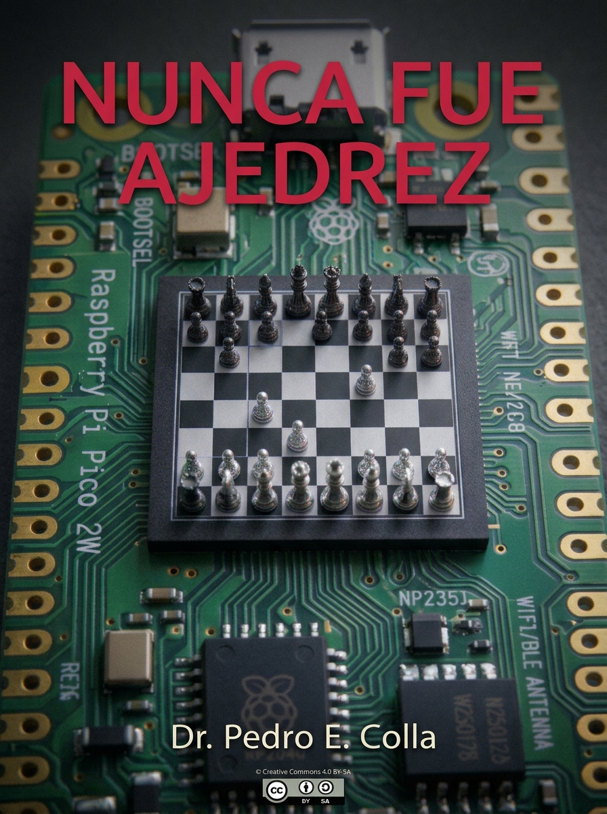
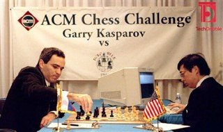
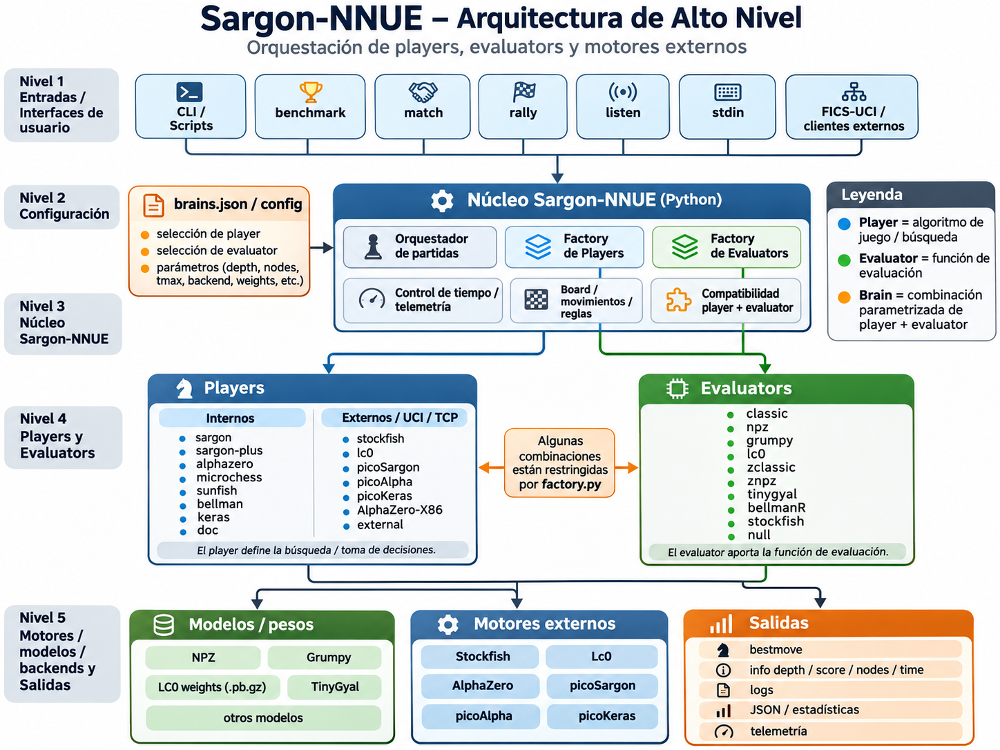
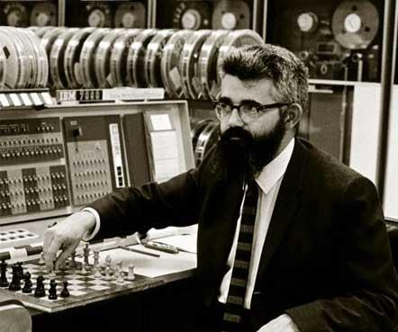
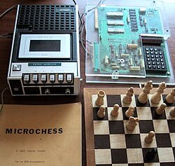
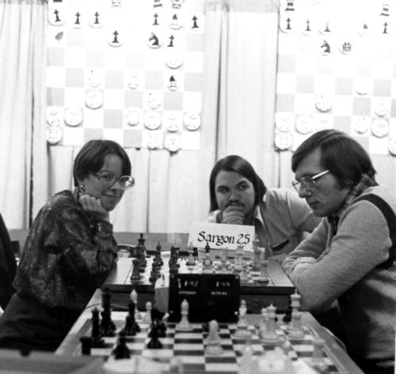
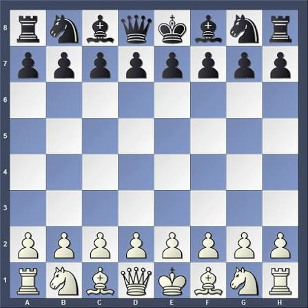
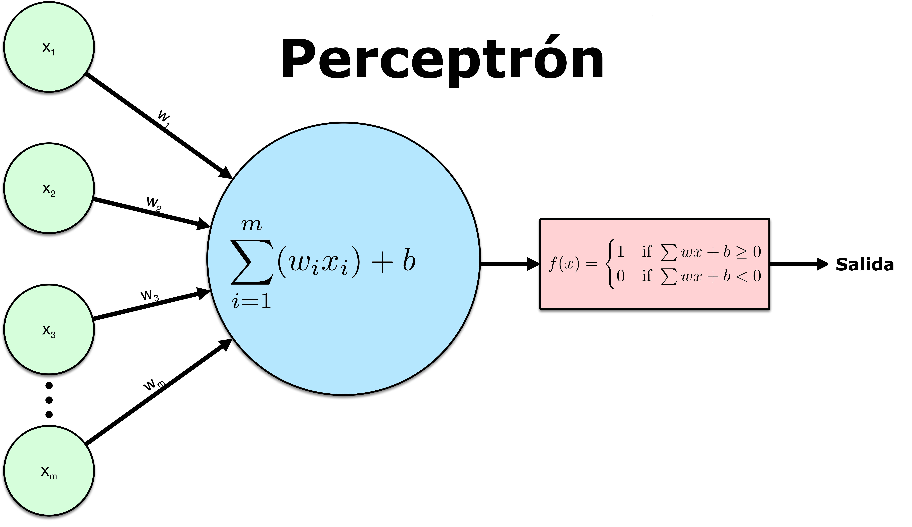
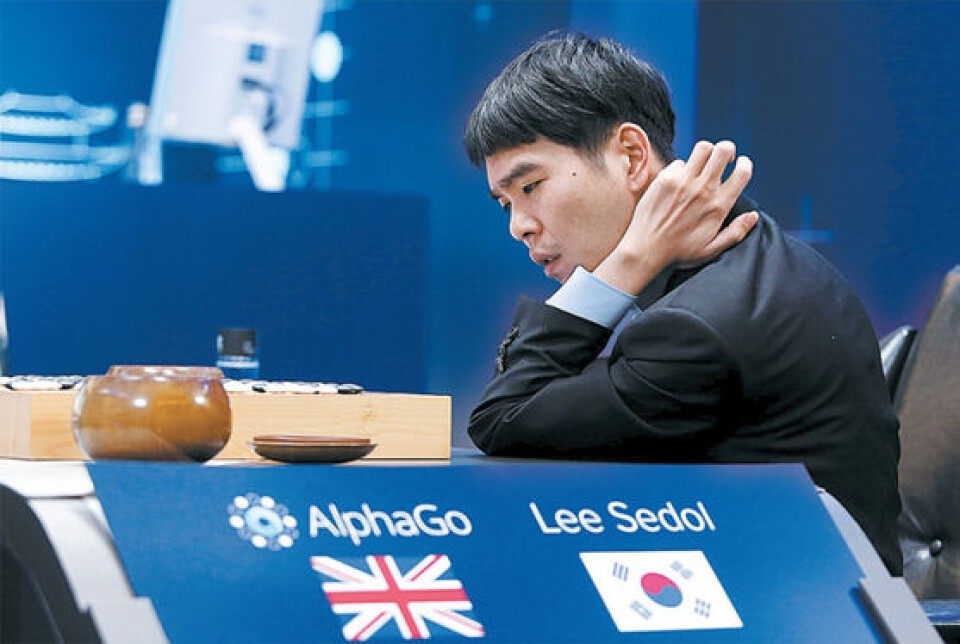

# Prefacio

Planteo outline de "Nunca fue ajedrez"
Libro de experiencias de investigación de Dr. Pedro E. Colla
Es un manual anotado,un journal de actividades

# CAP 1 Introducción

## Motivaciones

Para abordar el tema de explorar algoritmos y estrategias automáticas hay que, primero, 
entender las caracteristicas del juego. Su estructura, sus reglas, sus modos, sus convenciones y la infraestructura que rodea la forma de interpretar una partida.
El contexto de los motores de ajedrez ha evolucionado significativamente en la medida que aparecen plataformas mas veloces y algoritmos mas novedosos. O meramente algoritmos que eran impensables en una plataforma Z80 de 8 bits y pocos K de memoria RAM
son ahora triviales en un procesador de 64 bits con 32 GBytes de memoria y acceso a un procesador GPU de alta potencia, es una cuestión de perspectiva.

Pero en la esencia el problema no es, una vez actualizado, diferente a como lo planteo Claude Shannon, sigue habiendo dos tipos de algoritmos de juego

* la Tipo A (fuerza bruta, evaluar todas las jugadas posibles)
* la Tipo B (búsqueda selectiva, evaluar solo las mejores jugadas).

Y los dos tipos han evolucionado. Los de *Tipo A* se han rendido ante la evidencia de un juego que logra presentar el formidable desafío de $10^{130}$ combinaciones a explorar, imposible.

**Claude Shannon** lo formuló como una famosa analogía basada en sus conclusiones elementales: 
si convirtiéramos cada uno de los átomos del universo observable (aproximadamente $10^{80}$ ) en una supercomputadora —incluso en un computador cuántico operando a la máxima velocidad permitida por las leyes de la física y las pusiéramos a calcular combinaciones desde el Big Bang hasta hoy, apenas habrían analizado una fracción infinitesimal
del total.

Sin embargo el enfoque de fuerza bruta es abordable si se limita el *horizonte* dentro del cual se analizan las jugadas posibles; planteado de ésta forma el problema pasa a ser que tan lejos permite el algoritmo y la tecnología mover ese horizonte
hacia el futuro. 

**MicroChess** o **Sargon** , legendarias implementaciones ambas, hacen eso, aplican un método **minimax alpha/beta* para tratar de reducir el árbol de posibilidades
y, en un tiempo objetivo que se considere razonable examnar la mayor cantidad de jugadas posibles y elegir la mejor. Esos motores en sus ambientes de hardware originales no podían hacerlo mas que dos jugadas hacia adelante, hoy en hardware moderno el mismo
algoritmo puede analizar hasta 7 u 8 jugadas hacia adelante. Pero alli aparece la siguiente limitación, como evaluamos el posible valor de cada jugada comparada con otras. Aparecen los otros componentes de la estrategia, el valor de la i-esima
posición **Valor ($V_i$)** y la **Política ($P_i$o $\pi_{i}$ ), es decir que capacidad tiene una jugada para darme el mayor beneficio (usualmente tratar de ganar la partida) y entre las posibles cual es el criterio para elegir una movida en lugar de
otra.

**MicroChess** o **Sargon** tenían (*tienen*) analisis muy simplificados basado en una heurística determinada que asigna valor a las piezas, a la ocupación de ciertos sectores del tablero y a la chance que en la próxima jugada ocurra algo relevante (tal como
comer una pieza de mas valor o dar jaque mate). Pero como es de imaginar heurísticas de ese tipo son relativamente limitadas.

Básicamente capturan la **"ideología"** ajedrecistica de quien las formula, sus preferencias si se quiere. Pero ciertamente es dudoso que provengan de un experto jugador a nivel *Maestro* o *Gran Maestro*. Como resultado estas estrategias sorprenden a
un jugador casual, que quizás no realiza análisis de esa profundidad o con alguna heurística simple pero robusta, pero rara vez pueden sorprender, mucho menos ganar a un jugador de cierto nivel.

En la medida que la potencia de cálculo aumentó se desarrollan casi concurrentemente algoritmos sofisticados que permiten explorar mas posiciones o seleccionar aquellas posiciones mas prometedoras respecto a otras y al mismo tiempo algoritmos 
mas complejos para obtener el material para decidir que jugada es mejor que otra ($V_i$) y que jugada será mejor seleccionar
como movida propia $\pi_{i}$.

El epítome de fuerza bruta fue el programa *Deep Blue*, fue una supercomputadora de ajedrez desarrollada por IBM que hizo historia al convertirse en el
primer sistema informático en derrotar a un campeón del mundo vigente,  Garry Kasparov, en un encuentro con ritmo de juego de torneo.
Su desarrollo comenzó a finales de los años 80 bajo el nombre de ChipTest y luego Deep Thought en la Universidad Carnegie Mellon, de la mano de los científicos Feng-hsiung Hsu y Murray Campbell, quienes posteriormente fueron reclutados por IBM para culminar el proyecto.
A diferencia de la Inteligencia Artificial moderna basada en redes neuronales y aprendizaje autónomo (como *AlphaZero*, al que veremos luego), Deep Blue funcionaba mediante fuerza bruta computacional combinada con reglas heurísticas.

* Poder de procesamiento masivo:
 Consistía en un superordenador masivamente paralelo compuesto por dos torres de dos metros de altura que  albergaban más de 500 procesadores y 216 chips aceleradores específicamente diseñados para calcular movimientos de ajedrez.
* Velocidad de cálculo:
 La versión de 1997 era capaz de analizar y evaluar hasta 200 millones de posiciones por segundo.
* Algoritmo de búsqueda (Minimax):
 Calculaba los árboles de decisiones explorando masivamente las opciones de jugadas hacia adelante (profundidad de cálculo) y seleccionaba la mejor opción asumiendo que el rival también elegiría su mejor jugada.
* Función de evaluación humana:
 Para decidir si una posición final en su cálculo era "buena" o "mala", utilizaba una función programada  con conocimientos conceptuales de ajedrez (valor de las piezas, seguridad del rey, estructura de peones, espacio).
 El equipo contó con la asesoría de Grandes Maestros de ajedrez para afinar esta base de datos y su libro de aperturas.

En esencia se trata de cantidades masivas de potencia de cálculo para explorar millones de jugadas por segundo, en cambio **Sargon** puede, en un día bueno, explorar algunos miles a 2 jugadas hacia adelante) pero usando el algoritmo *minimax* y una funcion
de ($V_i$) y  $\pi_{i}$ dada por una combinación de posiciones recordadas y comparadas de partidas pasadas y preferencias de los entrenadores. El programa nunca se hizo público y solo se dispone de descripciones superficiales de su funcionamiento.

Pero estaba claro que el enfoque de *Deep Blue* ponía el sendero de la fuerza bruta muy lejos de la disponibilidad habitual de experimentadores con menos recursos.

La evolución progresó hasta la disponibilidad moderna de programas como *stockfish* [LINK] que puede mostrar niveles de juego que solo los grandes maestros puede batir, a veces.

Este programa, y algunos similares, pueden funcionar en computadores modernos, los que de por si son bastante mas poderosos que en la época de *Deep Blue* vs. Kasparov, con algoritmos muy especializados para reducir el espacio de exploración y con
heurísticas mas sofisticadas para evaluar las movidas. El resultado es que *stockfish* puede evaluar el equivalente a 20 o 30 jugadas hacia adelante en sus versiones mas extremas (las hay menos potentes). Recientemente, luego de la irrupción de
algoritmos como *AlphaZero* basado en redes neuronales *stockfish* también abraza el uso de técnicas de inteligencia artificial para mejorar sus capacidades de exploración y valoración de jugadas. 

Pero todos los métodos explorados, y algunos mas no mencionados, se caracterizan por ser pertenecientes a la familia de *fuerza bruta*, pero que hay de la otra familia los de *busqueda selectiva*?

Por cierto que tambien hay exponentes en ésta familia, algunos muy famosos.



AlphaZero es un programa de Inteligencia Artificial desarrollado por Google DeepMind que revolucionó los juegos de mesa de estrategia (ajedrez, shogi y go) al aprender a dominarlos de forma completamente autónoma.
A diferencia de los motores tradicionales que dependen del conocimiento acumulado por humanos durante siglos, AlphaZero aprendió a jugar partiendo de cero, jugando millones de partidas contra sí mismo utilizando únicamente
las reglas básicas del juego.
AlphaZero nació a finales de 2017 en los laboratorios de Google DeepMind, la división de IA de Google. Es la evolución directa de AlphaGo (la IA que derrotó al campeón mundial del milenario juego de Go) y AlphaGo Zero.
El equipo de DeepMind, liderado por Demis Hassabis, adaptó este sistema para crear un algoritmo más generalizado y aplicable a múltiples juegos complejos, publicando un histórico artículo científico donde demostraron que, en pocas horas de autoaprendizaje, la IA podía destruir a los campeones mundiales informáticos de ajedrez (Stockfish) y shogi (Elmo).
AlphaZero no utiliza la "fuerza bruta" de los ordenadores tradicionales ni funciones de evaluación programadas por humanos. Se basa en dos pilares tecnológicos:
* Redes Neuronales Profundas
 Tiene una red que evalúa las posiciones del tablero y otra que predice cuáles son  las jugadas más prometedoras. 
 En lugar de calcular millones de variantes absurdas, AlphaZero utiliza una intuición artificial similar a la  humana para enfocarse solo en las mejores líneas.
* Aprendizaje por Refuerzo (Tabula Rasa): 
 El programa comenzó sabiendo únicamente las reglas del ajedrez.
 Jugó contra copias de sí mismo a una velocidad asombrosa. 
 Al principio hacía movimientos aleatorios, pero la red neuronal se iba actualizando tras cada partida, aprendiendo qué estrategias llevaban a la victoria y cuáles a la derrota.
 En solo 4 horas de autoentrenamiento en ajedrez, superó el nivel de Stockfish (en ese momento).
* Búsqueda de Árboles de Monte Carlo (MCTS):
 En vez del algoritmo clásico Minimax que analiza posiciones de forma simétrica a gran profundidad, AlphaZero utiliza *Monte Carlo Tree Search (MCTS)* para simular los resultados más probables, calculando "solo" unas 80,000 posiciones por segundo (frente a los 70 millones de Stockfish), pero con una precisión
 y calidad estratégica radicalmente superiores.

*AlphaZero* no es un software comercial ni de código abierto; fue un proyecto de investigación científica interna de Google y no está disponible para que el público general lo descargue o lo use en su computadora.
Sin embargo, el mundo del ajedrez no se quedó de brazos cruzados, el proyecto *Leela Chess Zero (Lc0)* resultó del esfuerzo de una comunidad de ajedrez y programadores la que creó este proyecto de código abierto para replicar primero 
el funcionamiento de AlphaZero y luego extenderlo.
*Lc0* se entrena gracias a la potencia comunitaria de miles de usuarios que prestan sus tarjetas gráficas (GPUs).
Cualquier aficionado puede descargar Lc0 de forma gratuita, conectarlo a una interfaz (como Arena o ChessBase) y usarlo en su propia PC para analizar partidas con el "estilo AlphaZero".
El estilo de AlphaZero cambió para siempre la teoría del ajedrez moderno debido a sus marcadas diferencias con los motores clásicos:

| Característica	| Motores Tradicionales (Ej. Stockfish clásico)	| AlphaZero / Motores de Red Neuronal|
|-----------------------|-----------------------------------------------|------------------------------------|
|Origen del conocimiento|	Heurísticas y conceptos de estrategia programados por Grandes Maestros humanos.| Aprendizaje autónomo absoluto jugando contra sí mismo|
|Velocidad de cálculo	|Brutal. Evalúa decenas o cientos de millones de posiciones por segundo.| Eficiente. Evalúa decenas de miles de posiciones por segundo, pero muy selectas.|
|Estilo de juego	|Ultra-calculador, materialista, defensivo y busca la perfección táctica concreta.|Profundamente posicional, intuitivo, dinámico y famoso por sacrificar piezas a largo plazo por iniciativa.|
|Hardware ideal		|Procesadores comunes (CPU).	|Tarjetas gráficas de alta potencia o procesadores de IA (GPU / TPU)|

El éxito de AlphaZero fue tan rotundo que obligó a los motores tradicionales a evolucionar y al menos en parte abrazar su tecnolocía, hoy en día, el propio Stockfish
ya no es puramente tradicional pues adoptó la tecnología de redes neuronales (llamada *NNUE*) fusionando lo mejor de la fuerza bruta clásica con la enorme comprensión estratégica inspirada por AlphaZero.

Se explorarán algunos de los algoritmos involucrados en la medida que se discutan implementaciones concretas, pero lo cierto es que claramente define una posible estrategia para un recorrido de aprendizaje y comprensión.

Carece de sentido tratar de emular o superar a *stockfish* (o por caso a *AlphaZero*), es un esfuerzo de muchas personas, con enormes recursos materiales, de tiempo y tecnológicos por lo que tratar de conseguir algo distinto es un desafío que requiere calibrar los recursos disponibles.


El epítome actual de los motores está representado por *stockfish*, y eso lleva a preguntarse si hay espacio para que otro proyecto, sin replicarlo, realice alguna
contribución al estado del arte.

La respuesta no es lineal ni simple, siquiera quizás robusta. 

En realidad, se trata de aprender, explorar, comprender y eventualmente aplicar técnicas conocidas para familiarizarse con ellas, y quizás encontrar estrategias que permitan aplicarlas en computadores mas simples y de mucha menos potencia en forma efectiva,
microcontroladores, problema de optimización de performance. O quizás solo haber disfrutado el camino de aprendizaje.

# Planteo conceptual

El planteo conceptual del esfuerzo es determinar que componentes, sub-sistemas o módulos, tendrá la implementación para permitir ayudar en los objetivos y luego definir como se
conectarán entre si aplicando que convenciones.



Los objetivos van mutando con el aprendizaje, por lo tanto es mas facil contarlos 
cuando el proyecto esté terminado que al comenzar. 
Pero si se puede describir el punto de partida y la idea general.

* Explorar los distintos algoritmos.
* Entender las interacciones entre ellos.
* Experimentar el problema de ajedrez como compuesto de dos partes:
  * Explorar el valor de las jugadas que son factibles.
  * Evaluar que criterios se pueden usar para determinar la mejor.
* Probar que combinación da una performance razonable en ambientes muy pequeños.
* Desarrollar un protocolo de evaluación de los distintos enfoques propuestos.

Uno de los aprendizajes mas tempranos consiste en comprender como es el ciclo de vida
de un determinado esquema de juego, el que podría resumirse en algunos pasos que
se repiten:

* Se parte de una idea o estrategia para medir $V_i$ y $\pi_{i}$
* Implementarlo.
* Encontrar la forma de calibrarlo o entrenarlo.
* Probar el funcionamiento básico (**dry run**).
* Entender la performance y la capacidad de exploración que tiene.
* Calibrar la potencia relativa de cada algoritmo respecto a los restantes.
* Tomar alguna medida objetiva del potencial *"ajedrecistico"* que tiene.
* Optimizar la performance.
* Mover a las distintas plataformas, repetir la evaluación.
* .... tomar el siguiente 

Finalmente, 

¿como evaluar si una estrategia es "*suficientemente buena*" para declararla exitosa?

Esta determinación está plagada de intangibles, pero a los efectos de éste proyecto se tomará el criterio de *fortaleza competitiva recíproca* 

'''
Una combinación de algoritmos de evaluación y juego será mejor que otra cuando en competencia recíproca muestre tener un ELO relativo superior.
'''

Y un criterio de *aceptabilidad*

'''
Un motor será aceptable a los efectos de la experimentación cuando tenga un ELO superior al de un algoritmo Sargón histórico.
'''

Se verá mas adelante los mecanismos de medición de fortaleza ajedrecistica relativa,
en particular el sistema ELO.

Pero, para poder progresar, es necesario entender que es el ajedrez primero.


## Antecedentes

### Los inicios teóricos y mecánicos (1912 - 1950)

#### El Ajedrecista (1912):

 Construído por el ingeniero español Leonardo Torres y Quevedo, fue un autómata electromecánico capaz de jugar de forma totalmente automática un final de torre
 y rey contra el rey de un oponente humano. Se considera el primer juego de ajedrez automatizado de la historia.

#### Turochamp (1948):

Desarrollado en papel por Alan Turing junto a David Champernowne. Era un algoritmo con un sistema de puntuación heurístico que calculaba
dos jugadas en el futuro. Al no existir computadoras capaces de ejecutarlo, Turing tuvo que simular el código a mano (tardando unos 30 minutos por movimiento)
en una partida jugada en 1952.

#### El artículo de Claude Shannon (1950):

El matemático Claude Shannon publicó "Programming a Computer for Playing Chess" [LINK], el texto fundacional que definió las dos estrategias básicas
 de búsqueda para las computadoras de ajedrez:

* la Tipo A (fuerza bruta, evaluar todas las jugadas posibles)
* la Tipo B (búsqueda selectiva, evaluar solo las mejores jugadas).


### Las primeras ejecuciones en computadoras (1951 - 1959)

#### El programa de Dietrich Prinz (1951):
El primer programa de ajedrez real ejecutado por una computadora digital. Fue escrito para la Ferranti Mark 1 en la Universidad de Mánchester.
No jugaba partidas completas, pero era capaz de resolver problemas de **"jaque mate en dos jugadas"**.

#### El Ajedrez de Los Alamos (1956):
Desarrollado en la computadora MANIAC I por un equipo del Laboratorio Científico de Los Álamos (incluido Stanislaw Ulam).
Debido a las limitaciones de memoria, redujeron el tablero a 6x6 (sin alfiles ni peones dobles).
Fue el primer programa en jugar una partida completa y derrotar a un contrincante humano (un principiante que recibió ventaja).

#### El programa de Alex Bernstein (1957):
Creado en una IBM 704, fue el primer programa capaz de jugar una partida completa en un tablero estándar de 8x8.
Utilizaba una estrategia Tipo B (selectiva), analizando las 7 mejores jugadas posibles en cada posición.

### La era académica y los primeros torneos (1960 - 1977)

#### El programa Kotok-McCarthy (1962):



Desarrollado en el MIT bajo la tutela de John McCarthy. En 1966 protagonizó el primer match de ajedrez entre computadoras de la historia, enfrentándose vía telégrafo
al programa del Instituto de Física Teórica y Experimental (ITEP) de la Unión Soviética. El programa soviético ganó el encuentro 3-1.

#### Mac Hack Six (1966-1967):
Escrito por Richard Greenblatt en el MIT para la computadora PDP-6. Fue un punto de inflexión absoluto: incorporó amplios conocimientos de aperturas y heurísticas de ajedrez.
Se convirtió en el primer programa en competir contra humanos en torneos oficiales, logrando la primera victoria computacional contra un jugador federado y obteniendo un
rating ELO de unos 1200 o 1400 puntos.

#### La serie "Chess" de Northwestern University (1970 - 1977):
Creado por Larry Atkin, David Slate y Keith Gorlen. Sus versiones (Chess 3.0, Chess 4.0, etc.) dominaron por completo los primeros Campeonatos de Ajedrez de Computadoras de la ACM.
En 1977, Chess 4.6 ganó el segundo Campeonato Mundial de Ajedrez por Computadora y logró vencer por primera vez a un Gran Maestro (Michael Stean) en una partida de ajedrez rápido.

## El Fenómeno Histórico de Microchess (1976)

Microchess es el primer programa de ajedrez comercialmente exitoso para microcomputadoras en la historia de la informática.
Diseñado originalmente en 1976 por Peter R. Jennings para el microcomputador hobbista KIM-1 de MOS Technology, demostró al mundo que una máquina extremadamente
limitada podía ejecutar una simulación interactiva inteligente, ayudando a cimentar el mercado del software comercial independiente.

Fuentes
[1](https://chessprogramming.org/Peter_Jennings),
[2](https://en.wikipedia.org/wiki/Microchess),
[3](https://es.wikipedia.org/wiki/Microchess),
[4](https://wiki.texto-plano.xyz/microchess),
[5](https://www.microsiervos.com/archivo/ordenadores/historia-microchess-juego-ajedrez-1k-primer-software-comercial-historia.html),
[6](https://www.schach-computer.info/wiki/index.php?title=Jennings,_Peter_En)

### Mas cercano en el tiempo



En el año 1976, las computadoras domésticas daban sus primeros pasos. El KIM-1 de MOS Technology no era una computadora convencional, 
se trataba de una placa de circuito impreso sin caja, provista de un microprocesador MOS 6502 a 1 MHz, un teclado hexadecimal de 24 teclas, un display de 7 segmentos
de 6 dígitos y la asombrosa cantidad de 1 Kilobyte (1024 bytes) de memoria RAM.

[1](https://benlo.com/microchess/), 
[2](https://es.wikipedia.org/wiki/Microchess)

Peter Jennings, un recién graduado universitario, se propuso el desafío de meter un juego de ajedrez completo en ese espacio.
El 18 de diciembre de 1976 nació *Microchess*.

[1](https://www.computerhistory.org/chess/early-microcomputer-chess/), 
[2](https://www.schach-computer.info/wiki/index.php?title=Jennings,_Peter_En), 
[3](https://es.wikipedia.org/wiki/Microchess), 
[4](https://benlo.com/microchess/)

Inicialmente, Jennings vendía el programa por $10 dólares enviando un manual físico que contenía el código fuente completo en lenguaje ensamblador.
Los compradores debían teclear línea por línea los códigos hexadecimales en sus computadoras.
Más adelante, cofundó Personal Software y comenzó a distribuirlo en casete, vendiendo decenas de miles de copias (y eventualmente millones con sus posteriores
versiones gráficas para Apple II, TRS-80 y Commodore PET).
Curiosamente, las regalías generadas por Microchess sirvieron para financiar el desarrollo y lanzamiento de VisiCalc, la primera hoja de cálculo de la historia.

[1](https://www.schach-computer.info/wiki/index.php?title=Jennings,_Peter_En),
[2](https://es.wikipedia.org/wiki/Microchess), 
[3](https://www.microsiervos.com/archivo/ordenadores/historia-microchess-juego-ajedrez-1k-primer-software-comercial-historia.html),
[4](https://www.computerhistory.org/chess/early-microcomputer-chess/), 
[5](https://translate.google.com/translate?u=https://en.wikipedia.org/wiki/Microchess&hl=es&sl=en&tl=es&client=sge)

#### Filosofía de Diseño

La filosofía detrás de Microchess no era vencer a Grandes Maestros, sino lograr lo aparentemente imposible, la compresión absoluta y la optimización radical de un desarrollo de software dentro de recursos inimaginablemente reducidos.
En lugar de un árbol de búsqueda masivo, Jennings se enfocó en:

[1](https://www.schach-computer.info/wiki/index.php?title=Jennings,_Peter_En)
[1](https://translate.google.com/translate?u=https://en.wikipedia.org/wiki/Microchess&hl=es&sl=en&tl=es&client=sge)
[3](https://www.schach-computer.info/wiki/index.php?title=Jennings,_Peter_En),
[4](https://translate.google.com/translate?u=https://en.wikipedia.org/wiki/Microchess&hl=es&sl=en&tl=es&client=sge)

* Accesibilidad y entretenimiento
   El creador afirmaba que parte de su éxito comercial radicaba en que el programa cometía errores humanos,
    lo que hacía divertido jugar contra él y ganarle.

* Demostración técnica
  Servir como una "analogía del mundo real" para mostrar a familiares y amigos de qué era capaz un microordenador, rompiendo la percepción
    de que estas máquinas eran meros juguetes de luces parpadeantes.

* Heurística simplificada
 Basarse en conceptos estratégicos del famoso libro *My System* de Aron Nimzowitsch para tomar decisiones sin sobrecargar la memoria.

[1](https://benlo.com/microchess/)

#### Implementación Técnica

El programa original de Microchess ocupaba exactamente 924 bytes de memoria. En ese espacio diminuto se incluyó el generador de movimientos, la lógica de validación,
la función de evaluación, la interfaz de entrada/salida y las variables del juego. 
[1](https://www.schach-computer.info/wiki/index.php?title=Jennings,_Peter_En)

* Lenguaje: Código máquina / Ensamblador puro del MOS 6502. [1](https://es.wikipedia.org/wiki/Microchess)
* Interfaz de Usuario Básica: Sin gráficos. El jugador introducía su movimiento en formato numérico (por ejemplo, anotando las coordenadas de origen y destino por número
 de casilla) usando las teclas de la placa KIM-1, y el display de 7 segmentos respondía mostrando la jugada de la máquina. [1](https://www.computerhistory.org/chess/early-microcomputer-chess/), [2](https://translate.google.com/translate?u=https://en.wikipedia.org/wiki/Microchess&hl=es&sl=en&tl=es&client=sge)
* Estructura de Datos Ultra-Comprimida: En lugar de mapear un tablero clásico de 64 casillas completas (que consumiría demasiada memoria para la época),
 utilizaba una matriz compacta orientada al conteo y posición de piezas activas de cada bando. [1](https://chessprogramming.org/MicroChess)

#### Características Principales

* Modo de Juego Humano vs. CPU: Permitía jugar partidas completas contra el computador.
* Velocidades de ejecución configurables: Las versiones iniciales podían responder al instante, tomar de 5 a 10 segundos o calcular de forma más profunda para una
partida de aproximadamente una hora en total.
* Niveles de dificultad: Dependiendo de la versión, ofrecía desde 3 niveles (Microchess 1.5) hasta 8 niveles de juego en versiones posteriores.
* Herramienta de práctica: Era ideal para aprender aperturas estándar y practicar mates sencillos. [1](https://www.ecured.cu/Microchess), [2](https://translate.google.com/translate?u=https://en.wikipedia.org/wiki/Microchess&hl=es&sl=en&tl=es&client=sge)

#### Estrategia de juego

Para operar en menos de 1 KB de RAM sin desbordar la pila de llamadas (stack) del procesador 6502, Jennings ideó un algoritmo simplificado basado en variaciones
de Minimax con poda Alpha-Beta rudimentaria: 
[1](https://fvcalderan.github.io/myworks/articles/minimax_chess_engine.pdf), 
[2](https://chessprogramming.org/MicroChess)

En un Árbol de Búsqueda (Búsqueda por Plies), Microchess calculaba usualmente hasta 3 plies de profundidad (3 medios movimientos: Jugada CPU $\rightarrow$ Respuesta Humana $\rightarrow$ Réplica CPU).
[1](https://en.wikipedia.org/wiki/Microchess)
[2](https://translate.google.com/translate?u=https://en.wikipedia.org/wiki/Microchess&hl=es&sl=en&tl=es&client=sge)

* Generación de movimientos: El motor barría las piezas secuencialmente para encontrar movimientos legales.
* Inversión de Tablero (Board Reversing): Para ahorrar código de evaluación duplicado para blancas y negras, el programa "espejaba" o invertía internamente el tablero para
que el bando que estuviera calculando siempre fuera evaluado desde la misma perspectiva algorítmica. [1] (https://chessprogramming.org/MicroChess)

Se utilizaba una función de *Evaluación Estática* de manera que cuando el motor alcanzaba el límite de profundidad, ejecutaba una asignación de puntos preinicializada de 16 bytes que tasaba el valor de las piezas en unidades de medio peón:


|Pieza|	Valor en Microchess (Medios Peones)|
|-----|------------------------------------|
|Rey	|11|
|Reina	|10|
|Torre	|6|
|Alfil	|4|
|Caballo|	4|
|Peón	|2|

A este valor material estático se le sumaban sutiles bonificaciones posicionales basadas en la movilidad (cuántas casillas libres tenía una pieza para moverse)
y la ocupación del centro del tablero. El movimiento con la puntuación final ponderada más alta (Minimax) era el seleccionado. [1](https://benlo.com/microchess/)

#### Evaluación Comparativa de Potencia Ajedrecística

Microchess debe ser juzgado bajo el prisma de su contexto técnico:

|Criterio                    |	Microchess (1976)            |	Sargon (1978) / Sargon II (1979) |	Motores Modernos (Ej. Stockfish) |
|----------------------------|-------------------------------|-----------------------------------|---------------------------------------|
|Fuerza Estimada (Elo)	     |~1100 Elo (Nivel Principiante) |~1500 - 1800 Elo (Nivel Club)      |	>3500 Elo (Superhumano)          |
|Profundidad de Búsqueda     |Hasta 3 plies                  |	4 - 6 plies habitualmente        |	>30 plies con facilidad          |
|Consumo de Memoria	     |< 1 KB RAM                     |~8 KB - 16 KB RAM	                 |  Gigabytes de Tablas de Transposición |
|Reglas Soportadas	     |Básicas (algunas omisiones)    |	Ajedrez Completo                 | 	Ajedrez Completo e IA            |

Daría la impresión, desde ésta perspectiva que MicroChess no es mucho mas que una bonita referencia histórica, sin embargo hay un aspecto que no ha podido ser batido,
con esa arquitectura moderna era (*¿es?*) capaz de aportar aproximadamente un punto ELO por bit, Sargón aporta aprox. 0.09 puntos ELO por bit y Stockfish, con todo lo
impresionante que es, aporta 0.0000035 puntos ELO por bit. 
El sistema ELO, del cual nos ocuparemos en detalle mas adelante, es de naturaleza logaritmica, pero aún asi la performance de MicroChess es impresionante cuando 
se tienen en cuenta los recursos limitados que disponía.
Algunas ideas generales han sido utilizadas posteriormente por otros motores y serán
ocasionalmente rescatadas en éste trabajo.


#### Desempeño y Limitaciones

A nivel de juego puro, la crítica de la época y los historiadores posteriores (como Tim Harding) llegaron a catalogar el juego de Microchess como "terrible" en comparación con lo que vendría después. El motor cometía despistes graves y tácticos debido a su corta profundidad de cálculo y a que omitía cálculos complejos de finales. [1](https://translate.google.com/translate?u=https://en.wikipedia.org/wiki/Microchess&hl=es&sl=en&tl=es&client=sge)
Sin embargo, su potencia radicaba en la eficiencia. Mientras que competidores posteriores como Sargon requerían máquinas mucho más caras con al menos 8K o 16K de memoria, Microchess demostró que la optimización de código extrema podía suplir la falta de hardware, convirtiéndose en una leyenda irrepetible de la ingeniería informática. 
[1](https://www.schach-computer.info/wiki/index.php?title=Jennings,_Peter_En), [2](https://translate.google.com/translate?u=https://en.wikipedia.org/wiki/Microchess&hl=es&sl=en&tl=es&client=sge)

Sería interesante estudiar en mas detalle un fragmento de su código fuente en ensamblador 6502, ver cómo resolvía problemas específicos como el enroque o la promoción o
incluso  saber más sobre el duelo histórico entre Bobby Fischer y el Commodore ChessMate basado en este software?
Pero dejamos las cuestiones técnicas para mas adelante, cuando las analizaremos con algún detalle.


## Sargon: the old buddy (1978/1979)



Sargón fue el primer motor de juego para ajedrez automático relativamente completo comercialmente accesible, si bien existieron esfuerzos anteriores estaban normalmente
implementados en grandes plataformas de cómputos (mainframe, VAX y otras) que tenían escasas opciones de accederlas. 
**Sargon** fue desarrollado por **Dan y Kathe Spracklen** y presentado en 1978. Ese año ganó las cinco partidas del torneo de ajedrez para microcomputadoras
celebrado en la **West Coast Computer Faire**, uno de los primeros hitos competitivos del ajedrez en computadoras personales.
Su importancia no radica en haber inventado la búsqueda ajedrecística, sino en demostrar que una microcomputadora de 8 bits, con memoria y potencia muy limitadas, podía
ejecutar un jugador competitivo para su época. También contribuyó a popularizar el ajedrez informático entre aficionados y programadores.
Sargon fue escrito en **lenguaje ensamblador Z80**. Según la descripción de sus autores, ocupaba aproximadamente **8 KB de RAM**, distribuidos en unos 4 KB de lógica de juego,
2 KB de datos y 2 KB de interfaz gráfica.

Sus principales componentes eran:

- Representación del tablero y generación de movimientos:** rutinas especializadas por pieza, con comprobaciones de legalidad, jaques, enroque y captura al paso.
- **Búsqueda:** exploración en profundidad de un árbol de movimientos mediante **poda alfa-beta**, para descartar ramas que no podían mejorar la decisión.
- **Evaluación:** puntuación heurística de las posiciones, basada en material y consideraciones ajedrecísticas; incluía análisis de intercambios para reducir errores tácticos con un costo computacional contenido.
- **Interfaz:** visualización del tablero e interacción con el usuario, adaptadas a las capacidades de los equipos de la época.

No utilizaba redes neuronales ni aprendizaje automático: sus decisiones procedían de reglas, búsqueda y evaluación diseñadas explícitamente.
Sargon ayudó a consolidar el ajedrez como demostración práctica de **búsqueda heurística en hardware restringido**.
El libro *Sargon: A Computer Chess Program* (1978)[LINK], que incluía su código fuente comentado, facilitó el estudio, la adaptación y la enseñanza de técnicas de programación
de motores de ajedrez.
La familia Sargon tuvo posteriores versiones y adaptaciones para diversas computadoras personales.
Su legado resulta especialmente relevante para proyectos contemporáneos que combinan motores clásicos y evaluadores neuronales: permite observar qué aporta
la búsqueda y qué aporta el mecanismo de evaluación, dos componentes conceptualmente separables. En algún sentido es el punto de partida para muchas de las iniciativas que
se describen en el resto de éste material y de hecho se constituye en la "referencia" al momento de hacer evaluaciones preliminares de la fuerza ajedrecística de un enfoque.

### Fuentes

- Computer History Museum, [*Sargon: A Computer Chess Program*](https://www.computerhistory.org/chess/sft-431614f63c4c4/).
- Dan y Kathe Spracklen, [*Sargon: A Computer Chess Program* (1978), texto y listado histórico](https://chessforeva.bitbucket.io/govs/Oldies/Sargon.htm).
- Computer History Museum, [Dan y Kathe Spracklen en el campeonato ACM de 1978](https://www.computerhistory.org/chess/stl-431f4cc14ba4b/).


# CAP 2 Las reglas del ajedrez

Para poder adentrarse en el desarrollo de un motor es claro que debe asegurarse que los algoritmos (*motores*) utilizados cumplan algunas reglas del ajedrez en cuanto a como conducir las partidas y como realizar el movimiento de las piezas.

El ajedrez es un juego de estrategia para dos jugadores (blancas y negras) cuyo objetivo principal es dar jaque mate al rey adversario.
A continuación, tienes un resumen claro y estructurado de sus componentes y reglas fundamentales basadas en el reglamento oficial de la Federación Internacional de Ajedrez (FIDE):

## El Tablero (El Casillero)

El tablero de ajedrez es una cuadrícula perfecta de 8x8 casillas, alternadas en colores claros y oscuros, sumando un total de 64 casillas.
• Orientación: Se coloca de forma que cada jugador tenga una casilla clara (blanca) en su esquina inferior derecha ("blanca a la derecha").
• Columnas: Las líneas verticales se identifican con letras de la a a la h.
• Filas: Las líneas horizontales se identifican con números del 1 al 8.

## ♟️ Cantidad y Tipo de Piezas

Cada jugador comienza la partida con un ejército de 16 piezas (32 piezas en total sobre el tablero).

|Pieza		|Cantidad por jugador	|Valor sugerido (en puntos)|
|---------------|-----------------------|--------------------------|
|Peón		|8			|1	                   |
|Caballo	|2			|3                         |
|Alfil		|2         		|3                         |
|Torre		|2			|5		           |
|Dama (Reina)	|1			|9                         |
|Rey		|1			|Infinito (Invalorable)    |

El valor sugerido de las piezas es un factor que tiene que tomarse, como mucho, ligeramente. El real valor de una
pieza es su fuerza táctica en un contexto de juego determinado. Cada pieza tiene bondades y debilidades estratégicas
pero su valor depende del contexto. Por ejemplo, un peon a un paso de *coronar* no vale 1, aunque todavía no vale 
tanto como una Dama.


## Movimiento de las Piezas

Ninguna pieza puede saltar sobre otra, a excepción del caballo. Tampoco pueden ocupar una casilla donde ya haya una pieza de su propio color.

* ♟️ Peón: Avanza una casilla hacia adelante por turno. En su primer movimiento de la partida, tiene la opción de avanzar dos casillas. Captura en diagonal, avanzando una casilla hacia la izquierda o derecha. Nunca puede retroceder.
* ♞ Caballo: Se mueve en forma de "L" (dos casillas en una dirección y luego una en perpendicular). Es la única pieza que puede saltar sobre otras piezas.
* ♝ Alfil: Se mueve en línea recta por las diagonales tantas casillas como quiera. Cada jugador tiene un alfil para casillas claras y otro para oscuras.
* ♜ Torre: Se mueve en línea recta por las filas y columnas (horizontal y vertical) tantas casillas como desee.
* ♛ Dama: Es la pieza más poderosa. Puede moverse cualquier número de casillas en cualquier dirección: horizontal, vertical o diagonal.
* ♚ Rey: Se mueve solo una casilla en cualquier dirección. Es la pieza que se debe proteger a toda costa.


## Condiciones de Terminación de la Partida

Una partida de ajedrez termina cuando ocurre alguna de las siguientes situaciones:

* Victoria (Ganar la partida)

	* Jaque Mate: El rey de un jugador está bajo ataque directo (en jaque) y no tiene ningún movimiento legal para escapar, cubrirse o capturar a la pieza atacante.
	* Abandono: Un jugador decide rendirse de forma voluntaria al ver que su posición es indefendible.
	* Por tiempo: En partidas con reloj, si a un jugador se le agota el tiempo asignado, pierde automáticamente (siempre que el rival tenga material suficiente para dar mate).

* Tablas (Empate)

	* Ahogado: Es el turno de un jugador cuyo rey no está en jaque, pero no puede realizar ningún movimiento legal con ninguna de sus piezas en el tablero.
	* Insuficiencia de material: Ninguno de los dos bandos tiene piezas suficientes para forzar un jaque mate (por ejemplo: Rey contra Rey, o Rey y Caballo contra Rey).
	* Triple repetición: La misma posición exacta del tablero se repite tres veces durante la partida.
	* Regla de los 50 movimientos: Pasan 50 jugadas consecutivas de cada jugador sin que se haya movido un solo peón ni se haya capturado ninguna pieza.
	* Mutuo acuerdo: Ambos jugadores deciden y acuerdan que la partida es un empate.

## Modalidades de juego

Las modalidades en el ajedrez se definen principalmente por el control de tiempo asignado a cada jugador para toda la partida. Cuanto menos tiempo hay, el juego pasa de ser puramente estratégico y profundo a volverse un ejercicio de reflejos, intuición y pura táctica.
De acuerdo con el reglamento oficial de la FIDE y las principales plataformas en línea (como Chess.com y Lichess), las modalidades se dividen de la siguiente manera:

### ⏱️ Modalidades Oficiales de Ritmo Corto/Medio

* Ajedrez Clásico (Pensado): Es el formato tradicional de los torneos de élite. Cada jugador suele tener 90 minutos o más para las primeras 40 jugadas, muchas veces con un "incremento" (segundos extra que se añaden al reloj tras cada movimiento). Las partidas pueden durar entre 3 y 7 horas, priorizando la máxima precisión y profundidad estratégica.
* Ajedrez Rápido (Rapid): Un punto medio ideal. El tiempo asignado es de más de 10 minutos pero menos de 60 minutos por jugador. Es un ritmo muy popular en torneos híbridos porque exige calcular rápido sin perder por completo la calidad de las jugadas.
* Blitz (Relámpago): Una de las modalidades más populares y frenéticas. El tiempo total es de 10 minutos o menos por jugador (el estándar más común es 3 minutos con 2 segundos de incremento, o 5 minutos limpios). Aquí los errores tácticos son frecuentes y el manejo del reloj es vital.

### 🚀 Modalidades Ultra Rápidas y En Línea

* Bullet (Bala): El tiempo es extremadamente escaso, usualmente menos de 3 minutos para toda la partida (el ritmo rey es 1 minuto por jugador). No hay tiempo para pensar; se juega por puro instinto, memoria muscular y velocidad con el ratón o la pantalla táctil.
* Hyperbullet / Ultrabullet: Modalidades exclusivas de internet donde el tiempo es de 30 o 15 segundos en total por jugador. Ganar por tiempo ("relojear" al rival) es casi más importante que dar jaque mate.

### 📆 Modalidades de Ritmo Extendido o Asincrónico

* Ajedrez por Correspondencia: El extremo opuesto al Bullet. Los jugadores tienen días o semanas para hacer un solo movimiento. Antiguamente se jugaba por correo postal; hoy se realiza mediante servidores web. Permite un análisis profundo, científico y casi perfecto de la posición.

### 🎭 Variantes Populares del Juego (Cambios de Reglas)

Además del tiempo, existen modalidades donde cambias las reglas o la configuración inicial del tablero:

* Ajedrez 960 (Fischer Random): Creado por el campeón mundial Bobby Fischer. Las reglas de movimiento son las mismas, pero la posición de las piezas en la primera fila se sortea aleatoriamente antes de empezar (manteniendo los peones al frente). Existen 960 combinaciones posibles. Su objetivo es anular la memorización de aperturas teóricas.
* Pasapiezas (Bughouse): Se juega en parejas (dos tableros contiguos). Cuando capturas una pieza del rival, se la pasas a tu compañero, quien en su turno puede elegir entre mover una de sus piezas o "soltar" la pieza capturada en cualquier casilla vacía de su propio tablero.
* Ajedrez a la Ciega (Blindfold): Los jugadores disputan la partida sin ver el tablero ni tocar las piezas. Deben llevar la posición en su mente y cantar sus jugadas utilizando la notación algebraica (ej. "e4", "Cc3").

## Fortalezas y debilidades 

Desde el punto de vista táctico, cada pieza tiene una "personalidad" única definida por su geometría de movimiento. Entender sus ventajas y limitaciones te permite coordinarlas mejor en el tablero:

* ♟️ El Peón

	* Fortalezas: Son el "alma del ajedrez". Sirven como un escudo protector para tu propio rey, son excelentes para reclamar y controlar espacio en el centro, y son ideales para crear cadenas defensivas difíciles de romper. Su mayor fortaleza táctica es la promoción: si un peón llega al final, se transforma en Dama.
	* Debilidades: Son las piezas menos móviles y nunca pueden retroceder. Cada vez que avanzas un peón, dejas casillas débiles ("huecos") detrás de él que jamás podrá volver a defender.

* ♞ El Caballo

	* Fortalezas: Su movimiento en "L" le permite saltar sobre otras piezas, lo que lo convierte en el rey de las posiciones cerradas o bloqueadas. Es letal ejecutando dobletes (atacar dos piezas a la vez sin que ninguna pueda bloquear el ataque) y puede ubicarse en casillas fuertes del campo enemigo donde los peones rivales ya no lo puedan expulsar.
	* Debilidades: Tienen un alcance muy corto y tardan varios turnos en trasladarse de un lado al otro del tablero. En los bordes o esquinas pierden hasta el 75% de su potencia defensiva y de ataque.

* ♝ El Alfil

	* Fortalezas: Tienen un gran alcance a larga distancia y brillan en posiciones abiertas donde no hay peones estorbando. Son excelentes para clavar piezas enemigas y pueden cortar el tablero por la mitad controlando diagonales enteras desde la distancia.
	* Debilidades: Están limitados a la mitad del tablero, ya que un alfil que empieza en casillas claras jamás podrá tocar o defender una casilla oscura. Si la estructura de peones bloquea sus diagonales, se convierte en un "alfil malo", atrapado detrás de sus propias líneas.

* ♜ La Torre

	* Fortalezas: Tienen una enorme potencia en el final de la partida. Su objetivo táctico es dominar columnas abiertas (líneas verticales sin peones) para infiltrarse en la séptima u octava fila enemiga, donde suelen arrasar con los peones rezagados del rival.
	* Debilidades: Al inicio de la partida suelen estar atrapadas y desconectadas en las esquinas. Necesitan que el tablero se vacíe un poco o que los peones se muevan para poder activar su tremendo poder a larga distancia.

* ♛ La Dama

	* Fortalezas: Combina la fuerza de la Torre y el Alfil, lo que la convierte en la fuerza ofensiva más destructiva del juego. Su versatilidad la hace perfecta para crear ataques dobles, dar jaques continuos y castigar instantáneamente cualquier error de cálculo o casilla desprotegida del rival.
	* Debilidades: Es tan valiosa que no puede exponerse temprano en la partida. Si la sacas antes de tiempo, las piezas menores del rival (caballos y alfiles) la atacarán constantemente para ganar turnos de desarrollo mientras tú te ves obligado a moverla para salvarla.

* ♚ El Rey

	* Fortalezas: En la fase inicial y media es una pieza puramente defensiva, pero en el final de la partida se transforma en un atacante activo. Al quedar pocas piezas, el rey debe centralizarse para escoltar a sus propios peones hacia la promoción o frenar el avance de los peones rivales.
	* Debilidades: Su vulnerabilidad es absoluta durante la mayor parte del juego. Al moverse solo una casilla, es fácil de arrinconar o rodear si no cuenta con un enroque seguro o un escudo sólido de peones.


## Notaciones



Las notaciones en el ajedrez son los sistemas de escritura utilizados para registrar los movimientos de una partida. Esto permite recrear juegos históricos, estudiar teoría, publicar libros y permitir que las computadoras procesen el juego.
A lo largo de la historia han existido varios sistemas, pero hoy en día la Notación Algebraica es el estándar internacional oficial de la FIDE.
A continuación, te presento una descripción detallada con ejemplos de los métodos de notación más importantes.

### Notación Algebraica (El Estándar Moderno)

Este sistema trata al tablero como un plano cartesiano. Es el único sistema legal en torneos oficiales.

La Geometría del Tablero:

* Columnas (verticales): Se nombran con letras de la a a la h (de izquierda a derecha desde la perspectiva de las blancas).
* Filas (horizontales): Se nombran con números del 1 al 8 (desde la primera fila blanca hasta la octava fila negra).
* Casillas: Cada una tiene una dirección única uniendo su letra y número (ej. e4, c6, h8).

Identificación de las Piezas (en español):

Se utiliza la letra inicial mayúscula de la pieza. Los peones ♟️ no tienen letra; si solo se escribe la casilla, se entiende que se movió un peón.

* ♚ R = Rey
* ♛ D = Dama
* ♜ T = Torre
* ♝ A = Alfil
* ♞ C = Caballo

### Reglas de Escritura y Símbolos Especiales:

* Movimiento simple: Letra de la pieza + casilla de destino. (Ej: Cf3 significa "Caballo a la casilla f3").
* Movimiento de peón: Solo la casilla de destino. (Ej: e4 significa "Peón a la casilla e4").
* Captura: Se intercala una x entre la pieza y la casilla de destino. (Ej: Axb5 significa "Alfil captura en b5").
* Captura de peón: Se indica la columna de origen del peón, la x, y la casilla de destino. (Ej: exd5 significa "Peón de la columna e captura en d5").
* Jaque: Se añade un signo de más (+) al final de la jugada. (Ej: Dh5+).
* Jaque Mate: Se añade un signo de almohadilla o doble más (# o ++). (Ej: Dh7#).
* Enroque corto (flanco de rey): Se escribe 0-0.
* Enroque largo (flanco de dama): Se escribe 0-0-0.
* Promoción de peón: Se escribe la casilla de destino y la inicial de la pieza elegida. (Ej: e8=D).

### ⚠️ Resolución de Ambigüedades:

Si dos piezas idénticas (como dos caballos) pueden ir a la misma casilla, se debe especificar de dónde venía el que se movió, añadiendo su columna o fila de origen.
• Ejemplo: Si tienes caballos en f3 y d2, y ambos pueden ir a e4: si mueves el de f3, escribes Cfe4. Si estuvieran en la misma columna (ej. d2 y d4) y van a e4, escribes C2e4.

### Formato PGN (Portable Game Notation)

Es el estándar digital derivado de la notación algebraica. Es el formato de texto plano que leen páginas como Chess.com, Lichess o programas como ChessBase para guardar bases de datos de partidas.
Utiliza la notación algebraica pero siempre con las iniciales de las piezas en inglés (K=King, Q=Queen, R=Rook, B=Bishop, N=Knight) para que sea universal. Además, agrupa los metadatos de la partida entre corchetes antes de las jugadas.

Ejemplo real de un archivo PGN (El famoso "Mate del Pastor"):

<div>
[Event "Partida Amistosa"]
[Site "Mar del Plata, ARG"]
[Date "2026.10.31"]
[White "Jugador Blanco"]
[Black "Jugador Negro"]
[Result "1-0"]

1. e4 e5 2. Ac4 Cc6 3. Dh5 Cf6 4. Dxf7# 1-0
</div>

### Notación Descriptiva (El Sistema Antiguo)

Fue el sistema dominante en los países de habla hispana e inglesa hasta la década de 1980. Si abres un libro de ajedrez viejo, estará escrito así. Es mucho más complejo porque las casillas cambian de nombre según quién esté jugando.

Reglas principales:

* Las columnas no se llaman de la 'a' a la 'h', sino por el nombre de la pieza que la ocupa al inicio: TD (Torre Dama), CD (Caballo Dama), AD (Alfil Dama), D (Dama), R (Rey), AR (Alfil Rey), CR (Caballo Rey), TR (Torre Rey).
* Las filas se cuentan del 1 al 8 desde el punto de vista del jugador que mueve. Por lo tanto, la fila 4 de las blancas es la fila 5 de las negras.
* Se describe el origen y el destino.

Ejemplo de comparación (Algebraica vs Descriptiva):

Imagina el primer movimiento típico del peón de rey:
• En Algebraica: 1. e4 (Fácil, la casilla e4 es fija para ambos).
• En Descriptiva: 1. P4R (Significa: "Peón a la cuarta casilla del Rey"). Si las negras responden avanzando su peón equivalentemente, en descriptiva también se escribe 1. ... P4R (porque para el negro, es su propia cuarta fila). En algebraica, ese movimiento negro sería 1. ... e5.

### Notación FEN (Forsyth-Edwards Notation)

No registra los movimientos, sino que es un método de notación para describir una posición exacta del tablero en una sola línea de texto. Es una "fotografía" que las computadoras usan para guardar partidas suspendidas o puzzles tácticos.
* Lee el tablero fila por fila, desde la fila 8 hasta la fila 1 (de izquierda a derecha).
* Las piezas blancas van en Mayúsculas (P, N, B, R, Q, K) y las negras en minúsculas (p, n, b, r, q, k).
* Los números representan las casillas vacías consecutivas.
* Las filas se separan con una barra diagonal /.

Ejemplo:

La posición inicial del ajedrez en formato FEN se escribe así:

```
rnbqkbnr/pppppppp/8/8/8/8/PPPPPPPP/RNBQKBNR w KQkq - 0 1
```

Donde la w indica que juegan blancas, y KQkq indica que ambos bandos aún pueden enrocar en ambos lados.

## Sistema ELO

La utilización del sistema ELO es central para poder realizar comparaciones objetivas
sobre la potencia ajedrecística entre dos algoritmos, o entre el mismo algoritmo 
corriendo en plataformas diferentes donde la velocidad de procesamiento o las 
restricciones de memoria disponible determinan la profundidad alcanzable del 
análisis en determinados tiempos.

El Sistema de Puntuación ELO es un método matemático utilizado para calcular la habilidad relativa de los jugadores en juegos de suma cero, principalmente en el ajedrez.
Fue inventado por el físico estadounidense de origen húngaro Arpad Elo para reemplazar los imprecisos sistemas de clasificación previos y fue adoptado oficialmente por la Federación Internacional de Ajedrez (FIDE) en 1970. No es un acrónimo; lleva ese nombre en honor a su creador.

Es importante entender que el sistema ELO es de naturaleza logarítmica (o si se lo
prefiere, exponencial) de manera que una diferencia relativamente pequeña en los
puntajes entre dos jugadores cambia profundamente las probabilidades de éxito
cuando compiten.


### 🎯 ¿Para qué se usa?

* Medir el nivel real: Permite saber con precisión matemática qué tan fuerte es un jugador en comparación con toda la población activa.
* Emparejamiento (Matchmaking): En plataformas digitales como Chess.com o Lichess, se usa para emparejarte automáticamente con rivales de tu misma fuerza.
* Otorgar Títulos: La FIDE exige alcanzar ciertos umbrales de Elo (junto con otros requisitos) para otorgar títulos vitalicios:
	* Maestro FIDE (FM): 2300 puntos.
	* Maestro Internacional (IM): 2400 puntos.
	* Gran Maestro (GM): 2500 puntos.

### 📊 Cómo calcular la probabilidad de victoria basada en el Elo

Antes de actualizar los puntos de un jugador, el sistema necesita calcular la expectativa de puntuación (probabilidad de victoria) de un Jugador A frente a un Jugador B.
Un resultado de 1 representa una victoria, 0.5 un empate y 0 una derrota. La fórmula matemática para hallar la expectativa del Jugador A ($E_{A}$) es:

$E_{A}=\frac{1}{1+10^{\frac{R_{B}-R_{A}}{400}}}$

Donde:
* $R_{A}$: Elo actual del Jugador A.
* $R_{B}$: Elo actual del Jugador B.
* El número 400 es un factor de escala estándar: una diferencia de 400 puntos de Elo significa que el jugador superior tiene aproximadamente un 91% de probabilidad de ganar.

📝 Ejemplo de Probabilidad:

Imagina una partida entre Jugador A (Elo 1800) y Jugador B (Elo 1600). La diferencia es de 200 puntos.
1. Aplicamos la fórmula: $E_A = \frac{1}{1 + 10^{\frac{1600 - 1800}{400}}} = \frac{1}{1 + 10^{-0.5}}$
2. $10^{-0.5} \approx 0.3162$
3. $E_A = \frac{1}{1 + 0.3162} \approx 0.76$
Resultado: El Jugador A tiene una expectativa del 76% (0.76 puntos esperados). Esto significa que si juegan 10 partidas, se espera matemáticamente que el Jugador A sume 7.6 puntos (por ejemplo, 7 victorias, 1 empate y 2 derrotas). Por consiguiente, la expectativa del Jugador B ($E_{B}$) es el complemento: $1 - 0.76 = 0.24$(24%).

### 🧮 Cómo se calcula el intercambio de Elo tras una partida

Cuando dos jugadores terminan una partida, sus puntuaciones se actualizan según la diferencia entre el resultado real y el resultado esperado. La fórmula es:

$R_{A}^{\prime }=R_{A}+K\times (S_{A}-E_{A})$

Donde:
* $R_{A}^{\prime }$: El nuevo Elo del Jugador A.
* $R_{A}$: El Elo anterior del Jugador A.
* $S_{A}$: El resultado real de la partida (1 si ganó, 0.5 si empató, 0 si perdió).
* $E_{A}$: La expectativa de puntuación calculada en el paso anterior.
* $K$(Factor K): Es una constante que determina el impacto de la partida. Varía según el jugador para dar estabilidad al sistema:
	* K = 40: Para nuevos jugadores (primeras 30 partidas) o menores de 18 años. El Elo sube y baja muy rápido.
	* K = 20: Para la mayoría de los jugadores de club y torneos estándar.
	* K = 10: Para jugadores de élite que han alcanzado un Elo de 2400 o más (evita fluctuaciones drásticas).

📝 Ejemplo de Cálculo de Intercambio (K = 20):

Siguiendo el caso anterior donde Jugador A (1800) 

$E_{A} = 0.76$ juega contra Jugador B (1600) $E_{B} = 0.24$ :

* Escenario 1: Gana el Jugador A (el favorito).
	* Nuevo Elo de A: $1800 + 20 \times (1 - 0.76) = 1800 + 20 \times (0.24) = \mathbf{1804.8}$(+4.8 puntos).
	* Nuevo Elo de B: $1600 + 20 \times (0 - 0.24) = 1600 - 4.8 = \mathbf{1595.2}$(-4.8 puntos).
	* Nota: Como el favorito ganó, el cambio de puntos es pequeño.
* Escenario 2: Sorpresa, gana el Jugador B (el menos fuerte).
	* Nuevo Elo de A: $1800 + 20 \times (0 - 0.76) = 1800 - 15.2 = \mathbf{1784.8}$(-15.2 puntos).
	* Nuevo Elo de B: $1600 + 20 \times (1 - 0.24) = 1600 + 15.2 = \mathbf{1615.2}$(+15.2 puntos).
	* Nota: Las sorpresas se premian y castigan con muchos más puntos.

### 📈 Cómo calcular la diferencia de Elo basada en la proporción de partidas ganadas

Si dos jugadores disputan un bloque o match largo de muchas partidas (lo suficientemente grande para mitigar la varianza), podemos usar la proporción de puntos obtenidos para calcular la diferencia exacta de Elo ($\Delta R$) que existe entre ellos.
La fórmula matemática para despejar la diferencia de Elo a partir del porcentaje de puntos ganados o proporción ($P$) es la inversa de la fórmula logística:

$\Delta{R}=400\times \log _{10}\left(\frac{P}{1-P}\right)$

Donde $P$ es la proporción de puntos obtenidos (Puntos ganados / Puntos totales disputados).

📝 Ejemplo Basado en Proporción:

Dos amigos juegan un match de 20 partidas. El Jugador A obtiene 15 puntos (combinando victorias y empates) y el Jugador B obtiene 5 puntos.
1. Calculamos la proporción de A: 
   $P = \frac{15}{20} = 0.75$ (75% de los puntos).
2. Aplicamos la fórmula inversa: 
   $\Delta R = 400 \times \log_{10}\left(\frac{0.75}{1 - 0.75}\right)$
   $\Delta{R} = 400 \times \log_{10}\left(\frac{0.75}{0.25}\right) = 400 \times \log_{10}(3)$
3. Como $\log_{10}(3) \approx 0.4771$:
4. $\Delta{R} = 400 \times 0.4771 \approx \mathbf{190.8}$

Resultado: Basado puramente en el desempeño de este match, el rendimiento del Jugador A estuvo 191 puntos de Elo por encima del Jugador B. Si el Jugador B tuviera un Elo estimado de 1500, el Jugador A jugó al nivel de un Elo de 1691.

### ELO aplicado a algoritmos

En el ajedrez computarizado y las plataformas en línea, el sistema Elo se aplica de forma idéntica en su matemática básica tanto para humanos como para bots, pero difiere drásticamente en cómo se gestionan sus ecosistemas y la velocidad de sus fluctuaciones. Mientras que el Elo de un jugador humano evoluciona lentamente a lo largo de los años debido a limitaciones físicas, fatiga y un número reducido de partidas, los motores de ajedrez (bots) pueden disputar miles de partidas en cuestión de horas. Esto permite que plataformas de evaluación especializadas, como la CCRL (Computer Chess Rating Lists), utilicen factores de escala extremadamente precisos y calibraciones constantes para medir diferencias milimétricas de rendimiento entre versiones de un mismo programa.
El mayor desafío radica en que las poblaciones de humanos y bots rara vez comparten el mismo ecosistema cerrado, lo que genera una inflación o deflación del Elo relativo. Un bot de Chess.com con un Elo asignado de 2000 no necesariamente juega con la misma fuerza que un ser humano con 2000 de Elo en la FIDE, ya que los puntos Elo solo miden la habilidad en relación con los demás integrantes de ese grupo específico. Además, a diferencia de los humanos, los bots de competencia pura no sufren de inconsistencia psicológica: sus funciones de evaluación son deterministas, lo que significa que ante una misma ventaja táctica siempre rendirán igual, obligando a los desarrolladores a introducir algoritmos artificiales de "reducción de fuerza" o "errores programados" cuando se diseñan bots destinados a jugar de forma realista contra aficionados humanos.
Comparar el Elo de los mejores humanos con el de las computadoras actuales demuestra que la brecha
entre la inteligencia humana y los motores de ajedrez es absoluta e insalvable.
Mientras que los humanos medimos el progreso en pequeños márgenes, las máquinas han entrado en una escala
de fuerza completamente diferente. 
[1](https://www.quora.com/What-kind-of-ELO-rating-would-a-computer-bot-like-Stockfish-need-to-beat-Magnus-Carlson-everytime), 
[2](https://vocal.media/education/can-a-human-beat-the-best-chess-computer), 
[3](https://mychessplan.com/stockfish-vs-leela-chess-zero-adult-improver-engine-audit-2026/)

A continuación, se detalla la comparativa entre los picos humanos y las versiones más recientes de los motores dominantes (con datos actualizados a octubre de 2026):

#### 🧠 El Techo Humano: [Magnus Carlsen](https://www.google.com/search?kgmid=%2Fm%2F0291j3&q=Magnus+Carlsen)

* Elo Máximo Histórico (Ritmo Clásico): 2882 puntos (alcanzado por [Magnus Carlsen](https://www.google.com/search?kgmid=%2Fm%2F0291j3&q=Magnus+Carlsen) en mayo de 2014 y replicado en agosto de 2019). 
[1](https://www.guinnessworldrecords.es/world-records/68289-highest-chess-rating-men)
* Contexto: Este es el Elo oficial de la FIDE más alto jamás registrado en la historia del ajedrez (superando el pico de 2851 de Garry Kasparov). 
Ningún ser humano ha logrado romper la barrera de los 2900 puntos en ajedrez clásico presencial. 
[1](https://en.wikipedia.org/wiki/Magnus_Carlsen), 
[2](https://www.facebook.com/100088946902343/posts/did-you-know-that-magnus-carlsen-holds-the-record-for-the-highest-peak-classical/988116074163280/), 
[3](https://www.chess.com/forum/view/chess-players/magnus-carlsen-70)

Aunque Carlsen ha rozado los 3340 puntos de Elo en plataformas de internet para ritmos ultra rápidos (Blitz), ese es un ecosistema cerrado inflado y no comparable con el Elo de torneo internacional. 
[1](https://www.youtube.com/watch?v=4YzYk0shhn0&t=447)

#### 💻 Las Bestias de Silicio: Motores Actuales

Para medir a los motores se utilizan listas de clasificación de computadoras especializadas, siendo la más famosa la CCRL (Computer Chess Rating Lists). A diferencia de los humanos, el Elo de los motores varía según la potencia del procesador (CPU) o la tarjeta gráfica (GPU) donde se ejecuten. 

[1](https://computerchess.org.uk/ccrl/4040/rating_list_all.html), 
[2](https://ramachess.com/stockfish-chess/elo/), 
[3](https://ramachess.com/topchessengines/e/lczero.html), 
[4](https://chess.stackexchange.com/questions/42730/why-is-leela-chess-zero-rated-low-on-ccrl-leaderboards)

#### Stockfish 19 (El Rey Absoluto)

* Elo Estimado: ~3650 - 3690 puntos (en el control de tiempo estándar de torneo 40/15).
* Versión actual: Stockfish 19 (lanzado en septiembre de 2026).
* En las versiones mas recientes utiliza redes neuronales eficientemente actualizables (NNUE) combinadas con un cálculo bruto masivo que analiza millones de jugadas por segundo. 
En listas de Blitz informáticos con hardware de múltiples núcleos, llega a superar los 3800 puntos de Elo. 

[1](https://www.facebook.com/c24live/posts/stockfish-is-simply-a-monster/1562998360427947/), 
[2](https://chessnextmove.ai/blog/stockfish-19), 
[3](https://www.uscfsales.com/blogs/chess-technology/the-best-chess-engine-in-the-world), 
[4](https://ramachess.com/stockfish-chess/elo/)

#### Leela Chess Zero / Lc0 (La Red Neuronal Pura)

* Elo Estimado: ~3580 - 3670 puntos (corriendo en hardware óptimo con GPU dedicada).
* Inspirada en AlphaZero de DeepMind, Leela desarrolla sus habilidades jugando millones de partidas contra sí misma.
Su estilo es famoso por tener una "intuición posicional" más parecida a la humana, aunque respaldada por una fuerza de cálculo perfecta. 

[1](https://checkmatex.app/blog/stockfish-vs-leela-vs-komodo-best-chess-engine-2026), 
[2](https://chessnextmove.ai/blog/stockfish-18), 
[3](https://mychessplan.com/stockfish-vs-leela-chess-zero-adult-improver-engine-audit-2026/), 
[4](https://www.rankred.com/chess-engines/)

#### 📊 Comparativa Directa de Datos
|Competidor	Tipo	|Elo Máximo / Actual (Normalizado)	|Diferencia Magnus Carlsen|
|-------------------|-----------------------------------|-------------------------|
|Humano         	| 2882	                            |Base (0) |
|Leela Chess Zero	Motor (Red Neuronal / GPU)|	~3620	|+738 puntos|
|Stockfish 19	    Motor (Fuerza Bruta + NNUE)	|~3650	|+768 puntos|

[1](https://www.google.com/search?kgmid=%2Fm%2F0291j3&q=Magnus+Carlsen)

#### 📉 ¿Qué pasaría en un enfrentamiento real? (Análisis Táctico)

La diferencia de más de 750 puntos de Elo entre [Magnus Carlsen](https://www.google.com/search?kgmid=%2Fm%2F0291j3&q=Magnus+Carlsen) y Stockfish 19 se traduce, matemáticamente,
en una disparidad abismal utilizando la fórmula de expectativa de Arpad Elo: 
[1](https://chessnextmove.ai/blog/stockfish-18)
* Probabilidad de victoria: La probabilidad de que [Magnus Carlsen](https://www.google.com/search?kgmid=%2Fm%2F0291j3&q=Magnus+Carlsen) le gane una sola partida a Stockfish 19 es prácticamente del 0%. 
[1](https://www.quora.com/What-kind-of-ELO-rating-would-a-computer-bot-like-Stockfish-need-to-beat-Magnus-Carlson-everytime)
* Un Match de 100 partidas: Si Carlsen jugara un match a 100 partidas contra el Stockfish actual, el resultado
más probable sería de 95 a 98 derrotas para el humano y apenas 2 o 4 empates (tablas). [Carlsen](https://www.google.com/search?kgmid=%2Fm%2F0291j3&q=Carlsen) no ganaría un solo juego. Las únicas tablas ocurrirían si el motor entra de forma forzada en una línea teórica donde el juego esté matemáticamente simplificado ("muerto") desde la apertura. 
[1](https://www.quora.com/What-kind-of-ELO-rating-would-a-computer-bot-like-Stockfish-need-to-beat-Magnus-Carlson-everytime)
* Ventajas insalvables: Las computadoras no cometen errores tácticos de un solo movimiento, tienen acceso a "tablabases" de finales (saben perfectamente cómo ganar o empatar cualquier posición si quedan 7 piezas o menos en el tablero) y no sufren de cansancio, nervios ni presión psicológica. 
[1](https://vocal.media/education/can-a-human-beat-the-best-chess-computer)
En el ajedrez moderno, la IA ya no compite contra el ser humano; los grandes maestros humanos ahora
utilizan a Stockfish y Leela simplemente como "oráculos" o herramientas de entrenamiento para intentar
 comprender la profundidad de un juego que las máquinas ya dominan por completo. 
[1](https://checkmatex.app/blog/stockfish-vs-leela-vs-komodo-best-chess-engine-2026)

## Correcciones al método de medición de ELO cibernético

Para normalizar el rendimiento de distintos motores de ajedrez que corren en plataformas de hardware radicalmente diferentes, no podemos basarnos en variables teóricas aisladas (como la velocidad del reloj en GHz), ya que la arquitectura de un chip moderno o el uso de hilos (threads) no escalan de forma lineal.
En ciencias de la computación y ajedrez informático, la métrica reina para medir el rendimiento puro es la velocidad de nodos por segundo (NPS). Los "nodos" representan la cantidad de posiciones que el motor analiza y evalúa cada segundo.
Dado que la utilización del ELO es central en la estrategia de éste proyecto se 
utilizará un algoritmo de normalización matemática llamado *Algoritmo de Elo Corregido por Eficiencia de Silicio (ECES)*.

🧪 El Algoritmo: Elo Corregido por Eficiencia de Silicio (ECES)

El objetivo del algoritmo es calcular un Elo Base de Software ($Elo_{Base}$). Este indicador representa la fuerza táctica intrínseca del código del motor si todos compitieran exactamente sobre la misma máquina de referencia.

Paso 1️⃣: Obtener el Factor de Rendimiento Bruto (NPS)

En lugar de multiplicar GHz por RAM por núcleos, dejamos que el motor corra en su máquina objetivo un set estandarizado de posiciones complejas (por ejemplo, el test suite *Colditz* o *Arasan*) durante 3 minutos y extraemos el NPS promedio reportado por el motor mediante el protocolo UCI.
* Para motores tradicionales (CPU): El NPS mide posiciones tradicionales evaluadas por segundo.
* Para motores de redes neuronales puras (GPU como Lc0): El NPS suele medir "Nodos de Búsqueda" o evaluaciones de la red por segundo.

Paso 2️⃣: Calcular el Factor de Penalización/Bonificación por Hardware ($F_{H}$)

Definimos una Máquina de Referencia Estándar (por ejemplo: 1 CPU de 4 núcleos a 3.0 GHz, sin GPU, 8 GB RAM). 
Esta máquina produce un número de nodos de referencia conocido como $NPS_{Ref}$ para un motor base.
Calculamos el coeficiente de ventaja de hardware ($F_{H}$mediante la siguiente 
fórmula logarítmica (el logaritmo es crucial porque en ajedrez, duplicar la velocidad del hardware no duplica
la fuerza, sino que ofrece retornos decrecientes):

$F_{H}=\log _{2}(\frac{NPS_{Motor}}{NPS_{Ref}}$

Si un motor corre en una supercomputadora y genera 16 veces más NPS que la máquina de referencia, su

 $F_{H}$ será $\log_{2}(16) = 4$

Paso 3️⃣: Aplicar la Equivalencia de Elo por Duplicación de Velocidad 

$\Delta Elo_{NPS}$

Históricamente, en el desarrollo de motores como Stockfish, se ha demostrado una regla empírica constante: Duplicar la velocidad de cálculo (nodos por segundo) equivale a un aumento de aproximadamente entre 50 y 70 puntos de Elo reales (utilizaremos el estándar de la industria de 60 puntos de Elo).
El factor de corrección por hardware en puntos de Elo $C_{Elo}$es:

$C_{Elo}=F_{H}\times 60$

Paso 4: Calcular el Elo Neto de Software ($Elo_{Base}$)

Finalmente, tomamos el Elo observado en las partidas del torneo $Elo_{Medido}$y le restamos la ventaja otorgada por la potencia de su computadora:

$Elo_{Base}=Elo_{Medido}-C_{Elo}$

📝 Ejemplo Práctico de Aplicación

Imaginemos que ponemos a competir a dos motores en un torneo en línea y obtenemos sus Elos medidos tras 100 partidas. Queremos saber cuál software es mejor si corrieran en igualdad de condiciones.
* Establecemos el $NPS_{Ref}$ de la comunidad: 1,000,000 nodos por segundo (1 MNPS).

Caso Motor A: Stockfish (Corriendo en una Laptop Modesta)

* Hardware: CPU 4 núcleos, 2.5 GHz, 8 GB RAM.
* Rendimiento: Genera 2,000,000 de nodos por segundo (2 MNPS).
* Elo Medido en el torneo: 3300.
	1. $F_H = \log_{2}(2,000,000 / 1,000,000) = \log_{2}(2) = 1$
	2. $C_{Elo} = 1 \times 60 = 60$ puntos de ventaja por hardware.
	3. $Elo_{Base} = 3300 - 60 = \mathbf{3240}$

Caso Motor B: Leela Chess Zero (Corriendo en una PC Gamer de Gama Alta)

* Hardware: CPU 16 núcleos, 5.0 GHz, 64 GB RAM, Tarjeta Gráfica dedicada (GPU RTX 4090).
* Rendimiento: Gracias a su potente GPU, su equivalencia de procesamiento alcanza los 16,000,000 de nodos por segundo (16 MNPS).
* Elo Medido en el torneo: 3450 (Ganó el torneo).
	1. $F_H = \log_{2}(16,000,000 / 1,000,000) = \log_{2}(16) = 4$
	2. $C_{Elo} = 4 \times 60 = 240$ puntos de ventaja por hardware.
	3. $Elo_{Base} = 3450 - 240 = \mathbf{3210}$

🏆 Conclusión del Algoritmo

Aunque el Motor B ganó el torneo en la práctica con un Elo de 3450 frente a los 3300 del Motor A, el algoritmo ECES demuestra que en nivel de igualdad de condiciones (Elo Base), el código del Motor A es superior (3240 vs 3210). Si mudáramos el Motor A a la computadora del Motor B, el Motor A alcanzaría un Elo real estimado de 3240 + 240 = 3480, aplastando al Motor B.
¿Te gustaría que adaptemos este algoritmo para incluir una penalización por la gestión de la Memoria RAM (*Tablas de Hash*), las cuales reducen drásticamente el NPS necesario en los finales de partida?

Para integrar la gestión de la memoria RAM en el algoritmo, debemos entender cómo la utiliza un motor de ajedrez. Los motores no usan la RAM de forma pasiva; la destinan principalmente a las Tablas de Hash (Transposition Tables).
Estas tablas actúan como una memoria caché de cortísimo plazo: si el motor ya calculó una posición en una línea profunda, guarda el resultado en la RAM. Si vuelve a encontrarse con esa misma posición por otro orden de jugadas (transposición), no la vuelve a calcular; lee la respuesta directamente de la memoria.
Tener mucha RAM ahorra millones de cálculos, lo que significa que un motor con una tabla de hash gigante tiene una ventaja invisible que el indicador de Nodos por Segundo (NPS) no siempre llega a reflejar en su totalidad.
A continuación, actualizamos el algoritmo para transformarlo en el Algoritmo ECES-H (Elo Corregido por Eficiencia de Silicio y Hash).

🧮 El Algoritmo Actualizado: ECES-H

Añadiremos un nuevo factor independiente de penalización por el tamaño de las tablas de Hash asignadas en la memoria RAM.

Paso 1: Definir los Parámetros de la RAM de Referencia

Establecemos un tamaño estándar de Tablas de Hash en RAM para la comunidad informática como base neutra:
* $Hash_{Ref} = 1024 \text{ MB}$ (1 GB asignado exclusivamente al motor).

Paso 2: Calcular el Coeficiente de Ventaja por Hash $F_{Hash}$

De acuerdo con las pruebas empíricas acumuladas en torneos informáticos como el TCEC (Top Chess Engine Championship), duplicar de forma constante el tamaño del Hash ofrece un retorno decreciente que equivale a un aumento de entre 8 y 12 puntos de Elo (fijaremos el estándar de la industria en 10 puntos de Elo por cada duplicación).
Calculamos el factor logarítmico de ventaja por memoria:


$F_{Hash}=\log _{2}(\frac{Hash_{Motor}}{Hash_{Ref}})$

El factor de corrección por RAM en puntos de Elo ($C_{RAM}$) es:

$C_{RAM}=F_{Hash}\times 10$

Paso 3: Combinar los Factores en la Fórmula Final de Elo Base

Ahora, el cálculo del Elo Neto de Software $Elo_{Base}$ restará tanto la potencia bruta de procesamiento $C_{Elo}$ calculada previamente, como la ventaja táctica de memoria caché $C_{RAM}$:

$Elo_{Base}=Elo_{Medido}-C_{Elo}-C_{RAM}$

Donde (recordando el paso anterior):
$C_{Elo} = \log_{2}\left(\frac{NPS_{Motor}}{NPS_{Ref}}\right) \times 60$

📝 Ejemplo Práctico con Corrección de RAM

Ponemos a competir a dos versiones del mismo motor en dos servidores diferentes:
* Máquina de Referencia Común: $NPS_{Ref} = 1 \text{ MNPS}$ |  $Hash_{Ref} = 1024 \text{ MB}$(1 GB).

Caso Motor A: (Poco Procesamiento, pero mucha RAM)

* Rendimiento Bruto: Genera 2,000,000 de nodos por segundo (2 MNPS).
* Memoria Asignada: 16,384 MB (16 GB de Hash).
* Elo Medido en el torneo: 3200.
	1. Corrección por CPU $C_{Elo}$:
		* $F_H = \log_{2}(2 / 1) = 1$
		* $C_{Elo} = 1 \times 60 = \mathbf{60}$
	2. Corrección por RAM $C_{RAM}$:
		* $F_{Hash} = \log_{2}(16384 / 1024) = \log_{2}(16) = 4$(Ha duplicado 4 veces la RAM de referencia)
		* $C_{RAM} = 4 \times 10 = \mathbf{40}$
	3. Resultado Elo Base:
		* $Elo_{Base} = 3200 - 60 - 40 = \mathbf{3100}$

Caso Motor B: (Mucho Procesamiento, pero "ahogado" en RAM)

* Rendimiento Bruto: Genera 8,000,000 de nodos por segundo (8 MNPS).
* Memoria Asignada: Solo 1,024 MB (1 GB de Hash, igual al de referencia).
* Elo Medido en el torneo: 3210.
	1. Corrección por CPU $C_{Elo}$:
		* $F_H = \log_{2}(8 / 1) = 3$(Ha duplicado 3 veces los nodos por segundo)
		* $C_{Elo} = 3 \times 60 = \mathbf{180}$
	2. Corrección por RAM ($C_{RAM}$):
		* $F_{Hash} = \log_{2}(1024 / 1024) = \log_{2}(1) = 0$
		* $C_{RAM} = 0 \times 10 = \mathbf{0}$
	3. Resultado Elo Base:
		* $Elo_{Base} = 3210 - 180 - 0 = \mathbf{3030}$

🏆 Conclusión del Análisis de Eficiencia

Al introducir la RAM, vemos un comportamiento sumamente realista: el Motor B tiene mucha potencia bruta de CPU, pero su baja memoria RAM le impidió sacarle el máximo provecho, perdiendo eficiencia.
Aun así, al limpiar el ruido del hardware, el Motor A demuestra tener un código más eficiente $3100$vs $3030$. Si al Motor A le diéramos la misma velocidad de procesamiento que al B, su ventaja en las Tablas de Hash lo haría destrozar por completo la competencia.
Este modelo ya cubre CPU, GPU (mediante el mapeo de nodos equivalentes), hilos y RAM. ¿Te gustaría que incluyéramos la última frontera de optimización de hardware: el uso de las Syzygy Tablebases (discos de estado sólido SSD / NVMe que almacenan finales perfectos resueltos)?


## Análisis de una partida

🔎 ¿Qué significa analizar una partida?

En ajedrez, analizar una partida significa desarmar el juego jugada por jugada después de haberlo terminado. Consiste en una autopsia crítica para descubrir la verdad oculta de la posición: qué se hizo bien, qué se hizo mal, qué oportunidades se dejaron pasar y cuáles eran los planes correctos que ninguno de los dos jugadores logró ver mientras corría el reloj.
Antiguamente, el análisis se hacía de forma puramente humana (moviendo las piezas sobre el tablero junto al rival o un entrenador). Hoy en día es un proceso híbrido: el jugador intenta comprender sus propios pensamientos y luego contrasta sus conclusiones con el veredicto infalible de un motor de ajedrez (como Stockfish).

📉 Ejemplos prácticos de un análisis

Durante un análisis, las jugadas se evalúan y se clasifican mediante símbolos universales. Aquí tienes cómo se vería un fragmento de análisis:
* Identificar el Error Grave (*Blunder*):
	* Ejemplo: "En la jugada 14, moví 14. Tfe1??. No me di cuenta de que al quitar la torre de f1, desprotegí el peón de f2. El motor me muestra que mi rival tenía la jugada táctica 14... Cg4!, atacando f2 y ganando la partida de inmediato."
* Descubrir la Jugada Brillante (*Brilliant*):
	* Ejemplo: "Mi rival sacrificó su dama con 22... Dxf3!!. En el momento pensé que se había equivocado, pero analizando la línea completa descubrí que tras mi captura 23. gxf3, sus alfiles coordinaban un jaque mate inevitable en tres movimientos. Fue un sacrificio profundamente calculado."
* Encontrar "La Jugada Profiláctica" (Prevención):
	* Ejemplo: "Antes de lanzar mi ataque en el flanco de dama, debí jugar 18. h3!. El análisis me demuestra que esa jugada silenciosa evitaba que el caballo enemigo saltara a g4 y arruinara mis planes ofensivos."

🏆 ¿Qué se obtiene al analizar?

Analizar tus propias partidas es el método número uno en el mundo para mejorar tu nivel de ajedrez. De este proceso obtienes:
* Detección de patrones de error: Descubres si tiendes a perder por errores tácticos (colgadas de piezas), por una mala gestión del tiempo o por no saber cómo jugar los finales de partida.
* Ampliación del repertorio: Entiendes en qué jugada exacta te desviaste de la teoría de aperturas y qué debiste haber respondido ante la sorpresa del rival.
* Pensamiento autocrítico: Rompes la ilusión de que "jugaste perfecto y perdiste por mala suerte". El análisis destruye el ego y te muestra la realidad matemática de tus decisiones.

🏷️ ¿Por qué determinadas partidas o jugadas tienen nombres?

En el ajedrez, los nombres no se asignan de forma automática; nacen de la historia, la geografía y el impacto cultural. Existen tres categorías principales de nombres:

### Aperturas y Defensas (Los primeros movimientos)

Tienen nombre para que los jugadores no tengan que memorizar secuencias numéricas largas, sino conceptos estratégicos.
* Por origen geográfico: Se nombran según el lugar donde se jugaron por primera vez o donde se popularizó su estudio.
	* Ejemplo: *La Apertura Española* (1. e4 e5 2. Cf3 Cc6 3. Ab5) o la Defensa Siciliana (1. e4 c5).
* Por el apellido del jugador: En honor al ajedrecista que la descubrió o la llevó a la élite.
	* Ejemplo: *La Defensa Alekhine* (1. e4 Cf6), nombrada por el campeón mundial Alexander Alekhine.

### Partidas Históricas (Bautizos por su belleza o contexto)

Cuando una partida alcanza un nivel de genialidad artística o drama político inigualable, la comunidad internacional le otorga un nombre propio.
* La *Partida Inmortal* (1851): También conocida como *evergreen* donde Adolf Anderssen sacrificó casi todas sus piezas mayores (sus dos torres y la dama) para dar un jaque mate espectacular con sus tres piezas menores restantes. Se le llamó así porque su belleza vivirá para siempre.
* La *Partida del Siglo* (1956): Un joven Bobby Fischer de solo 13 años derrotó al maestro Donald Byrne realizando un sacrificio de dama alucinante que revolucionó el ajedrez mundial.

### Patrones Tácticos y de Mate

Ciertas configuraciones de piezas que se repiten constantemente reciben nombres visuales o históricos para facilitar su reconocimiento rápido durante el juego.
* El *Mate del Pastor*: El clásico mate en 4 jugadas que aprovecha la debilidad del peón en f7.
* El *Mate del Pasillo*: Ocurre cuando un rey queda atrapado detrás de su propia barrera de peones y una torre o dama enemiga lo ataca en la octava fila.
* La *Clavada / El Tenedor*: Nombres descriptivos de recursos tácticos (un "tenedor" es cuando un caballo ataca a dos piezas importantes a la vez, como si las pinchara juntas).


## Métodos de aprendizaje

Aprender ajedrez de forma eficiente es un viaje que va desde el control muscular básico (mover las piezas sin tirarlas) hasta el desarrollo de una mente estratégica capaz de predecir el futuro. Un humano no aprende acumulando datos, sino automatizando patrones.
Es útil entender la hoja de ruta descriptiva de los pasos que hay que dar para 
lograrlo. El desarrollo de métodos automatizados tiene similitudes notables con el 
mismo proceso hecho por humanos, quizás con otros tiempos.
La hoja de ruta puede ser dividida en 4 etapas lógicas para dominar el juego, diseñada para transformar a un principiante absoluto en un jugador competitivo de club.

🗺️ Hoja de Ruta para Aprender Ajedrez

* 1️⃣ Alfabetización 
* 2️⃣ El Despertar Táctico 
* 3️⃣ Pensamiento Estratégico
* 4️⃣ Competencia

### Etapa 1️⃣: La Alfabetización Visual y Reglas (Elo 0 - 600)

El objetivo en esta fase es acostumbrar al ojo a la geometría del tablero y no cometer ilegalidades.

* Paso 1: Mecánica del tablero. Aprender las reglas básicas, los movimientos y los movimientos especiales (enroque, captura al paso y promoción).
* Paso 2: Fluidez de la Notación. Aprender a leer y escribir en notación algebraica de forma fluida. Si no puedes "hablar" el idioma del ajedrez, no podrás leer libros ni entender análisis.
* Paso 3: Evitar la "ceguera de piezas". Jugar partidas amistosas con un único objetivo táctico: no regalar piezas en una sola jugada (comúnmente llamado colgarse una pieza). Antes de mover, el cerebro debe hacerse la "pregunta de seguridad": ¿A qué casillas ataca la pieza que voy a mover y qué casillas deja de defender?

### Etapa 2️⃣: El Despertar Táctico (Elo 600 - 1200)

En el ajedrez amateur, el 99% de las partidas se deciden por táctica (errores de cálculo inmediatos). Aquí aprendes a usar la fuerza bruta calculada.

* Paso 1: Patrones de Mate Esenciales. Estudiar los mates básicos que terminan la partida rápidamente (Mate del pasillo, mate del beso de la dama, mate con dos torres, rey y torre contra rey).
* Paso 2: Resolución masiva de "Puzzles" (Problemas). Dedicar el 70% del tiempo de estudio a resolver problemas de táctica de 1 o 2 jugadas. El cerebro humano aprende esto por reconocimiento de formas. Debes automatizar los conceptos de:

	* El Tenedor / Ataque doble: Una pieza ataca dos objetivos.
	* La Clavada: Inmovilizar una pieza enemiga porque detrás hay una más valiosa.
	* La Enfilada: Un ataque en línea recta a una pieza valiosa que, al moverse, expone a la que está detrás.

* Paso 3: Construir un "Repertorio de Aperturas" minimalista. No memorizar líneas profundas. Aprender los Principios de la Apertura: controlar el centro con los peones, desarrollar los caballos y alfiles rápidamente, y poner el rey a salvo mediante el enroque. Elegir una sola apertura con Blancas (ej. Apertura Italiana) y una defensa sólida con Negras (ej. Defensa Karo-Kann o e5).

### Etapa 3️⃣: Pensamiento Estratégico y Posicional (Elo 1200 - 1600)

Aquí el jugador descubre que no siempre hay un golpe táctico disponible. Se aprende a formular planes a largo plazo cuando el tablero está en calma.

* Paso 1: Estructura de peones y casillas. Aprender que los peones dictan los planes. Identificar peones doblados, peones aislados y peones pasados. Aprender a identificar "casillas fuertes" (debilidades en el campo rival donde puedes meter un caballo de forma permanente).
* Paso 2: El Método de Análisis Post-Partida. Aplicar obligatoriamente la regla de oro: revisar cada partida jugada. El humano progresa cuando encuentra el momento exacto donde su plan estratégico falló y busca la alternativa correcta utilizando el motor como asistente.
* Paso 3: Introducción a los Finales. Estudiar la teoría de finales básicos. El ajedrez se aprende al revés: es más fácil entender el poder de tres piezas en un tablero vacío que el de 32 piezas al inicio. Dominar los finales de peones (regla del cuadrado, la oposición del rey) y finales básicos de torres.

### Etapa 4️⃣: Especialización y Competición (Elo 1600+)

El juego se vuelve un deporte psicológico y de resistencia. El entrenamiento se asemeja al de un atleta.

* Paso 1: Gestión del tiempo y psicología. Aprender a jugar bajo la presión del reloj, gestionar los nervios tras un error y aprender a "recular" o defender posiciones inferiores (resiliencia en el tablero).
* Paso 2: Estudio de Clásicos. Analizar partidas de los Campeones Mundiales (Capablanca para la sencillez posicional, Alekhine o Kasparov para el ataque dinámico, Carlsen para los finales). El cerebro absorbe la "intuición" de los maestros.
* Paso 3: Transición al Ajedrez Presencial (Over the Board). Jugar torneos oficiales con relojes físicos y piezas reales. El salto del tablero bidimensional de la pantalla al tablero tridimensional real requiere una adaptación visual y espacial crucial.

# CAP 3 Algoritmo Minimax con poda Alfa-Beta

Se abordó previamente en forma superficial que para que un algoritmo pueda jugar al
ajedrez, dejando de lado cuestiones de conectividad e infraestructura, es necesario
que en una determinada posición de piezas pueda evaluar el valor ($V_{i}$) de una acción
en comparación a otra para luego decidir la jugada en función de una política $\pi_{i}$
que trate de maximizar las posibilidades propias de ganar, o lo que es lo mismo, las
posibilidades del oponente de perder.
Con el tiempo han evolucionado distintas familias de algoritmos para éste propósito.

El algoritmo Minimax con poda Alfa-Beta (*Alpha-Beta Pruning*) es uno de los fundamentos clásicos de la inteligencia artificial aplicada a juegos de estrategia de dos jugadores, particularmente el ajedrez.

Su objetivo consiste en determinar la mejor decisión posible para un jugador, suponiendo que su adversario también tomará decisiones óptimas. Para ello, construye y explora un árbol de posibles jugadas y respuestas, evaluando las consecuencias de cada alternativa.

El algoritmo combina dos conceptos:

- Minimax: establece cómo seleccionar una jugada considerando que ambos jugadores intentan optimizar resultados opuestos.
- Poda Alfa-Beta: permite descartar partes del árbol de búsqueda que matemáticamente no pueden modificar la decisión final.

La característica fundamental de Alfa-Beta es que produce el mismo resultado que Minimax completo, para la misma profundidad, función de evaluación y orden legal de jugadas, siempre que la búsqueda se implemente correctamente y no se introduzcan aproximaciones adicionales.

La ventaja consiste en reducir considerablemente la cantidad de posiciones que es necesario analizar, permitiendo alcanzar mayores profundidades con los mismos recursos computacionales.

## Espacio de estados

Un juego de ajedrez puede modelarse mediante un conjunto de estados:

$S=\{s_0,s_1,s_2,\ldots\}$

Cada estado $s$contiene toda la información necesaria para representar una posición y determinar las jugadas
legales, incluyendo:

- Distribución de las piezas sobre el tablero.
- Jugador al que corresponde mover.
- Derechos de enroque.
- Posibilidad de captura al paso.
- Contador de movimientos para la regla de los cincuenta movimientos.
- Información histórica necesaria para detectar repeticiones de posiciones.

Una posición de ajedrez no queda necesariamente determinada por la ubicación de las piezas: dos tableros visualmente idénticos pueden permitir distintas jugadas legales o tener diferentes condiciones de tablas.

Definimos:

$A(s)=\{a_1,a_2,\ldots,a_n}$

como el conjunto de jugadas legales disponibles en el estado $s$.

Una función de transición:

$T:S\times A\rightarrow S $

representa el resultado de ejecutar una jugada:

$s'=T(s,a) $

Por ejemplo, desde la posición inicial, una de las transiciones posibles es:

$s_1=T(s_0,\text{e2e4}) $

La posición resultante tendrá un peón blanco en e4, corresponderá mover a las negras y se actualizarán los demás componentes del estado.

## Naturaleza adversarial del problema

El ajedrez es un juego:

1. De dos jugadores.
2. De información perfecta: ambos conocen la posición completa.
3. Determinista: una jugada legal tiene un resultado definido.
4. De suma cero, si se modelan los resultados como ganancia de un jugador y pérdida equivalente del otro.

Podemos definir una utilidad terminal desde la perspectiva de las blancas:

$U(s)= \begin{cases} +1 & \text{si ganan las blancas}\\ 0 & \text{si la partida termina en tablas}\\ -1 & \text{si ganan las negras} \end{cases}$

Por lo tanto, si $U_B(s)$ representa la utilidad para las blancas y $U_N(s)$ la de las negras:

$U_N(s)=-U_B(s)$

Esto permite representar las decisiones de ambos jugadores mediante una única función de valor.

## El árbol de juego

Desde cada posición se generan sus posibles movimientos, formando un árbol de búsqueda.

Ejemplo simplificado desde la posición inicial

```
                     Posición inicial
                       BLANCAS
                           │
             ┌─────────────┼─────────────┐
             │             │             │
           1.e4          1.d4          1.Nf3
             │             │             │
           NEGRAS        NEGRAS        NEGRAS
          ┌──┴──┐       ┌──┴──┐       ┌──┴──┐
          │     │       │     │       │     │
        ...e5  ...c5   ...d5  ...Nf6 ...d5 ...Nf6
          │     │       │     │       │     │
          ▼     ▼       ▼     ▼       ▼     ▼
        Nuevas posiciones para evaluar
```

Cada nivel del árbol corresponde a una jugada individual, denominada ply.

Una profundidad de búsqueda de $d=6$significa que se examinan seis medias jugadas desde la posición inicial de análisis: tres movimientos de las blancas y tres de las negras, si las jugadas alternan normalmente.

## Complejidad del espacio de búsqueda

Si una posición tiene, en promedio, $b$movimientos legales y analizamos una profundidad $d$, el número aproximado de posiciones terminales del árbol es:

$N(d)\approx b^d$

Para un factor de ramificación típico:

$b=35$

obtenemos:

| Profundidad (ply) | Posiciones hoja aproximadas |
| ----------------- | --------------------------- |
| 1                 | 35                          |
| 2                 | 1.225                       |
| 3                 | 42.875                      |
| 4                 | 1.500.625                   |
| 5                 | 52.521.875                  |
| 6                 | 1.838.265.625               |
| 8                 | 2,25 × 10¹²                 |

Lo que muestra claramente el crecimiento exponencial de las posiciones (hojas) a explorar, este crecimiento exponencial constituye el principal problema computacional de Minimax.

La cantidad exacta de posiciones varía según la posición y las jugadas legales disponibles. Además de las jugadas legales en una posición concreta pueden existir transposiciones, posiciones terminales anticipadas y otras condiciones que hacen que el árbol no sea uniforme.

## Fundamento matemático de Minimax

El algoritmo utiliza dos tipos de nodos:

* MAX: corresponde al jugador que intenta maximizar la utilidad.
* MIN: corresponde al adversario que intenta minimizarla.

Si definimos que MAX representa las blancas y MIN las negras, una puntuación positiva representa una posición favorable para las blancas.

Para un estado terminal:

$V(s)=U(s)$

Para un estado no terminal en el que mueve MAX:

$\boxed{ V(s)=\max\_{a\in A(s)} V(T(s,a)) } $

Para un estado no terminal en el que mueve MIN:

$\boxed{ V(s)=\min\_{a\in A(s)} V(T(s,a)) } $

Estas ecuaciones constituyen el núcleo del algoritmo.

La decisión óptima para MAX se define mediante:

$\boxed{ a^\*=\arg\max\_{a\in A(s)}V(T(s,a)) } $

Si corresponde jugar a MIN, se utiliza `argmin` en lugar de `argmax`.

La hipótesis esencial es que el adversario no coopera con nuestro plan, sino que selecciona la respuesta más perjudicial para nuestros intereses.

A modo de ejemplo consideremos un árbol con tres jugadas posibles para MAX: A, B y C.

Cada jugada conduce a una posición donde MIN dispone de dos respuestas. Los números representan las evaluaciones obtenidas luego de esas respuestas.

Árbol Minimax de profundidad 2. MAX elige la alternativa C, porque garantiza la mayor evaluación frente a las mejores respuestas de MIN.

Para la alternativa A:

$V(A)=\min(3,5)=3 $

Para la alternativa B:

$V(B)=\min(2,9)=2 $

Para la alternativa C:

$V(C)=\min(4,6)=4 $

En la raíz, MAX selecciona:

$V(s)=\max(3,2,4)=4 $

Por lo tanto:

$\boxed{a^\*=C} $

Aunque B ofrece la posibilidad de obtener una puntuación de 9, MAX no puede suponer que su adversario elegirá
voluntariamente esa respuesta. MIN escogerá la respuesta que limita el resultado a 2.

Esta es una distinción fundamental entre la evaluación optimista de una jugada y su evaluación Minimax.

## Minimax con profundidad limitada

En ajedrez real, el árbol completo de la partida resulta demasiado grande para explorarlo exhaustivamente, por lo tanto, los motores utilizan una profundidad máxima de búsqueda:

$d\_{\max} $

Al alcanzar esa profundidad, en lugar de conocer el resultado definitivo de la partida, se aplica una función heurística de evaluación:

$E(s) $

De este modo:

$V(s,d)= \begin{cases} U(s) & \text{si }s\text{ es terminal}\\ E(s) & \text{si }d=0\\ \max\limits\_{a\in A(s)}V(T(s,a),d-1) & \text{si mueve MAX}\\ \min\limits\_{a\in A(s)}V(T(s,a),d-1) & \text{si mueve MIN} \end{cases}$

Esto convierte Minimax en una búsqueda heurística de horizonte finito.

La conclusión importante es que el algoritmo ya no determina necesariamente la mejor jugada de toda la partida, sino la mejor jugada según la función de evaluación y la profundidad de búsqueda elegidas.

## Función de evaluación en ajedrez

Una evaluación clásica puede construirse mediante una combinación ponderada de características de la posición:

$E(s)=w_m M(s)+w_p P(s)+w_k K(s)+w_c C(s)+w_t T(s)$

Donde:

- $M(s)$: diferencia de material.
- $P(s)$: estructura de peones.
- $K(s)$: seguridad de los reyes.
- $C(s)$: control del centro y actividad de las piezas.
- $T(s)$: factores tácticos o posicionales adicionales.

Los coeficientes $w_i$ determinan la importancia relativa de cada característica y deben elegirse de acuerdo con la escala de cada término.

Una aproximación tradicional al valor material, expresada en centipeones, es:

| Pieza   | Valor aproximado                       |
| ------- | -------------------------------------- |
| Peón    | 100                                    |
| Caballo | 320                                    |
| Alfil   | 330                                    |
| Torre   | 500                                    |
| Dama    | 900                                    |
| Rey     | No tiene valor material intercambiable |

Por ejemplo, si las blancas disponen de una torre y las negras de un alfil como únicas piezas no reales, aparte de los peones, la diferencia de material se calcula sumando los valores de todas las piezas de ambos bandos.

En general:

$M(s)=\sum\_{p\in B}v(p)-\sum\_{p\in N}v(p)$

La evaluación material aislada no contempla situaciones como clavadas, ataques descubiertos, amenazas de mate o piezas atrapadas, por lo que necesita complementarse con otros criterios.

## Alternativas de evaluación

Las funciones de evaluación son heurísticas que corresponden a una determinada *ideología* de juego, pero están disenadas manualmente para tratar de capturar el valor ($V_{i}$) de una determinada posición.
Pero el algoritmo Minimax no exige una función de evaluación diseñada manualmente, simplemente algún método que con algún criterio devuelva el valor estimado de la posición. 
Un criterio crecientemente utilizado, y posteriormente desarrollado es ntonces reemplazarla por una red neuronal, mecanismo que será crucial en algunos algoritmos a desarrollar posteriormente.

$E\_\theta(s)=f\_\theta(\phi(s))$

Donde:

- $\phi(s)$ representa la codificación de la posición.
- $\theta$ contiene los parámetros entrenados.
- $f_{\theta}$ produce una valoración de la posición.

En motores que utilizan redes del tipo *NNUE (Efficiently Updatable Neural Network)* donde la red actúa como evaluador de las hojas del árbol, frecuentemente con mecanismos de actualización incremental de características.

Por lo tanto, búsqueda y evaluación cumplen funciones complementarias:

$\text{Minimax / Alfa-Beta} \longrightarrow \text{exploración de consecuencias}]$

$\text{Evaluador clásico o NNUE} \longrightarrow \text{estimación del valor de posiciones}$

Una red neuronal más precisa puede mejorar la decisión sin cambiar la estructura fundamental del algoritmo de búsqueda.

## La poda (prunning) Alfa-Beta


Minimax examina todas las alternativas hasta la profundidad establecida, incluso cuando algunas de ellas ya no pueden influir en la selección final.
La observación fundamental de *Alfa-Beta* es que no siempre necesitamos conocer el valor exacto de una rama.
En determinadas circunstancias basta con saber que su resultado será necesariamente peor que otra alternativa que ya conocemos.

Supongamos que analizamos dos jugadas, A y B.

Ya hemos determinado que A garantiza una evaluación de:

$V(A)=+300$

es decir, aproximadamente tres peones de ventaja para MAX.

Durante el análisis de B descubrimos que el adversario puede responder de manera que el valor de B no supere:

$V(B)\leq +100$

Por lo tanto:

$V(B)\<V(A)$

No resulta necesario continuar explorando B, independientemente de las demás respuestas posibles, MAX nunca preferirá esa jugada frente a A.

La poda Alfa-Beta formaliza matemáticamente este razonamiento. Para implementarlo se mantienen dos parámetros:

* $\boxed{\alpha}$

Es el mejor valor que MAX puede garantizar hasta ese momento, considerando las alternativas ya examinadas en el contexto de la búsqueda y actúa como una cota inferior.

* $\boxed{\beta}$*

Es el mejor límite superior impuesto por MIN en el contexto de los nodos ancestros y actúa como una cota superior.

Inicialmente se establece:

$\alpha=-\infty$

$\beta=+\infty$

Durante el recorrido del árbol:

- En nodos MAX, el valor de $\alpha$puede aumentar.
- En nodos MIN, el valor de $\beta$puede disminuir.
- Los límites heredados de los ancestros restringen lo que todavía es relevante explorar.

La condición fundamental de poda es:

$\boxed{\alpha\geq\beta}$

Cuando se cumple, los nodos restantes de la rama actual pueden descartarse sin alterar el resultado Minimax de la raíz.
Es importante distinguir las cotas del valor exacto de una posición. Alfa y Beta no representan necesariamente la evaluación definitiva del nodo: describen el intervalo de valores que todavía puede ser relevante para sus ancestros.

## Actualización de Alfa en nodos MAX

En un nodo MAX, cada hijo aporta un valor $v_i$. El mejor valor local después de examinar $k$hijos es:

$v\_{\text{MAX}}^{(k)}=\max\_{1\leq i\leq k}v_i$

La cota alfa se actualiza:

$\boxed{\alpha\leftarrow\max(\alpha,v_i)}$

Al incorporar más hijos, el máximo parcial nunca disminuye:

$v\_{\text{MAX}}^{(k+1)}\geq v\_{\text{MAX}}^{(k)}$

Esto permite comprender por qué es seguro interrumpir el análisis cuando el valor ya es demasiado alto para un ancestro MIN.

## Actualización de Beta en nodos MIN

En un nodo MIN, la situación es simétrica, el valor local después de examinar
 $k$ hijos es:

$v\_{\text{MIN}}^{(k)}=\min\_{1\leq i\leq k}v_i$

La cota beta se actualiza:

$\boxed{\beta\leftarrow\min(\beta,v_i)}$

Al examinar más alternativas, el mínimo parcial nunca aumenta:

$v\_{\text{MIN}}^{(k+1)}\leq v\_{\text{MIN}}^{(k)}$

Por eso, si MIN ya encontró una respuesta suficientemente mala para MAX, las demás respuestas pueden resultar irrelevantes para la decisión de un MAX ancestro.

Por ejemplo, retomemos el árbol anterior, con tres alternativas A, B y C.

Supondremos que las ramas se exploran de izquierda a derecha.

La rama B se interrumpe después de examinar la hoja de valor 2. La hoja de valor 9 se representa únicamente para mostrar lo que contiene el árbol completo.

Al examinar la alternativa A MAX inicia con:

$\alpha=-\infty,\qquad\beta=+\infty$

La alternativa A conduce a un nodo MIN con dos respuestas evaluadas en 3 y 5.

Primera respuesta:

$\beta_A=\min(+\infty,3)=3$

Segunda respuesta:

$\beta_A=\min(3,5)=3$

Se obtiene:

$V(A)=3$

Al regresar a la raíz MAX:

$\alpha=\max(-\infty,3)=3$

A partir de este instante, MAX sabe que dispone de una jugada capaz de garantizar una puntuación de al menos 3.

Entramos entonces en el nodo MIN correspondiente a B, el que recibe los límites:

$\alpha=3,\qquad\beta=+\infty$

Su primera respuesta tiene evaluación 2.

Por lo tanto:

$\beta_B=\min(+\infty,2)=2$

Comprobamos:

$\alpha\geq\beta_B$

$3\geq2$

La condición de poda se cumple.

Esto significa que MIN ya dispone de una respuesta que limita B a un resultado de 2.

Aunque existieran otras respuestas, no podrían aumentar el mínimo:

$V(B)=\min(2,v_2,v_3,\ldots)\leq 2$

Y, dado que:

$2<3$

MAX no seleccionará B mientras conserve A como alternativa.

La segunda hoja de B no necesita examinarse.

Obsérvese que no afirmamos haber calculado exactamente $V(B)$. Sabemos únicamente que:

$V(B)\leq 2$

Esta información resulta suficiente para descartarla.

El nodo MIN correspondiente a C recibe:

$\alpha=3,\qquad\beta=+\infty$

Su primera respuesta produce un valor de 4:

$\beta_C=\min(+\infty,4)=4$

Como:

$3<4$

no puede realizarse la poda. La segunda respuesta tiene valor 6:

$\beta_C=\min(4,6)=4$

Por lo tanto:

$V(C)=4$

De regreso en MAX:

$\alpha=\max(3,4)=4$


La decisión final hecha con la información disponible es:

$V(A)=3$

$V(B)\leq 2$

$V(C)=4$

Por lo tanto:

$\boxed{V(s)=4,\qquad a^\*=C}$

El resultado es idéntico al obtenido con Minimax completo, pero una hoja no fue evaluada.

Este ahorro es pequeño porque el árbol es deliberadamente reducido. En árboles con millones de posiciones, la misma propiedad permite evitar la exploración de subárboles enteros.

### Dos tipos de corte

Tradicionalmente se distinguen dos situaciones simétricas:

*Corte Alfa* (Alpha Cutoff): ocurre en un nodo MIN cuando su valor parcial resulta menor o igual que el alfa heredado. MAX ya dispone de una alternativa mejor en un ancestro.

*Corte Beta* (Beta Cutoff): ocurre en un nodo MAX cuando su valor parcial alcanza o supera el beta heredado. MIN ya dispone de una alternativa preferible en un ancestro.

En ambas situaciones se aplica la condición general:

$\alpha\geq\beta$

La diferencia consiste en cuál de los límites provoca el corte.

## Justificación matemática de la corrección de Alfa-Beta

La poda Alfa-Beta puede justificarse mediante el carácter monótono de los operadores mínimo y máximo. Para tener en cuenta la propiedad de los nodos MIN consideremos un nodo MIN con hijos:

$v_1,v_2,\ldots,v_n$

Su valor exacto es:

$V\_{\text{MIN}}=\min(v_1,v_2,\ldots,v_n)$

Después de examinar únicamente los primeros $k$hijos:

$m_k=\min(v_1,\ldots,v_k)$

Necesariamente:

$V\_{\text{MIN}}\leq m_k$

porque incorporar nuevos valores a un mínimo nunca puede aumentarlo.

Si un ancestro MAX ya dispone de un valor garantizado $\alpha$y:

$m_k\leq\alpha$

entonces:

$V\_{\text{MIN}}\leq m_k\leq\alpha$

En consecuencia, ese nodo MIN nunca permitirá mejorar la alternativa que MAX ya conoce.

Los hijos restantes son irrelevantes para la decisión de ese ancestro.

Por su parte para un nodo MAX:

$V\_{\text{MAX}}=\max(v_1,v_2,\ldots,v_n)$

Después de analizar $k$hijos:

$M_k=\max(v_1,\ldots,v_k)$

Necesariamente:

$V\_{\text{MAX}}\geq M_k$

Si el nodo MAX está subordinado a un ancestro MIN con límite superior $\beta$y:

$M_k\geq\beta$

entonces:

$V\_{\text{MAX}}\geq M_k\geq\beta$

MIN dispone de otra alternativa que no supera $\beta$, de modo que nunca necesitará elegir esta rama para mejorar su decisión.

Los demás hijos del nodo MAX pueden descartarse.

## Invariante de búsqueda

Durante una ejecución correcta de Alfa-Beta se preserva el siguiente principio:

> Toda rama descartada es incapaz de modificar la decisión óptima de alguno de los ancestros que
> determina el resultado de la búsqueda.

Por inducción sobre la profundidad del árbol, los nodos no podados conservan las operaciones mínimo y máximo
correspondientes. Los nodos podados se reemplazan por información de cotas que es suficiente para sus ancestros.

Por ello, al ejecutar una búsqueda exacta dentro del horizonte elegido:

$\boxed{ V\_{\text{Alfa-Beta}}(s,d)=V\_{\text{Minimax}}(s,d) }$

para la raíz de la búsqueda realizada con una ventana inicial completa.

Esta igualdad supone una función de evaluación determinista, un modelo de estados correcto y las mismas reglas
de profundidad y terminalidad. La poda, por sí sola, no introduce pérdida de calidad en la decisión pero puede
reducir significativamente el espacio de búsqueda.

## Implementación de Minimax

Una implementación recursiva convencional puede escribirse en pseudocódigo.

```
def minimax(position, depth, maximizing):
        for move in moves:
            child = make_move(position, move)
            score = minimax(child,depth - 1,False)
            best = max(best, score)
            return best
        else:
            best = +INF
            for move in moves:
                child = make_move(position, move)
                score = minimax(child,depth - 1,True)
                best = min(best, score)
                return best
```

Esta implementación refleja directamente la formulación matemática, aunque presupone que
`evaluate()` y `terminal_score()` utilizan una escala fija favorable a MAX.

Sus principales limitaciones son:

- Recorre todas las ramas.
- No aprovecha información de las alternativas ya examinadas.
- Repite el análisis de posiciones que pueden alcanzarse por diferentes secuencias.
- No contempla mecanismos especiales para capturas, amenazas o inestabilidad táctica.

La primera mejora fundamental consiste en incorporar los límites Alfa y Beta.

Una implementación básica, con búsqueda de raíz incluida, es la siguiente:

```
INF = 10**12     # Suficientemente parecido a infinito
def alphabeta(position, depth, alpha, beta, maximizing):
    if is_terminal(position):
       return terminal_score(position)
    if depth == 0:
       return evaluate(position)
    moves = generate_legal_moves(position)
    if maximizing:
        best = -INF
        for move in moves:
            child = make_move(position, move)
            score = alphabeta(child,depth - 1,alpha,beta,False)
            best = max(best, score)
            alpha = max(alpha, best)
            if alpha >= beta:
                break  # Corte Beta
        return best
    else:
        best = +INF
        for move in moves:
            child = make_move(position, move)
            score = alphabeta(child,depth - 1,alpha,beta,True)
            best = min(best, score)
            beta = min(beta, best)
            if alpha >= beta:
                break  # Corte Alfa
        return best
def find_best_move(position, depth):
    maximizing = white_to_move(position)
    alpha = -INF
    beta = +INF
    best_score = -INF
 if maximizing else +INF
    best_move = None
    for move in generate_legal_moves(position):
        child = make_move(position, move)
        score = alphabeta(child,depth - 1,alpha,beta,not maximizing)
        if maximizing:
            if score > best_score:
                best_score = score
                best_move = move
            alpha = max(alpha, best_score)
        else:
            if score < best_score:
                best_score = score
                best_move = move
            beta = min(beta, best_score)
    return best_move, best_score
```

El código es una referencia conceptual. Para funcionar como motor de ajedrez necesita implementaciones correctas
de generación de jugadas legales, evaluación, transición de estados y detección de resultados terminales.

Los retornos de algunos nodos podados pueden representar cotas y no valores Minimax exactos del subárbol.

## Tratamiento de posiciones terminales

En ajedrez, la evaluación terminal debe distinguir:

- Jaque mate.
- Ahogado.
- Tablas por material insuficiente.
- Tablas automáticas aplicables.
- Tablas reclamables cuando corresponda, según las reglas y el modelo de búsqueda.

Una escala habitual asigna un valor $M$, muy superior a cualquier evaluación posicional normal, al jaque mate.

Por ejemplo:

$M=100000$

Desde una perspectiva fija de las blancas:

$U(s)= \begin{cases} +M & \text{mate favorable a blancas}\\ -M & \text{mate favorable a negras}\\ 0 & \text{tablas} \end{cases}$

Para priorizar los mates más rápidos y retrasar las derrotas inevitables, puede incorporarse la distancia al mate en medias jugadas:

$U(s)= \begin{cases} M-p & \text{mate de las blancas}\\ -M+p & \text{mate de las negras}\\ 0 & \text{tablas} \end{cases}$

donde $p$ es la distancia desde la raíz hasta el estado terminal.

Así, una victoria por mate en menos jugadas recibe una puntuación mayor, y una derrota más lejana recibe una puntuación menos negativa.

Debe existir una distinción entre los valores devueltos al protocolo UCI como *centipeones* (`score cp`) y las puntuaciones de mate (`score mate`), ya que no tienen el mismo significado.

>Un centipeón (o centipawn en inglés) es una unidad de medida utilizada en el ajedrez por computadora para evaluar la ventaja o desventaja de una posición, equivalente a la centésima parte del valor de un peón (0.01 peones).

## Análisis de una posición concreta

Consideremos la siguiente posición, expresada en notación FEN:

```
6k1/5ppp/8/8/8/5q2/5PPP/6KQ w - - 0 1
```

Posición de ejemplo: juegan las blancas

Las blancas tienen el turno. La dama negra en f3 amenaza al rey blanco, por lo que la búsqueda debe considerar únicamente respuestas legales.

En esta posición, la dama negra ataca al peón de g2 y condiciona severamente la libertad del rey blanco.
Una búsqueda Minimax no puede limitarse a comparar material: debe verificar el jaque, las posibles capturas y las consecuencias forzadas.

La secuencia lógica del motor es:

1. Identificar el jugador al que corresponde mover.
2. Generar las jugadas legales, descartando cualquier movimiento que deje al rey en jaque.
3. Aplicar temporalmente cada movimiento y calcular la posición resultante.
4. Generar las mejores respuestas negras, suponiendo un adversario óptimo.
5. Continuar alternando maximización y minimización hasta la profundidad establecida.
6. Evaluar las posiciones hoja o detectar resultados terminales.
7. Propagar hacia la raíz los valores Minimax.
8. Seleccionar la jugada que proporcione la mejor puntuación garantizada.

El ejemplo ilustra por qué la generación de jugadas legales y la detección de amenazas forman parte indispensable del motor. No basta con producir movimientos geométricamente posibles.

Supongamos que un motor analiza una posición más equilibrada y considera las siguientes jugadas candidatas:

| Jugada | Evaluación Minimax hipotética |
| ------ | ----------------------------- |
| e4   | +35 cp                        |
| d4   | +24 cp                        |
| Nf3  | +18 cp                        |
| c4   | +28 cp                        |

Estos valores son exclusivamente ilustrativos; no corresponden a la salida medida de un motor específico.

Desde la perspectiva de las blancas:

$V(\text{e4})=35$

$V(\text{d4})=24$

$V(\text{Nf3})=18$

$V(\text{c4})=28$

La jugada seleccionada es:

$a^\*=\arg\max(35,24,18,28)$
$\boxed{a^\*=\text{e4}}$

Es esencial interpretar correctamente el resultado: el motor no asegura que e4 gane la partida, ni que sea la mejor jugada en términos absolutos. 
Afirma que, dentro de su horizonte de búsqueda y según su evaluador, e4 resulta preferible a las demás alternativas.

## Negamax: una formulación más eficiente

Debido a que el ajedrez es un juego de suma cero, *Minimax* puede simplificarse mediante la formulación *Negamax*.
En lugar de implementar alternativamente nodos MAX y MIN, se define la evaluación desde la perspectiva del jugador
al que corresponde mover.

Sea:

$V(s,d)$

la utilidad de la posición para el jugador activo.

Entonces:

$\boxed{ V(s,d)=\max\_{a\in A(s)} \left[-V(T(s,a),d-1)\right] }$

La negación aparece porque la evaluación del hijo está expresada desde la perspectiva del adversario.

Una ventaja para el oponente equivale a una desventaja propia.

En el caso de aplicar poda Alfa-Beta la implementación recursiva es considerablemente más compacta:

```
def negamax(position, depth, alpha, beta):
    if is_terminal(position):
        return terminal_score_for_side_to_move(position)
    if depth == 0:
        return evaluate_for_side_to_move(position)
    best = -INF
    moves = generate_legal_moves(position)
    for move in moves:
        child = make_move(position, move)
        score = -negamax(child,depth - 1,-beta,-alpha)
        best = max(best, score)
        alpha = max(alpha, score)
        if alpha >= beta:
            break
    return best
```

Obsérvese el cambio de límites en la llamada recursiva:

$\boxed{ (\alpha,\beta)\rightarrow(-\beta,-\alpha) }$

Esta transformación resulta de cambiar la perspectiva del jugador activo.

Si un valor $v$pertenece al intervalo:

$\alpha\<v<\beta$

entonces:

$-\beta<-v<-\alpha$

Por eso, al negar los valores también deben intercambiarse y negarse las cotas.

Negamax es especialmente conveniente en implementaciones de motores de ajedrez porque evita mantener dos implementaciones distintas para los jugadores MAX y MIN.

## Eficiencia de Alfa-Beta

En el peor caso si las jugadas se examinan en un orden desfavorable, Alfa-Beta puede realizar prácticamente el mismo trabajo que Minimax completo.

Su complejidad temporal en el peor caso sigue siendo:

$\boxed{O(b^d)}$

donde:

- $b$: factor medio de ramificación.
- $d$: profundidad de búsqueda.

Por lo tanto, Alfa-Beta no elimina el carácter exponencial del problema.

En el mejor caso en un árbol uniforme, con ordenación perfecta de movimientos y condiciones ideales de búsqueda,
Alfa-Beta puede reducir el número de hojas examinadas a un orden de:

$\boxed{O(b^{d/2})}$

Una forma habitual de expresar esta mejora es que la búsqueda puede alcanzar aproximadamente el doble de profundidad
con un presupuesto comparable de evaluación de hojas, respecto de Minimax sin poda.

La cantidad exacta de hojas depende de la paridad de la profundidad y de las características del árbol, pero el comportamiento asintótico es el indicado.

Si:

$b=35,\qquad d=6$

Minimax completo examinaría aproximadamente:

$N\_{\text{Minimax}}=35^6$

$N\_{\text{Minimax}}=1.838.265.625$

En un caso idealizado de Alfa-Beta:

$N\_{\text{AB}}\sim35^3$

$N\_{\text{AB}}\sim42.875$

Evaluaciones de hojas: modelo teórico

Comparación en escala de millones para b=35 y d=6; Alfa-Beta representa el orden de magnitud del mejor caso idealizado.
El número de nodos internos también contribuye al tiempo total, no solamente las hojas.

## Complejidad espacial

En una búsqueda recursiva en profundidad, la memoria necesaria para mantener la pila de llamadas es proporcional a:

$O(d)$

si la generación y exploración de movimientos se realiza de forma incremental y el almacenamiento por nivel es acotado.

Si se materializan y almacenan explícitamente hasta $b$movimientos en cada nivel, la memoria auxiliar puede aproximarse por:

$O(bd)$

Esto es muy inferior a almacenar el árbol completo, que requeriría memoria exponencial.

Una propiedad extraordinariamente importante de Alfa-Beta es que su eficiencia depende del orden en que se examinan los movimientos.

Considérese un nodo MIN con valores:

$[2,9,6,5]$

y un alfa heredado de:

$\alpha=3$

Si examinamos primero el valor 2:

$\beta=2$

Como:

$\beta\leq\alpha$

podamos inmediatamente las otras tres ramas.

En cambio, si examinamos:

$[9,6,5,2]$

necesitamos recorrer las cuatro respuestas para descubrir que el nodo puede reducirse a 2.
El resultado Minimax es idéntico, pero el esfuerzo de búsqueda es diferente.
Los motores modernos utilizan diversas estrategias para intentar examinar primero las jugadas más prometedoras:

| Heurística        | Principio                                                             |
| ----------------- | --------------------------------------------------------------------- |
| PV Move           | Priorizar la jugada de la variante principal anterior.                |
| TT Move           | Priorizar la jugada registrada en una tabla de transposiciones.       |
| MVV-LVA           | Priorizar determinadas capturas según víctima y atacante.             |
| Killer Moves      | Recordar movimientos no capturantes que produjeron cortes anteriores. |
| History Heuristic | Utilizar estadísticas de efectividad de jugadas en búsquedas previas. |
| SEE               | Estimar el balance de intercambios en una casilla.                    |

Una ordenación frecuente coloca primero el movimiento sugerido por la tabla de transposiciones, luego capturas favorables y otras jugadas tácticamente importantes, y finalmente los movimientos restantes según heurísticas históricas.

La mejor ordenación no puede conocerse de antemano sin resolver previamente el problema de búsqueda, por lo que estas técnicas son aproximaciones prácticas.

## Iterative deepening

Una optimización central de los motores de ajedrez consiste en ejecutar búsquedas sucesivas con profundidad creciente.

En lugar de comenzar directamente con profundidad 8:

$d=8$

se realizan búsquedas:

$d=1,2,3,\ldots,8$

Este procedimiento se denomina Iterative Deepening.

```
Profundidad 1
    │
    ▼
Mejor jugada provisional
    │
    ▼
Profundidad 2
    │
    ▼
Mejor variante principal
    │
    ▼
Profundidad 3
    │
    ▼
Actualización de ordenamiento
    │
    ▼
        ...
    │
    ▼
Profundidad N
```

A primera vista, repetir las búsquedas parece desperdiciar tiempo. Sin embargo, existen beneficios significativos:

1. La mejor jugada encontrada en profundidad $d-1$sirve para ordenar la búsqueda de profundidad $d$.
2. Las tablas de transposiciones conservan resultados aprovechables.
3. El motor puede finalizar al alcanzar un límite de tiempo.
4. Siempre dispone de una mejor jugada provisional procedente de una iteración completada.

En particular, el ordenamiento mejorado puede producir suficientes podas adicionales para compensar una parte sustancial del costo de las búsquedas anteriores.

## Ventanas de aspiración

Si en profundidad $d-1$se obtuvo una evaluación $v$, puede intentarse la siguiente búsqueda con una ventana estrecha:

$\alpha=v-\delta$

$\beta=v+\delta$

Por ejemplo:

$v=+45,\qquad\delta=30$

resulta:

$\alpha=15,\qquad\beta=75$

Una ventana estrecha puede aumentar las posibilidades de poda.
Sin embargo, si el valor verdadero queda fuera de la ventana, la búsqueda produce un resultado de tipo fail-low o fail-high y normalmente debe repetirse con límites más amplios.
Por lo tanto, las ventanas de aspiración intercambian un mayor potencial de poda por el riesgo de repetir parte del trabajo.

## Tablas de transposiciones

También conocido como el problema de los estados repetidos, donde distintas secuencias de jugadas pueden conducir a una misma posición.

Por ejemplo, determinados órdenes de desarrollo de piezas pueden producir el mismo estado final.

Si el motor no conserva información de búsquedas anteriores, examinará nuevamente esa posición aunque ya la haya analizado (e incluso desechado). Las tablas de transposiciones (TT) permiten registrar resultados asociados a posiciones previamente exploradas.

Generalmente se utiliza una clave hash, habitualmente de tipo *Zobrist*, para representar el estado.

Una entrada puede contener:

```
Hash de posición
Profundidad de búsqueda
Valor obtenido
Tipo de cota
Mejor jugada
Generación o antigüedad
```

Una tabla de transposiciones debe distinguir entre valores exactos y cotas.

| Tipo       | Interpretación                                                    |
| ---------- | ----------------------------------------------------------------- |
| EXACT      | Valor Minimax calculado exactamente al horizonte correspondiente. |
| LOWERBOUND | El valor verdadero es mayor o igual que el valor almacenado.      |
| UPPERBOUND | El valor verdadero es menor o igual que el valor almacenado.      |

Esta distinción resulta necesaria porque los cortes Alfa-Beta pueden devolver información parcial.

Por ejemplo, un resultado de tipo LOWERBOUND:

$V(s) \geq 120$

no significa necesariamente:

$V(s)=120$

Usarlo como valor exacto podría producir decisiones incorrectas.

Conceptualmente:

```
entry = transposition_table.lookup(position)
if entry is not None and entry.depth >= depth:
    if entry.type == EXACT:
        return entry.score
    if entry.type == LOWERBOUND:
        alpha = max(alpha, entry.score)
    if entry.type == UPPERBOUND:
        beta = min(beta, entry.score)
    if alpha >= beta:
        return entry.score
```

Esta lógica representa una consulta simplificada. Una implementación de producción también debe administrar correctamente las puntuaciones de mate relativas a la distancia, las colisiones de hash, la validez del estado y el almacenamiento de nuevas entradas.

Además, la historia de repeticiones y las reglas de tablas requieren atención especial: dos posiciones con las mismas piezas no siempre son equivalentes respecto de todos los resultados posibles de la partida.

## El problema del horizonte

Una limitación importante de Minimax con profundidad fija es el denominado *Horizon Effect*.

Supongamos que un motor evalúa una posición en la que una dama puede ser capturada en la siguiente jugada.

Si la búsqueda finaliza justo antes de la captura, el evaluador puede asignar una puntuación artificialmente favorable porque la pérdida material todavía no se produjo.

El problema no es estrictamente un error de Minimax: es una consecuencia de sustituir la resolución completa de la partida por una evaluación heurística a profundidad limitada.

Para reducir este problema se utiliza la *búsqueda de quiescencia*, o *Quiescence Search*.

Al alcanzar la profundidad nominal, en lugar de aplicar inmediatamente la evaluación estática, el motor continúa explorando una selección de jugadas tácticamente relevantes.

Habitualmente se consideran capturas, ciertas promociones y, según la implementación, otras amenazas forzantes.

La formulación básica desde Negamax puede expresarse mediante:

$q(s,\alpha,\beta)$

En una posición tranquila, donde no es obligatorio responder a un jaque, se calcula primero la evaluación estática:

$v_0=E(s)$

Si:

$v_0\geq\beta$

puede producirse un corte.

En caso contrario:

$\alpha\leftarrow\max(\alpha,v_0)$

y se exploran los movimientos tácticos seleccionados:

$v_a=-q(T(s,a),-\beta,-\alpha)$

actualizando:

$\alpha\leftarrow\max(\alpha,v_a)$

La búsqueda continúa hasta alcanzar una posición suficientemente estable o algún límite de seguridad establecido por el motor.

Cuando el rey se encuentra en jaque, no es válido utilizar simplemente la evaluación estática como alternativa a responder: deben considerarse las evasiones legales, ya que no existe la opción de permanecer en jaque.

La búsqueda de quiescencia es especialmente relevante cuando se usan evaluadores basados en material o redes NNUE, porque permite que la evaluación se aplique a posiciones menos inestables tácticamente.

## Alfa-Beta en motores modernos de ajedrez

Un motor competitivo raramente utiliza Alfa-Beta aislado.

Normalmente implementa una arquitectura de búsqueda con varios componentes complementarios.

Arquitectura conceptual simplificada de un motor de ajedrez basado en Alfa-Beta. 
La interacción real entre los componentes es recursiva, y no estrictamente secuencial.

## Otras optimizaciones frecuentes

Además de las técnicas ya presentadas, pueden utilizarse:

* *Principal Variation Search (PVS)*. Parte de la hipótesis de que el primer movimiento, después de una buena ordenación, probablemente sea el mejor. Los movimientos posteriores se examinan inicialmente con ventanas estrechas, y se reexaminan cuando es necesario.

* *Null Move Pruning*. Permite estimar si una posición parece suficientemente favorable incluso concediendo ficticiamente un turno al adversario. Puede producir cortes eficientes, pero requiere precauciones importantes, especialmente en posiciones de zugzwang.

* *Late Move Reductions (LMR)*. Reduce inicialmente la profundidad para algunos movimientos tardíos y considerados menos prometedores. Cuando una búsqueda reducida indica que podrían ser importantes, puede requerirse una búsqueda de verificación más profunda.

* *Futility Pruning*. Descarta ciertas ramas próximas al horizonte cuando una cota basada en evaluación estática y márgenes de seguridad indica que probablemente no mejorarán alfa.

* *Extensiones selectivas*. Incrementan la profundidad ante situaciones especialmente relevantes, como determinados jaques o secuencias forzadas.

Debe destacarse una diferencia conceptual: mientras que la poda Alfa-Beta clásica conserva el resultado Minimax exacto al horizonte elegido, algunas de estas optimizaciones introducen aproximaciones heurísticas. Por tanto, al
incorporar LMR, Null Move Pruning o Futility Pruning, ya no puede garantizarse en general la igualdad exacta con una búsqueda Minimax exhaustiva de profundidad fija.

Es importante diferenciar tres conceptos.

* Mejor jugada según el evaluador

Es aquella que maximiza el valor calculado por el motor a una determinada profundidad:

$a^\*=\arg\max_a V(T(s,a),d-1)$

No implica necesariamente que la posición sea ganadora.

* Mejor jugada según el resultado teórico

Es la jugada que maximiza el resultado de la partida bajo juego perfecto, considerando la búsqueda hasta
estados terminales.

Si la posición es teóricamente tablas, una jugada óptima puede simplemente preservar esas tablas.

* Mejor jugada práctica

En determinadas circunstancias competitivas, un jugador puede preferir una jugada objetivamente
inferior porque complica la posición y aumenta las posibilidades de error del adversario.

Esa decisión incorpora factores probabilísticos o psicológicos que no están presentes en el Minimax tradicional
de adversario perfecto.

Así, Minimax responde fundamentalmente a la pregunta:

> ¿Qué jugada ofrece el mejor resultado bajo el supuesto de que el adversario siempre seleccionará la mejor respuesta disponible, según el modelo de valoración utilizado?

No responde directamente:

> ¿Qué jugada tiene mayor probabilidad de hacer cometer un error a este adversario en particular?

Para abordar la segunda pregunta se necesitaría un modelo adicional del comportamiento del oponente.

## Relación entre profundidad, evaluación y calidad de juego

La calidad de un motor basado en Alfa-Beta depende de varias dimensiones:

$Q\approx F(d,E,O,R)$

donde:

- $d$: profundidad de búsqueda alcanzada.
- $E$: calidad de la función de evaluación.
- $O$: eficacia del ordenamiento de movimientos.
- $R$: calidad y corrección de las reglas, reducciones y extensiones.

Esta expresión es conceptual, no una fórmula empírica que permita evaluar la "*fuerza ajedrecística*" de un determinado algoritmo o motor.

De hecho el evaluarlo no es un problema resuelto, por lo que debe desarrollarse un protocolo de evaluación que permita obtener cierta introspectiva estadística sobre el comportamiento de un motor frente a otros, de manera
de poder evaluar su fuerza relativa.

Dos motores con idéntico evaluador pueden ofrecer resultados distintos si uno alcanza mayor profundidad o consigue ordenar mejor sus movimientos. Por eso dos motores iguales con diferente potencia de procesamiento pueden obtener diferencias vastas de resultados, aunque objetivamente usen el mismo algoritmo.

Sin embargo, no existe una relación simple que garantice que duplicar la profundidad o reducir a la mitad el error de evaluación produzca una determinada mejora de Elo.

## Consideraciones sobre redes NNUE pequeñas

Ya se mencionó la posibilidad de utilizar redes neuronales pequenas en sistemas con recursos computacionales limitados, el costo de evaluar una posición puede resultar decisivo.

Supongamos dos evaluadores:

| Característica                             | Evaluador A | Evaluador B |
| ------------------------------------------ | ----------- | ----------- |
| Tiempo por evaluación                      | 10 μs       | 100 μs      |
| Precisión heurística                       | Moderada    | Mayor       |
| Evaluaciones por segundo, sin otros costos | 100.000     | 10.000      |

El evaluador B es hipotéticamente más preciso, pero diez veces más costoso.

Al usar Alfa-Beta, la decisión no puede tomarse solamente comparando la calidad estática de las evaluaciones.

Debe medirse el rendimiento completo:

$NPS=\frac{N\_{\text{nodos}}}{t\_{\text{segundos}}}$

y también:

$D(t)=\text{profundidad alcanzada en tiempo }t$

Una red pequeña y eficiente puede permitir búsquedas más profundas; una red más grande puede proporcionar evaluaciones más precisas pero reducir la profundidad alcanzable.

La combinación óptima depende de la arquitectura del procesador, el costo de generación de movimientos, el ordenamiento, la posibilidad de actualizar incrementalmente la red y la calidad efectiva del evaluador.

Un motor que implementa búsqueda Alfa-Beta puede reportar su progreso mediante el protocolo *UCI*.

Un ejemplo ilustrativo es:

```
info depth 4 score cp 18 nodes 12500 time 120 nps 104166 pv e2e4 e7e5 g1f3 b8c6
info depth 5 score cp 32 nodes 58000 time 510 nps 113725 pv e2e4 c7c5 g1f3 d7d6
info depth 6 score cp 25 nodes 210000 time 1780 nps 117977 pv e2e4 e7e5 g1f3 b8c6 f1b5 a7a6
bestmove e2e4
```

La telemetría contiene:

| Campo      | Significado                                                       |
| ---------- | ----------------------------------------------------------------- |
| `depth`    | Profundidad nominal alcanzada, expresada en medias jugadas.       |
| `score cp` | Evaluación en centipeones, desde la perspectiva definida por UCI. |
| `nodes`    | Nodos visitados durante la búsqueda según el contador del motor.  |
| `time`     | Tiempo acumulado de búsqueda en milisegundos.                     |
| `nps`      | Nodos procesados por segundo.                                     |
| `pv`       | Principal Variation: secuencia principal de jugadas encontrada.   |
| `bestmove` | Mejor movimiento seleccionado.                                    |

La puntuación puede cambiar entre profundidades porque el motor descubre nuevas consecuencias.

Una posición inicialmente evaluada en +32 cp puede pasar a +25 cp cuando se detecta una defensa que no era visible en la búsqueda anterior.

La variante principal también puede cambiar completamente al aumentar la profundidad.

Esto no significa necesariamente que el motor esté funcionando mal; refleja el carácter aproximado de una búsqueda de horizonte limitado.

## Limitaciones fundamentales

Aunque Minimax con Alfa-Beta es muy eficiente en comparación con Minimax completo, conserva varias limitaciones estructurales.

El algoritmo tiene dependencia del evaluador pues utiliza los valores que recibe del evaluador.
Si la función de evaluación considera favorable una posición que en realidad contiene una amenaza táctica decisiva, Alfa-Beta puede propagar correctamente una valoración equivocada.
La corrección matemática del algoritmo de búsqueda no garantiza la corrección estratégica del evaluador.
Tambien búsqueda de profundidad limitada puede no detectar combinaciones cuyo desenlace aparece más allá del horizonte.
Extensiones, quiescencia y búsqueda selectiva reducen ciertos problemas, pero no eliminan esta limitación general.

Incluso con poda eficaz, el crecimiento del árbol continúa siendo un desafío.

El mejor caso idealizado:

$O(b^{d/2})$

sigue siendo exponencial respecto de la profundidad.
Un ordenamiento deficiente reduce las oportunidades de poda y puede producir diferencias importantes en el número de nodos examinados.
Los errores en generación de movimientos, detección de jaques, tratamiento del enroque, captura al paso, promociones o tablas pueden invalidar todo el análisis.
Por ello, en un motor real, la verificación de la legalidad y de la consistencia del estado debe considerarse anterior a las optimizaciones de rendimiento.

## Conclusiones

Minimax con poda Alfa-Beta constituye un ejemplo fundamental de cómo el razonamiento matemático puede transformar un problema de búsqueda computacionalmente costoso en uno considerablemente más eficiente.

Minimax modela el comportamiento adversarial mediante operaciones alternadas de máximo y mínimo:

$V\_{\text{MAX}}(s)=\max\_{a\in A(s)}V(T(s,a))$

$V\_{\text{MIN}}(s)=\min\_{a\in A(s)}V(T(s,a))$

La poda Alfa-Beta incorpora información sobre los límites de utilidad relevantes:

$\alpha=\text{cota inferior relevante para MAX}$
$\beta=\text{cota superior relevante impuesta por MIN}$

y descarta ramas cuando:

$\boxed{\alpha\geq\beta}$

La importancia de este mecanismo reside en que evita cálculos cuyo resultado no puede alterar la decisión de los ancestros.
Bajo las condiciones de una búsqueda exacta a profundidad fija, Alfa-Beta no modifica la respuesta de Minimax: solamente reduce el esfuerzo necesario para obtenerla.
En el ajedrez, esta técnica se combina con evaluación heurística o neuronal, búsqueda iterativa, tablas de transposiciones, ordenamiento de movimientos y búsqueda de quiescencia.
El resultado es una arquitectura capaz de explorar millones de posiciones y seleccionar jugadas mediante el análisis de sus consecuencias, incluso cuando no resulta posible resolver completamente el árbol de la partida.
La idea central es que un motor de ajedrez no necesita examinar todas las continuaciones posibles para descartar una jugada: necesita demostrar que esa jugada no puede superar a otra alternativa ya conocida.
Esta distinción entre conocer el valor exacto de una alternativa y conocer lo suficiente para descartarla es el fundamento matemático y computacional de la poda Alfa-Beta.

1. Knuth, D. E., & Moore, R. W. (1975). An Analysis of Alpha-Beta Pruning. Artificial Intelligence, 6(4), 293–326.
2. Pearl, J. (1984). Heuristics: Intelligent Search Strategies for Computer Problem Solving. Addison-Wesley.
3. Russell, S., & Norvig, P. Artificial Intelligence: A Modern Approach. Secciones de búsqueda adversarial y juegos.
4. Shannon, C. E. (1950). Programming a Computer for Playing Chess. Philosophical Magazine, 41(314), 256–275.
5. Marsland, T. A. (1986). A Review of Game-Tree Pruning. ICCA Journal, 9(1), 3–19.
6. [Chessprogramming Wiki — Alpha-Beta](https://www.chessprogramming.org/Alpha-Beta?utm_source=chatgpt.com). Recurso técnico sobre los fundamentos, las variantes y las técnicas de implementación de Alfa-Beta.
7. [Chessprogramming Wiki — Negamax](https://www.chessprogramming.org/Negamax?utm_source=chatgpt.com). Formulación Negamax y relación con la búsqueda Alfa-Beta.


# CAP 4 Aprendizaje profundo, la ecuacion de Bellman

La ecuación de Bellman constituye uno de los fundamentos matemáticos de la programación dinámica, la teoría de decisiones secuenciales y el aprendizaje por refuerzo (*Reinforcement Learning, RL*).

Su importancia reside en una idea aparentemente sencilla:

> El valor de una decisión puede expresarse mediante la recompensa inmediata que produce y el valor esperado de las decisiones futuras que quedan disponibles después de ejecutarla.

Esta propiedad, conocida como principio de optimalidad de Bellman, permite descomponer problemas de decisión de largo plazo en relaciones recursivas entre estados sucesivos.

En el ajedrez, el objetivo consiste en determinar qué movimientos conducen al mejor resultado posible de una partida, considerando que ambos jugadores persiguen objetivos opuestos.

En principio, si fuera posible asignar correctamente un valor a todas las posiciones de ajedrez, elegir una jugada se reduciría a comparar los valores de las posiciones que produce.

El problema es que esos valores son desconocidos para prácticamente todas las posiciones y el espacio de estados es demasiado grande para calcularlos de manera exhaustiva.

El aprendizaje profundo ofrece una alternativa: aproximar la función de valor mediante una red neuronal y aprender simultáneamente una política que asigne probabilidades o preferencias a las jugadas disponibles.

En este enfoque, la ecuación de Bellman no es una arquitectura neuronal ni un algoritmo de entrenamiento por sí misma. Es una relación matemática que caracteriza cómo deberían ser los valores coherentes de estados sucesivos. El aprendizaje profundo proporciona un mecanismo aproximado para intentar satisfacer esa relación a partir de la experiencia.

Examinaremos una arquitectura en la cual un agente aprende a jugar ajedrez mediante partidas contra sí mismo, utilizando:

- Una función de valor $V_{\theta}(s)$, que estima el resultado esperado de una posición.
- Una función de acción-valor $Q_{\theta}(s,a)$, que estima el mérito de ejecutar una jugada.
- Una política $\pi\_\phi(a\mid s)$, que determina la selección de movimientos.
- La ecuación de Bellman, que relaciona las valoraciones de posiciones sucesivas.
- Un procedimiento de aprendizaje por diferencias temporales o por resultados finales.
- Opcionalmente, un mecanismo de búsqueda que mejore las decisiones y produzca objetivos de entrenamiento más informativos.

El objetivo es estudiar qué podría aprender un sistema de estas características, cómo lo aprendería y qué dificultades aparecen al aplicarlo al ajedrez.

## Formulación matemática del ajedrez como problema de decisión

Sea el *estado*:

$s_t\in S$

el estado del juego en el instante $t$.

El estado debe incluir suficiente información para que las transiciones futuras dependan únicamente de él y de las acciones que se ejecuten.

Para el ajedrez, una representación completa debe contemplar:

$s_t=(B_t,c_t,C_t,e_t,h_t,H_t)$

donde:

- $B_t$: distribución de las piezas.
- $c_t$: jugador al que corresponde mover.
- $C_t$: derechos de enroque.
- $e_t$: situación de captura al paso.
- $h_t$: contador relevante para las reglas de movimientos sin capturas ni movimientos de peones.
- $H_t$: información histórica necesaria para determinar repeticiones y otras condiciones dependientes de la historia.

La inclusión de información histórica es importante. Una representación limitada únicamente al tablero y al turno puede no satisfacer completamente la propiedad de Markov, porque la posibilidad de reclamar tablas por repetición depende de acontecimientos anteriores.

En términos de un proceso de decisión de Markov:

$P(s\_{t+1}\mid s_0,a_0,\ldots,s_t,a_t) = P(s\_{t+1}\mid s_t,a_t)$

La igualdad significa que, conocido el estado actual completo y la acción seleccionada, la historia anterior ya no aporta información adicional para determinar la transición siguiente.

Se define el *espacio de acciones* como:

$A(s)=\\{a_1,a_2,\ldots,a_n\\}$

como el conjunto de movimientos legales en la posición $s$.

La cantidad de movimientos disponibles cambia de una posición a otra.

Desde la posición inicial existen 20 jugadas legales. En posiciones posteriores pueden existir muchas más, y en un estado terminal no quedan jugadas que permitan continuar la partida.

El agente debe elegir exclusivamente entre acciones legales:

$a_t\in A(s_t)$

Esto constituye una restricción fundamental para las redes neuronales de política, porque una red puede producir una salida para un conjunto fijo de movimientos posibles, pero no todos serán legales en una posición determinada.

El ajedrez es determinista respecto de las jugadas:

$s\_{t+1}=T(s_t,a_t)$

Una vez conocido el estado y la jugada legal, el estado siguiente está determinado.

No existe incertidumbre física sobre el resultado de ejecutar una acción, a diferencia de otros problemas de aprendizaje por refuerzo, como el control de robots sometidos a perturbaciones o el comportamiento de sistemas con transiciones probabilísticas.

La incertidumbre del ajedrez aparece principalmente porque no conocemos qué jugadas elegirá el adversario y porque no es posible evaluar exhaustivamente todas las consecuencias futuras.

Una formulación posible es utilizar las recompensas únicamente al finalizar la partida.

Desde la perspectiva de las blancas:

$z= \begin{cases} +1 & \text{victoria de las blancas}\\ 0 & \text{tablas}\\ -1 & \text{victoria de las negras} \end{cases}$

Para las negras, el resultado tiene signo opuesto:

$z_N=-z_B$

La recompensa inmediata puede definirse como:

$r_t= \begin{cases} 0 & \text{si la jugada no finaliza la partida}\\\ z & \text{si la jugada finaliza la partida} \end{cases}$

La escala anterior es un ejemplo de recompensa escasa (sparse reward).

Durante la mayor parte de la partida, el sistema no recibe ninguna señal inmediata de éxito o fracaso. Solamente al finalizar obtiene una indicación del resultado alcanzado.

Esta característica tendrá consecuencias importantes sobre la velocidad y la estabilidad del aprendizaje.

## La ecuación de Bellman en su formulación tradicional

En un problema de aprendizaje por refuerzo, el retorno desde un instante $t$se define como:

$\boxed{ G_t=\sum\_{k=0}^{T-t-1}\gamma^k r\_{t+k+1} }$

donde:

- $T$ representa el instante terminal.
- $r_{t+k+1}$ es la recompensa recibida después de una acción.
- $\gamma\in[0,1]$ es el factor de descuento.

El factor de descuento permite dar menor peso a recompensas alejadas temporalmente.

En un problema de control económico, por ejemplo, puede ser razonable que una recompensa obtenida hoy tenga mayor valor que una obtenida dentro de varios años.

En el ajedrez, la interpretación es distinta.

Si el objetivo consiste exclusivamente en ganar, empatar o perder, puede elegirse:

$\boxed{\gamma=1}$

De ese modo, una victoria no pierde valor solamente por requerir más movimientos.

Si se selecciona $(\gamma<1$, se introduce una preferencia temporal: bajo una formulación apropiada, las victorias cercanas resultan más valiosas y las derrotas lejanas pueden resultar menos perjudiciales.

Esto modifica el objetivo de optimización.

Para determinar la función de valor de una política

Sea:

$\pi(a\mid s)$

la probabilidad de seleccionar la acción $a$cuando el agente se encuentra en $s$.

La función de valor de una política se define como:

$\boxed{ V^\pi(s)= E\_\pi[G_t\mid s_t=s] }$

Representa el retorno esperado si el agente comienza en el estado $s$y posteriormente sigue la política $\pi$.

La ecuación de Bellman de evaluación de una política es:

$\boxed{ V^\pi(s)= \sum\_{a\in A(s)} \pi(a\mid s) \sum\_{s'} P(s'\mid s,a) \left[ r(s,a,s')+\gamma V^\pi(s') \right] }$

Esta relación se obtiene separando la primera recompensa del retorno restante:

$G_t=r\_{t+1}+\gamma G\_{t+1}$

Tomando esperanza condicional:

$V^\pi(s_t) = E\_\pi \left[ r\_{t+1}+\gamma V^\pi(s\_{t+1}) \mid s_t \right]$

La ecuación es recursiva: el valor de una posición está determinado por las recompensas inmediatas y los valores de las posiciones que pueden alcanzarse desde ella.

Como el ajedrez tiene transiciones deterministas, para cada acción legal existe un único sucesor:

$s'=T(s,a)$

Por lo tanto:

$P(s'\mid s,a)= \begin{cases} 1 & s'=T(s,a)\\\ 0 & \text{en otro caso} \end{cases}$

La ecuación se simplifica a:

$\boxed{ V^\pi(s)= \sum\_{a\in A(s)} \pi(a\mid s) \left[ r(s,a)+\gamma V^\pi(T(s,a)) \right] }$

Pero aquí aparece una particularidad esencial: en el ajedrez los jugadores tienen intereses opuestos.

No puede aplicarse la ecuación de optimalidad de un único agente que maximiza el retorno en todos los turnos, porque eso equivaldría a suponer que ambos jugadores colaboran para mejorar la misma utilidad.

## Formulación con una perspectiva fija

Dado que el ajedrez es un juego adversarial de suma cero (lo que gana un jugador lo pierde el otro), definamos:

$V(s)$

como el valor de una posición desde la perspectiva de las blancas.

Cuando mueven las blancas, buscan maximizar ese valor:

$\boxed{ V^\*(s)= \max\_{a\in A(s)} \left[ r_B(s,a)+\gamma V^\*(T(s,a)) \right] }$

Cuando mueven las negras, buscan minimizar el valor de las blancas:

$\boxed{ V^\*(s)= \min\_{a\in A(s)} \left[ r_B(s,a)+\gamma V^\*(T(s,a)) \right] }$

Por lo tanto:

$\boxed{ V^\*(s)= \begin{cases} \max\limits\_{a\in A(s)} [r_B(s,a)+\gamma V^\*(T(s,a))] & \text{turno blanco}\\$6pt] \min\limits\_{a\in A(s)} [r_B(s,a)+\gamma V^\*(T(s,a))] & \text{turno negro} \end{cases} }$

Esta es la versión adversarial de la ecuación de optimalidad.

Cuando $\gamma=1$ y las recompensas no terminales son nulas, la formulación coincide con la recurrencia básica de Minimax:

$V^\*(s)= \begin{cases} \max_a V^\*(T(s,a)) & \text{blancas}\\ \min_a V^\*(T(s,a)) & \text{negras} \end{cases}$

Así, Minimax y Bellman no son principios incompatibles.

Minimax representa precisamente una forma de programación dinámica adversarial sobre el árbol de juego.

La diferencia está en cómo se obtiene el valor de las posiciones. Minimax con búsqueda lo calcula retrospectivamente a partir de hojas evaluadas, mientras que el aprendizaje por refuerzo intenta aprender una aproximación reutilizable del valor a partir de numerosas experiencias.

Para trabajar con una sola red neuronal es conveniente definir:

$V(s)$

como el valor de la posición desde la perspectiva del jugador al que corresponde mover.

En ese caso, después de ejecutar una jugada, el turno cambia y la evaluación debe cambiar de signo.

Si todas las recompensas intermedias son cero:

$\boxed{ V^\*(s)= \max\_{a\in A(s)} \left[ -\gamma V^\*(T(s,a)) \right] }$

para transiciones no terminales, con:

$V^\*(s_T)=z_T$

en estados terminales evaluados desde la perspectiva que se haya definido para ellos.

Una formulación especialmente clara utiliza:

$Q^\*(s,a)=r(s,a)-\gamma V^\*(s')$

para una transición no terminal, y la recompensa final directamente cuando la acción termina la partida.

Entonces:

$\boxed{ V^\*(s)=\max\_{a\in A(s)}Q^\*(s,a) }$

Esta expresión muestra que el agente no necesita distinguir explícitamente entre blancas y negras en su regla de selección: ambos jugadores maximizan su propio valor, cambiando el signo del valor adversario.

Si se conoce $Q^\*(s,a)$, la política óptima determinista puede establecerse mediante:

$\boxed{ \pi^\*(s)=\arg\max\_{a\in A(s)}Q^\*(s,a) }$

La función $Q^\*$proporciona una valoración de las acciones.

La política determina cuál de ellas ejecutar.

Esta distinción será fundamental cuando incorporemos redes neuronales.

Supongamos una posición en la cual juegan las blancas y existen tres movimientos relevantes:

$A(s)=\{a_1,a_2,a_3\}$

Los movimientos conducen a posiciones donde corresponde jugar a las negras.

Una red neuronal devuelve las siguientes estimaciones desde la perspectiva del jugador activo en cada posición sucesora:

| Movimiento blanco | Valor de la posición para las negras |
| ----------------- | ------------------------------------ |
| $a_1$        | $-0,40$                         |
| $a_2$        | $+0,25$                         |
| $a_3$        | $-0,10$                         |

Tomemos:

$\gamma=1$

y recompensas intermedias nulas.

Aplicando Bellman con cambio de perspectiva:

$Q(s,a_1)=-(-0,40)=+0,40$

$Q(s,a_2)=-(+0,25)=-0,25$

$Q(s,a_3)=-(-0,10)=+0,10$

La política codiciosa seleccionará:

$a^\*=\arg\max(0,40,-0,25,0,10)$
$\boxed{a^\*=a_1}$

Valor de las acciones desde la perspectiva blanca
Valores hipotéticos obtenidos cambiando el signo de las evaluaciones de los estados sucesores.

$-0.3 -0.1 +0.1 +0.3 +0.5 a_{1} a_{2} ... a_{n}$

La interpretación importante es que $a_1$no se selecciona por ser visualmente atractiva ni por obtener una ventaja material inmediata, sino porque conduce a una posición que, según el evaluador, resulta desfavorable para el adversario.

No obstante, los valores son estimaciones. Si la red se equivoca al asignar $-0,40$a la primera posición sucesora, la selección también puede ser equivocada.

El mecanismo de aprendizaje intentará corregir precisamente esas estimaciones.

La formulación anterior presupone que conocemos $V^\*(s)$, lo que en realidad constituye el problema que deseamos resolver.

El espacio de posiciones de ajedrez es demasiado grande para almacenar explícitamente el valor de cada estado.

Por lo tanto, se propone utilizar una red neuronal parametrizada:

$\boxed{ V\_\theta(s)\approx V^\*(s) }$

donde:

$\theta=\\{W_1,b_1,W_2,b_2,\ldots,W_L,b_L\\}$

representa los pesos y sesgos de una red de $L$capas.

La red recibe una representación de la posición y produce una estimación escalar de su valor.

## Representación de entrada

Para trasladar la formulación al juego mismo hay que definir la representación de la entrada, es decir de la posición
de juego en un momento dado, ana posibilidad consiste en representar el tablero mediante planos binarios.

Para las seis clases de piezas de cada jugador:

$6\times2=12$

se utilizan doce matrices de dimensión $8\times8$.

Cada elemento indica la presencia o ausencia de una determinada pieza en una casilla.

Por ejemplo, el plano correspondiente a los peones blancos puede representarse como:

$X\_{\text{peones blancos}}\in\\{0,1\\}^{8\times8}$

donde:

$X\_{ij}= \begin{cases} 1 & \text{si existe un peón blanco en }(i,j)\\ 0 & \text{en otro caso} \end{cases}$

La representación básica tiene:

$12\times8\times8=768$

características binarias.

Sin embargo, esto no es suficiente para representar completamente el estado del juego.

Se necesitan características adicionales para identificar, entre otras cosas, el turno, los derechos de enroque, las posibilidades de captura al paso y la información relevante para las reglas de tablas.

Puede construirse un tensor más amplio:

$X(s)\in R^{C\times8\times8}$

donde $C$representa la cantidad total de canales.

También es posible representar las piezas desde la perspectiva del jugador activo, intercambiando los colores y orientando el tablero de manera canónica.

Esa decisión reduce ciertas simetrías que la red tendría que aprender, pero exige transformar coherentemente la codificación de jugadas y las características históricas.

## Arquitectura de la red de valor

Una red simple completamente conectada puede expresarse mediante:

$h_1=\sigma(W_1x+b_1)$

$h_2=\sigma(W_2h_1+b_2)$

$\vdots$

$h_L=\sigma(W_Lh\_{L-1}+b_L)$

por lo tanto 

$\boxed{ V\_\theta(s)=\tanh(w_v^\top h_L+b_v) }$

La función tangente hiperbólica limita la salida al intervalo:

$V\_\theta(s)\in[-1,1]$

Esto resulta coherente con el objetivo de aprender resultados de victoria, tablas o derrota.

Por ejemplo:

$V\_\theta(s)=+0,70$

significa que la red estima una posición favorable para el jugador activo, de acuerdo con la escala de entrenamiento.

No debe interpretarse automáticamente como un 70 % de probabilidad de victoria.

Si se utiliza la codificación $+1,0,-1$, la esperanza del resultado es:

$V(s)=P(W\mid s)-P(L\mid s)$

porque las tablas tienen contribución nula.

Y como:

$P(W\mid s)+P(D\mid s)+P(L\mid s)=1$

un único valor escalar no permite reconstruir por separado las tres probabilidades.

Para obtener probabilidades de victoria, tablas y derrota resulta más apropiado utilizar una cabeza de salida WDL (Win–Draw–Loss):

$\mathbf p\_\theta(s)= \begin{bmatrix} P\_\theta(W\mid s)\\\ P\_\theta(D\mid s)\\\ P\_\theta(L\mid s) \end{bmatrix}$

mediante una función *Softmax*.

Entonces, el valor esperado puede obtenerse como:

$\boxed{ V\_\theta(s)=P\_\theta(W\mid s)-P\_\theta(L\mid s) }$

Esta representación conserva más información que un único escalar.

## ¿Cómo se aprende la función de valor?

El problema fundamental es determinar los parámetros:

$\theta^\*$

que permitan aproximar correctamente el valor de las posiciones.

Existen varias formas de generar los objetivos de entrenamiento.

* Aprendizaje a partir del resultado final

Consideremos una partida completa:

$s_0,a_0,s_1,a_1,\ldots,s_T$

Al terminar, conocemos el resultado:

$z\in\\{-1,0,+1\\}$

Si $z$se expresa desde la perspectiva de las blancas y la red evalúa desde el jugador activo, el objetivo de cada posición será:

$z_t= \begin{cases} z & \text{si mueven las blancas en }s_t\\\ -z & \text{si mueven las negras en }s_t \end{cases}$

Se intenta minimizar:

$\boxed{ L_V(\theta)= \frac{1}{N} \sum\_{i=1}^{N} \left[ V\_\theta(s_i)-z_i \right]^2 }$

La función de pérdida mide el error cuadrático entre la predicción neuronal y el resultado observado.

El entrenamiento ajusta los pesos mediante descenso por gradiente:

$\boxed{ \theta\_{k+1} = \theta_k-\eta\nabla\_\theta L_V(\theta_k) }$

donde $\eta$ es la tasa de aprendizaje.

Este mecanismo es una forma de aprendizaje Monte Carlo a partir de retornos completos.

Tiene una ventaja importante: los objetivos se obtienen de resultados efectivamente observados, sin depender de una estimación neuronal del estado siguiente.

Pero también presenta una dificultad: una posición muy favorable puede terminar en derrota porque el jugador cometió errores posteriores.

Por consiguiente, el resultado final es una muestra del retorno de la política que produjo la partida, no necesariamente del valor óptimo de la posición.

## Aprendizaje por diferencias temporales

La ecuación de Bellman permite aprender sin esperar necesariamente el final de la partida.

Este mecanismo se denomina *Temporal Difference Learning (TD)*.

Para una transición no terminal:

$s_t\xrightarrow{a_t}s\_{t+1}$

desde la perspectiva alternada de los jugadores, se define el objetivo:

$\boxed{ y_t=r_t-\gamma V\_{\bar\theta}(s\_{t+1}) }$

donde $\bar\theta$son los parámetros de una red de referencia, que puede mantenerse temporalmente fija.

El signo negativo aparece porque después del movimiento corresponde jugar al adversario.

Si la acción termina la partida, se utiliza simplemente la recompensa terminal desde la perspectiva del jugador que ejecutó la acción:

$y_t=r_t$

Así, una expresión completa es:

$\boxed{ y_t= \begin{cases} r_t & \text{si }s\_{t+1}\text{ es terminal}\\ r_t-\gamma V\_{\bar\theta}(s\_{t+1}) & \text{en otro caso} \end{cases} }$

El error TD es:

$\boxed{ \delta_t=y_t-V\_\theta(s_t) }$

El objetivo de aprendizaje consiste en reducir ese error:

$L\_{\text{TD}}(\theta)= \frac12 \left[ V\_\theta(s_t)-y_t \right]^2$

Para una actualización TD semigradiente, manteniendo fijo el objetivo $y_t$durante el paso de entrenamiento:

$\boxed{ \theta\_{t+1} = \theta_t+ \eta\delta_t\nabla\_\theta V\_\theta(s_t) }$

Esta ecuación es fundamental.

El agente modifica los parámetros de la red para hacer que el valor predicho en una posición se aproxime al valor respaldado por la posición sucesora y la recompensa observada.

Supongamos una posición en la que juegan las blancas.

La red estima:

$V\_\theta(s_t)=0,20$

Las blancas realizan una jugada no terminal, y la red de referencia evalúa la nueva posición desde la perspectiva negra:

$V\_{\bar\theta}(s\_{t+1})=-0,50$

Con:

$r_t=0,\qquad\gamma=1$

el objetivo TD es:

$y_t=0-(-0,50)=+0,50$

El error:

$\delta_t=0,50-0,20$

$\boxed{\delta_t=+0,30}$

La red había asignado a la posición inicial un valor de $0,20$, pero la evaluación posterior sugiere que debería acercarse a $0,50$.

El entrenamiento ajusta sus parámetros para aumentar la predicción, localmente, en la dirección del gradiente.

La actualización no garantiza que el nuevo valor sea correcto. Solamente reduce la discrepancia con el objetivo generado.

Esta observación conduce a una dificultad central del aprendizaje mediante Bellman: el objetivo también puede estar equivocado.

## Propagación retrospectiva del resultado de una partida

La importancia del aprendizaje temporal se comprende mejor observando cómo una recompensa final puede propagarse hacia posiciones anteriores.

Supongamos que un agente comienza sin conocimiento y asigna valor cero a todas las posiciones:

$V\_\theta(s)=0$

Luego juega una partida que termina en victoria de las blancas.

Esquema conceptual: la recompensa observada al terminar la partida puede modificar las estimaciones de posiciones anteriores a través de aprendizaje retrospectivo o actualizaciones TD repetidas.

Para simplificar la explicación, utilizaremos inicialmente un valor definido desde una perspectiva fija, sin alternar signos.

Supongamos que:

$s_0\rightarrow s_1\rightarrow s_2\rightarrow s_3\rightarrow s_T$

y que la última transición produce:

$r=+1$

Con una actualización tabular TD(0), tasa de aprendizaje:

$\eta=0,5$

y valor inicial cero, la transición final produce:

$V\_{\text{nuevo}}(s_3) = V(s_3)+\eta[1-V(s_3)]$

$V\_{\text{nuevo}}(s_3)=0,5$

En una revisión posterior de la transición anterior:

$V\_{\text{nuevo}}(s_2) = 0+0,5[0,5-0]$

$V\_{\text{nuevo}}(s_2)=0,25$

Continuando retrospectivamente:

$V\_{\text{nuevo}}(s_1)=0,125$

$V\_{\text{nuevo}}(s_0)=0,0625$

Los valores obtenidos son:

| Estado    | Valor después del ejemplo de actualización |
| --------- | ------------------------------------------ |
| $s_0$| 0,0625                                     |
| $s_1$| 0,125                                      |
| $s_2$| 0,2500                                     |
| $s_3$| 0,5000                                     |
| Final     | 1,0000                                     |

Esta demostración supone actualizaciones tabulares retrospectivas, con $\gamma=1$, y no representa directamente el resultado de una sola pasada TD(0) en orden cronológico.

En una red neuronal, modificar los pesos para mejorar un estado también puede alterar los valores de otros estados, debido a la generalización entre posiciones.

Si se utiliza una evaluación desde el jugador activo, los signos deben alternarse según el turno.

## Problema de propagación lenta

El mecanismo TD(0) propaga información mediante transiciones individuales.

Si una recompensa aparece después de 80 medias jugadas, pueden necesitarse múltiples actualizaciones para que su influencia alcance las primeras posiciones.

Una forma de acelerar ese proceso consiste en utilizar retornos de varios pasos.

Para una transición de $n$medias jugadas, y suponiendo que ninguna finaliza la partida antes del último estado, un objetivo consistente con la perspectiva alternada es:

$\boxed{ G_t^{(n)} = \sum\_{k=0}^{n-1} (-\gamma)^k r\_{t+k} + (-\gamma)^n V\_{\bar\theta}(s\_{t+n}) }$

Aquí cada recompensa $r\_{t+k}$está expresada desde la perspectiva del jugador que actúa en ese paso.

El factor $(-1)^k$permite trasladar las recompensas sucesivas a la perspectiva del jugador inicial.

En una implementación que utilice una perspectiva fija para un jugador, resulta más sencillo emplear las ecuaciones habituales de retornos descontados sin alternancia de signos, siempre que todas las recompensas y valores se expresen en esa misma perspectiva.

También pueden utilizarse métodos TD$(\lambda)$o trazas de elegibilidad, que combinan información de varios horizontes.

## Aprender el valor de las acciones: Deep Q-Learning

Hasta aquí hemos considerado una red que estima:

$V\_\theta(s)$

Pero también puede entrenarse una red que evalúe directamente cada par estado-acción:

$\boxed{ Q\_\theta(s,a) }$

En este caso, el agente intenta aprender el valor de ejecutar la jugada $a$en la posición $s$, seguido de decisiones posteriores.

La principal ventaja es que una política puede derivarse directamente de:

$\boxed{ \pi\_\theta(s)= \arg\max\_{a\in A(s)}Q\_\theta(s,a) }$

sin necesitar evaluar por separado todas las posiciones sucesoras con una red de valor de estados.

En ajedrez, usando valores desde la perspectiva del jugador activo, definimos:

$Q^\*(s,a)= \begin{cases} r(s,a) & \text{si la transición es terminal}\\\$4pt] r(s,a)-\gamma\max\limits\_{a'\in A(s')} Q^\*(s',a') & \text{si no es terminal} \end{cases}$

donde:

$s'=T(s,a)$

Por lo tanto:

$\boxed{ Q^\*(s,a)= r(s,a)-\gamma\max\_{a'}Q^\*(s',a') }$

para una transición no terminal.

Obsérvese que esta expresión difiere del Q-Learning convencional de un único agente por el signo negativo.

En un agente convencional se maximiza el valor del estado siguiente porque se supone que el mismo agente continúa controlando las decisiones.

En ajedrez, después de la jugada corresponde decidir al oponente.

Si se utilizara incorrectamente:

$r+\gamma\max Q(s',a')$

sin controlar la perspectiva, el agente podría aprender a seleccionar posiciones favorables para su adversario.

## Objetivo de entrenamiento de Deep Q-Learning

Definimos:

$y_t= \begin{cases} r_t & \text{si termina la partida}\\\$4pt] r_t-\gamma\max\limits\_{a'\in A(s\_{t+1})} Q\_{\bar\theta}(s\_{t+1},a') & \text{en otro caso} \end{cases}$

La pérdida puede calcularse como:

$\boxed{ L_Q(\theta)=  E\_{(s,a,r,s')\sim D} \left[ \left( Q\_\theta(s,a)-y \right)^2 \right] }$

donde $D$es un conjunto de experiencias anteriores.

En la práctica, puede preferirse una pérdida Huber para reducir la sensibilidad a errores elevados.

## Experience Replay

Las experiencias pueden almacenarse en una memoria:

$D=\\{(s_t,a_t,r_t,s\_{t+1},d_t)\\}$

donde $d_t$indica si el episodio terminó.

Durante el entrenamiento se seleccionan lotes aleatorios de experiencias almacenadas.

Esto permite:

- Reutilizar experiencias anteriores.
- Reducir la correlación entre ejemplos consecutivos.
- Mejorar la eficiencia de datos.
- Evitar entrenar exclusivamente con las posiciones más recientes.

Sin embargo, almacenar experiencias generadas por políticas anteriores introduce un problema: las distribuciones de datos pueden diferir de las producidas por la política actual.

## Target Network

Otra técnica consiste en utilizar dos redes:

$Q\_\theta$

y:

$Q\_{\bar\theta}$

La primera es la red que se entrena.

La segunda se mantiene relativamente estable y se utiliza para calcular los objetivos Bellman.

Cada cierto número de pasos, sus parámetros se actualizan mediante:

$\bar\theta\leftarrow\theta$

O bien mediante una actualización gradual:

$\boxed{ \bar\theta\leftarrow \tau\theta+(1-\tau)\bar\theta }$

con:

$0<\tau\ll1$

Esto reduce parcialmente el problema de perseguir un objetivo que cambia simultáneamente con los parámetros que se están optimizando.

## Aprendizaje de la política mediante una red neuronal

La función de valor permite estimar qué tan favorable es una posición. La política representa algo distinto: cómo seleccionar las jugadas.

Una política estocástica se define mediante:

$\boxed{ \pi\_\phi(a\mid s) = P(a_t=a\mid s_t=s;\phi) }$

donde $\phi$representa los parámetros de una red neuronal.

La política debe satisfacer:

$\sum\_{a\in A(s)}\pi\_\phi(a\mid s)=1$

y:

$\pi\_\phi(a\mid s)\geq0$

En ajedrez, la red puede producir preferencias para todas las acciones representables, aunque solamente las legales deberán participar en la normalización.

Supongamos que la red produce una puntuación o logit para cada acción:

$\ell\_\phi(s,a)$

Entonces:

$\boxed{ \pi\_\phi(a\mid s)= \frac{ \exp(\ell\_\phi(s,a)/\tau) }{ \sum\_{b\in A(s)} \exp(\ell\_\phi(s,b)/\tau) } }$

donde $\tau>0$ es un parámetro de temperatura.

Si $\tau$ es grande, la distribución tiende a ser más uniforme.

Si $\tau$ es pequeña, se concentra alrededor de las jugadas con mayor puntuación.

Para una política determinista de evaluación, puede seleccionarse:

$a^\*=\arg\max_a\pi\_\phi(a\mid s)$

En entrenamiento, elegir movimientos mediante muestreo favorece la exploración.

Supongamos que la red produce las siguientes probabilidades entre cuatro jugadas legales:

| Movimiento | Probabilidad |
| ---------- | ------------ |
| e2e4       | 0,55         |
| d2d4       | 0,25         |
| g1f3       | 0,15         |
| c2c4       | 0,05         |

Distribución de una política neuronal

La política considera que e2e4 es la alternativa preferida, pero no elimina completamente las otras opciones.

Durante el autojuego, esta característica permite experimentar con jugadas distintas de las consideradas mejores hasta ese momento.

El resultado posterior de las partidas permitirá modificar las probabilidades.

Una política neuronal no es necesariamente una representación exacta de los valores de las jugadas. Puede aprender preferencias de acción mediante sus propios objetivos, que no tienen por qué coincidir perfectamente con el orden inducido por la red de valor.

## Cómo aprender simultáneamente valor y política

Existen distintas posibilidades para combinar ambos componentes.

Una arquitectura especialmente interesante utiliza una red neuronal compartida con dos salidas.

Matemáticamente:

$h=f\_{\theta_s}(s)$

$\boxed{ (\mathbf p,v)=f\_{\theta_s,\phi,\theta_v}(s) }$

donde:

- $\theta_s$: parámetros compartidos.
- $\phi$: parámetros de la cabeza de política.
- $\theta_v$: parámetros de la cabeza de valor.

La ventaja es que la red puede compartir características útiles para ambas tareas.

Por ejemplo, reconocer una estructura de peones favorable puede contribuir tanto a determinar el valor de la posición como a priorizar jugadas que preserven esa estructura.

Pero el aprendizaje simultáneo también puede producir interferencias entre objetivos, porque los gradientes de valor y política no siempre apuntan hacia modificaciones compatibles de la representación interna.

## Aprendizaje Actor-Critic

Una posibilidad es utilizar una arquitectura Actor-Critic.

El componente Actor aprende la política:

$\pi\_\phi(a\mid s)$

El componente Critic estima el valor:

$V\_\theta(s)$

La función de valor permite evaluar si las decisiones tomadas por el actor producen resultados mejores o peores que los esperados.

Para estudiar la ventaja de una acción definimos:

$\boxed{ A^\pi(s,a)=Q^\pi(s,a)-V^\pi(s) }$

Esta magnitud se denomina Advantage.

Si:

$A^\pi(s,a)>0$

la acción tiene un valor superior al promedio esperado bajo la política considerada.

Si:

$A^\pi(s,a)<0$

su resultado esperado es inferior al valor de referencia.

El Actor puede aprender a aumentar la probabilidad de acciones con ventaja positiva y reducirla para acciones con ventaja negativa.

## Aproximación de la ventaja mediante TD

Utilizando la perspectiva del jugador activo:

$\boxed{ \hat A_t= r_t-\gamma V\_{\bar\theta}(s\_{t+1})-V\_\theta(s_t) }$

para transiciones no terminales.

En estados terminales:

$\hat A_t=r_t-V\_\theta(s_t)$

Esto coincide con el error TD definido anteriormente.

La coincidencia no es accidental: el error de predicción de valor puede utilizarse como una señal de mejora relativa para la política.

El gradiente de política tiene la forma:

$\boxed{ \nabla\_\phi J(\phi) =  E \left[ \nabla\_\phi\log\pi\_\phi(a_t\mid s_t) A^\pi(s_t,a_t) \right] }$

Esta expresión corresponde al marco de gradientes de política, bajo los supuestos apropiados sobre la distribución de trayectorias y el retorno.

Para minimizar una pérdida:

$\boxed{ L\_{\text{Actor}}(\phi)= - E \left[ \log\pi\_\phi(a_t\mid s_t) \hat A_t \right] }$

Cuando la ventaja es positiva, el entrenamiento tiende a aumentar la probabilidad de la acción ejecutada.

Cuando es negativa, tiende a disminuirla.

El evaluador intenta reducir el error de predicción:

$\boxed{ L\_{\text{Critic}}(\theta)= \frac12  E \left[ V\_\theta(s_t)-y_t \right]^2 }$

Una función objetivo combinada puede ser:

$\boxed{ L= L\_{\text{Actor}} + \lambda_v L\_{\text{Critic}} - \lambda_H H(\pi) }$

donde:

$H(\pi)= -\sum\_{a\in A(s)} \pi(a\mid s)\log\pi(a\mid s)$

es la entropía de la política.

El término de entropía favorece que la política no se concentre demasiado pronto en unas pocas acciones.

Los coeficientes:

$\lambda_v,\lambda_H$

controlan la influencia relativa de los distintos objetivos.

Supongamos que el Actor asigna:

$\pi\_\phi(a_1\mid s)=0,20$

El Critic estima:

$V\_\theta(s)=+0,10$

Después de ejecutar la jugada, la estimación respaldada por la transición es:

$y=+0,45$

La ventaja estimada es:

$\hat A=0,45-0,10$

$\boxed{\hat A=+0,35}$

La jugada fue mejor de lo esperado por el Critic.

El entrenamiento del Actor tenderá a aumentar su probabilidad en situaciones similares.

Simultáneamente, el Critic ajustará su estimación del valor de la posición.

Pero existe una advertencia importante: el objetivo $+0,45$es una estimación, no una verdad demostrada. Si el Critic sobreestima la posición sucesora, ambos componentes pueden reforzar una jugada objetivamente mala.

## Iteración de políticas y ecuación de Bellman

La relación entre valor y política puede entenderse mediante Policy Iteration.

El procedimiento ideal contiene dos etapas.

Para realizar una evaluación dada una política:

$\pi_k$

se calcula su función de valor:

$V^{\pi_k}(s)$

mediante la ecuación de Bellman correspondiente.

En un juego de suma cero, esta evaluación debe considerar las políticas de ambos jugadores.

Si ambos utilizan la misma política expresada desde la perspectiva del jugador activo, el valor describe el resultado esperado del enfrentamiento entre esas políticas, no necesariamente el resultado contra un adversario óptimo.

Una vez conocida la función de valor, puede construirse una política mejorada.

Idealmente:

$\boxed{ \pi\_{k+1}(s) = \arg\max\_{a\in A(s)} \left[ r(s,a)-\gamma V^{\pi_k}(T(s,a)) \right] }$

con la convención terminal correspondiente.

El procedimiento conceptual es:

```
            Política inicial π₀
                   │
                   ▼
           Evaluar V(π₀)
                   │
                   ▼
        Mejorar usando Bellman
                   │
                   ▼
             Nueva política π₁
                   │
                   ▼
           Evaluar V(π₁)
                   │
                   ▼
                ...
```

En programación dinámica tabular exacta, existen resultados de convergencia bajo determinados supuestos.

Pero trasladar esas garantías directamente al ajedrez con redes profundas sería incorrecto.

En aprendizaje profundo, la función de valor es aproximada, el muestreo es parcial, los adversarios cambian y las actualizaciones pueden ser inestables.

Por lo tanto, la iteración de políticas proporciona una estructura conceptual, no una garantía automática de convergencia.

## Autojuego como mecanismo de generación de experiencia

Una característica especialmente atractiva del ajedrez es que el entorno no requiere un simulador probabilístico complejo.

Las reglas son conocidas y permiten generar una cantidad ilimitada de partidas sintéticas, condicionada solamente por los recursos computacionales disponibles.

El agente puede jugar contra sí mismo:

$\pi\_{\phi_k}\quad\text{versus}\quad\pi\_{\phi_k}$

Cada partida produce una trayectoria:

$\tau_i= (s_0,a_0,s_1,a_1,\ldots,s_T,z)$

Las trayectorias se almacenan y se utilizan para entrenar la función de valor y la política.

El entrenamiento puede comenzar con una política inicial completamente aleatoria sobre las jugadas legales.

Sin embargo, ese comienzo presenta dificultades importantes.

Un agente aleatorio no tiene conocimientos básicos de desarrollo, material, seguridad del rey ni coordinación de piezas.

Por lo tanto, las primeras partidas pueden contener secuencias prácticamente irrelevantes para aprender juego estratégico.

Una alternativa es comenzar con una política entrenada mediante partidas existentes, un evaluador convencional o un agente anterior.

Esto no contradice el uso de Bellman: modifica la inicialización y la distribución inicial de experiencias.

Para evitar que el sistema repita exclusivamente las jugadas consideradas mejores, puede utilizarse una política $\varepsilon$ -greedy:

$\pi\_\varepsilon(a\mid s)= \begin{cases} \text{acción óptima estimada} & \text{con probabilidad }1-\varepsilon\\ \text{acción legal aleatoria} & \text{con probabilidad }\varepsilon \end{cases}$

En caso de empates entre acciones, puede establecerse una regla de desempate aleatoria.

También pueden utilizarse políticas Softmax, muestreo con temperatura o ruido introducido en las preferencias.

La exploración es necesaria porque una política que nunca prueba alternativas puede quedar atrapada en comportamientos mediocres.

Pero explorar durante una partida competitiva también implica ejecutar jugadas que el propio sistema considera inferiores.

Por eso conviene separar el comportamiento de entrenamiento del comportamiento de evaluación.

Consideremos una posición hipotética donde el agente dispone de tres acciones:

$a_1,a_2,a_3$

Inicialmente, la política asigna:

$\pi(a_1\mid s)=0,40$

$\pi(a_2\mid s)=0,35$

$\pi(a_3\mid s)=0,25$

La función de valor estima:

$V\_\theta(s)=0,10$

El agente ejecuta $a_2$.

Después de esa jugada, el valor de la posición sucesora desde la perspectiva adversaria es:

$V\_{\bar\theta}(s')=-0,50$

Con recompensa inmediata nula y $\gamma=1$:

$y=0-(-0,50)=0,50$

La ventaja estimada es:

$\hat A=0,50-0,10=0,40$

Como la ventaja es positiva, el Actor aumenta la preferencia por $a_2$.

Supongamos que después de numerosas actualizaciones se obtiene:

$\pi\_{\text{nueva}}(a_1\mid s)=0,25$

$\pi\_{\text{nueva}}(a_2\mid s)=0,60$

$\pi\_{\text{nueva}}(a_3\mid s)=0,15$

La política ha modificado su comportamiento:

Antes del aprendizaje

a₁ = 40%

a₂ = 35%

a₃ = 25%

Después del aprendizaje

a₁ = 25%

a₂ = 60%

a₃ = 15%

Los números son ilustrativos y no implican una regla fija de actualización entre ventaja y probabilidades.

El ejemplo muestra la lógica del entrenamiento: una experiencia evaluada favorablemente modifica la distribución de acciones para aumentar la frecuencia de movimientos similares.

Pero el sistema todavía necesita resolver un problema crítico.

¿La jugada $a_2$ es realmente buena o simplemente el evaluador se equivoca al considerar mala la posición del adversario?

Para responder, necesitamos utilizar información más sólida que una única predicción de la red.

## Combinación de Bellman con búsqueda de movimientos

Una posibilidad particularmente interesante consiste en combinar la red neuronal con un procedimiento de búsqueda.

La red produce estimaciones de valor y probabilidades iniciales de jugadas, mientras que la búsqueda examina posibles consecuencias y corrige parcialmente esas estimaciones.

Este es el principio general de los sistemas que combinan redes de política y valor con Monte Carlo Tree Search (MCTS), como AlphaZero. Conviene precisar que AlphaZero no es simplemente un sistema de Deep Q-Learning ni utiliza como objetivo principal el residuo Bellman TD(0): su entrenamiento publicado utiliza resultados finales de partidas y distribuciones de acciones obtenidas de la búsqueda.

La red calcula:

$\boxed{ (\mathbf p,v)=f\_\theta(s) }$

donde:

$p_a=\pi\_\theta(a\mid s)$

es la probabilidad previa asignada a cada movimiento y:

$v=V\_\theta(s)$

es la estimación de valor.

La búsqueda utiliza estas dos salidas para decidir qué ramas explorar.

En una implementación de MCTS puede mantenerse, para cada acción:

- $N(s,a)$ : cantidad de visitas.
- $W(s,a)$ : suma de valores acumulados.
- $Q(s,a)=W(s,a)/N(s,a)$ : valor medio estimado.
- $P(s,a)$ : probabilidad previa neuronal.

Una regla frecuente, denominada PUCT, selecciona movimientos utilizando:

$\boxed{ a^\*=\arg\max\_{a\in A(s)} \left[ Q(s,a)+U(s,a) \right] }$

donde un término de exploración puede ser:

$\boxed{ U(s,a)= c\_{\text{puct}} P(s,a) \frac{ \sqrt{\sum_b N(s,b)} }{ 1+N(s,a) } }$

El término $Q$ favorece movimientos que han obtenido evaluaciones elevadas.

El término $U$ promueve movimientos con probabilidad previa significativa y pocas visitas.

Esta expresión presupone que $Q$ está representado desde la perspectiva del jugador que selecciona la acción en $s$.

Supongamos que una simulación alcanza una posición hoja:

$s_L$

La red devuelve:

$v_L=V\_\theta(s_L)$

Ese valor se propaga hacia los nodos anteriores.

Como los jugadores alternan, debe cambiarse el signo al atravesar cada media jugada.

Para una trayectoria:

$s_0\rightarrow s_1\rightarrow \cdots\rightarrow s_L$

con recompensas intermedias cero y $\gamma=1$, el valor de la hoja desde la perspectiva del jugador activo en $s_t$ es:

$\boxed{ v_t=(-1)^{L-t}v_L }$

La búsqueda puede acumular esos valores en las aristas de su árbol.

Cada vez que una arista $s,a)$recibe una nueva observación $v$:

$N(s,a)\leftarrow N(s,a)+1$

$W(s,a)\leftarrow W(s,a)+v$

$Q(s,a)=\frac{W(s,a)}{N(s,a)}$

De esta manera, los valores iniciales de la red se combinan con información obtenida mediante exploración de continuaciones.

Esto no garantiza eliminar los errores de evaluación, pero permite contrastar las preferencias iniciales con consecuencias de varios movimientos.

Después de realizar $K$simulaciones, puede obtenerse una nueva distribución de política a partir de los conteos de visitas:

$\boxed{ \pi\_{\text{MCTS}}(a\mid s)= \frac{ N(s,a)^{1/\tau} }{ \sum_b N(s,b)^{1/\tau} } }$

Esta distribución puede servir para seleccionar la jugada ejecutada y también como objetivo para entrenar la cabeza de política de la red.

Una función de pérdida inspirada en el procedimiento publicado para AlphaZero es:

$\boxed{ L(\theta)= (z-V\_\theta(s))^2 - \sum_a \pi\_{\text{MCTS}}(a\mid s) \log p\_\theta(a\mid s) + \lambda\\|\theta\\|\_2^2 }$

El primer término entrena el valor frente al resultado final.

El segundo entrena la política para aproximar la distribución de visitas producida por MCTS.

El tercero introduce regularización.

De esta forma, la red intenta aprender a reproducir parte del comportamiento de una búsqueda mucho más costosa, permitiendo orientar mejor búsquedas futuras.&#x20;

Existen tres estrategias que conviene distinguir:

| Estrategia   | Objetivo de valor                                | Obtención de la política               |
| ------------ | ------------------------------------------------ | -------------------------------------- |
| TD / Bellman | Valor del estado sucesor y recompensa            | Greedy, Actor-Critic o derivada de Q   |
| Monte Carlo  | Resultado final observado                        | Gradiente de política o supervisión    |
| Red + MCTS   | Resultado final, valor de búsqueda o combinación | Distribución de visitas de la búsqueda |

Las tres pueden considerarse dentro de una familia más amplia de aprendizaje por refuerzo.

Pero no son equivalentes desde el punto de vista de las funciones de pérdida, la estabilidad o el costo computacional.

## Una propuesta de aprendizaje profundo guiado explícitamente por Bellman

Podemos construir ahora una arquitectura que utilice directamente la ecuación de Bellman para mejorar tanto el valor como la política.

La idea consiste en utilizar una red de doble salida y entrenarla mediante un procedimiento de autojuego, con objetivos Bellman respaldados por una red de referencia.

Definimos:

$f\_\theta(s)= \left( V\_\theta(s),\pi\_\theta(\cdot\mid s) \right)$

Para cada estado $s$, se generan sus movimientos legales:

$A(s)$

Después de aplicar cada jugada:

$s'\_a=T(s,a)$

calculamos un valor aproximado de acción:

$\boxed{ \hat Q(s,a)= \begin{cases} r(s,a) & \text{si la jugada termina la partida}\\$4pt] r(s,a)-\gamma V\_{\bar\theta}(s'\_a) & \text{en otro caso} \end{cases} }$

Esta expresión genera una estimación del valor de cada jugada sin realizar una búsqueda extensa.

Podemos construir un objetivo de optimalidad Bellman:

$\boxed{ y_V(s)= \max\_{a\in A(s)}\hat Q(s,a) }$

La pérdida de valor será:

$\boxed{ L_V= \left[ V\_\theta(s)-\text{stopgrad}(y_V(s)) \right]^2 }$

La operación $\text{stopgrad}$indica que el objetivo se considera constante durante la actualización.

Con ello se evita propagar el gradiente a través del propio cálculo del objetivo Bellman.

Esta estrategia constituye una forma de aproximación de valor óptimo de un paso, en la que se evalúan todos los sucesores legales con la red de referencia.

No debe confundirse con TD sobre la jugada realmente ejecutada: en el objetivo anterior se realiza una maximización sobre las jugadas disponibles.

Para la política puede utilizarse una distribución derivada de los valores de acción:

$\boxed{ \pi_B(a\mid s)= \frac{ \exp(\hat Q(s,a)/\tau) }{ \sum\_{b\in A(s)} \exp(\hat Q(s,b)/\tau) } }$

La distribución $\pi_B$constituye una política mejorada aproximadamente por Bellman.

A temperaturas bajas, se concentra en los movimientos con mayor valor estimado.

A temperaturas altas, conserva mayor diversidad.

La red de política se entrena para aproximar esa distribución mediante entropía cruzada:

$\boxed{ L\_\pi= -\sum\_{a\in A(s)} \pi_B(a\mid s) \log\pi\_\theta(a\mid s) }$

La función de pérdida combinada puede escribirse:

$\boxed{ L(\theta)= \lambda_V L_V+ \lambda\_\pi L\_\pi+ \lambda_R\\|\theta\\|\_2^2 }$

El objetivo es que la cabeza de valor aprenda a estimar el valor Bellman de las posiciones y que la cabeza de política aprenda a seleccionar las acciones que maximizan esos valores.

La arquitectura intenta aproximar simultáneamente dos relaciones.

Consistencia de valor:

$\boxed{ V\_\theta(s)\approx \max\_{a\in A(s)} \left[ r(s,a)-\gamma V\_{\bar\theta}(T(s,a)) \right] }$

con tratamiento terminal especial.

Consistencia de política:

$\boxed{ \pi\_\theta(a\mid s)\approx \text{Softmax} \left( \hat Q(s,a)/\tau \right) }$

La primera relación busca que el valor de una posición sea coherente con las consecuencias de sus jugadas.

La segunda busca que la probabilidad de seleccionar una jugada sea coherente con su valor estimado.

En términos conceptuales, ambas cabezas aprenden aproximaciones diferentes de una misma estructura de decisión.

Una implementación conceptual puede utilizar el siguiente esquema:

```
initialize network(theta)
initialize target_network(theta_target)
initialize replay_buffer()
for iteration in range(max_iterations):
    # 1. Generar partidas
        games = self_play(        network=theta,        exploration=True    )    replay_buffer.add(games)    # 2. Seleccionar posiciones    batch = replay_buffer.sample_batch()    value_targets = []    policy_targets = []    for position in batch.positions:        legal_moves = generate_legal_moves(position)        action_values = []        # 3. Evaluar cada sucesor legal        for move in legal_moves:            child = make_move(position, move)            if is_terminal(child):                q = terminal_reward_for_mover(child)
        else:                q = -gamma * target_network.value(child)
```

El pseudocódigo describe la estructura del método y omite detalles como el tratamiento de posiciones terminales ya presentes en el lote, las máscaras legales, los límites de partidas, la gestión de gradientes y la evaluación de nuevos modelos.

Si el entrenamiento funcionara idealmente, la red aprendería una función:

$V\_\theta(s)$

que satisficiera aproximadamente:

$V\_\theta(s)\approx T V\_\theta(s)$

donde $T$es el operador de optimalidad Bellman adversarial.

En el caso de recompensas finales y transiciones no terminales:

$( T V)(s)= \max\_{a\in A(s)} \left[-\gamma V(T(s,a))\right]$

con las condiciones terminales correspondientes.

Un punto fijo del operador satisface:

$\boxed{ V= T V }$

En un juego finito adecuadamente formulado, la función óptima cumple esa relación.

La red intenta aproximar ese punto fijo mediante gradientes y experiencia parcial, sin enumerar todo el espacio de estados.

Este es el aspecto matemáticamente más atractivo de la propuesta.

También es el origen de varias de sus dificultades.

## ¿Qué resultado puede obtenerse?

Es importante distinguir entre el objetivo matemático ideal y el resultado que razonablemente puede esperarse de una implementación real.

En el límite ideal, si se dispusiera de:

- Representación completa de los estados.
- Exploración suficiente.
- Aproximación exacta de la función de valor.
- Actualizaciones estables.
- Condiciones terminales correctas.
- Recursos computacionales suficientes.

podría obtenerse una aproximación arbitrariamente precisa al valor óptimo de las posiciones relevantes, bajo los supuestos matemáticos correspondientes.

Para una formulación tabular exacta de un juego finito de suma cero, los valores óptimos determinan estrategias que preservan el resultado de juego perfecto.

En un juego como el ajedrez, si el valor exacto de todas las posiciones fuera conocido, una política podría seleccionar movimientos que preservaran el mejor resultado teórico disponible.

Con utilidad terminal:

$z\in\\{-1,0,+1\\}$

la función de valor óptimo tendría, para estados deterministas completamente resueltos, valores correspondientes a victoria, tablas o derrota bajo juego perfecto.

En tal escenario:

$V^\*(s)\in\\{-1,0,+1\\}$

cuando el estado incluye toda la información relevante y el juego se resuelve con reglas terminales bien definidas.

Esto no debe confundirse con el valor de una política estocástica aprendida, que puede tomar valores intermedios porque representa expectativas sobre múltiples continuaciones.

En la práctica, la red podría producir:

1. Una estimación continua del resultado esperado de una posición.
2. Una distribución de probabilidades sobre jugadas legales.
3. Una política capaz de seleccionar movimientos sin búsqueda extensa.
4. Una representación interna de patrones posicionales y tácticos aprendidos.
5. Un evaluador reutilizable dentro de un motor con Minimax, Alfa-Beta o MCTS.

Sin embargo, el aprendizaje no garantiza obtener juego óptimo, ni siquiera una mejora monotónica de la fuerza del agente.

La calidad final dependerá de la arquitectura, la cantidad y diversidad de experiencias, los objetivos de entrenamiento, los adversarios utilizados y el presupuesto computacional.

## Principales problemas del enfoque

La utilización directa de la ecuación de Bellman con redes neuronales para aprender a jugar ajedrez resulta matemáticamente razonable, pero enfrenta dificultades importantes.

Algunas son problemas generales del aprendizaje por refuerzo profundo; otras aparecen específicamente por la naturaleza adversarial del ajedrez.

El primer problema es que el resultado relevante de una partida aparece normalmente después de numerosas decisiones.

Una partida puede contener decenas o cientos de medias jugadas, pero solamente proporciona una recompensa final:

$r_T\in\\{-1,0,+1\\}$

Durante el resto de la partida:

$r_t=0$

Esto dificulta determinar qué decisiones fueron responsables del resultado.

Por ejemplo, una derrota puede deberse a un error cometido 30 movimientos antes del final.

Un mecanismo TD de un paso no identifica directamente esa responsabilidad. La información debe propagarse mediante sucesivas actualizaciones.

El problema recibe el nombre de *credit assignment*.

Como consecuencia el aprendizaje puede requerir grandes cantidades de partidas para descubrir relaciones que una búsqueda táctica relativamente superficial podría identificar directamente.

Una alternativa sería introducir recompensas intermedias por capturar material, mejorar la seguridad del rey o controlar el centro.

Sin embargo, esto altera el objetivo original. Un agente podría aprender a maximizar capturas de peones aun cuando ello perjudicara sus posibilidades de ganar.

Si se incorpora reward shaping, debe diseñarse cuidadosamente para evitar que el agente optimice una medida auxiliar en lugar del resultado real de la partida.

En el aprendizaje por refuerzo convencional, suele suponerse que las propiedades del entorno permanecen estables.

En el autojuego, el adversario también está aprendiendo.

Por lo tanto:

$\pi\_{\text{oponente}}^{(k)} \neq \pi\_{\text{oponente}}^{(k+1)}$

La distribución de experiencias cambia a lo largo del entrenamiento.

Una estrategia eficaz contra una versión anterior del agente puede ser completamente ineficaz contra una versión posterior.

Esto produce un problema de no estacionariedad.

Además, una política puede aprender a explotar debilidades específicas de sí misma sin adquirir necesariamente una capacidad general para enfrentar adversarios diferentes.

Por ejemplo, si ambos agentes desarrollan una tendencia a no proteger determinadas piezas, pueden aprender patrones que funcionan dentro de su población de autojuego pero fracasan frente a un adversario externo.

Una solución parcial consiste en entrenar contra una población de versiones anteriores, políticas de distinta fuerza o adversarios de diferentes estilos.

Este es uno de los problemas más importantes de un enfoque Bellman directo.

Supongamos que la red asigna incorrectamente a una posición:

$V\_\theta(s')=-0,80$

El agente que puede conducir a esa posición calcula:

$Q(s,a)=-V\_\theta(s')=+0,80$

y considera que la jugada es excelente.

La cabeza de política incrementa su probabilidad.

El agente comienza a ejecutar esa jugada con mayor frecuencia.

Si los ejemplos posteriores tampoco revelan adecuadamente el error, el sistema puede reforzar una creencia equivocada.

Se produce un ciclo:

```
Evaluación equivocada
        ↓
Preferencia por una mala jugada
        ↓
Más experiencias asociadas
        ↓
Objetivos Bellman contaminados
        ↓
Refuerzo de la evaluación equivocada
```

El problema no consiste en que Bellman sea matemáticamente incorrecto.

Consiste en que las aproximaciones neuronales utilizadas en ambos lados de la ecuación pueden contener errores correlacionados.

Las redes de referencia, la búsqueda adicional y los resultados finales ayudan a mitigar este problema, pero no lo eliminan de manera general.

En Deep Q-Learning aparece una dificultad conocida como la tríada mortal del aprendizaje por refuerzo:

1. Aproximación de funciones.
2. Aprendizaje fuera de política (off-policy).
3. Objetivos construidos mediante bootstrapping.

Estas tres características pueden generar divergencia o inestabilidad.

El problema surge porque los valores objetivo dependen de estimaciones realizadas por una red cuyos parámetros también están cambiando.

En particular:

$y=r-\gamma\max\_{a'}Q\_{\bar\theta}(s',a')$

puede variar considerablemente cuando se modifican los pesos de la red.

Además, el operador de maximización puede amplificar errores de estimación.

Es importante distinguir que la presencia de bootstrapping y aproximación neuronal no implica automáticamente divergencia; el riesgo depende del algoritmo y de las condiciones de entrenamiento.

Las redes objetivo, el replay buffer y las variantes de Double Q-Learning pueden mejorar la estabilidad, pero no proporcionan una garantía general de convergencia en el ajedrez profundo.

## Espacio del problema 

El espacio de posiciones de ajedrez es extraordinariamente grande.

La red solamente observa una fracción diminuta de ese espacio durante el entrenamiento.

Por lo tanto, debe generalizar hacia posiciones que nunca vio.

Esto puede funcionar para patrones frecuentes, como el desarrollo de piezas o determinadas estructuras de peones.

Sin embargo, en ajedrez existen posiciones muy poco frecuentes donde pequeños detalles cambian radicalmente el resultado.

Un peón desplazado una sola casilla, una posibilidad de captura al paso o la pérdida de un derecho de enroque pueden modificar completamente el valor estratégico.

La generalización neuronal no garantiza conservar esas diferencias críticas.

Una red puede aprender que una posición parece favorable, pero eso no significa que haya identificado todas las combinaciones forzadas.

Por ejemplo, una combinación de sacrificio puede requerir diez medias jugadas para mostrar sus consecuencias.

Una evaluación directa:

$V\_\theta(s)$

debe inferir esas consecuencias sin explorarlas explícitamente.

Esto puede exigir una capacidad de representación y un volumen de entrenamiento considerablemente mayores que los necesarios para reconocer patrones posicionales generales.

La búsqueda, en cambio, puede verificar concretamente una secuencia de movimientos.

Por ello, una arquitectura puramente neuronal sin búsqueda tiene una limitación importante cuando se enfrenta a problemas tácticos que requieren razonamiento combinatorio preciso.

La existencia de sistemas eficaces que combinan redes de valor y política con búsqueda ofrece evidencia de la utilidad de esta complementariedad, pero no demuestra que toda arquitectura híbrida supere a cualquier sistema neuronal directo.&#x20;

El ajedrez presenta una dificultad adicional: muchas posiciones permiten obtener tablas mediante juego correcto.

La recompensa:

$z=0$

es idéntica tanto para una posición completamente equilibrada como para una posición materialmente desfavorable en la que existe una defensa forzada que preserva las tablas.

Desde el punto de vista del resultado teórico, ambas pueden tener el mismo valor.

Pero desde una perspectiva práctica, las posiciones pueden ser muy diferentes.

Además, si el autojuego contiene muchas partidas que terminan en tablas, la red puede recibir una gran cantidad de objetivos cercanos a cero.

Esto puede dificultar la discriminación de ventajas pequeñas y reducir la presión de aprendizaje para encontrar estrategias ganadoras.

Una cabeza WDL permite distinguir probabilidades de victoria, tablas y derrota, pero no resuelve automáticamente la falta de información sobre la calidad táctica de una posición.

En muchas aplicaciones de aprendizaje por refuerzo se utiliza:

$0<\gamma<1$

porque ese descuento proporciona propiedades matemáticas convenientes.

Para operadores Bellman estándar, el descuento puede hacer que el operador sea contractivo en la norma supremo:

$\\| TV- TW\\|\_\infty \leq \gamma\\|V-W\\|\_\infty$

En particular, si:

$\gamma<1$

la contracción facilita ciertos resultados de existencia, unicidad y convergencia en formulaciones tabulares exactas.

La propiedad puede extenderse al operador adversarial de máximo y mínimo bajo supuestos adecuados.

Pero en ajedrez suele interesar:

$\gamma=1$

porque el objetivo es ganar, independientemente del tiempo que requiera conseguirlo.

Con $\gamma=1$, ya no se dispone de la contracción estricta basada únicamente en el descuento.

En juegos episódicos finitos o adecuadamente terminantes pueden existir otros argumentos que garanticen una solución, pero no deben confundirse con la contracción descontada.

En particular, si se permiten ciclos sin condiciones terminales adecuadas, la formulación puede resultar incompleta.

Este es un compromiso matemático real: elegir un descuento puede facilitar el tratamiento numérico, pero introduce preferencias temporales que no estaban presentes en el objetivo original.

Este problema merece especial atención.

Supongamos que una red obtiene un residuo Bellman pequeño:

$\epsilon_B(s)= V\_\theta(s)-( TV\_\theta)(s)$

y que:

$|\epsilon_B(s)|\approx0$

para las posiciones observadas durante el entrenamiento.

Esto indica consistencia local con las predicciones utilizadas.

Pero no demuestra que:

$V\_\theta(s)\approx V^\*(s)$

para todas las posiciones relevantes.

Con $\gamma<1$, en un modelo tabular exacto y cuando el residuo está acotado uniformemente sobre todo el espacio de estados, puede obtenerse una relación del tipo:

$\boxed{ \\|V-V^\*\\|\_\infty \leq \frac{ \\|V- TV\\|\_\infty }{ 1-\gamma } }$

Esta cota requiere las hipótesis de contracción y control uniforme del residuo.

No puede aplicarse directamente al error medio observado en un pequeño conjunto de posiciones de entrenamiento.

Cuando $\gamma=1$, la cota anterior deja de ser útil, porque el denominador se anula.

Por lo tanto, un error Bellman pequeño medido sobre partidas de autojuego no certifica por sí mismo que la política aprendida juegue bien al ajedrez.

En la propuesta de Bellman de un paso, para obtener:

$y_V(s)=\max_a\hat Q(s,a)$

es necesario evaluar los estados sucesores de todas las jugadas legales.

Si una posición dispone de $b$movimientos:

$N\_{\text{eval}}\approx b$

por cada posición de entrenamiento.

Si se procesan $N$posiciones:

$N\_{\text{eval,total}}\approx Nb$

Para:

$N=10^7,\qquad b=35$

se necesitarían aproximadamente:

$3,5\times10^8$

evaluaciones de posiciones sucesoras.

Esto no incluye el costo de generar partidas, calcular gradientes, almacenar experiencias ni evaluar nuevos modelos.

Por lo tanto, aun sin búsqueda profunda, el entrenamiento puede ser costoso.

Una política que evalúa directamente todos los movimientos en una única pasada puede reducir parte de ese costo, pero también cambia las características del modelo y de sus objetivos de aprendizaje.

## Comparación con otros enfoques de aprendizaje y búsqueda

| Enfoque                        | Principal ventaja                                                    | Principal dificultad                                      |
| ------------------------------ | -------------------------------------------------------------------- | --------------------------------------------------------- |
| Bellman + red de valor         | Aprende una estimación reutilizable de posiciones                    | Objetivos autoestimados y propagación de errores          |
| Deep Q-Learning                | Aprende valores directamente para acciones                           | Estabilidad, espacio de acciones y cambio de perspectiva  |
| Actor-Critic                   | Aprende conjuntamente política y valor                               | Varianza, errores del Critic y no estacionariedad         |
| Monte Carlo desde partidas     | Utiliza resultados finales observados                                | Recompensas escasas y alta varianza                       |
| Red + MCTS                     | Combina aprendizaje y exploración de consecuencias                   | Alto costo de búsqueda y entrenamiento                    |
| Alfa-Beta + evaluador neuronal | Verifica tácticamente consecuencias y utiliza un evaluador aprendido | Necesita una búsqueda eficiente y una evaluación adecuada |

No existe una superioridad universal entre estas alternativas.

El resultado depende de los recursos disponibles, la arquitectura de la red, las características del hardware, el costo de evaluación y los objetivos de investigación.

Un aspecto especialmente interesante es que la red Bellman puede utilizarse como evaluador de otro algoritmo de búsqueda.

No resulta obligatorio elegir entre aprender una función de valor y ejecutar Minimax.

Por ejemplo:

$V\_\theta(s)$

puede actuar como evaluación de hoja de un árbol Alfa-Beta.

La búsqueda puede corregir algunas decisiones tácticamente equivocadas que la red tomaría de forma aislada.

También es posible emplear los valores Bellman para entrenar una política que ordene las jugadas antes de la búsqueda.

Esta combinación permite separar dos problemas:

- Aprender patrones generales de valoración.
- Verificar consecuencias concretas de movimientos.

## Posible experimento

Para investigar seriamente la viabilidad de utilizar Bellman en ajedrez, convendría diseñar un experimento con controles que permitan distinguir la mejora real del aprendizaje de los efectos provocados por una búsqueda adicional.

Una comparación razonable utilizaría cuatro agentes:

| Agente | Arquitectura                                                        |
| ------ | ------------------------------------------------------------------- |
| A      | Red de valor entrenada mediante Bellman TD                          |
| B      | Red de política y valor entrenada mediante Actor-Critic             |
| C      | Red de política y valor entrenada con resultados finales y búsqueda |
| D      | Alfa-Beta con evaluador clásico de referencia                       |

También convendría incluir un agente aleatorio legal como control inicial.

Para una comparación equilibrada, los agentes neuronales deberían utilizar capacidades semejantes y, cuando sea posible, presupuestos de entrenamiento comparables.

No sería suficiente medir solamente la pérdida de entrenamiento.

Se deberían registrar:

Error de valor:

$MSE= \frac1N \sum\_{i=1}^N (V\_\theta(s_i)-z_i)^2$

Error Bellman:

$BE= \frac1N \sum\_{i=1}^N \left[ V\_\theta(s_i)-( TV\_{\bar\theta})(s_i) \right]^2$

Calidad de política: porcentaje de coincidencia con jugadas de referencia, cuando existan, o medidas de concordancia entre distribuciones de política.

Rendimiento competitivo: resultados de partidas contra adversarios fijos y variados, con colores alternados y controles de tiempo definidos.

Eficiencia computacional: tiempo de entrenamiento, inferencias por segundo, memoria utilizada y costo por jugada.

Generalización: desempeño sobre posiciones no observadas durante el entrenamiento y problemas tácticos seleccionados.

Los resultados de autojuego contra la misma versión del agente no serían suficientes para demostrar una mejora general de fuerza.

Una comparación particularmente informativa consistiría en evaluar el mismo modelo neuronal bajo tres condiciones:

1. Selección directa de la jugada con la política aprendida.
2. Evaluación Bellman de un paso sobre todos los sucesores legales.
3. Búsqueda Alfa-Beta de profundidad fija utilizando la misma red de valor.

Así podría determinarse hasta qué punto la capacidad adquirida reside en la red y hasta qué punto depende de la búsqueda.

También permitiría medir la relación entre el costo de realizar más inferencias neuronales y el beneficio obtenido por explorar más profundamente.

## Conclusión

La ecuación de Bellman ofrece una formulación rigurosa para describir cómo debería relacionarse el valor de una posición de ajedrez con los valores de las posiciones que pueden alcanzarse mediante sus jugadas legales.

Desde la perspectiva del jugador activo, su formulación adversarial fundamental es:

$\boxed{ V^\*(s)= \max\_{a\in A(s)} \left[ -\gamma V^\*(T(s,a)) \right] }$

para movimientos no terminales con recompensa inmediata nula, utilizando las condiciones de frontera apropiadas para los resultados finales.

El aprendizaje profundo propone aproximar esa función mediante:

$\boxed{ V\_\theta(s)\approx V^\*(s) }$

y aprender una política:

$\boxed{ \pi\_\phi(a\mid s) }$

capaz de seleccionar las jugadas con mayor valor estimado.

El entrenamiento ajusta los parámetros neuronales utilizando errores de predicción, relaciones Bellman, resultados finales de partidas y eventualmente información producida por una búsqueda.

En términos conceptuales, el aprendizaje intenta trasladar parte del trabajo de exploración hacia una función de evaluación generalizable: en lugar de resolver nuevamente desde cero cada posición, la red aprende regularidades a partir de experiencias anteriores.

Sin embargo, esta transferencia plantea una dificultad fundamental.

La ecuación de Bellman proporciona una condición de consistencia entre valores, pero no proporciona por sí misma valores correctos ni garantiza que una red neuronal entrenada con experiencias parciales converja al juego óptimo.

En ajedrez, los principales obstáculos son la escasez de recompensas, los enormes espacios de estados y acciones, la no estacionariedad del autojuego, los errores que se retroalimentan mediante bootstrapping y la necesidad de detectar secuencias tácticas precisas.

Por estas razones, una arquitectura neuronal que aplique Bellman de manera directa puede constituir una línea de investigación valiosa, aunque no deba suponerse que necesariamente superará a los métodos basados en búsqueda.

La recomendación metodológica más sólida es separar experimentalmente tres capacidades: aprender el valor de las posiciones, aprender una política de movimientos y mejorar las decisiones mediante búsqueda.

Esa separación permitiría determinar qué conocimiento adquirió realmente la red neuronal, cuáles son las limitaciones de la ecuación de Bellman aproximada y cuánto contribuye cada componente a la fuerza ajedrecística del sistema.

1. Bellman, R. (1957). Dynamic Programming. Princeton University Press.
2. Sutton, R. S., & Barto, A. G. (2018). Reinforcement Learning: An Introduction. MIT Press. Especialmente los capítulos sobre programación dinámica, aprendizaje por diferencias temporales, aproximación de funciones y métodos de gradiente de política.
3. Watkins, C. J. C. H., & Dayan, P. (1992). Q-learning. Machine Learning, 8, 279–292.
4. Mnih, V., et al. (2015). Human-level control through deep reinforcement learning. Nature, 518, 529–533.
5. Silver, D., et al. (2018). [A general reinforcement learning algorithm that masters chess, shogi, and Go through self-play](https://doi.org/10.1126/science.aar6404?utm_source=chatgpt.com). Science, 362, 1140–1144.
6. Schrittwieser, J., et al. (2020). Mastering Atari, Go, Chess and Shogi by Planning with a Learned Model. Nature, 588, 604–609.
7. van Hasselt, H., Guez, A., & Silver, D. (2016). Deep Reinforcement Learning with Double Q-learning. Proceedings of AAAI.
8. Schulman, J., et al. (2017). Proximal Policy Optimization Algorithms. arXiv:1707.06347.
9. [Acquisition of chess knowledge in AlphaZero](https://pmc.ncbi.nlm.nih.gov/articles/PMC9704706/?utm_source=chatgpt.com). Estudio sobre el conocimiento ajedrecístico adquirido mediante redes de valor y política entrenadas con autojuego.


# CAP 5 Redes neuronales

Las redes neuronales artificiales constituyen una familia de modelos matemáticos capaces de aprender relaciones entre variables a partir de ejemplos, experiencias o señales de realimentación.

Su característica principal es que, en lugar de programar explícitamente todas las reglas que permiten resolver un problema, se define una estructura de operaciones parametrizadas y un procedimiento que ajusta sus parámetros para aproximar el comportamiento deseado.

En términos generales, una red neuronal implementa una función:

$\boxed{\hat y=f\_\theta(x)}$

donde:

- $x$representa los datos de entrada.
- $\hat y$representa la salida calculada.
- $f$es una composición de transformaciones matemáticas.
- $\theta$es el conjunto de parámetros ajustables, principalmente pesos y sesgos.

El aprendizaje consiste en determinar:

$\boxed{\theta^\*=\arg\min\_\theta \mathcal L(\theta)}$

donde $\mathcal L$mide la discrepancia entre lo que produce la red y el comportamiento esperado.

La simplicidad de esta formulación es engañosa. En las redes modernas, $\theta$puede contener desde algunos cientos hasta miles de millones de parámetros. Además, la función $f\_\theta$puede incluir operaciones lineales, no linealidades, convoluciones, mecanismos de atención, normalización, conexiones residuales y múltiples salidas especializadas.

En el ajedrez, las redes neuronales pueden desempeñar tres funciones diferentes:

1. Evaluación: estimar la calidad de una posición.
2. Política: asignar preferencias o probabilidades a las jugadas legales.
3. Representación: aprender características internas del tablero que permitan reconocer relaciones materiales, posicionales y tácticas.

Es importante distinguir la red del algoritmo de búsqueda. Una red puede evaluar posiciones sin elegir movimientos. Un motor de búsqueda puede seleccionar jugadas utilizando un evaluador neuronal, o puede utilizar una red que produzca directamente una política de juego.

El desarrollo histórico de las redes neuronales explica cómo se llegó a estas arquitecturas y por qué las técnicas modernas de entrenamiento son tan importantes como el diseño de las propias redes.


## Primeros antecedentes: McCulloch y Pitts (1943)

Uno de los primeros modelos matemáticos de neurona artificial fue propuesto por Warren McCulloch y Walter Pitts en 1943.

Su modelo representaba una neurona mediante una función lógica de umbral.

Sean las entradas:

$x_1,x_2,\ldots,x_n$

y los pesos asociados:

$w_1,w_2,\ldots,w_n$

La activación podía representarse conceptualmente mediante:

$y= \begin{cases} 1 & \sum_i w_ix_i\geq\vartheta\\\ 0 & \sum_i w_ix_i<\vartheta \end{cases}$

donde $\vartheta$es un umbral.

Este modelo permitió demostrar que combinaciones de neuronas formales podían representar operaciones lógicas.

Su principal limitación era que los parámetros no se aprendían automáticamente mediante un procedimiento general de entrenamiento. El modelo se utilizaba fundamentalmente para estudiar capacidades de cómputo y organización lógica.

## Donald Hebb y el aprendizaje asociativo (1949)

En 1949, Donald Hebb propuso una teoría de modificación de conexiones neuronales basada en la actividad conjunta.

Una versión matemática simplificada de la regla hebbiana es:

$\boxed{\Delta w\_{ij}=\eta x_i y_j}$

donde:

- $x_i$es la actividad presináptica.
- $y_j$es la actividad postsináptica.
- $\eta$es un coeficiente de aprendizaje.

La idea es que la correlación entre las actividades de dos unidades puede fortalecer su conexión.

El aprendizaje hebbiano no es equivalente al entrenamiento moderno mediante descenso por gradiente. No requiere necesariamente una función de pérdida global ni propaga errores desde la salida hacia capas anteriores.

Sin embargo, introdujo un principio fundamental: las conexiones pueden modificarse como consecuencia de la experiencia.

## El perceptrón de Rosenblatt (1957–1958)



Frank Rosenblatt desarrolló el perceptrón, uno de los primeros modelos de clasificación con aprendizaje automático.

El perceptrón calcula:

$z=w^\top x+b$

y produce una clasificación binaria:

$\hat y= \begin{cases} 1 & z\geq0\\\ 0 & z<0 \end{cases}$

Su aprendizaje ajusta los pesos cuando se produce un error de clasificación:

$\boxed{ w\leftarrow w+\eta(y-\hat y)x }$

$b\leftarrow b+\eta(y-\hat y)$

El perceptrón tiene una propiedad matemática importante: si los ejemplos son linealmente separables y se cumplen las condiciones del algoritmo, el procedimiento converge a una solución separadora en un número finito de actualizaciones.

No obstante, su capacidad representacional es limitada.

Ejemplo: el problema XOR

Los puntos del XOR pertenecen a clases que no pueden separarse mediante una sola recta.

| $x_1$| $x_2$| XOR |
| --------- | --------- | --- |
| 0         | 0         | 0   |
| 0         | 1         | 1   |
| 1         | 0         | 1   |
| 1         | 1         | 0   |

Dos clases aparecen en esquinas opuestas del espacio de entrada.

Para resolver XOR se necesita introducir una transformación no lineal, por ejemplo mediante una capa oculta.

La crítica a las limitaciones de los perceptrones de una sola capa se hizo especialmente conocida mediante el libro Perceptrons, publicado por Marvin Minsky y Seymour Papert en 1969.

El problema no era que las redes neuronales multicapa no pudieran resolver XOR, sino que faltaba un mecanismo general, eficiente y suficientemente difundido para aprender automáticamente sus representaciones internas.

## Redes multicapa y antecedentes del aprendizaje profundo

Durante las décadas de 1960 y 1970 se investigaron redes con varias capas, métodos de control óptimo y procedimientos de diferenciación automática.

Alexey Ivakhnenko y sus colaboradores desarrollaron sistemas de aprendizaje de múltiples capas basados en métodos inductivos, considerados antecedentes importantes del aprendizaje profundo.

Sin embargo, el entrenamiento de redes con múltiples capas ocultas seguía siendo difícil.

Los problemas principales eran:

- Ausencia de algoritmos de entrenamiento ampliamente difundidos.
- Capacidad computacional limitada.
- Escasez de grandes conjuntos de datos digitales.
- Dificultad para determinar cómo modificar los pesos de capas internas.
- Problemas numéricos derivados de funciones de activación y redes profundas.

La evolución posterior estuvo estrechamente relacionada con el desarrollo de la diferenciación automática en modo inverso, que se convertiría en el fundamento computacional de backpropagation.

## Backpropagation

La historia de backpropagation requiere distinguir varios aportes que frecuentemente se atribuyen incorrectamente a un único inventor.

Principales hitos del método

1. Décadas de 1950–1960: control óptimo y cálculo de derivadas

   Investigaciones sobre condiciones de optimalidad, métodos adjuntos y aplicación de la regla de la cadena a sistemas de múltiples etapas.
2. 1970: Seppo Linnainmaa

   Desarrolló una formulación eficiente de diferenciación automática en modo inverso para secuencias de operaciones computacionales, sin presentarla originalmente como entrenamiento de redes neuronales.
3. 1974 y 1982: Paul Werbos

   Estudió la aplicación del cálculo de derivadas a sistemas adaptativos y desarrolló aplicaciones explícitas del procedimiento al entrenamiento de redes neuronales.
4. 1985: David Parker y Yann LeCun

   Desarrollaron independientemente trabajos relacionados con el aprendizaje mediante propagación de gradientes en redes multicapa.
5. 1986: David Rumelhart, Geoffrey Hinton y Ronald Williams

   Publicaron *Learning representations by back-propagating errors*, que demostró y popularizó la capacidad de aprender representaciones internas útiles mediante propagación de errores.

La publicación de 1986 fue decisiva para la difusión del procedimiento, pero no constituyó su primera formulación matemática. Sus antecedentes en diferenciación automática y entrenamiento de sistemas adaptativos son anteriores.&#x20;

## Redes convolucionales y aprendizaje visual

Durante las décadas de 1980 y 1990, Yann LeCun y otros investigadores desarrollaron y aplicaron redes convolucionales al reconocimiento de patrones, particularmente caracteres escritos a mano.

Estas redes introdujeron un principio importante: aprovechar la estructura espacial de los datos mediante filtros cuyos pesos se reutilizan en diferentes posiciones.

En lugar de aprender una conexión independiente entre cada píxel y cada neurona, una convolución aplica un mismo conjunto de pesos sobre regiones locales.

Esta propiedad es especialmente relevante para representar tableros de ajedrez, imágenes y cualquier problema donde la posición relativa de los elementos tenga significado.

## Renacimiento del aprendizaje profundo

A partir de la década de 2000, y especialmente desde 2012, la combinación de aceleración mediante GPU, conjuntos de datos grandes, mejores algoritmos de optimización y arquitecturas profundas permitió avances sustanciales.

Algunos hitos fueron:

- 2006: renovado interés en el entrenamiento de redes profundas y técnicas de preentrenamiento.
- 2012: AlexNet demostró resultados destacados en clasificación de imágenes mediante redes convolucionales profundas.
- 2014: se introdujeron las redes generativas adversariales, GAN.
- 2015: las redes residuales, ResNet, facilitaron el entrenamiento de modelos convolucionales mucho más profundos.
- 2016–2018: AlphaGo, AlphaGo Zero y AlphaZero demostraron la utilidad de combinar redes neuronales con búsqueda y aprendizaje por refuerzo.
- 2017: la arquitectura Transformer introdujo una forma de modelar relaciones mediante atención, sin requerir convoluciones ni recurrencia en su diseño original.
- Década de 2020: se expandieron los modelos de gran escala, las arquitecturas multimodales, la cuantización, la inferencia eficiente y la destilación de conocimientos.

En el ajedrez contemporáneo conviven redes neuronales muy diferentes: evaluadores incrementales compactos, redes residuales convolucionales y modelos basados en atención.

El tamaño de una red no determina por sí solo su capacidad ajedrecística. Importan también su arquitectura, la calidad de los datos, el entrenamiento y el sistema de búsqueda que la utiliza.

## Fundamento matemático de una neurona artificial

Una neurona artificial recibe un vector de entradas:

$x= \begin{bmatrix} x_1 \\ x_2 \\ \vdots \\ x_n \end{bmatrix}$

y calcula una combinación lineal:

$z=\sum\_{i=1}^{n}w_ix_i+b$

o, en notación matricial:

$\boxed{z=w^\top x+b}$

Posteriormente aplica una función no lineal:

$\boxed{a=\sigma(z)}$

La función $\sigma$recibe el nombre de función de activación.

La no linealidad es esencial: una composición de transformaciones exclusivamente lineales continúa siendo equivalente a una sola transformación lineal.

Por ejemplo:

$W_3(W_2(W_1x))=(W_3W_2W_1)x$

Sin activaciones no lineales, agregar capas no amplía la familia de funciones lineales representables.

## Funciones de activación

Sigmoide logística:

$\sigma(x)=\frac{1}{1+e^{-x}}$

Su derivada es:

$\boxed{\sigma'(x)=\sigma(x)(1-\sigma(x))}$

Produce valores en $(0,1)$, apropiados para determinadas salidas probabilísticas.

Tangente hiperbólica:

$\tanh(x)=\frac{e^x-e^{-x}}{e^x+e^{-x}}$

Con derivada:

$\boxed{\frac{d}{dx}\tanh(x)=1-\tanh^2(x)}$

Produce valores en $(-1,1)$, convenientes para funciones de valoración del resultado de una partida.

ReLU:

$\boxed{\text{ReLU}(x)=\max(0,x)}$

Su derivada, salvo en el punto de no diferenciabilidad, es:

$\text{ReLU}'(x)= \begin{cases} 0 & x<0\\\ 1 & x>0 \end{cases}$

En $x=0$puede elegirse un subgradiente convencional.

Clipped ReLU:

$\text{CReLU}(x)=\min(c,\max(0,x))$

La saturación superior facilita el empleo de aritmética entera y cuantización en determinados evaluadores NNUE.

GELU:

$\text{GELU}(x)=x\Phi(x)$

donde $\Phi$es la función de distribución acumulada de una normal estándar.

GELU es habitual en arquitecturas Transformer.

Funciones de activación habituales

Comparación de ReLU, tanh y sigmoide.

ReLU tanh Sigmoide

-20246-4-2024

## Red multicapa

Una red neuronal de propagación hacia adelante, o *feedforward*, está formada por capas.

Para la capa $\ell$:

$\boxed{ z^{(\ell)}=W^{(\ell)}a^{(\ell-1)}+b^{(\ell)} }$

$\boxed{ a^{(\ell)}=\sigma\_\ell(z^{(\ell)}) }$

con:

$a^{(0)}=x$

La salida final es:

$\hat y=a^{(L)}$

Si una capa recibe $n\_{\ell-1}$entradas y posee $n\_\ell$neuronas:

$W^{(\ell)}\in \mathbb R^{n\_\ell\times n\_{\ell-1}}$

y tiene:

$\boxed{ P\_\ell=n\_{\ell-1}n\_\ell+n\_\ell }$

parámetros, considerando pesos y sesgos.

Una red con dimensiones:

$768\rightarrow256\rightarrow32\rightarrow1$

tiene:

$P= (768\cdot256+256) + (256\cdot32+32) + (32+1)$

$\boxed{P=205121}$

parámetros.

Esta fórmula permite estimar el tamaño estructural de una red antes de implementarla.

No obstante, el número de parámetros es diferente de la cantidad de operaciones necesarias para evaluarla y de la memoria requerida para ejecutarla.

## Backpropagation: derivación matemática detallada

Backpropagation es el procedimiento que permite calcular eficientemente las derivadas de una función de pérdida respecto de todos los parámetros de una red.

No es, por sí mismo, un algoritmo de optimización.

Backpropagation calcula:

$\nabla\_\theta\mathcal L$

El optimizador, por ejemplo SGD o AdamW, utiliza ese gradiente para modificar $\theta$.

### Definición de la función de pérdida

Para una red que produce una salida escalar:

$\hat y=f\_\theta(x)$

y un valor objetivo $y$, podemos utilizar el error cuadrático:

$\boxed{ \mathcal L(\theta)=\frac12(\hat y-y)^2 }$

El factor $1/2$simplifica su derivada:

$\frac{\partial\mathcal L}{\partial\hat y}=\hat y-y$

Para un conjunto de $N$ejemplos:

$\mathcal L(\theta)= \frac1N \sum\_{i=1}^{N} \frac12(f\_\theta(x_i)-y_i)^2$

El objetivo del aprendizaje es encontrar parámetros que reduzcan esta función sobre los datos de entrenamiento y, especialmente, que permitan generalizar a ejemplos nuevos.

## Derivada de una neurona individual

Consideremos:

$z=wx+b$

$a=\sigma(z)$

$\mathcal L=\frac12(a-y)^2$

Deseamos calcular:

$\frac{\partial\mathcal L}{\partial w}$

La regla de la cadena establece:

$\frac{\partial\mathcal L}{\partial w} = \frac{\partial\mathcal L}{\partial a} \frac{\partial a}{\partial z} \frac{\partial z}{\partial w}$

Sabemos que:

$\frac{\partial\mathcal L}{\partial a}=a-y$

$\frac{\partial a}{\partial z}=\sigma'(z)$

$\frac{\partial z}{\partial w}=x$

Por lo tanto:

$\boxed{ \frac{\partial\mathcal L}{\partial w} = (a-y)\sigma'(z)x }$

Análogamente:

$\boxed{ \frac{\partial\mathcal L}{\partial b} = (a-y)\sigma'(z) }$

Estos gradientes permiten modificar el peso y el sesgo para reducir el error.

## Generalización a una red multicapa

Consideremos nuevamente:

$z^{(\ell)} = W^{(\ell)}a^{(\ell-1)}+b^{(\ell)}$

$a^{(\ell)}=\sigma\_\ell(z^{(\ell)})$

Definimos el vector de error local:

$\boxed{ \delta^{(\ell)} = \frac{\partial\mathcal L} {\partial z^{(\ell)}} }$

Este vector resulta central porque resume la sensibilidad de la pérdida ante los valores previos a la activación de una capa.

Para la capa de salida:

$\boxed{ \delta^{(L)} = \nabla\_{a^{(L)}}\mathcal L \odot \sigma_L'(z^{(L)}) }$

donde $\odot$representa el producto elemento a elemento.

Para una capa oculta:

$\boxed{ \delta^{(\ell)} = \left[ (W^{(\ell+1)})^\top \delta^{(\ell+1)} \right] \odot \sigma\_\ell'(z^{(\ell)}) }$

Esta es la ecuación fundamental de propagación inversa.

Una vez calculado $\delta^{(\ell)}$, los gradientes de los parámetros se obtienen mediante:

$\boxed{ \frac{\partial\mathcal L}{\partial W^{(\ell)}} = \delta^{(\ell)} (a^{(\ell-1)})^\top }$

y:

$\boxed{ \frac{\partial\mathcal L}{\partial b^{(\ell)}} = \delta^{(\ell)} }$

La eficiencia se debe a que las derivadas parciales se reutilizan al recorrer la red en sentido inverso, evitando recalcular repetidamente toda la cadena de dependencias para cada peso.

Consideremos una neurona con:

$x=2,\quad w=0,5,\quad b=0$

Activación sigmoide y objetivo:

$y=1$

Primero calculamos:

$z=0,5\cdot2=1$

$a=\sigma(1)\approx0,731059$

La pérdida:

$\mathcal L= \frac12(0,731059-1)^2 \approx0,0361647$

La derivada de la sigmoide:

$\sigma'(1) = 0,731059(1-0,731059) \approx0,196612$

El gradiente respecto del peso:

$\frac{\partial\mathcal L}{\partial w} = (0,731059-1)(0,196612)(2)$

$\boxed{ \frac{\partial\mathcal L}{\partial w}\approx-0,105754 }$

Con tasa de aprendizaje:

$\eta=0,1$

el descenso por gradiente produce:

$w\_{\text{nuevo}} = w-\eta\frac{\partial\mathcal L}{\partial w}$

$w\_{\text{nuevo}} = 0,5-0,1(-0,105754)$

$\boxed{ w\_{\text{nuevo}}\approx0,510575 }$

Si mantenemos el sesgo constante para aislar el efecto del peso, la salida aumenta ligeramente y se acerca al valor objetivo 1.

En un entrenamiento real se actualizaría también el sesgo:

$\frac{\partial\mathcal L}{\partial b} \approx-0,052877$

El mismo principio se aplica a una red de millones de pesos.

## Flujo completo de entrenamiento

Forward pass: cálculo de salida y pérdida. Backward pass: cálculo de gradientes. Optimización: actualización de parámetros.

En redes profundas, los gradientes de capas iniciales contienen productos repetidos de matrices y derivadas.

Conceptualmente:

$\frac{\partial\mathcal L}{\partial a^{(0)}} = J_1^\top J_2^\top\cdots J_L^\top \frac{\partial\mathcal L}{\partial a^{(L)}}$

donde $J\_\ell$es el jacobiano local de una capa.

Si las normas relevantes de esos jacobianos tienden a ser menores que uno, el producto puede disminuir rápidamente y producir vanishing gradients.

Si tienden a amplificarse, puede producir exploding gradients.

Este fenómeno explica parte de las dificultades históricas del entrenamiento de redes profundas.

Entre los mecanismos que reducen esos problemas se encuentran las inicializaciones Xavier y He, las activaciones ReLU, las conexiones residuales, la normalización y el recorte de gradientes.

## Optimización del aprendizaje y convergencia

Una vez calculados los gradientes mediante backpropagation, es necesario determinar cómo modificar los parámetros.

La regla más elemental es:

$\boxed{ \theta\_{t+1}=\theta_t-\eta\nabla\_\theta\mathcal L(\theta_t) }$

Este procedimiento se denomina descenso por gradiente.

## Learning rate

El parámetro $\eta$, denominado learning rate, determina el tamaño del paso de actualización.

Si $\eta$es demasiado pequeño, el entrenamiento puede progresar muy lentamente.

Si es demasiado grande, el procedimiento puede oscilar, divergir o atravesar regiones de baja pérdida sin estabilizarse.

Representación conceptual de la influencia del learning rate sobre una función de pérdida convexa unidimensional.

En una función cuadrática:

$\mathcal L(\theta)=\frac12\lambda\theta^2$

el gradiente es:

$\nabla\mathcal L=\lambda\theta$

La actualización queda:

$\theta\_{t+1}=(1-\eta\lambda)\theta_t$

Para que converja hacia cero se requiere:

$|1-\eta\lambda|<1$

Por lo tanto:

$\boxed{0<\eta<\frac{2}{\lambda}}$

Para una función cuadrática multidimensional con matriz Hessiana definida positiva $H$, la condición correspondiente al descenso por gradiente de paso constante utiliza el mayor autovalor:

$\boxed{ 0<\eta<\frac{2}{\lambda\_{\max}(H)} }$

Estas condiciones no constituyen una regla universal para redes profundas no convexas, pero ilustran por qué el learning rate depende de la curvatura de la función de pérdida.

## Batch, epoch y tamaño de lote

En entrenamiento con grandes conjuntos de datos se utiliza normalmente un gradiente aproximado calculado sobre un lote de ejemplos.

Para un lote $B_t$:

$g_t= \frac1{|B_t|} \sum\_{i\in B_t} \nabla\_\theta\ell_i(\theta_t)$

El tamaño de lote afecta tanto el costo computacional como la variabilidad del gradiente.

Los conceptos son:

- Batch: conjunto de ejemplos procesados conjuntamente.
- Iteration o step: actualización de parámetros.
- Epoch: recorrido de los ejemplos del conjunto de entrenamiento, normalmente una vez por época.

Para $N$ejemplos y un batch de tamaño $B$, la cantidad aproximada de pasos por época es:

$\left\lceil\frac NB\right\rceil$

Los lotes pequeños pueden producir gradientes más ruidosos, mientras que los grandes aprovechan mejor determinadas arquitecturas de cómputo paralelo, pero requieren más memoria.

## Descenso por gradiente estocástico: SGD

SGD utiliza un gradiente calculado sobre un ejemplo o minibatch:

$\boxed{\theta\_{t+1}=\theta_t-\eta g_t}$

Su principal virtud es la simplicidad.

Puede generalizar bien y presenta un costo auxiliar de memoria relativamente bajo.

Su principal dificultad es que requiere una selección adecuada del learning rate y puede avanzar lentamente en regiones donde las curvaturas difieren mucho entre direcciones.

## SGD con momentum

Momentum incorpora una memoria de los gradientes anteriores:

$\boxed{ m_t=\beta m\_{t-1}+(1-\beta)g_t }$

$\boxed{ \theta\_{t+1}=\theta_t-\eta m_t }$

Esta es una convención de promedio exponencial; también existen formulaciones sin el factor $1-\beta$.

Un valor habitual es:

$\beta=0,9$

Momentum suaviza oscilaciones y acumula dirección cuando los gradientes son persistentes.

## Nesterov momentum

El método de Nesterov utiliza información del gradiente evaluada en una posición anticipada.

Una formulación es:

$\tilde\theta_t=\theta_t+\mu v_t$

$v\_{t+1}=\mu v_t-\eta\nabla\mathcal L(\tilde\theta_t)$

$\theta\_{t+1}=\theta_t+v\_{t+1}$

La diferencia conceptual respecto de momentum clásico es que incorpora una evaluación adelantada de la dirección de movimiento.

## Adagrad

Adagrad adapta el paso de aprendizaje según el historial de gradientes de cada parámetro.

$G_t=G\_{t-1}+g_t\odot g_t$

$\boxed{ \theta\_{t+1} = \theta_t- \eta\frac{g_t}{\sqrt{G_t}+\epsilon} }$

Las operaciones son elemento a elemento.

Es útil con características dispersas, porque cada parámetro adquiere su propia escala efectiva de actualización.

Su principal inconveniente es que $G_t$crece continuamente, por lo que el learning rate efectivo puede disminuir demasiado.

## RMSprop

RMSprop reemplaza la acumulación indefinida por un promedio móvil:

$\boxed{ v_t=\rho v\_{t-1}+(1-\rho)g_t^2 }$

$\boxed{ \theta\_{t+1} = \theta_t- \eta\frac{g_t}{\sqrt{v_t}+\epsilon} }$

De esta manera, los gradientes antiguos pierden influencia progresivamente.

## Adam

Adam (Adaptive Moment Estimation) combina estimaciones del primer y segundo momento de los gradientes.

Definimos:

$g_t=\nabla\_\theta\mathcal L(\theta\_{t-1})$

El primer momento:

$\boxed{ m_t=\beta_1m\_{t-1}+(1-\beta_1)g_t }$

El segundo momento:

$\boxed{ v_t=\beta_2v\_{t-1}+(1-\beta_2)g_t^2 }$

Como ambos momentos comienzan en cero, se introducen correcciones de sesgo:

$\hat m_t=\frac{m_t}{1-\beta_1^t}$

$\hat v_t=\frac{v_t}{1-\beta_2^t}$

Finalmente:

$\boxed{ \theta_t= \theta\_{t-1} - \eta \frac{\hat m_t}{\sqrt{\hat v_t}+\epsilon} }$

Valores habituales de inicialización son:

$\beta_1=0,9,\qquad \beta_2=0,999,\qquad \epsilon=10^{-8}$

Adam adapta el tamaño del paso a cada parámetro.

No debe interpretarse como un procedimiento que garantiza encontrar el mínimo global de una red profunda.

## AdamW

AdamW introduce una separación entre la actualización adaptativa y la penalización de los pesos.

En Adam clásico, cuando se implementa regularización L2 incorporándola al gradiente, su contribución atraviesa el sistema de momentos adaptativos.

En AdamW, la reducción de pesos se aplica de manera desacoplada.

Una forma de escribir la actualización es:

$\boxed{ \theta_t= (1-\eta\lambda)\theta\_{t-1} - \eta \frac{\hat m_t}{\sqrt{\hat v_t}+\epsilon} }$

donde:

$\lambda=\text{weight decay}$

El procedimiento permite controlar la reducción de magnitud de los parámetros separadamente de los momentos del gradiente.

Es una opción frecuente en el entrenamiento de transformers y otras redes profundas.&#x20;

## Comparación de optimizadores

| Optimizador    | Mecanismo                        | Ventaja                          | Limitación                 |
| -------------- | -------------------------------- | -------------------------------- | -------------------------- |
| SGD            | Gradiente directo                | Sencillo y económico             | Sensible al learning rate  |
| SGD + Momentum | Promedio de gradientes           | Reduce oscilaciones              | Requiere calibrar momentum |
| Nesterov       | Gradiente adelantado             | Mejora determinadas trayectorias | Depende de hiperparámetros |
| Adagrad        | Escala por gradientes acumulados | Útil para entradas dispersas     | Pasos decrecientes         |
| RMSprop        | Segundo momento móvil            | Adaptación continua              | Sensible a configuración   |
| Adam           | Primer y segundo momento         | Buen comportamiento inicial      | Más memoria y ajustes      |
| AdamW          | Adam con decay desacoplado       | Control de regularización        | Más hiperparámetros        |

## Estrategias para lograr convergencia práctica

No existe una receta que garantice la convergencia global de redes profundas arbitrarias.

Sin embargo, se utilizan estrategias que suelen mejorar la estabilidad del entrenamiento.

Inicialización Xavier/Glorot. Para capas apropiadas, utiliza escalas de pesos relacionadas con el número de entradas y salidas:

$\text{Var}(W)\approx \frac{2}{n\_{\text{in}}+n\_{\text{out}}}$

Inicialización He. Especialmente asociada a activaciones ReLU:

$\text{Var}(W)\approx\frac{2}{n\_{\text{in}}}$

Gradient clipping. Limita la norma de los gradientes:

$\boxed{ g\leftarrow g\cdot\min\left(1,\frac{c}{\\|g\\|\_2}\right) }$

Learning-rate scheduling. Reduce o modifica el learning rate durante el entrenamiento.

Un decaimiento cosenoidal puede expresarse como:

$\eta(t)=\eta\_{\min} + \frac12(\eta\_{\max}-\eta\_{\min}) \left(1+\cos\frac{\pi t}{T}\right)$

Warmup. Incrementa progresivamente el learning rate durante los primeros pasos.

Normalización. Batch Normalization o Layer Normalization pueden mejorar el comportamiento numérico de determinadas arquitecturas.

Conexiones residuales. Facilitan la propagación de información y gradientes:

$y=x+F\_\theta(x)$

Early stopping. Interrumpe el entrenamiento cuando deja de mejorar una métrica de validación.

Regularización. Weight decay, dropout y otras técnicas reducen ciertos riesgos de sobreajuste.

## Cómo determinar si el aprendizaje está funcionando

Es importante distinguir tres conceptos:

* $\text{pérdida de entrenamiento}$
* $\text{pérdida de validación}$
* $\text{rendimiento real}$

Una red puede reducir continuamente su pérdida de entrenamiento y, al mismo tiempo, empeorar sobre datos nuevos.

En ajedrez también puede suceder que mejore su error de predicción respecto de un evaluador de referencia, pero no mejore su rendimiento competitivo.

Por ello, conviene registrar simultáneamente:

- Pérdida de entrenamiento y validación.
- Norma del gradiente.
- Learning rate efectivo.
- Distribución de las predicciones.
- Error frente a posiciones no observadas.
- Rendimiento en posiciones tácticas.
- Resultados de partidas con controles de tiempo constantes.

El criterio final debe corresponder al objetivo que realmente se desea alcanzar.

## Redes neuronales aplicadas al ajedrez

Las redes neuronales trabajan con números. Por lo tanto, es necesario convertir una posición de ajedrez en un vector, matriz o tensor.

La representación más elemental utiliza un vector binario con una característica por tipo de pieza, color y casilla.

Existen:

$6\times2=12$

categorías de piezas.

Para 64 casillas:

$\boxed{ 12\times64=768 }$

características.

Una característica puede definirse:

$x\_{p,c,s}= \begin{cases} 1 & \text{si existe una pieza de tipo }p,\text{ color }c,\text{ en }s\\ 0 & \text{en otro caso} \end{cases}$

Por ejemplo, si una torre blanca está en a1, la característica correspondiente a torre blanca en a1 vale 1.

Si esa torre se mueve a a3, se desactiva la característica anterior y se activa la nueva.

Este cambio pequeño es especialmente interesante para redes incrementales NNUE.

Sin embargo, los 768 valores de piezas no describen por completo las reglas de la partida. Pueden agregarse características como turno, enroques, captura al paso y contadores relevantes.

## Principales familias de redes de ajedrez

| Familia              | Entrada típica                       | Salida              | Uso principal                   |
| -------------------- | ------------------------------------ | ------------------- | ------------------------------- |
| Perceptrón multicapa | Vector de características            | Valor               | Evaluador sencillo              |
| NNUE incremental     | Características dispersas            | Centipeones o valor | Evaluación en Alfa-Beta         |
| CNN residual         | Tensor de planos del tablero         | Valor y/o política  | Evaluación y MCTS               |
| Red de doble cabeza  | Vector o tensor                      | Política y valor    | Autojuego y búsqueda            |
| Transformer          | Tokens o características del tablero | Valor y política    | Modelado de relaciones globales |

NNUE se refiere principalmente a un enfoque de evaluación eficiente y actualizable, no a una única topología de capas.

Igualmente, una red con dos cabezas de salida no constituye una familia arquitectónica independiente: puede construirse utilizando capas densas, convolucionales o transformers.

## Redes NNUE: arquitectura y funcionamiento

**NNUE** significa *Efficiently Updatable Neural Network* .

Su característica fundamental consiste en permitir una actualización rápida de determinadas activaciones cuando se modifica ligeramente la posición.

Esto resulta especialmente importante para motores que recorren árboles Alfa-Beta, donde una misma posición puede generar decenas de sucesores y la mayor parte de las piezas permanece inmóvil entre un nodo y otro.

Supongamos una red cuya primera capa calcula:

$h=\sigma(Wx+b)$

donde:

$x\in\mathbb R^N$

es el vector de características del tablero.

Calcular completamente:

$Wx$

requiere, en una matriz densa, una cantidad de operaciones proporcional a:

$O(NH)$

si existen $H$neuronas en la capa.

Pero si una jugada modifica únicamente algunas características, no necesitamos repetir toda la multiplicación.

Definamos el acumulador previo a la activación:

$\boxed{ A(s)=b+\sum\_{i\in F(s)}W\_{:,i} }$

donde $F(s)$es el conjunto de características activas y $W\_{:,i}$es la columna correspondiente a la característica $i$.

Si una jugada elimina la característica $i$y agrega la característica $j$:

$\boxed{ A(s')=A(s)-W\_{:,i}+W\_{:,j} }$

El costo de actualización pasa a depender de la cantidad de características modificadas, no de la dimensión total de entrada.

Supongamos que un caballo blanco se mueve de g1 a f3.

En una codificación simple pieza-casilla:

$x\_{\text{caballo blanco,g1}}:1\rightarrow0$

$x\_{\text{caballo blanco,f3}}:0\rightarrow1$

Entonces:

$\boxed{ A(s')= A(s) - W\_{:,\text{Cb-g1}} + W\_{:,\text{Cb-f3}} }$

Si la primera capa tiene 256 neuronas, la actualización exige aproximadamente 256 restas y 256 sumas, en lugar de recorrer todas las 768 características.

En una codificación con referencia al rey, como HalfKP, también es necesario considerar cómo afecta el movimiento a las características dependientes de la posición del rey.

### Características HalfKP

Una representación conocida de NNUE utiliza características que dependen de:

- Casilla del rey propio.
- Casilla de otra pieza.
- Tipo de pieza.
- Color de la pieza.

Una característica puede expresarse:

$f=(k,s,p,c)$

Para 64 posiciones del rey, 64 casillas y diez categorías de piezas no reales:

$\boxed{ 64\times64\times10=40960 }$

características posibles por perspectiva.

No significa que las 40.960 características estén activas simultáneamente. Una posición típica activa solamente las correspondientes a sus piezas presentes.

Las representaciones de esta familia permiten actualizar incrementalmente los acumuladores cuando cambia una pieza.

Los movimientos del rey constituyen un caso especial porque modifican la referencia de múltiples características. En esos casos puede ser necesario reconstruir el acumulador de la perspectiva correspondiente.

Las implementaciones modernas de Stockfish utilizan variantes y refinamientos de estas ideas, por lo que HalfKP debe entenderse como una referencia arquitectónica importante, no como una descripción exhaustiva de todas las redes actuales de Stockfish.&#x20;

### Cuantización

Para ejecutar una NNUE eficientemente puede resultar conveniente representar los pesos con enteros de 8 o 16 bits.

Una cuantización simétrica sencilla es:

$\boxed{ w_q= \text{clip} \left( \text{round}\left(\frac{w}{s}\right), -q\_{\max}, q\_{\max} \right) }$

donde $s$representa una escala.

La aproximación real del peso es:

$\hat w=s\\,w_q$

En redes cuantizadas, las multiplicaciones pueden utilizar instrucciones enteras, evitando parcialmente el costo de operaciones de punto flotante.

Sin embargo, la cuantización introduce error:

$e_q=w-\hat w$

Por ello, el entrenamiento y la conversión deben verificar que el error acumulado no modifique excesivamente las evaluaciones.

## Arquitectura compacta de 8 neuronas por perspectiva

Consideremos ahora una red extremadamente compacta, diseñada para evaluar posiciones con recursos de memoria y procesamiento limitados.

La arquitectura inspeccionada en el proyecto utiliza dos perspectivas de acumulación, cada una con ocho componentes, seguida de una salida lineal dependiente de la cantidad de piezas.

Para describirla utilizaremos exclusivamente sus dimensiones y operaciones, sin asignarle un nombre particular.

La representación de piezas dispone de doce categorías sobre 64 casillas:

$12\times64=768$

Se construyen dos acumuladores de ocho componentes:

$A_W(s)\in\mathbb Z^8$

$A_B(s)\in\mathbb Z^8$

Las características se orientan de manera diferente según la perspectiva.

La arquitectura conceptual es:

```
       Posición de ajedrez
               │
      Características 768
               │
       ┌───────┴───────┐
       │               │
   Perspectiva W   Perspectiva B
       │               │
   Acumulador 8    Acumulador 8
       │               │
       └───────┬───────┘
               │
       16 activaciones
               │
     Selección por bucket
               │
        Salida escalar
               │
      Ajuste material
               │
       Evaluación en cp
```

### Acumuladores

Para una perspectiva $p$:

$\boxed{ A\_{p,j}(s)=b_j+ \sum\_{f\in F_p(s)}w\_{f,j} }$

con:

$j=1,\ldots,8$

Se utilizan dos conjuntos de características orientadas:

$F_W(s),\qquad F_B(s)$

La transformación de orientación permite representar posiciones equivalentes desde ambos lados.

Cada acumulador recibe la contribución de las piezas presentes, sin evaluar una capa densa completa en cada posición.

### Activación entera

Las activaciones se limitan mediante:

$\boxed{ h\_{p,j}= \min(32,\max(0,A\_{p,j})) }$

Esto equivale a una ReLU recortada con límite superior 32.

La salida contiene 16 activaciones:

$h(s)= \begin{bmatrix} h\_{W,1}\\\ \vdots\\\ h\_{W,8}\\\ h\_{B,1}\\\ \vdots\\\ h\_{B,8} \end{bmatrix}$

El orden de las dos perspectivas se intercambia según el jugador al turno.

### Buckets de fase material

La salida utiliza ocho grupos de parámetros, o buckets, determinados por una medida derivada de la cantidad de piezas.

Sea:

$k(s)\in\\{0,\ldots,7\\}$

el índice del bucket.

El evaluador utiliza diferentes pesos finales para cada bucket:

$w^{\text{out}}\_{k(s)}$

y un sesgo:

$b^{\text{out}}\_{k(s)}$

La evaluación neuronal puede escribirse conceptualmente como:

$\boxed{ v\_{\text{NN}}(s)= b^{\text{out}}\_{k(s)} + \sum\_{j=1}^{16} w^{\text{out}}\_{k(s),j}h_j(s) }$

Después se aplica una escala entera y se agrega una contribución material explícita:

$\boxed{ E(s)= Q\big(v\_{\text{NN}}(s)\big)+M(s) }$

donde $Q$representa la conversión de escala y truncamiento utilizada por el evaluador.

La separación entre componente neuronal y material implica que la red no tiene que aprender necesariamente desde cero toda la diferencia de valor entre las piezas.

### Compresión de parámetros

La implementación examinada utiliza un conjunto compacto de 1.680 coeficientes enteros pequeños.

Estos coeficientes se expanden durante la carga para construir una tabla efectiva de pesos.

La tabla expandida contiene:

$768\times8=6144$

coeficientes de entrada, más ocho sesgos de acumulación.

Sin embargo, los 6.144 coeficientes no son todos parámetros independientes: se reconstruyen mediante una combinación de coeficientes compactos asociados a categorías y componentes de las casillas.

En el formato inspeccionado:

$1680\times6=10080$

bits contienen los coeficientes de seis bits.

Esto equivale a:

$10080/8=1260$

bytes de carga útil, además de una cabecera de 44 bytes.

El archivo completo tiene:

$\boxed{1304\text{ bytes}}$

La arquitectura ilustra una diferencia importante entre número de parámetros almacenados, número de coeficientes efectivos durante la inferencia y tamaño físico del archivo.

### Cómo entrenarla

Debido a sus restricciones, una opción razonable consiste en entrenar primero un modelo diferenciable que reproduzca las operaciones esenciales.

Durante el entrenamiento pueden mantenerse pesos en punto flotante:

$w\in\mathbb R$

utilizando activaciones recortadas:

$h=\text{clip}(A,0,32)$

El objetivo puede ser una evaluación normalizada:

$y=\tanh\left(\frac{cp}{c}\right)$

donde $c$es un factor de escala elegido experimentalmente.

La pérdida:

$\boxed{ L= \frac1N\sum_i (f\_\theta(s_i)-y_i)^2 }$

El procedimiento general es:

1. Preparar posiciones y evaluaciones de referencia.
2. Entrenar una representación diferenciable de la red compacta.
3. Aplicar las restricciones de pesos compartidos.
4. Introducir simulación de cuantización cuando sea conveniente.
5. Exportar los 1.680 coeficientes compactos.
6. Reconstruirlos mediante el mismo procedimiento usado en el evaluador.
7. Medir la diferencia entre las salidas de entrenamiento y las de inferencia entera.

Una advertencia técnica: entrenar libremente los 6.144 coeficientes expandidos y luego intentar comprimirlos puede producir errores importantes. Es preferible incorporar las restricciones de parametrización durante el entrenamiento o realizar un ajuste posterior que minimice explícitamente el error introducido por la compresión.

### Arquitectura NPZ: red densa de 781–64–1

Se trata de una variante de red NNUE elegida como nativa para algunos experimentos de ésta plataforma, la red utiliza:

$\boxed{781\rightarrow64\rightarrow1}$

La entrada está formada por:

$768+4+8+1=781$

características.

Las 768 primeras representan piezas y casillas.

Las otras corresponden a:

- Cuatro indicadores de derechos de enroque.
- Ocho indicadores posibles de columna de captura al paso.
- Un indicador del turno.

La red utiliza una capa oculta ReLU de 64 unidades:

$\boxed{ h=\text{ReLU}(W_1^\top x+b_1) }$

La salida es:

$\boxed{ v=h^\top w_2+b_2+w_h\frac{hmc}{50} }$

donde $hmc$representa el contador de medias jugadas sin captura ni movimiento de peón.

La evaluación se convierte posteriormente a centipeones mediante un factor de calibración de 400:

$\boxed{E(s)=400v}$

En esta implementación, el contador no está incluido entre las 781 características de entrada: ingresa mediante un término escalar adicional que posee su propio parámetro entrenable.

La primera capa contiene:

$781\times64+64=50048$

parámetros.

La segunda:

$64+1=65$

Y existe un peso adicional para el contador:

$1$

En total:

$\boxed{ P=50114 }$

parámetros entrenables.

Aunque el vector de entrada tiene 781 componentes, solamente una pequeña fracción es distinta de cero.

Por lo tanto, la primera capa puede calcularse mediante:

$\boxed{ z=b+\sum\_{i\in F(s)}W\_{i,:} }$

sin realizar las multiplicaciones correspondientes a entradas nulas.

La implementación utiliza esta propiedad para construir el acumulador.

### Entrenamiento

Se necesita un conjunto de pares:

$D=\\{(s_i,y_i)\\}\_{i=1}^{N}$

donde $y_i$puede representar una evaluación de un motor de referencia, una etiqueta posicional o una transformación del resultado de la partida.

Una pérdida sencilla:

$L\_{\text{NPZ}}= \frac1N \sum_i (E\_\theta(s_i)-y_i)^2$

Los valores de salida deben normalizarse correctamente: si la red trabaja en una escala interna y la referencia está en centipeones, hay que convertir una de ellas antes de calcular la pérdida.

Para esta red, el entrenamiento con Adam o AdamW es viable, pero no constituye necesariamente la mejor opción en todos los conjuntos de datos. SGD también puede servir como referencia experimental.

El formato `.npz` no especifica por sí mismo una arquitectura neuronal. Es un contenedor de arreglos NumPy. La arquitectura real queda determinada por las dimensiones, las operaciones y la semántica de los arreglos almacenados.

## Arquitectura Cerebrum

La arquitectura Cerebrum 2.0 implementa dos perspectivas de 768-256, seguidas de 
32-1 

$\boxed{ 2\times(768\rightarrow256) \rightarrow32\rightarrow1 }$

Esto significa que se construyen dos acumuladores de 256 unidades, uno por perspectiva.

Las salidas se concatenan:

$h= \begin{bmatrix} h_W\\\h_B \end{bmatrix} \in\mathbb R^{512}$

Posteriormente:

$z_2=W_2h+b_2$

con:

$W_2\in\mathbb R^{32\times512}$

y finalmente:

$v=w_3^\top\sigma(z_2)+b_3$

El diagrama de la arquitectura es 

```
           Posición de ajedrez
                   │
           Características 768
                   │
       ┌───────────┴───────────┐
       │                       │
  Perspectiva blanca     Perspectiva negra
       │                       │
   768 → 256               768 → 256
       │                       │
       └───────────┬───────────┘
                   │
           Concatenación
               512
                   │
              512 → 32
                   │
               32 → 1
                   │
             Evaluación
```

Las dos transformaciones de entrada comparten los pesos de la matriz principal, utilizando características orientadas de manera diferente.

Por lo tanto, no corresponde contar dos matrices independientes de $768\times256$.

La matriz de entrada contiene:

$768\times256=196608$

pesos.

El sesgo de esa capa:

$256$

La segunda capa:

$512\times32+32=16416$

La salida:

$32+1=33$

Total:

$\boxed{ P=213313 }$

Este cálculo corresponde a la arquitectura de pesos compartidos utilizada por el evaluador inspeccionado.

Si se crearan dos transformaciones de entrada independientes, el número de parámetros sería diferente.

### Entrenamiento y cuantización

Una estrategia es utilizar una versión de entrenamiento en punto flotante:

$A_W=W_1x_W+b_1$

$A_B=W_1x_B+b_1$

$h=\text{concat}(\sigma(A_W),\sigma(A_B))$

$v=W_3\sigma(W_2h+b_2)+b_3$

Después de entrenar, se cuantizan los pesos y activaciones de acuerdo con las escalas del formato de inferencia.

La implementación examinada utiliza pesos y acumuladores enteros con distintas anchuras, por lo que la conversión debe preservar los factores de escala y el comportamiento de truncamiento.

No basta con guardar arbitrariamente los pesos como `int8`.

Es necesario determinar, por capa:

$s_w,\quad s_a,\quad s_b$

y verificar la correspondencia:

$z\_{\text{entero}}s_z\approx z\_{\text{real}}$

Las comprobaciones deben realizarse sobre una colección de posiciones representativa.

### Comparación de los evaluadores compactos

| Arquitectura                       | Parámetros principales       | Característica dominante                |
| ---------------------------------- | ---------------------------- | --------------------------------------- |
| Compacta de 8 unidades/perspectiva | 1.680 coeficientes compactos | Compresión extrema y enteros            |
| NPZ 781–64–1                       | 50.114                       | Red densa sencilla y entradas dispersas |
| Cerebrum 2.0                       | 213.313                      | Acumuladores de 256 por perspectiva     |

El número de parámetros por sí solo no establece una clasificación de fuerza.

La arquitectura más grande puede representar funciones más complejas, pero también puede requerir mayor esfuerzo de entrenamiento y evaluación.

Para sistemas con recursos muy limitados, el costo de inferencia y la memoria pueden importar tanto como la precisión del evaluador.

## Redes neuronales convolucionales (CNN)

Las redes convolucionales, o CNN (Convolutional Neural Networks), fueron diseñadas para aprovechar regularidades espaciales de los datos.

En ajedrez resultan naturales porque las piezas se distribuyen sobre una matriz de $8\times8$, y muchas relaciones relevantes tienen una estructura espacial: diagonales, columnas abiertas, estructuras de peones y coordinación entre piezas.

En lugar de aplanar el tablero como un vector, se utiliza un tensor:

$\boxed{X\in\mathbb R^{C\times8\times8}}$

Por ejemplo, con doce planos de piezas:

$X\in\\{0,1\\}^{12\times8\times8}$

Otros canales pueden representar el turno, enroques, historia reciente y características adicionales.

Si una red utiliza 112 planos, su entrada tiene:

$112\times8\times8=7168$

valores.

Estos planos no son parámetros entrenables: son datos de entrada.

### Operación de convolución

Una capa convolucional calcula:

$\boxed{ Y\_{o,i,j}= b_o+ \sum\_{c=1}^{C\_{\text{in}}} \sum\_{u=0}^{k-1} \sum\_{v=0}^{k-1} K\_{o,c,u,v} X\_{c,i+u,j+v} }$

donde:

- $C\_{\text{in}}$: canales de entrada.
- $C\_{\text{out}}$: canales de salida.
- $k$: tamaño del filtro.
- $K$: pesos del núcleo convolucional.

Se supone el manejo de bordes correspondiente, por ejemplo mediante padding.

La cantidad de parámetros es:

$\boxed{ P\_{\text{conv}}= k^2C\_{\text{in}}C\_{\text{out}}+C\_{\text{out}} }$

para una convolución estándar con sesgos.

Por ejemplo, una convolución de $3\times3$que recibe 112 planos y produce 16 filtros contiene:

$P=3^2\times112\times16+16$

$\boxed{P=16144}$

parámetros.

Los mismos pesos se aplican en diferentes casillas, de modo que la red aprende detectores espaciales reutilizables.

### Campo receptivo

Una neurona convolucional no observa necesariamente todo el tablero.

En una convolución $3\times3$, una salida depende inicialmente de una región de tres casillas por tres casillas.

Al apilar varias convoluciones, el campo receptivo aumenta.

Sin dilataciones, para $L$capas $3\times3$de stride 1:

$\boxed{R=1+2L}$

En una torre con cuatro convoluciones sucesivas:

$R=9$

lo que permite, al menos geométricamente, cubrir toda una dimensión del tablero de ajedrez.

Esta relación explica por qué apilar capas aumenta la capacidad para reconocer interacciones entre piezas alejadas.

Sin embargo, un campo receptivo grande no garantiza que la red aprenda correctamente esas relaciones.

### Bloques residuales

Las CNN profundas utilizadas en ajedrez suelen emplear bloques residuales.

Un bloque básico puede expresarse:

$F(x)=W_2\*\sigma(W_1\*x)$

donde $\*$representa convolución.

La salida es:

$\boxed{y=\sigma(x+F(x))}$

La conexión directa $x\rightarrow y$facilita la propagación de gradientes y permite que el bloque aprenda una corrección sobre la representación anterior.

En arquitecturas modernas puede incorporarse normalización, conexiones preactivación y otros refinamientos.

### Squeeze-and-Excitation

Los bloques SE (Squeeze-and-Excitation) permiten que la red aprenda la relevancia relativa de sus canales.

Primero se calcula una descripción global de cada canal:

$z_c=\frac1{64} \sum\_{i=1}^{8}\sum\_{j=1}^{8}X\_{c,i,j}$

Luego se produce un vector de factores:

$g=\sigma(W_2\text{ReLU}(W_1z))$

Finalmente:

$\boxed{ Y\_{c,i,j}=g_cX\_{c,i,j} }$

Esto introduce un mecanismo de atención por canales, diferente de la autoatención completa de un Transformer.

## Redes convolucionales en Leela Chess Zero

Leela Chess Zero (LC0) se desarrolló utilizando inicialmente arquitecturas relacionadas con AlphaZero, basadas en torres residuales profundas.

Su documentación describe arquitecturas con convoluciones, bloques residuales y mecanismos SE, con configuraciones como $10\times128$, $20\times256$y $24\times320$.&#x20;

La notación:

$B\times F$

representa habitualmente:

- $B$: cantidad de bloques residuales.
- $F$: cantidad de filtros o canales por bloque.

No debe interpretarse como el producto que determina directamente el número total de parámetros.

### Tamaño aproximado de una torre residual

Supongamos que cada bloque contiene dos convoluciones $3\times3$de $F$canales de entrada y salida.

El número dominante de pesos por bloque es:

$P\_{\text{bloque}}\approx2(3^2F^2)$

$\boxed{ P\_{\text{bloque}}\approx18F^2 }$

Para $B$bloques:

$\boxed{ P\_{\text{torre}}\approx18BF^2 }$

Esta expresión omite sesgos, normalización, SE, convolución inicial y cabezas de salida.

Por lo tanto, es una aproximación del costo dominante de la torre, no el tamaño total de una red LC0.

| Configuración | Parámetros aproximados de la torre residual |
| ------------- | ------------------------------------------- |
| 1×8           | 1.152                                       |
| 2×16          | 9.216                                       |
| 10×128        | 2.949.120                                   |
| 20×256        | 23.592.960                                  |
| 24×320        | 44.236.800                                  |

Escalamiento de una torre CNN residual

Millones de pesos aproximados, únicamente en las dos convoluciones 3×3 de cada bloque.

0153045601×82×1610×12820×25624×320

El crecimiento con respecto al número de filtros es cuadrático:

$P\propto F^2$

Mientras que el crecimiento con respecto a la cantidad de bloques es aproximadamente lineal:

$P\propto B$

Por consiguiente, duplicar los filtros puede multiplicar por cuatro el número dominante de parámetros convolucionales.

Duplicar los bloques, manteniendo los filtros, aproximadamente duplica los parámetros de la torre.

### Arquitecturas pequeñas

Una red de $2\times16$ utiliza dos bloques residuales con 16 filtros.

Una red de $1\times8$ utiliza un único bloque residual con ocho filtros.

Estas arquitecturas son mucho más pequeñas que las torres tradicionales de LC0.

Su ventaja es el menor costo de memoria e inferencia.

La limitación es que disponen de menos capacidad para representar patrones posicionales complejos.

No obstante, el rendimiento real depende de los datos, la calidad del entrenamiento y la búsqueda que acompaña a la red.

### Entrenamiento de una red convolucional

Se prepara una colección de posiciones representadas como tensores:

$X_i\in\mathbb R^{C\times8\times8}$

Los objetivos pueden ser evaluaciones de posiciones, resultados finales, jugadas seleccionadas o distribuciones de política.

En una red puramente evaluadora:

$v_i=f\_\theta(X_i)$

puede minimizarse:

$L_V=\frac1N\sum_i(v_i-z_i)^2$

En una red de política y valor se agregan los objetivos de jugada, como veremos a continuación.

El entrenamiento de una CNN sigue utilizando backpropagation: las derivadas de las convoluciones se calculan respecto de los filtros y de sus entradas, y un optimizador actualiza los parámetros.

Una vez entrenados los pesos, pueden exportarse a formatos de inferencia como los utilizados por el motor, siempre que la arquitectura sea compatible.

## Redes de doble cabeza: política y valor

Una arquitectura especialmente importante para ajedrez utiliza una representación compartida del tablero y produce dos salidas.

La primera evalúa la posición.

La segunda proporciona una distribución sobre posibles movimientos.

Se expresa:

$\boxed{ f\_\theta(s)= \left( p\_\theta(\cdot\mid s), v\_\theta(s) \right) }$

donde:

$p\_\theta(a\mid s)$

es la probabilidad previa asignada al movimiento $a$.

Y:

$v\_\theta(s)$

es el valor estimado de la posición.

### Cuerpo compartido y cabezas de salida

La red primero calcula una representación interna:

$h=f\_{\theta_b}(s)$

La cabeza de política produce logits:

$\ell=W_ph+b_p$

La distribución final:

$\boxed{ p(a\mid s)= \frac{e^{\ell_a}} {\sum\_{j\in\mathcal A(s)}e^{\ell_j}} }$

Las jugadas ilegales se excluyen de la normalización mediante una máscara.

La cabeza de valor calcula:

$\boxed{ v(s)=\tanh(w_v^\top h+b_v) }$

El valor queda acotado al intervalo $[-1,1]$.

Supongamos que se introduce una posición donde corresponde jugar a las blancas.

La red podría devolver:

$v(s)=+0,45$

y la política:

| Movimiento | Probabilidad |
| ---------- | ------------ |
| e2e4       | 0,48         |
| d2d4       | 0,27         |
| g1f3       | 0,15         |
| c2c4       | 0,10         |

En este ejemplo simplificado, solo se muestran cuatro movimientos para facilitar la interpretación; una distribución real debe incluir todas las jugadas legales, con sus probabilidades correspondientes.

La valoración:

$v(s)=+0,45$

significa que la red considera favorable la posición para el jugador activo de acuerdo con la escala utilizada.

La política prioriza e2e4.

Ambas salidas representan información distinta.

La política no indica directamente cuánto vale cada jugada en centipeones, y el valor escalar no informa por sí mismo cuál es el mejor movimiento.

### Codificación de acciones

Una red necesita una codificación fija de salidas.

Una opción sencilla consiste en representar:

$(a\_{\text{origen}},a\_{\text{destino}})$

La cantidad de combinaciones origen-destino es:

$64\times64=4096$

Sin embargo, esta representación no distingue suficientemente determinadas promociones: una misma casilla de origen y destino puede representar promociones a diferentes piezas.

Por ello se necesita codificación adicional para esos casos.

Otra posibilidad utiliza planos de acciones, representando desplazamientos y promociones.

Por ejemplo, una codificación con 73 planos por casilla tiene:

$\boxed{ 8\times8\times73=4672 }$

salidas posibles.

Estas salidas no corresponden necesariamente a jugadas legales en toda posición.

La máscara legal selecciona las alternativas efectivamente disponibles.

### Entrenamiento supervisado de política

Supongamos que un conjunto de datos contiene posiciones y jugadas elegidas por un jugador o motor de referencia.

La jugada objetivo se representa mediante una distribución one-hot:

$y_a= \begin{cases} 1 & a=a^\*\\ 0 & a\neq a^\* \end{cases}$

La pérdida de política es:

$\boxed{ L_P= -\sum_a y_a\log p\_\theta(a\mid s) }$

Este procedimiento enseña a la red a imitar las decisiones del sistema de referencia.

Si existen múltiples jugadas razonables, puede ser preferible entrenar con una distribución suave en lugar de una única respuesta.

### Entrenamiento del valor

Si el objetivo es el resultado final:

$z\in\\{-1,0,+1\\}$

la pérdida puede ser:

$\boxed{ L_V=(v\_\theta(s)-z)^2 }$

Si se utiliza una salida WDL de tres probabilidades, puede emplearse entropía cruzada.

### Pérdida combinada

La red se entrena minimizando:

$\boxed{ L= \lambda_P L_P+ \lambda_V L_V+ \lambda_R\\|\theta\\|\_2^2 }$

Los coeficientes regulan la importancia de las pérdidas.

El entrenamiento conjunto permite que ambas cabezas compartan representaciones útiles.

Pero también puede producir conflictos entre gradientes, especialmente si los objetivos de política y valor provienen de fuentes de distinta calidad.

## Relación entre la red de doble cabeza y MCTS

MCTS (Monte Carlo Tree Search) es un algoritmo de búsqueda, no una arquitectura neuronal.

Puede funcionar sin redes neuronales.

Sin embargo, las redes de política y valor permiten mejorar dos operaciones centrales de la búsqueda:

- Elegir qué movimientos explorar.
- Evaluar posiciones alcanzadas durante la exploración.

En una búsqueda guiada por una red neuronal se mantienen estadísticas por acción:

$N(s,a),\quad W(s,a),\quad Q(s,a),\quad P(s,a)$

donde:

- $N$: visitas.
- $W$: suma de valores.
- $Q$: valor medio.
- $P$: probabilidad previa de la red.

Una expresión habitual de selección es:

$\boxed{ a^\*=\arg\max_a \left[ Q(s,a)+ c\_{\text{puct}} P(s,a) \frac{\sqrt{\sum_bN(s,b)}}{1+N(s,a)} \right] }$

El primer término favorece acciones con buenas evaluaciones.

El segundo favorece la exploración de acciones prometedoras todavía poco visitadas.

### Ejemplo

La red puede asignar inicialmente:

$P(e4)=0,50$

$P(d4)=0,30$

$P(Nf3)=0,20$

Después de 200 simulaciones MCTS, las visitas podrían ser:

$N(e4)=80$

$N(d4)=105$

$N(Nf3)=15$

La distribución derivada de visitas, con temperatura 1, sería:

$\pi\_{\text{MCTS}}= (0,40,\ 0,525,\ 0,075)$

La búsqueda ha desplazado su preferencia hacia d4, aunque la política neuronal inicial favorecía e4.

La distribución de visitas proporciona una señal de aprendizaje para mejorar la cabeza de política.

### Aprendizaje mediante autojuego

Un ciclo típico consiste en:

1. Generar una posición mediante autojuego.
2. Evaluarla con la red de política y valor.
3. Ejecutar un conjunto de simulaciones MCTS.
4. Obtener la distribución de visitas.
5. Seleccionar una jugada según la política de búsqueda.
6. Continuar hasta finalizar la partida.
7. Entrenar el valor con el resultado final y la política con las visitas.

Una pérdida característica es:

$\boxed{ L(\theta)= (z-v\_\theta(s))^2 - \pi\_{\text{MCTS}}^\top \log p\_\theta(\cdot\mid s) + \lambda\\|\theta\\|\_2^2 }$

Este mecanismo permite que la red aprenda a reproducir parte de la información obtenida mediante la búsqueda.

No garantiza convergencia al juego perfecto, pero ofrece un procedimiento práctico de mejora iterativa.

## Redes Transformer

Las redes Transformer fueron introducidas por Ashish Vaswani y colaboradores en 2017, mediante el trabajo *Attention Is All You Need*.

Su idea central consiste en utilizar mecanismos de atención para modelar relaciones entre elementos de una entrada, evitando depender exclusivamente de convoluciones o estructuras recurrentes.&#x20;


Es importante distinguir tres conceptos:

- Keras es una API para construir y entrenar redes neuronales.
- Transformer es una arquitectura neuronal basada principalmente en mecanismos de atención.
- TensorFlow y PyTorch son entornos de cálculo y diferenciación automática que pueden implementar transformers y muchas otras arquitecturas.

Por lo tanto, una red implementada con Keras no es necesariamente un Transformer. Puede ser una MLP, CNN, LSTM, Transformer o una combinación de varias arquitecturas.

### Representación del ajedrez mediante tokens

Una alternativa es representar cada casilla como un token.

Para el tablero:

$N=64$

tokens.

Cada token puede incorporar información sobre:

- Pieza presente.
- Color.
- Coordenadas.
- Características globales del estado.
- Información histórica, cuando sea necesaria.

La representación inicial puede escribirse:

$\boxed{ X\in\mathbb R^{64\times d} }$

donde $d$es la dimensión de representación o embedding dimension.

Por ejemplo:

$d=256$

produce:

$X\in\mathbb R^{64\times256}$

Cada casilla queda representada por un vector de 256 componentes.

La red puede incorporar embeddings para tipo de pieza, color y posición.

### Queries, Keys y Values

El mecanismo de atención construye tres proyecciones lineales:

$\boxed{ Q=XW_Q }$

$\boxed{ K=XW_K }$

$\boxed{ V=XW_V }$

Estas matrices permiten calcular relaciones entre tokens.

La atención escalada se define:

$\boxed{ \text{Attention}(Q,K,V)= \text{Softmax} \left( \frac{QK^\top}{\sqrt{d_k}} \right)V }$

La matriz:

$QK^\top$

contiene medidas de compatibilidad entre pares de tokens.

En un tablero de 64 casillas, una cabeza de atención completa produce conceptualmente una matriz:

$64\times64$

con:

$4096$

coeficientes de relación.

La función Softmax normaliza esas compatibilidades.

Consideremos un alfil blanco ubicado en c4.

Una red convolucional reconoce relaciones mediante filtros locales y su composición a través de capas.

Un Transformer puede aprender a establecer relaciones directas entre el token de c4 y otros tokens, como f7, aunque las casillas estén separadas.

En particular, puede aprender que ciertas relaciones de ataque, defensa o protección son relevantes para evaluar la posición.

Esto no significa que la atención implemente automáticamente las reglas legales del ajedrez. La red debe aprender dichas relaciones, o recibir características y restricciones que las representen explícitamente.

### Multi-Head Attention

En lugar de calcular una única atención, se utilizan varias cabezas.

Para la cabeza $i$:

$H_i= \text{Attention} (XW_Q^{(i)},XW_K^{(i)},XW_V^{(i)})$

Las salidas se concatenan:

$\boxed{ H= \text{Concat}(H_1,\ldots,H_h)W_O }$

Esto permite que diferentes cabezas aprendan relaciones distintas.

Por ejemplo, algunas pueden especializarse en patrones locales, otras en relaciones a distancia y otras en características de estructura posicional.

Estas especializaciones son posibilidades de aprendizaje, no asignaciones garantizadas de funciones concretas a cada cabeza.

### Bloque Transformer

Un bloque Transformer de tipo encoder puede utilizar:

$Y=X+\text{MHA}(\text{LN}(X))$

$\boxed{ Z=Y+\text{FFN}(\text{LN}(Y)) }$

La red feedforward interna suele tener:

$\text{FFN}(x)= W_2\sigma(W_1x+b_1)+b_2$

Las conexiones residuales y la normalización permiten entrenar estructuras profundas.

En un Transformer con dimensión $d$, el conjunto de proyecciones de atención suele requerir aproximadamente:

$4d^2$

pesos, considerando $Q$, $K$, $V$y la proyección de salida.

Si la capa feedforward utiliza dimensión intermedia:

$d\_{\text{ff}}=rd$

sus dos matrices dominantes contienen:

$2rd^2$

pesos.

Por lo tanto:

$\boxed{ P\_{\text{bloque}}\approx(4+2r)d^2 }$

Para:

$r=4$

resulta:

$\boxed{ P\_{\text{bloque}}\approx12d^2 }$

Esta expresión no incluye sesgos, normalizaciones, embeddings ni cabezas de salida.

| Configuración           | Pesos aproximados del encoder |
| ----------------------- | ----------------------------- |
| 2 capas, dimensión 64   | 98.304                        |
| 4 capas, dimensión 128  | 786.432                       |
| 10 capas, dimensión 256 | 7.864.320                     |
| 15 capas, dimensión 512 | 47.185.920                    |

El número de cabezas de atención no multiplica necesariamente los parámetros principales si la dimensión total $d$se mantiene constante y las proyecciones se reparten entre cabezas.

En cambio, aumentar $d$tiene un impacto cuadrático.

### Coste computacional

Además de los parámetros, la atención completa tiene un costo de interacción entre tokens aproximadamente proporcional a:

$\boxed{ O(N^2d) }$

Para ajedrez, con $N=64$, este término puede resultar manejable en comparación con el procesamiento de secuencias de miles de tokens.

No obstante, una arquitectura que represente historia de partidas, movimientos o múltiples estados puede aumentar considerablemente la cantidad de tokens.

### Transformers en Leela Chess Zero

Además de las CNN residuales históricas, Leela Chess Zero utiliza redes modernas basadas en transformers, conocidas en parte como Chessformers.

Entre sus modelos publicados existen configuraciones de la familia T1 y modelos más grandes de la familia BT. El catálogo del proyecto identifica modelos T1 con dimensiones 256 y 512, además de modelos BT de mayor escala.

La descripción pública de Leela presenta su familia Chessformer como transformers encoder con sesgos geométricos de atención apropiados para ajedrez.&#x20;

Esto es relevante para evitar una clasificación obsoleta: LC0 ya no debe identificarse exclusivamente con redes convolucionales.

Un Transformer puede entrenarse para predecir:

$p\_\theta(a\mid s)$

y:

$v\_\theta(s)$

El procedimiento requiere codificar posiciones como tokens y establecer cabezas de política y valor.

La pérdida es análoga a la utilizada en otras redes de doble salida:

$\boxed{ L= \lambda_pL\_{\text{política}} + \lambda_vL\_{\text{valor}} + \lambda_rL\_{\text{regularización}} }$

Los datos pueden provenir de partidas supervisadas, posiciones evaluadas por motores o autojuego.

En modelos grandes se utilizan frecuentemente optimizadores como AdamW, learning-rate warmup, programación de tasas de aprendizaje y técnicas de entrenamiento distribuido.

El principal costo de los transformers no reside solamente en almacenar sus pesos, sino también en ejecutar sus multiplicaciones matriciales y manejar activaciones, gradientes y estados del optimizador durante el entrenamiento.

## Destilación de conocimientos

Cuando una red grande produce evaluaciones o políticas de calidad, puede utilizarse como sistema maestro para entrenar una red más pequeña.

Este proceso se denomina Knowledge Distillation.

La idea es construir un modelo estudiante:

$f\_{\theta_S}$

que aproxime el comportamiento de un maestro:

$f\_{\theta_T}$

sin necesidad de reproducir su arquitectura ni su tamaño.

### Destilación de valor

Supongamos que un motor de referencia evalúa una posición:

$E_T(s)=+125\text{ cp}$

El estudiante produce:

$E_S(s)=+80\text{ cp}$

Podemos minimizar:

$\boxed{ L_V= \left(E_S(s)-E_T(s)\right)^2 }$

Pero las evaluaciones en centipeones pueden adquirir magnitudes muy grandes, especialmente en posiciones tácticas.

Por ello, puede ser conveniente transformar las puntuaciones mediante:

$\boxed{ y(s)=\tanh\left(\frac{E_T(s)}{c}\right) }$

donde $c$es una escala.

El estudiante aprende:

$v_S(s)\approx y(s)$

La transformación conserva el signo y comprime las magnitudes extremas.

Sin embargo, también pierde resolución en posiciones muy favorables o desfavorables.

### Destilación de política

Si el maestro proporciona una distribución:

$p_T(a\mid s)$

el estudiante puede minimizar la divergencia KL:

$\boxed{ D\_{\mathrm{KL}}(p_T\\|p_S) = \sum_a p_T(a\mid s) \log\frac{p_T(a\mid s)}{p_S(a\mid s)} }$

Una alternativa equivalente para optimizar el estudiante, salvo una constante independiente de sus parámetros, es minimizar la entropía cruzada:

$\boxed{ L_P=-\sum_a p_T(a\mid s)\log p_S(a\mid s) }$

Cuando el maestro produce logits, puede aplicarse temperatura:

$p_T^{(\tau)}(a\mid s) = \frac{e^{\ell\_{T,a}/\tau}} {\sum_be^{\ell\_{T,b}/\tau}}$

Con temperaturas mayores, la distribución revela información sobre alternativas secundarias, no solamente sobre la jugada principal.

### Destilación usando Stockfish

Un motor como Stockfish puede proporcionar etiquetas evaluando posiciones a una profundidad o límite de tiempo establecido.

Un registro de entrenamiento podría contener:

```
FEN
Evaluación en centipeones
Mejor jugada
Profundidad de búsqueda
Tiempo de evaluación
Resultado terminal, si corresponde
```

La calidad de los objetivos depende del tiempo y la profundidad asignados al maestro.

También es necesario distinguir puntuaciones `cp` de puntuaciones `mate`, ya que una puntuación de mate no representa una cantidad ordinaria de centipeones.

### Destilación usando Leela Chess Zero (LC0)

LC0 puede proporcionar información de valoración y política, según la interfaz y el procedimiento de extracción utilizados.

En un esquema ideal se obtienen:

$v_T(s)$

y:

$p_T(a\mid s)$

El estudiante minimiza:

$\boxed{ L= \lambda_V(v_S-v_T)^2 + \lambda_PD\_{\mathrm{KL}}(p_T\\|p_S) }$

Una ventaja de la destilación es que una red compacta puede aprender aproximaciones de relaciones descubiertas durante un entrenamiento mucho más costoso.

La desventaja es que reproduce también los errores y sesgos del maestro.

### Destilación de una red grande hacia una NNUE pequeña

Un procedimiento posible es:

```
            Motor maestro
          Stockfish o LC0
                  │
        Evaluar posiciones
                  │
        Crear datos etiquetados
                  │
       ┌──────────┴──────────┐
       │                     │
   Valor en cp          Política
       │                     │
       └──────────┬──────────┘
                  │
          Entrenar estudiante
                  │
        Compresión / cuantización
                  │
          Red NNUE compacta
                  │
         Pruebas de inferencia
```

Si el estudiante solo dispone de una salida de valoración, no puede reproducir directamente una distribución de política.

En ese caso, la destilación se limita al valor, o se necesita una arquitectura adicional para aprender movimientos.

### Conocimiento que no puede comprimirse arbitrariamente

La destilación no garantiza conservar toda la capacidad del maestro.

Una red pequeña tiene una capacidad representacional limitada.

Si el maestro distingue configuraciones tácticas complejas que el estudiante no puede representar, la reducción de tamaño producirá pérdida de precisión.

Por lo tanto, conviene medir una curva entre:

$\text{tamaño del estudiante}$

y:

$\text{error de destilación}$

y, especialmente:

$\text{fuerza ajedrecística}$

El objetivo práctico no siempre consiste en minimizar el error medio, sino en encontrar una red suficientemente pequeña que conserve las propiedades más relevantes para la toma de decisiones.

## PyTorch como entorno de entrenamiento

PyTorch es un entorno de programación que proporciona herramientas para implementar redes neuronales, calcular derivadas automáticamente y optimizar sus parámetros.

Sus componentes principales son:

- `torch.Tensor`: representación de datos numéricos multidimensionales.
- `torch.nn`: construcción de redes y capas.
- `torch.autograd`: diferenciación automática.
- `torch.optim`: algoritmos de optimización.
- `torch.utils.data`: manejo de conjuntos de datos.
- Herramientas de ejecución sobre CPU y aceleradores compatibles.

PyTorch permite expresar la función neuronal mediante operaciones ordinarias sobre tensores, registrando las dependencias necesarias para aplicar backpropagation.

### Autograd

Consideremos:

$z=wx+b$

$L=(z-y)^2$

En PyTorch:

```
import torchx = torch.tensor([2.0])
y = torch.tensor([1.0])
w = torch.tensor([0.5], requires_grad=True)
b = torch.tensor([0.0], requires_grad=True)
z = w * x + b
loss = (z - y).pow(2).mean()
loss.backward()
print(w.grad)
print(b.grad)
```

La instrucción:

```
loss.backward()
```

calcula las derivadas de la pérdida respecto de los tensores que requieren gradiente.

Internamente se utiliza diferenciación automática en modo inverso, relacionada directamente con los fundamentos de backpropagation.

### Definición de una red

Una red densa sencilla puede definirse como:

```
import torch
import torch.nn as nnclass
 ChessValueNet(nn.Module):
     def __init__(self):
             super().__init__()
                     self.network = nn.Sequential(nn.Linear(781, 64),nn.ReL(),            nn.Linear(64, 1))
                         def forward(self, x):
                                 return self.network(x)
```

La estructura anterior representa una red 781–64–1.

Es una implementación didáctica que no reproduce automáticamente las características de un evaluador NPZ particular, como el término separado de contador de medias jugadas o su factor de calibración.

### Bucle de entrenamiento

El procedimiento general de entrenamiento contiene cuatro operaciones fundamentales:

```
optimizer.zero_grad()
prediction = model(inputs)
loss = criterion(prediction, targets)
loss.backward()optimizer.step()
```

Estas instrucciones representan respectivamente:

1. Limpiar gradientes acumulados.
2. Calcular las predicciones.
3. Medir el error y calcular sus derivadas.
4. Actualizar los parámetros.

Este es también el esquema básico documentado en los tutoriales oficiales de PyTorch.&#x20;


### Ejemplo completo de entrenamiento

El siguiente ejemplo genera datos sintéticos para demostrar el mecanismo de aprendizaje.

No constituye un entrenador de ajedrez completo, porque sus entradas son aleatorias y no representan posiciones legales.

```
import torch
import torch.nn as nn
from torch.utils.data import TensorDataset, DataLoadertorch.manual_seed(42)
# Datos sintéticos
X = torch.randn(10000, 781)
# Objetivo artificial en intervalo [-1, 1]
y = torch.tanh(    X[:, :10].sum(dim=1, keepdim=True) / 10)dataset = TensorDataset(X, y)loader = DataLoader(    dataset,    batch_size=128,    shuffle=True)class ValueNet(nn.Module):    
def __init__(self):
        super().__init__()
                self.net = nn.Sequential(            nn.Linear(781, 64),            nn.ReLU(),            nn.Linear(64, 1),            nn.Tanh()        )
                    def forward(self, x):
                            return self.net(x)device = torch.device()
```

El ejemplo utiliza AdamW con:

$\eta=10^{-3}$

y:

$\lambda=10^{-4}$

Estos valores son puntos de partida experimentales, no parámetros universalmente óptimos.

Para un entrenamiento real es necesario sustituir los datos sintéticos por posiciones codificadas y objetivos de evaluación.

### Entrenamiento de una red con doble cabeza

También es posible definir una arquitectura que produzca política y valor.

```
class PolicyValueNet(nn.Module):
    def __init__(self, input_size=781, action_size=4672):
            super().__init__()
                    self.body = nn.Sequential(            nn.Linear(input_size, 256),            nn.ReLU(),            nn.Linear(256, 128),            nn.ReLU()        )
                            self.policy = nn.Linear(            128,            action_size        )
                                    self.value = nn.Sequential(            nn.Linear(128, 1),            nn.Tanh()        )
                                        def forward(self, x):        h = self.body(x)
                                                policy_logits = self.policy(h)        value = self.value(h)
                                                        return policy_logits, value
```

La red devuelve dos resultados:

$(\ell,v)$

Para obtener una distribución de política deben enmascararse las acciones ilegales antes de aplicar Softmax.

Un entrenamiento con distribuciones objetivo puede utilizar:

```
import torch.nn.functional as F
policy_logits, value = model(positions)
# legal_mask: tensor booleano [batch, action_size]
masked_logits = policy_logits.masked_fill(    ~legal_mask,    -1e9)
log_probs = F.log_softmax(    masked_logits,    dim=-1)
policy_loss = -(    target_policy * log_probs).sum(dim=-1).mean()
value_loss = F.mse_loss(    value,    target_value)
loss = policy_loss + value_loss
optimizer.zero_grad()loss.backward()optimizer.step()
```

Se supone que:

- Todas las posiciones tienen al menos una acción legal.
- Las distribuciones objetivo están normalizadas.
- Las jugadas ilegales tienen probabilidad objetivo cero.
- El espacio de acciones utiliza una codificación consistente.
- Las posiciones terminales se tratan separadamente.

El código ilustra cómo PyTorch implementa el entrenamiento; no sustituye los componentes de reglas y generación de partidas.

### Conversión de modelos a formatos de inferencia

Una vez entrenada una red es posible exportar sus pesos.

Entre los formatos utilizados en diferentes ecosistemas se encuentran:

| Formato        | Uso característico                                            |
| -------------- | ------------------------------------------------------------- |
| `.pt` / `.pth` | Tensores o checkpoints de PyTorch                             |
| `.npz`         | Arreglos NumPy                                                |
| `.keras`       | Modelos del ecosistema Keras                                  |
| SavedModel     | Representación de modelos y funciones TensorFlow              |
| `.onnx`        | Intercambio de grafos de modelos                              |
| `.tflite`      | Inferencia TensorFlow Lite                                    |
| `.pb.gz`       | Formatos protobuf comprimidos usados por determinados motores |
| `.bin` / `.nn` | Formatos binarios específicos de evaluadores                  |

Debe tenerse presente que las extensiones no aseguran compatibilidad.

Un `.pb.gz` usado por LC0 tiene un esquema de red específico. No basta con comprimir arbitrariamente un archivo protobuf para producir una red compatible.

Lo mismo sucede con `.npz`: debe incluir los arreglos, dimensiones y convenciones esperados por el evaluador que lo cargará.

La exportación debe comprobar equivalencia numérica entre la salida del modelo original y la del motor de inferencia.

## Entrenamiento de redes de ajedrez

Independientemente de la arquitectura seleccionada, el proceso para entrenar redes
capaces de realizar las funciones de evaluación necesarias debe realizarse en varias etapas.

### Preparación de datos

Cada ejemplo de entrenamiento debe contener, según el objetivo:

$(s_i,y_i)$

o:

$(s_i,\pi_i,z_i)$

donde:

- $s_i$: posición.
- $y_i$: evaluación de referencia.
- $\pi_i$: política objetivo.
- $z_i$: resultado de partida.

Es fundamental mantener una convención uniforme de perspectiva.

Por ejemplo:

$E(s)>0$

puede representar ventaja blanca, o ventaja del jugador activo.

Ambas convenciones son válidas, pero no pueden mezclarse sin convertir los signos.

### Partición de entrenamiento y validación

Puede elegirse el conjunto de datos que se usará para el entrenamiento, en caso de ser menor que el total disponible deberá realizarse una selección o *muestreo*.

Esta selección se tomará a partidas completas.

### Selección de arquitectura

La arquitectura depende del objetivo.

Si la prioridad es inferencia rápida dentro de una búsqueda Alfa-Beta, una NNUE incremental puede ser adecuada.

Si interesa aprender patrones espaciales de manera directa, una CNN puede ser razonable.

Si se busca una política y valoración conjunta, puede utilizarse una red de doble cabeza.

Si interesa modelar relaciones globales entre casillas y se dispone de recursos suficientes, un Transformer constituye otra alternativa.

### Entrenamiento progresivo

Una estrategia experimental es comenzar con una red pequeña y aumentar su capacidad solamente cuando los resultados indiquen que existe una limitación representacional.

Puede utilizarse una progresión:

$\text{modelo pequeño} \rightarrow \text{modelo intermedio} \rightarrow \text{modelo grande}$

manteniendo el mismo conjunto de evaluación y criterios comparables.

Esto permite identificar el punto a partir del cual incrementar parámetros ya no proporciona mejoras proporcionales.

### Evaluación competitiva

El resultado final debe verificarse mediante partidas.

Las métricas útiles incluyen:

- Porcentaje de victorias, tablas y derrotas.
- Diferencia de Elo estimada, con intervalo de incertidumbre.
- Rendimiento frente a adversarios de distinta arquitectura.
- Tiempo de decisión por jugada.
- Nodos o evaluaciones por segundo, interpretados según el motor.
- Consumo de memoria.
- Precisión sobre posiciones tácticas conocidas.

Un error MSE más pequeño frente a Stockfish o LC0 no garantiza una mejora ajedrecística proporcional.

La calidad de una función de evaluación también depende de su interacción con la búsqueda.

## Comparación general de arquitecturas

| Arquitectura                          | Tamaño representativo                   | Principal fortaleza                          | Principal costo                              |
| ------------------------------------- | --------------------------------------- | -------------------------------------------- | -------------------------------------------- |
| NNUE compacta, 8 unidades/perspectiva | 1.680 coeficientes compactos            | Inferencia y almacenamiento reducidos        | Capacidad representacional limitada          |
| NPZ 781–64–1                          | 50 mil parámetros                       | Simplicidad y entrenamiento accesible        | Evaluación posicional limitada               |
| Cerebrum 2×256–32–1                   | 213 mil parámetros                      | Acumulación incremental y mayor capacidad    | Memoria y operaciones                        |
| CNN 2×16                              | Miles o decenas de miles, según cabezas | Patrones espaciales en dispositivos pequeños | Limitación de profundidad y filtros          |
| CNN 10×128                            | Millones                                | Modelado espacial profundo                   | Costo de inferencia                          |
| CNN 20×256                            | Decenas de millones                     | Alta capacidad representacional              | Memoria y procesamiento                      |
| Transformer 10×256                    | Millones                                | Relaciones globales por atención             | Multiplicaciones matriciales y entrenamiento |
| Transformer 15×512                    | Decenas de millones                     | Representación de mayor capacidad            | Recursos computacionales elevados            |

Las cifras de CNN y Transformer son orientativas y dependen de las cabezas, las capas auxiliares y las convenciones concretas de arquitectura.

La evolución de las redes neuronales muestra una transición desde modelos lógicos de umbral y clasificadores lineales hacia arquitecturas profundas capaces de aprender representaciones complejas.

El avance decisivo del entrenamiento moderno fue disponer de un procedimiento eficiente para calcular los gradientes de todos los parámetros.

Backpropagation utiliza la regla de la cadena en sentido inverso:

$\boxed{ \delta^{(\ell)}= (W^{(\ell+1)})^\top \delta^{(\ell+1)} \odot \sigma'(z^{(\ell)}) }$

y permite obtener:

$\boxed{ \nabla\_\theta\mathcal L }$

Los optimizadores, como SGD, RMSprop, Adam y AdamW, utilizan esos gradientes para modificar los pesos de la red.

En ajedrez, las arquitecturas se diferencian principalmente por la manera en que representan el tablero, procesan las relaciones entre piezas y producen evaluaciones o políticas.

Las NNUE priorizan la actualización incremental y la eficiencia de inferencia. Las CNN utilizan filtros espaciales. Los transformers modelan relaciones entre tokens mediante atención. Las redes de doble cabeza permiten aprender simultáneamente valoración y preferencias de jugadas.

La destilación permite transferir parte del comportamiento de redes o motores de referencia a modelos más pequeños, aunque no puede garantizar que toda la información relevante sobreviva a la compresión.

Finalmente, PyTorch proporciona un entorno de diferenciación automática y optimización que permite implementar y entrenar estas arquitecturas mediante un mecanismo común:

$\boxed{ \text{Datos} \rightarrow \text{Red neuronal} \rightarrow \text{Pérdida} \rightarrow \text{Backpropagation} \rightarrow \text{Optimizador} \rightarrow \text{Nuevos pesos} }$

La decisión arquitectónica más importante para un motor de ajedrez no es seleccionar la red con mayor cantidad de parámetros, sino encontrar el equilibrio adecuado entre calidad de evaluación, costo de inferencia, capacidad de aprendizaje y profundidad de búsqueda.

1. McCulloch, W. S., & Pitts, W. (1943). A Logical Calculus of the Ideas Immanent in Nervous Activity. Bulletin of Mathematical Biophysics.
2. Hebb, D. O. (1949). The Organization of Behavior. Wiley.
3. Rosenblatt, F. (1958). The Perceptron: A Probabilistic Model for Information Storage and Organization in the Brain. Psychological Review.
4. Minsky, M., & Papert, S. (1969). Perceptrons. MIT Press.
5. Linnainmaa, S. (1970). The Representation of the Cumulative Rounding Error of an Algorithm as a Taylor Expansion of the Local Rounding Errors.
6. Werbos, P. J. (1974). Beyond Regression: New Tools for Prediction and Analysis in the Behavioral Sciences. Harvard University.
7. Rumelhart, D. E., Hinton, G. E., & Williams, R. J. (1986). [Learning Representations by Back-Propagating Errors](https://doi.org/10.1038/323533a0?utm_source=chatgpt.com). Nature.
8. LeCun, Y., Bottou, L., Bengio, Y., & Haffner, P. (1998). Gradient-Based Learning Applied to Document Recognition. Proceedings of the IEEE.
9. Kingma, D. P., & Ba, J. (2014). Adam: A Method for Stochastic Optimization. arXiv:1412.6980.
10. Loshchilov, I., & Hutter, F. (2019). Decoupled Weight Decay Regularization. ICLR.
11. He, K., Zhang, X., Ren, S., & Sun, J. (2016). Deep Residual Learning for Image Recognition. CVPR.
12. Hu, J., Shen, L., & Sun, G. (2018). Squeeze-and-Excitation Networks. CVPR.
13. Vaswani, A., et al. (2017). [Attention Is All You Need](https://arxiv.org/abs/1706.03762?utm_source=chatgpt.com).
14. Silver, D., et al. (2018). A General Reinforcement Learning Algorithm that Masters Chess, Shogi, and Go through Self-Play. Science.
15. Hinton, G., Vinyals, O., & Dean, J. (2015). Distilling the Knowledge in a Neural Network. arXiv:1503.02531.
16. [Stockfish — Documentación de NNUE](https://official-stockfish.github.io/docs/nnue-pytorch-wiki/docs/nnue.html?utm_source=chatgpt.com).
17. [Leela Chess Zero — Arquitecturas neuronales y backends](https://lczero.org/dev/backend/?utm_source=chatgpt.com).
18. [PyTorch — Tutorial de entrenamiento](https://docs.pytorch.org/tutorials/beginner/introyt/trainingyt?utm_source=chatgpt.com).
19. [PyTorch — AdamW y sus parámetros](https://docs.pytorch.org/docs/stable/generated/torch.optim.AdamW?utm_source=chatgpt.com).

La descripción de las arquitecturas compactas, NPZ y Cerebrum se ha contrastado con los fuentes disponibles. Las demás familias se describen según sus principios matemáticos y documentación técnica pública.

## TensorFlow: origen, funciones y papel en el aprendizaje neuronal

**TensorFlow** es una plataforma de código abierto para computación numérica y aprendizaje automático desarrollada inicialmente por Google Brain. Fue presentada públicamente el **9 de noviembre de 2015** como una evolución de las infraestructuras internas de Google, entre ellas *DistBelief*. Su objetivo era facilitar el desarrollo y la ejecución de algoritmos de aprendizaje a distintas escalas: desde una computadora individual hasta sistemas distribuidos de múltiples dispositivos.

En 2016, Martín Abadi y colaboradores describieron formalmente TensorFlow como un sistema que representa cálculos mediante **grafos de flujo de datos**. Los nodos ejecutan operaciones matemáticas sobre tensores y pueden distribuirse entre CPU, GPU y aceleradores especializados (TPU).

Con **TensorFlow 2** (2019) se popularizó la ejecución inmediata (*eager execution*), que simplificó la programación y depuración, y se consolidó Keras como API de alto nivel.

TensorFlow sirve para **definir, entrenar, evaluar, guardar y ejecutar modelos de aprendizaje automático**. También se utiliza para cómputo numérico diferenciable fuera de las redes neuronales.

Sus capacidades esenciales incluyen:

- **Tensores (`tf.Tensor`):** arreglos multidimensionales para entradas, pesos, activaciones y salidas.
- **Operaciones numéricas:** productos matriciales, convoluciones, normalización y transformaciones.
- **Diferenciación automática:** obtención de derivadas y gradientes mediante `tf.GradientTape`.
- **Aceleración:** ejecución en CPU, GPU y TPU, cuando el entorno lo permite.
- **Distribución:** entrenamiento sobre varios dispositivos o máquinas.
- **Persistencia:** almacenamiento de pesos, checkpoints y exportación para inferencia.

TensorFlow **no es una arquitectura neuronal**: es el motor que ejecuta las operaciones que constituyen una arquitectura determinada.

| Dimensión | Opciones | Impacto |
|---|---|---|
| Ejecución | Eager / `tf.function` (grafos) | Facilidad de depuración y posibilidades de optimización |
| Hardware | CPU / GPU / TPU | Rendimiento, memoria disponible y compatibilidad |
| Precisión | FP32 / FP64 / precisión mixta FP16 o BF16 | Velocidad, memoria y estabilidad numérica |
| Distribución | Un dispositivo / múltiples dispositivos | Escalabilidad y sincronización |
| Construcción | Keras / API TensorFlow de bajo nivel | Productividad frente a control |
| Entrada de datos | Arrays / `tf.data.Dataset` | Preprocesamiento y alimentación eficiente |
| Salida | Checkpoints / SavedModel / otros formatos compatibles | Reanudación del aprendizaje y despliegue |

**Hiperparámetros del entrenamiento:** tamaño de lote (*batch size*), épocas, tasa de aprendizaje (*learning rate*), optimizador, función de pérdida, regularización, planificación de la tasa de aprendizaje y parada temprana. Los define el desarrollador; TensorFlow proporciona los mecanismos para aplicarlos.

Sea una red con parámetros $(\theta)$, entrada $(x)$y salida $(\hat y=f_\theta(x))$. Para datos supervisados $((x_i,y_i))$, se minimiza una función de pérdida:

${L}(\theta)=\frac{1}{N}\sum_{i=1}^N\ell(f_\theta(x_i),y_i)$

El procedimiento básico comprende:

1. **Propagación hacia adelante:** la red calcula las predicciones.
2. **Evaluación de la pérdida:** se mide la discrepancia con el objetivo.
3. **Retropropagación:** TensorFlow calcula derivadas mediante diferenciación automática y la regla de la cadena.
4. **Optimización:** se actualizan los parámetros para reducir la pérdida.
5. **Validación:** se comprueba la capacidad de generalización.
6. **Guardado:** se conservan pesos y, cuando corresponde, estado del optimizador.

Con descenso por gradiente:


$\theta_{t+1}=\theta_t-\eta\nabla_\theta\mathcal{L}(\theta_t)$


donde $(\eta)$es la tasa de aprendizaje. **Adam** adapta las actualizaciones usando momentos del gradiente; **AdamW** añade decaimiento de pesos desacoplado. TensorFlow implementa el cálculo matemático requerido, pero no garantiza convergencia ni evita automáticamente el sobreajuste.

**Keras no es un tipo de red neuronal**, sino una API que simplifica la construcción, el entrenamiento y la evaluación de modelos.

En las versiones modernas, **Keras 3 es multibackend**: puede utilizar TensorFlow, JAX o PyTorch como motor de ejecución. Para emplear TensorFlow:

```python
import os
os.environ["KERAS_BACKEND"] = "tensorflow"  # Antes de importar keras

import keras
from keras import layers

model = keras.Sequential([
    layers.Input(shape=(32,)),
    layers.Dense(64, activation="relu"),
    layers.Dense(1)
])

model.compile(
    optimizer=keras.optimizers.Adam(learning_rate=1e-3),
    loss="mse",
    metrics=["mae"]
)

# model.fit(x_train, y_train, batch_size=64, epochs=20)
```

En este ejemplo, **Keras** declara las capas y organiza el entrenamiento; **TensorFlow**, como backend, realiza las operaciones y calcula los gradientes.

Keras ofrece tres estilos principales: `Sequential` para cadenas lineales de capas, API funcional para modelos con ramificaciones y múltiples entradas/salidas, y subclases personalizadas para lógica más compleja.

Un modelo Keras que utiliza operaciones exclusivas de TensorFlow no es necesariamente portable a todos los backends; `keras.ops` permite escribir componentes más independientes.

La expresión «red transformacional Keras» puede confundirse con **Transformer**, una arquitectura neuronal basada en atención. Un Transformer **puede implementarse en Keras**, que a su vez puede ejecutar sus cálculos mediante TensorFlow.

La atención utiliza tres proyecciones de la entrada $(X)$:


$Q=XW_Q,\qquad K=XW_K,\qquad V=XW_V.$

La atención escalada se define por:

$\text{Attention}(Q,K,V)=
\text{softmax}\left(\frac{QK^\top}{\sqrt{d_k}}+M\right)V,$

donde $(d_k)$ es la dimensión de las claves y $(M)$una máscara opcional.

Un bloque Transformer normalmente combina **atención multi-cabeza**, conexiones residuales, normalización y una red *feed-forward*. Durante el entrenamiento, TensorFlow puede calcular los gradientes de las matrices de proyección, embeddings y demás parámetros.

**Roles separados:**

- **Transformer:** define cómo interactúan los elementos de una secuencia o representación.
- **Keras:** proporciona capas como `MultiHeadAttention` y herramientas de entrenamiento.
- **TensorFlow:** ejecuta los productos matriciales y calcula las derivadas cuando se usa como backend.
- **Optimizador:** ajusta los pesos.
- **Modelo entrenado:** realiza inferencia sin retropropagación habitual.

Los Transformers son adecuados para múltiples problemas secuenciales, pero no son automáticamente superiores a redes densas o convolucionales para todos los dominios.

TensorFlow y Keras pueden entrenar distintas arquitecturas que luego se integran en un motor ajedrecístico:

| Arquitectura | Entrada típica | Salida | Observación |
|---|---|---|---|
| MLP | Características del tablero | Valor de posición | Sencilla, su rendimiento depende de la representación |
| NNUE | Características dispersas e incrementales | Evaluación | Especialmente pensada para inferencia eficiente en motores |
| CNN residual | Planos que describen la posición | Valor y/o política | Frecuente en sistemas de estilo AlphaZero |
| Transformer | Tokens de piezas, casillas o historial | Valor, política u otras | Permite modelar relaciones mediante atención |
| Red con dos cabezas | Representación compartida | Política $(p(a\mid s))$y valor $(v(s))$| Útil con búsqueda MCTS |

**Entrenamiento e inferencia son etapas diferentes.** Una red puede entrenarse en una GPU con TensorFlow y después ejecutar sus pesos en C++, TensorFlow Lite u otro runtime compatible. La exportación, conversión y cuantización (por ejemplo, INT8) requieren comprobar tipos de operaciones y precisión resultante. Un archivo `.keras` no se ejecuta directamente como firmware de un microcontrolador.

La búsqueda **MCTS** utiliza predicciones de política y valor, pero es un algoritmo de búsqueda separado del entrenamiento de la red.

* Ventajas y limitaciones

**Ventajas:** diferenciación automática, flexibilidad de arquitecturas, integración con aceleradores, experimentación reproducible, entrenamiento distribuido y herramientas de exportación.

**Limitaciones:** requisitos de memoria, compatibilidad de dispositivos y controladores, dificultad de despliegue embebido, diferencias entre formatos y riesgo de sobreajuste. La elección de TensorFlow no sustituye la selección cuidadosa de datos, objetivos e hiperparámetros.

La distinción fundamental es:

> **Arquitectura neuronal:** qué función se aprende (MLP, CNN, NNUE, Transformer).  
> **Keras:** cómo se expresa y entrena el modelo mediante una API.  
> **TensorFlow:** cómo se ejecutan los cálculos y se obtienen gradientes, cuando es el backend elegido.  
> **Runtime de inferencia:** cómo se usan los pesos entrenados en el dispositivo de destino.

Para desarrollar una red conviene definir primero la representación de los datos, el objetivo de aprendizaje y las restricciones de inferencia. Después se eligen arquitectura, framework, optimizador y estrategia de entrenamiento.

1. Google (2015), [Presentación de TensorFlow](https://blog.google/innovation-and-ai/products/tensorflow-smarter-machine-learning-for/).
2. Abadi et al. (2016), [*TensorFlow: A System for Large-Scale Machine Learning*](https://research.google/pubs/tensorflow-a-system-for-large-scale-machine-learning/).
3. TensorFlow, [Guía oficial de fundamentos](https://www.tensorflow.org/guide/basics).
4. TensorFlow, [Diferenciación automática](https://www.tensorflow.org/guide/autodiff).
5. Keras, [About Keras 3](https://keras.io/getting_started/about/).
6. Keras, [Getting Started](https://keras.io/getting_started/).
7. Vaswani et al. (2017), [*Attention Is All You Need*](https://arxiv.org/abs/1706.03762).

# CAP 6 Microchess (1976)

**Autor:** Peter Jennings  
**Año:** 1976  
**Plataforma original:** MOS Technology KIM-1  
**Procesador:** MOS 6502, de 8 bits  
**Lenguaje:** Ensamblador 6502  
**Distribución original:** Micro-Ware Ltd., Toronto, Canadá  
**Categoría:** Motor de ajedrez basado en heurísticas, generación secuencial de movimientos y búsqueda táctica selectiva.

**Microchess** fue desarrollado por Peter Jennings en 1976 y es considerado uno de los primeros programas comerciales de ajedrez para microcomputadoras personales.

Su primera versión funcionaba en el computador KIM-1, basado en el microprocesador MOS Technology 6502, con aproximadamente 1 KB de memoria disponible.

El código original ocupaba **924 bytes**, mientras que el programa y sus datos utilizaban aproximadamente **1.118 de los 1.152 bytes de RAM disponibles**, según la documentación comercial de la época.

El programa podía distribuirse como un listado hexadecimal que el usuario introducía manualmente mediante el teclado del KIM-1. Posteriormente se ofreció su distribución en casete y se desarrollaron adaptaciones para otras plataformas.

La importancia histórica de Microchess no reside en su fuerza ajedrecística, considerablemente inferior a la de los motores modernos, sino en haber demostrado que un computador extremadamente limitado podía generar movimientos, reconocer amenazas, analizar intercambios y seleccionar jugadas mediante una evaluación estratégica.

Su arquitectura constituye un ejemplo temprano de optimización algorítmica bajo restricciones severas de memoria.

## Arquitectura del computador original

El KIM-1 era una computadora de placa única introducida en 1976.

Sus principales características eran:

| Característica | Descripción |
|---|---|
| Procesador | MOS Technology 6502 |
| Arquitectura | 8 bits |
| Frecuencia típica | Aproximadamente 1 MHz |
| Memoria RAM | 1.152 bytes disponibles en la configuración original |
| Interfaz | Teclado hexadecimal |
| Visualización | Seis dígitos LED |
| Almacenamiento | Casete, opcional |
| Sistema operativo | Monitor residente en ROM |

La limitación fundamental era la memoria.

No resultaba práctico almacenar múltiples tableros, árboles completos de búsqueda ni estructuras auxiliares grandes.

Jennings resolvió el problema mediante una representación compacta de las piezas, generación secuencial de movimientos y un mecanismo de aplicación y restauración de jugadas.

El programa privilegiaba ahorrar memoria, incluso cuando ello significaba repetir cálculos.
.\
## Representación del tablero

Microchess utilizaba una representación numérica compacta de las 64 casillas, compatible con una numeración octal.

Una casilla podía expresarse mediante:

$
s=8r+f
$

donde:

- $r$ es la fila, entre 0 y 7.
- $f$ es la columna, entre 0 y 7.
- $s$ es la posición codificada, entre 0 y 63.

La representación permitía utilizar desplazamientos numéricos para calcular movimientos.

| Pieza o desplazamiento | Incrementos |
|---|---|
| Horizontal | $\pm 1$|
| Vertical | $\pm 8$|
| Diagonal | $\pm 7,\pm 9$|
| Caballo | $\pm 6,\pm 10,\pm 15,\pm 17$|

Estos desplazamientos necesitaban comprobaciones de los límites del tablero para impedir movimientos que atravesaran incorrectamente sus bordes.

Una decisión fundamental fue mantener información sobre las posiciones de las piezas en lugar de conservar múltiples matrices completas de 64 casillas.

Conceptualmente, puede representarse mediante:

$L=(s_0,s_1,\ldots,s_{31})$

Cada entrada indica la casilla ocupada por una pieza determinada.

Esta descripción es una abstracción del diseño histórico, no una reconstrucción exacta de todas sus tablas de memoria.

La identificación de las piezas podía depender de su posición en las tablas, mientras que la ocupación de una casilla se determinaba examinando las posiciones registradas.

Esto reducía el almacenamiento necesario, a costa de aumentar el tiempo de consulta.

Microchess utilizaba una pila de movimientos que permitía explorar posiciones hipotéticas y regresar a la posición original.

Para un movimiento:

$m=(p,a,b,c)$

donde $p$ identifica la pieza, $a$ su origen, $b$ su destino y $c$ una eventual captura, el procedimiento conceptual era:

1. Registrar la información necesaria para restaurar el estado.
2. Desplazar la pieza.
3. Registrar temporalmente la captura, si existía.
4. Analizar la nueva posición.
5. Deshacer el movimiento y recuperar las piezas afectadas.

El mecanismo evitaba copiar el tablero completo para cada variante examinada.

La documentación original divide Microchess en tres grandes unidades funcionales.

Responsable de inicializar el juego, interpretar comandos, recibir las jugadas del adversario y presentar las respuestas mediante los dispositivos del KIM-1.

Responsable de determinar los movimientos disponibles y obtener información acerca de:

- Movilidad de las piezas.
- Amenazas propias y adversarias.
- Posibles capturas.
- Continuaciones de una jugada.
- Respuestas del oponente.
- Intercambios sucesivos de material.

Responsable de combinar las mediciones anteriores mediante una función matemática y asignar una puntuación a cada jugada candidata.

El programa seleccionaba el movimiento con la mayor valoración estratégica.

## Rutinas fundamentales: GNM, JANUS y STATE


La rutina **GNM** (*Generate Moves*) era uno de los elementos centrales del programa.

Su funcionamiento consistía en generar movimientos mediante tres niveles de iteración.

**NEWP** seleccionaba sucesivamente las piezas, desde los peones hasta el rey.

**NEX** recorría las direcciones potencialmente disponibles para cada pieza, utilizando tablas como `MOVEX` y el puntero de dirección `MOVEN`.

El tercer nivel determinaba las distancias posibles en cada dirección, hasta encontrar un obstáculo, una captura o un límite del tablero.

GNM no necesitaba conservar una lista completa de jugadas. Podía entregar cada movimiento al mecanismo de análisis y continuar posteriormente con el siguiente.

La generación también se reutilizaba para reconocer ataques, calcular movilidad y estudiar intercambios.

**JANUS** era la rutina encargada de interpretar el estado de la búsqueda y decidir qué operación ejecutar a continuación.

Después de generar un movimiento, GNM transfería el control a JANUS.

Según el estado vigente, JANUS podía:

- Evaluar un movimiento candidato.
- Examinar continuaciones.
- Calcular respuestas del adversario.
- Analizar capturas sucesivas.
- Comprobar amenazas al rey.
- Regresar a una etapa anterior.

JANUS podía modificar el estado y volver a invocar GNM, proporcionando una forma compacta de exploración recursiva.

La variable `STATE` determinaba qué información debía recopilarse y cómo debía interpretarse cada movimiento generado.

Entre los estados documentados se encuentran:

| Estado | Función |
|---|---|
| Inicial (`00`) | Recopilar estadísticas de referencia de la posición |
| `04` | Examinar movimientos candidatos |
| Continuación | Examinar oportunidades de movimientos propios posteriores |
| Respuesta | Analizar las respuestas del adversario |
| `FF`, `FE`, `FD`, `FC` | Etapas del análisis de intercambios |
| `F9` | Comprobación de ilegalidad relacionada con amenazas al rey |

Los valores simbólicos y numéricos reflejan la documentación histórica; la correspondencia completa de cada transición requiere el análisis del listado ensamblador original.

La combinación GNM/JANUS/STATE permitía reutilizar una parte importante del código para operaciones distintas.

## Función de evaluación estratégica

Microchess no utilizaba redes neuronales ni una función convencional basada exclusivamente en la diferencia de material.

Su evaluación combinaba movilidad, amenazas, capturas, intercambios y algunas consideraciones posicionales.

El manual original presenta una función denominada `STRATGY`.

Las variables se organizaban alrededor de tres perspectivas:

| Prefijo | Significado |
|---|---|
| `P` | Mediciones de la posición anterior al movimiento |
| `W` | Mediciones de las oportunidades propias |
| `B` | Mediciones de las amenazas y respuestas adversarias |

Las principales magnitudes eran:

**MOB — movilidad**

Representaba el número de movimientos disponibles.

La documentación indicaba que los movimientos de dama se contaban dos veces.

Conceptualmente:

$M(P,c)=\sum_{m\in M(P,c)}w(m)$

con:

$w(m)=\begin{cases}2 & \text{si mueve una dama}\\1 & \text{en otro caso}\end{cases}$

**MAXC — máxima captura**

Representaba el valor de la pieza más importante que podía capturarse.

$MAXC(P,c)=\max_{m\in C(P,c)}v(m)$

donde $v(m)$ es el valor de la pieza capturable.

**CC — cuenta de capturas o amenazas**

Representaba la suma del valor de las piezas adversarias amenazadas.

$CC(P,c)=\sum_{p\in A(P,c)}v(p)$

Estas variables permitían diferenciar una amenaza individual importante del conjunto de oportunidades ofensivas.

Microchess utilizaba valores relativos del material para reconocer la importancia de las capturas y los intercambios.

El material histórico consultado no permite fijar con suficiente certeza una tabla completa y exacta de los valores internos utilizados por todas las versiones del programa.

Para explicar el mecanismo puede utilizarse una escala convencional ilustrativa:

| Pieza | Valor relativo ilustrativo |
|---|---:|
| Peón | 1 |
| Caballo | 3 |
| Alfil | 3 |
| Torre | 5 |
| Dama | 9 |

**Estos valores son ilustrativos y no deben atribuirse como constantes exactas del Microchess original.**

La característica central de su heurística era que el valor de las piezas intervenía en las oportunidades de captura y en los riesgos de intercambio, no solamente en el material presente en el tablero.

Las variables `WCAP0`, `WCAP1`, `WCAP2` y `BCAP0`, `BCAP1`, `BCAP2` reflejaban información obtenida de distintas etapas del análisis de capturas.

El programa examinaba intercambios sucesivos con límites definidos, que podían alcanzar hasta tres capturas por bando.

El objetivo era distinguir una ganancia material aparente de una captura que podía provocar pérdidas posteriores.

Por ejemplo, si una torre captura un alfil, pero después resulta capturada por un peón:

$G=3-5=-2$

La secuencia resulta desfavorable pese a la captura inicial.

Esta expresión es un ejemplo de intercambio neto moderno; el Microchess histórico utilizaba sus mediciones de captura en la función estratégica publicada.

La función documentada puede expresarse como:

$\begin{aligned}V={}&4WCAP0+1.25WCAP1\\&+0.75(WMAXC+WCC)\\
&+0.25(WMOB+WCAP2)\\
&-2.50BMAXC-2BCC\\
&-1.25BCAP1-0.50BMAXC\\
&-0.25(PMAXC+PCC+PMOB\\
&\qquad+BCAP0+BCAP2+BMOB)
\end{aligned}$

En la transcripción del manual utilizada como referencia, `BMAXC` figura dos veces, con coeficientes diferentes. Se conserva esa particularidad sin atribuirla automáticamente a un error tipográfico.

Reuniendo ambos términos y multiplicando por cuatro se obtiene:


$\begin{aligned}
4V={}&16WCAP0+5WCAP1\\
&+3(WMAXC+WCC)\\
&+WMOB+WCAP2\\
&-12BMAXC-8BCC-5BCAP1\\
&-(PMAXC+PCC+PMOB\\
&\qquad+BCAP0+BCAP2+BMOB)
\end{aligned}$


Esta transformación permite expresar los coeficientes mediante operaciones enteras.

Es consistente con las restricciones del microprocesador 6502, aunque no demuestra por sí sola que el programa ensamblador implementara literalmente esta transformación.

Además de la ecuación, la documentación describe bonificaciones por:

- Avance hacia casillas centrales.
- Desarrollo de piezas desde sus posiciones iniciales.
- Situaciones estratégicamente favorables.

Una bonificación documentada era:

$V\leftarrow V+2$

También se utilizaban valores especiales para penalizar movimientos ilegales y premiar posiciones de jaque mate.

Estos valores estaban vinculados con la codificación compacta del sistema original y no deben interpretarse directamente como centipeones modernos.

## Política de selección de jugadas

Microchess utilizaba una política de selección basada en la evaluación de candidatos.

Para una posición $P$, la decisión puede representarse como:

$m^*=\underset{m\in M(P)}{\text{argmax}}S(P,m)$

donde:

- $P$ : posición actual.
- $M(P)$ : conjunto de movimientos considerados.
- $S(P,m)$ : valoración estratégica de la jugada.
- $m^*$ : movimiento seleccionado.

El procesamiento conceptual era:

1. Obtener estadísticas de referencia de la posición.
2. Generar un movimiento candidato mediante GNM.
3. Aplicarlo temporalmente.
4. Calcular movilidad y oportunidades propias.
5. Examinar amenazas y respuestas del adversario.
6. Investigar intercambios sucesivos de piezas.
7. Evaluar la jugada mediante STRATGY.
8. Restaurar la posición anterior.
9. Conservar el mejor movimiento encontrado.
10. Continuar con el siguiente candidato.

Este procedimiento permitía seleccionar jugadas sin mantener un árbol completo en memoria.

A diferencia de un motor minimax convencional, Microchess utilizaba las continuaciones principalmente para reunir información estratégica y táctica con la que valorar los movimientos.

No corresponde describirlo simplemente como un minimax moderno de profundidad fija.

## Profundidad de análisis y búsqueda selectiva

El programa original dedicaba esfuerzo especial al examen de capturas y amenazas.

Su exploración no era uniforme: determinados intercambios podían examinarse con mayor profundidad que otros movimientos.

Esta política anticipa conceptualmente la búsqueda de quiescence utilizada en motores posteriores, aunque no constituye una implementación histórica idéntica de dicho algoritmo.

Una formulación moderna de *quiescence* es:

$Q(P,d)=\max\left(E(P),\max_{m\in C(P)}[-Q(T(P,m),d-1)]\right)$

donde:

- $E(P)$ es una evaluación estática.
- $C(P)$ reúne capturas tácticamente relevantes.
- $T(P,m)$ es la posición resultante.
- $d$ limita el análisis.

La implementación original de Jennings recopilaba magnitudes de intercambio para incorporarlas a STRATGY; no se ha demostrado que utilizara esta recurrencia.

## Reglas del ajedrez

Para ahorrar memoria, la primera versión básica de Microchess omitía algunas reglas del ajedrez:

- Enroque.
- Captura al paso.
- Promoción de peones.

El manual también reconocía limitaciones en el tratamiento de determinadas situaciones de jaque y en la evaluación estratégica de estructuras posicionales.

Por lo tanto, Microchess no constituía una implementación completa de las reglas modernas.

Es importante distinguir esta limitación histórica de cualquier adaptación actual que utilice bibliotecas ajedrecísticas completas para validar los movimientos.

## Características principales

| Característica | Microchess original |
|---|---|
| Autor | Peter Jennings |
| Año | 1976 |
| Computador | MOS KIM-1 |
| CPU | MOS 6502 |
| Memoria | Aproximadamente 1 KB |
| Representación | Compacta, centrada en piezas |
| Generación | Secuencial mediante GNM |
| Control | Máquina de estados JANUS/STATE |
| Evaluación | Heurística lineal STRATGY |
| Criterios | Movilidad, amenazas, capturas, desarrollo |
| Análisis táctico | Intercambios selectivos |
| Selección | Mejor puntuación entre candidatos |
| Aprendizaje automático | No |
| Red neuronal | No |
| Limitaciones | Reglas incompletas y horizonte táctico reducido |

## Ventajas

**Eficiencia de memoria.** Su principal innovación fue realizar análisis ajedrecístico con una cantidad extraordinariamente pequeña de memoria.

**Reutilización algorítmica.** La rutina GNM servía para generar movimientos y recopilar diferentes tipos de información estratégica.

**Arquitectura compacta.** JANUS/STATE permitía compartir código entre distintas etapas del análisis.

**Evaluación interpretable.** La función STRATGY utilizaba características explícitas y coeficientes conocidos, lo que facilitaba comprender y modificar su comportamiento.

**Análisis selectivo.** La exploración de capturas permitía dedicar trabajo adicional a situaciones tácticamente importantes sin recorrer uniformemente todo el árbol.

**Adaptabilidad.** El programa estaba documentado para permitir modificaciones y experimentos con nuevas heurísticas.

## Desventajas

**Fuerza de juego limitada.** Su capacidad táctica y estratégica era reducida frente a motores que podían explorar árboles de búsqueda más profundos.

**Horizonte de análisis restringido.** Las secuencias tácticas largas podían escapar a su evaluación.

**Dependencia de coeficientes manuales.** Los pesos no eran producto de entrenamiento estadístico ni de optimización exhaustiva.

**Evaluación posicional incompleta.** No incorporaba modelos sofisticados de estructura de peones, seguridad del rey, finales o coordinación de piezas.

**Reglas incompletas.** La primera versión no implementaba todas las reglas del ajedrez.

**Costo de generación repetida.** Ahorrar memoria obligaba a repetir operaciones que otros motores podían acelerar almacenando estructuras auxiliares.

**Arquitectura altamente especializada.** Su diseño estaba estrechamente condicionado por el hardware original, lo que dificulta trasladarlo literalmente a arquitecturas modernas sin modificar sus compromisos.

## Conclusión

Microchess representa un hito temprano de la ingeniería de software para sistemas con restricciones extremas.

Su innovación fundamental consistió en reemplazar estructuras de datos grandes y exploraciones exhaustivas por generación secuencial, reutilización de rutinas, máquinas de estados y evaluación heurística.

Su arquitectura demuestra que un sistema puede producir decisiones relativamente complejas utilizando representaciones compactas e información calculada bajo demanda.

Desde el punto de vista del ajedrez computacional, su contribución principal no fue una fuerza de juego excepcional, sino una solución ingeniosa al problema de decidir bajo recursos extraordinariamente limitados.

La incorporación de sus ideas a Akkad permite estudiar experimentalmente las diferencias entre heurísticas históricas, búsqueda tradicional y evaluación mediante redes neuronales.

**[1] Jennings, Peter (1976).** *Microchess: A Chess Playing Program for the 6502 Microcomputer.* Micro-Ware Ltd., Toronto, Canadá. Manual del programa, documentación técnica, explicación de rutinas y listado de código fuente. Conservado por Computer History Museum.  
https://www.computerhistory.org/chess/doc-431614f6d8478/

**[2] Jennings, Peter (1976).** *Microchess Programmer's Manual.* Documentación original de GNM, JANUS, STATE y STRATGY. Reproducida en la colección de documentación histórica 1976–1978 del Computer History Museum.  
https://archive.computerhistory.org/resources/access/text/2018/02/102775100-05-01-acc.pdf

**[3] Jennings, Peter.** *History of Microchess.* Relato del autor acerca del desarrollo, representación del tablero, limitaciones de memoria y comercialización del programa.  
https://www.benlo.com/microchess/

**[4] Computer History Museum.** *Microchess Source Code, Version 1.0 (1976).* Registro del programa original para KIM-1 y su listado de 924 bytes.  
https://www.computerhistory.org/chess/sft-431e19dae0914/

**[5] Computer History Museum.** *Early Microcomputer Chess.* Panorama histórico de los primeros programas comerciales de ajedrez para microcomputadoras.  
https://www.computerhistory.org/chess/early-microcomputer-chess/

**[6] Computer History Museum (2005).** *Oral History of Peter Jennings.* Entrevista sobre el desarrollo de Microchess, las limitaciones del KIM-1 y las decisiones de diseño.  
https://archive.computerhistory.org/projects/chess/related_materials/oral-history/jennings.oral_history.2005.102630656/jennings.oral_history_transcrit.2005.102630656.pdf


# CAP 7 SARGON (1978) the **old buddy** 

**Autores:** Dan Spracklen y Kathe Spracklen  
**Año de creación:** 1978  
**Plataforma original:** Wave-Mate Jupiter III  
**Procesador:** Zilog Z80, arquitectura de 8 bits  
**Lenguaje:** Ensamblador Z80, utilizando TDL Macro Assembler  
**Memoria requerida:** Aproximadamente 8 KB  
**Publicación:** *Sargon: A Computer Chess Program*, Hayden Book Company, 1978  
**Categoría:** Motor de ajedrez basado en búsqueda minimax, poda alfa-beta, evaluación heurística y análisis especializado de intercambios.

**SARGON** fue desarrollado por Dan y Kathe Spracklen en 1978 y se convirtió en uno de los programas fundamentales de la historia del ajedrez para microcomputadoras.

Su presentación pública más importante tuvo lugar durante la segunda West Coast Computer Faire, celebrada en marzo de 1978. Allí ganó el primer torneo de ajedrez destinado exclusivamente a microcomputadoras, obteniendo cinco victorias en cinco partidas.

Este resultado fue especialmente significativo porque los microprocesadores de aquella época disponían de recursos computacionales muy inferiores a los grandes computadores utilizados en los programas de ajedrez más avanzados.

SARGON demostró que una combinación eficiente de búsqueda en árbol, evaluación posicional y conocimiento táctico podía producir un nivel de juego competitivo dentro de restricciones severas de memoria y capacidad de procesamiento.

En 1978, sus autores publicaron el libro *Sargon: A Computer Chess Program*, que incluía una descripción de la arquitectura, instrucciones de funcionamiento y el código fuente completo en ensamblador Z80.

Esta publicación convirtió a SARGON en uno de los motores históricos mejor documentados, permitiendo estudiar directamente sus estructuras de datos y rutinas.

SARGON dio origen a una familia de programas que continuó evolucionando durante las décadas siguientes, con versiones como SARGON II, SARGON III y SARGON V.

Es importante distinguir estas versiones: sus algoritmos, evaluadores, capacidades tácticas y plataformas no eran necesariamente idénticos.

El presente documento se concentra en **SARGON I, versión original de 1978**.

## Arquitectura original

La versión documentada fue desarrollada para el Wave-Mate Jupiter III, un computador basado en el microprocesador Zilog Z80.

El Z80 era un microprocesador de 8 bits con registros de propósito general de 8 y 16 bits, instrucciones aritméticas, operaciones lógicas, acceso directo a memoria y soporte para operaciones de bloques.

La memoria disponible era limitada, de manera que el programa debía utilizar estructuras relativamente compactas y controlar cuidadosamente el almacenamiento asociado a la búsqueda.

Los autores describieron una distribución aproximada de 8 KB:

| Componente | Memoria |
|---|---:|
| Estructuras y datos | 2 KB |
| Interfaz y representación gráfica | 2 KB |
| Lógica de movimientos y búsqueda | 4 KB |
| **Total** | **8 KB** |

Esta distribución no debe confundirse con el tamaño de todos los ejecutables comerciales posteriores.

La versión original presentaba un tablero gráfico y una lista de movimientos, además de permitir elegir el color y la profundidad de análisis.

La interfaz dependía parcialmente del sistema operativo JOVE del Jupiter III, pero los autores procuraron aislar las operaciones dependientes del hardware.

Esta separación facilitó posteriormente la adaptación del programa a computadoras como TRS-80, Apple II y Commodore PET.

## Representación interna del tablero

Una de las decisiones fundamentales de SARGON fue utilizar una representación del tablero mediante una matriz de **120 posiciones**, organizada conceptualmente como 12 filas por 10 columnas.

Solamente 64 posiciones correspondían a las casillas reales del ajedrez.

Las restantes formaban un borde artificial que permitía detectar movimientos fuera del tablero.

Esta representación se conoce actualmente como *mailbox 10×12*.

Conceptualmente:

$B[0],B[1],\ldots,B[119]$

La codificación de una casilla válida puede expresarse mediante:

$s=21+10r+f$

donde:

- $r\in\{0,\ldots,7\}$ representa una fila interna.
- $f\in\{0,\ldots,7\}$ representa una columna.
- $s$ es el índice correspondiente dentro de la matriz.

El origen exacto de las coordenadas depende de la orientación interna del tablero.

Los elementos exteriores se marcaban con el valor hexadecimal `FF`.

La principal ventaja consistía en simplificar la generación de movimientos.

Por ejemplo:

| Desplazamiento | Incremento |
|---|---:|
| Horizontal | $\pm1$|
| Vertical | $\pm10$|
| Diagonal | $\pm9,\pm11$|
| Caballo | $\pm8,\pm12,\pm19,\pm21$|

Para examinar un desplazamiento:

$s'=s+\Delta$

bastaba consultar el contenido de la casilla de destino.

Si:

$B[s']=FF_{16}$

el movimiento había alcanzado el borde artificial y debía descartarse.

Esto eliminaba numerosas comprobaciones explícitas de filas y columnas.

El costo era utilizar 120 bytes para representar un tablero de 64 casillas, pero esa decisión simplificaba considerablemente el código de generación.

SARGON representaba las piezas mediante valores compactos de un byte.

Los tres bits inferiores identificaban el tipo de pieza:

| Pieza | Código |
|---|---:|
| Casilla vacía | 0 |
| Peón | 1 |
| Caballo | 2 |
| Alfil | 3 |
| Torre | 4 |
| Dama | 5 |
| Rey | 6 |

El bit 7 representaba el color:

$$c=\begin{cases}0 & \text{blancas}\\128 & \text{negras}\end{cases}$$

Por tanto, una pieza podía codificarse como:

$p=c+t$

donde $t$ es el tipo de pieza.

Los bits restantes podían representar información adicional, como si la pieza ya había sido movida o determinadas condiciones asociadas al enroque.

Esta representación permitía realizar operaciones sobre tipo y color mediante máscaras y operaciones binarias.

## Arquitectura general del programa

El programa estaba organizado alrededor de rutinas especializadas y estructuras compartidas.

La rutina de control general era `DRIVER`.

La selección de movimientos estaba centralizada en `FNDMOV`, que coordinaba la búsqueda.

Las restantes rutinas podían clasificarse en cuatro grupos funcionales:

1. Representación y modificación del tablero.
2. Generación y validación de movimientos.
3. Evaluación de posiciones e intercambios.
4. Búsqueda, ordenación y selección de jugadas.

La separación era considerablemente más estructurada que en muchos programas contemporáneos de tamaño similar.

## Rutinas principales

`DRIVER` coordinaba el funcionamiento del programa.

Sus responsabilidades incluían inicializar el tablero, solicitar el color y la profundidad de búsqueda, recibir movimientos del usuario, ejecutar movimientos propios y actualizar la pantalla.

El control de entrada y salida estaba relativamente separado de la lógica ajedrecística.

`GENMOV` generaba los movimientos correspondientes a un bando.

Utilizaba rutinas subordinadas:

- `MPIECE`: generación para una pieza determinada.
- `PATH`: exploración de una dirección de movimiento.
- `ADMOVE`: incorporación de un movimiento a la lista.
- `CASTLE`: tratamiento del enroque.
- `ENPSNT`: tratamiento de la captura al paso.
- `INCHK`: comprobación de jaque.

A diferencia del Microchess original, SARGON implementaba explícitamente reglas especiales del ajedrez, incluyendo enroque y captura al paso.

El programa también incluía tratamiento de promoción de peones.

`MOVE` aplicaba temporalmente una jugada sobre el tablero.

`UNMOVE` restauraba el estado anterior.

La combinación permitía explorar sucesivamente ramas del árbol sin almacenar una copia completa del tablero en cada nodo.

Conceptualmente:

$P'=T(P,m)$

y, después de analizar la posición:

$P=T^{-1}(P',m,u)$

donde $u$representa la información necesaria para deshacer exactamente la jugada.

`PINFND` identificaba piezas clavadas contra el rey o la dama.

Esta información era importante para evitar atribuir una capacidad de ataque efectiva a piezas que no podían desplazarse sin comprometer una pieza de mayor valor.

Las clavadas también influían en el análisis de intercambios.

`ATTACK` determinaba las piezas que atacaban o defendían una casilla.

Construía información sobre atacantes y defensores que podía ser utilizada por las rutinas de evaluación.

## 5.6. XCHNG: evaluación de intercambios

`XCHNG` era una de las rutinas tácticas más importantes.

Su objetivo era determinar el resultado potencial de intercambios de material en una casilla.

El análisis consideraba las piezas atacantes y defensoras, sus valores relativos y el orden de posibles capturas.

La rutina `NEXTAD` ayudaba a seleccionar sucesivos atacantes y defensores.

Esta técnica permitía evaluar amenazas materiales sin tener que desarrollar sistemáticamente todos los movimientos posibles en un árbol completo.

`POINTS` combinaba los criterios estratégicos empleados por SARGON.

Sus elementos principales eran:

- Diferencia de material.
- Control del tablero.
- Desarrollo de piezas.
- Seguridad táctica del material.
- Oportunidades y riesgos de intercambio.

La evaluación de material era predominante.

`LIMIT` impedía que las bonificaciones de desarrollo y control del tablero dominaran excesivamente las decisiones.

Esto resultaba fundamental para evitar que una ventaja posicional modesta compensara arbitrariamente una pérdida material significativa.

`SORTM` ordenaba las jugadas candidatas mediante puntuaciones obtenidas a través de `EVAL`.

La ordenación era un componente esencial de la eficiencia de alfa-beta.

`FNDMOV` era la rutina central del motor.

Controlaba:

- La profundidad de búsqueda.
- La generación de candidatos.
- La exploración de variantes.
- La ordenación de movimientos.
- Las evaluaciones.
- Los límites alfa-beta.
- La propagación de resultados.
- La selección final.

`ASCEND` administraba el retorno desde un nivel del árbol hacia el nivel anterior.

Incluía las operaciones necesarias para restaurar el estado y actualizar la información de búsqueda.

`BOOK` implementaba un repertorio de apertura extremadamente reducido.

La primera jugada de blancas podía seleccionarse entre los avances centrales de peón de rey o dama, utilizando un elemento de aleatoriedad.

Cuando jugaba con negras, elegía una respuesta central apropiada.

No era una biblioteca moderna de aperturas, sino un mecanismo para evitar la búsqueda completa durante la primera jugada.

## Valores heurísticos de las piezas

El listado original incluye una tabla denominada `PVALUE`.

Los valores publicados son:

| Pieza | Valor |
|---|---:|
| Peón | 1 |
| Caballo | 3 |
| Alfil | 3 |
| Torre | 5 |
| Dama | 9 |
| Rey | 10 |

La tabla tiene la forma:

```text
PVALUE = {1, 3, 3, 5, 9, 10}
```

Estos valores son los del código original y no una reconstrucción aproximada.

El valor asignado al rey debe interpretarse en el contexto de las rutinas internas de captura y evaluación, no como el valor real de sacrificar un rey. Su pérdida sigue estando sujeta a las reglas especiales del juego.

Sea $n_{c,p}(P)$ el número de piezas de tipo $p$pertenecientes al color $c$.

La diferencia material puede expresarse como:

$M(P)=\sum_p v_p\left[n_{W,p}(P)-n_{B,p}(P)\right]$

donde $v_p$ corresponde a la tabla histórica.

En unidades de peón, una posición en la que las blancas disponen de una torre adicional tendría una ventaja material nominal de cinco unidades.

Sin embargo, SARGON no se limitaba a sumar material.

El programa intentaba determinar si las piezas presentes podían conservarse después de resolver los intercambios pendientes.

## Evaluación de intercambios

Una captura puede representar una ganancia inmediata y, simultáneamente, conducir a una pérdida material posterior,
esto puede verse con claridad en la jugada llamada *sacrificio* o *gambito*.

Supongamos que una torre captura un alfil y después es capturada por un peón:

$G_0=3$

La recaptura representa una pérdida de cinco unidades:

$G_1=3-5=-2$

Por tanto, una valoración que considere solamente la primera captura resulta engañosa.

SARGON buscaba estimar los resultados de los intercambios examinando atacantes y defensores.

Una formulación moderna útil para expresar la idea es:

$SEE(P,s)=\max\left(0,\,v_0-SEE(P',s)\right)$

donde:

- $s$ es la casilla objeto del intercambio.
- $v_0$ es el valor de la pieza capturada.
- $P'$ representa la posición después de la captura.
- El siguiente término estima las recapturas posibles.

Esta ecuación describe el concepto de evaluación estática de intercambios, no una transcripción literal del código de `XCHNG`.

El algoritmo histórico utilizaba listas de atacantes y defensores, evaluaba secuencias de capturas y registraba ganancias o pérdidas potenciales.

Una pieza clavada puede aparecer geométricamente como atacante, pero no necesariamente puede ejecutar su captura.

Por ello, el análisis táctico necesitaba información adicional sobre clavadas.

Esta integración entre `PINFND`, `ATTACK` y `XCHNG` constituía una fortaleza importante.

El evaluador de intercambios no equivalía a una exploración táctica arbitrariamente profunda.

Podía fallar cuando la secuencia incluía:

- Jugadas intermedias.
- Jaques inesperados.
- Sacrificios posicionales.
- Desviaciones de defensores.
- Amenazas en otras casillas.
- Capturas cuya conveniencia depende de una continuación no local.

El sistema analizaba principalmente la dinámica material de los intercambios, no todas las consecuencias estratégicas de la posición.

## Evaluación posicional

El evaluador de SARGON puede describirse mediante el esquema:

$E(P)=M(P)+C(P)+D(P)+X(P)$

donde:

- $M(P)$: diferencia material.
- $C(P)$: control del tablero.
- $D(P)$: desarrollo.
- $X(P)$: ajustes asociados a intercambios.

El código real combina mediciones, comparaciones, restricciones y condiciones específicas.

Para cada casilla, SARGON calculaba información de atacantes blancos y negros.

Una medida conceptual de control es:

$C(P)=\sum_{s\in B}\left[A_W(P,s)-A_B(P,s)\right]$

donde $A_W$y $A_B$ representan los números de atacantes de cada bando.

El listado muestra explícitamente que se acumulaba la diferencia entre cantidades de atacantes.

Esta medida favorecía posiciones donde las piezas propias controlaban más casillas.

SARGON contemplaba bonificaciones y penalizaciones asociadas a la actividad de las piezas.

El código incluía, entre otras condiciones:

- Penalizaciones asociadas al desarrollo de determinadas piezas mayores durante la apertura.
- Premios relacionados con el enroque.
- Consideraciones sobre si una pieza había sido movida.

En el listado de `POINTS` aparece una bonificación de seis unidades por determinadas condiciones de enroque y penalizaciones de dos unidades relacionadas con el desarrollo.

Estos coeficientes deben interpretarse dentro de las escalas internas del programa, no como centipeones modernos.

SARGON aplicaba la rutina `LIMIT` para restringir la influencia de las ventajas de control y desarrollo.

Conceptualmente:

$E(P)=M(P)+\text{clip}\big(C(P)+D(P),-L,L\big)+X(P)$

La expresión anterior ilustra el principio de limitar contribuciones posicionales; no reproduce exactamente el orden de operaciones del ensamblador.

Su propósito era asegurar que la posición no recibiera una valoración excesiva por aspectos estratégicos menores mientras existieran diferencias materiales importantes.

Esta decisión introducía una jerarquía heurística: el material y los intercambios debían tener un peso decisivo.

## Algoritmo de búsqueda minimax

A diferencia del diseño de Microchess, SARGON utilizaba explícitamente un árbol de búsqueda alternando las decisiones de ambos jugadores.

Sea:

- $P$: posición.
- $d$: profundidad restante.
- $E(P)$: evaluación estática.
- $T(P,m)$: posición resultante de ejecutar $m$.
- $M(P)$: movimientos legales.

Desde la perspectiva de blancas:

$V(P,d)=\begin{cases}E(P), & d=0\\\displaystyle\max_{m\in M(P)}V(T(P,m),d-1), & \text{juegan blancas}\\\displaystyle\min{m\inM(P)}V(T(P,m),d-1), & \text{juegan negras}\end{cases}$

Los estados terminales requieren valores especiales para mate y tablas.

Una formulación simétrica moderna es negamax:

$N(P,d)=\max_{m\in M(P)}\left[-N(T(P,m),d-1)\right]$

con la evaluación expresada desde el punto de vista del bando que mueve.

Negamax es una reformulación matemática conveniente de minimax. No debe interpretarse como una identificación exacta de la estructura del código ensamblador.

La interfaz documentada permitía seleccionar profundidades de uno a seis *plies*.

>Un ply corresponde a un movimiento individual de uno de los jugadores.

Por ejemplo, tres plies representan:

1. Una jugada del motor.
2. Una respuesta del adversario.
3. Una segunda jugada del motor.

La cantidad de nodos crece aproximadamente como:

$N(d)\approx b^d$

donde $b$ representa el factor de ramificación medio.

Si suponemos $b=30$:

$N(3)\approx 27\,000$

$N(4)\approx 810\,000$

$N(5)\approx 24\,300\,000$

Estos valores son ilustrativos y corresponden a un árbol completo uniforme, no a mediciones del SARGON original.

## Poda alfa-beta

La poda alfa-beta evita explorar ramas que no pueden mejorar la decisión del jugador.

Mantiene dos límites:

$\alpha=\text{mejor valor garantizado para MAX}$

$\beta=\text{mejor valor garantizado para MIN}$

Cuando:

$\alpha\geq\beta$

la rama restante puede descartarse.

Una formulación moderna del algoritmo es:

```text
ALPHABETA(P, d, alpha, beta):

    si P es terminal:
        devolver resultado terminal

    si d == 0:
        devolver E(P)

    si juega MAX:

        valor = -infinito

        para cada movimiento legal m:

            aplicar(m)

            valor = max(
                valor,
                ALPHABETA(P', d-1, alpha, beta)
            )

            deshacer(m)

            alpha = max(alpha, valor)

            si alpha >= beta:
                interrumpir

        devolver valor

    si juega MIN:

        valor = +infinito

        para cada movimiento legal m:

            aplicar(m)

            valor = min(
                valor,
                ALPHABETA(P', d-1, alpha, beta)
            )

            deshacer(m)

            beta = min(beta, valor)

            si alpha >= beta:
                interrumpir

        devolver valor
```

El listado original de SARGON implementaba la administración de límites y el recorrido en profundidad fundamentalmente dentro de `FNDMOV`.

En términos de complejidad, sin poda:

$O(b^d)$

Con ordenación ideal de movimientos, alfa-beta puede reducir considerablemente el número de nodos examinados, aproximándose en el caso favorable a:

$O(b^{d/2})$

Esta es una propiedad teórica de alfa-beta y no una garantía del rendimiento obtenido por SARGON.

En una máquina de 8 bits, reducir el número de nodos resultaba especialmente importante.

## Ordenamiento de movimientos

La eficiencia de alfa-beta depende fuertemente del orden en que se examinan los movimientos.

Si las mejores jugadas se examinan primero, los límites alfa y beta se ajustan antes y se producen más cortes.

SARGON utilizaba `SORTM` para ordenar candidatos.

Para obtener una estimación preliminar, `SORTM` recurría a `EVAL`, que:

1. Aplicaba temporalmente la jugada.
2. Verificaba su legalidad.
3. Actualizaba la información de clavadas.
4. Evaluaba la posición resultante mediante `POINTS`.
5. Restauraba la posición anterior.

Conceptualmente, la ordenación puede representarse como:

$m_1,m_2,\ldots,m_n=\text{sort}_{\downarrow}\left(\widehat V(P,m)\right)$

donde $\widehat V$representa una valoración preliminar.

La evaluación previa tenía un costo computacional propio, pero podía compensarlo reduciendo considerablemente la exploración posterior.

En el contexto histórico, esta combinación de evaluación y ordenación fue una decisión particularmente importante.

## Política de elección de jugada

La política de SARGON no consistía simplemente en seleccionar el movimiento con mejor evaluación inmediata.

Buscaba maximizar el resultado esperado bajo la hipótesis de que el adversario también elegiría respuestas favorables para sí mismo.

Su criterio conceptual era:

$m^*=\underset{m\in M(P)}{\text{argmax}}\left[-N(T(P,m),d-1)\right]$

La selección comprendía:

1. Generar candidatos.
2. Ordenarlos mediante una evaluación preliminar.
3. Explorar las respuestas del adversario.
4. Aplicar poda alfa-beta.
5. Evaluar las posiciones alcanzadas.
6. Incorporar las consecuencias de los intercambios materiales.
7. Propagar resultados hacia la raíz.
8. Seleccionar la jugada de mayor valor minimax.

Esta arquitectura tenía una ventaja significativa frente a una política basada únicamente en la valoración estratégica inmediata: permitía detectar secuencias tácticas que dependían de varias jugadas alternadas.

Sin embargo, la fuerza final dependía de la profundidad alcanzada y de la calidad de la evaluación utilizada en las hojas.

Supongamos que SARGON considera tres movimientos:

| Movimiento | Evaluación inmediata | Mejor respuesta adversaria | Resultado a profundidad 2 |
|---|---:|---:|---:|
| A | +4 | −6 | −2 |
| B | +2 | −1 | +1 |
| C | +1 | 0 | +1 |

Los valores son hipotéticos y se expresan desde la perspectiva del motor.

Una política de evaluación inmediata elegiría A porque presenta la mayor ganancia aparente.

Minimax considera la respuesta del adversario.

Suponiendo que las cifras finales representan los valores minimax de cada rama:

$V(A)=-2,\quad V(B)=+1,\quad V(C)=+1$

SARGON preferiría B o C frente a A.

La selección definitiva entre B y C dependería de la ordenación, los criterios de desempate y la información adicional disponible.

Este ejemplo ilustra por qué el análisis de respuestas proporciona una capacidad táctica que no se obtiene con la evaluación inmediata de movimientos.

## Diferencias entre SARGON y Microchess

| Característica | Microchess (1976) | SARGON (1978) |
|---|---|---|
| Autores | Peter Jennings | Dan y Kathe Spracklen |
| Procesador original | MOS 6502 | Zilog Z80 |
| Memoria | Aproximadamente 1 KB | Aproximadamente 8 KB |
| Representación | Compacta, centrada en piezas | Mailbox de 120 casillas |
| Generación | Secuencial | Generación de listas |
| Control | GNM/JANUS/STATE | FNDMOV y rutinas especializadas |
| Búsqueda principal | Valoración selectiva de candidatos | Minimax con alfa-beta |
| Profundidad | Selectiva y limitada | Configurable por plies |
| Evaluación | STRATGY | POINTS |
| Intercambios | WCAP/BCAP | XCHNG |
| Clavadas | Tratamiento limitado | PINFND |
| Ordenación | Selección de candidatos | SORTM |
| Desarrollo | Heurístico | Heurístico |
| Aperturas | Sin biblioteca extensa | BOOK de una jugada |
| Reglas especiales | Incompletas en versión básica | Enroque, al paso y promoción |
| Principal ventaja | Economía extrema de memoria | Mayor profundidad y capacidad táctica |

La diferencia conceptual más importante es que SARGON asignaba mayor responsabilidad a la exploración del árbol de variantes.

Microchess obtenía una parte considerable de su conocimiento de la posición mediante mediciones estratégicas y análisis selectivos relativamente compactos.

SARGON combinaba evaluación heurística con una búsqueda adversarial explícita.

## Fortalezas

La separación entre generación, evaluación, búsqueda, análisis de intercambios e interfaz facilitaba comprender y modificar el programa.

Minimax permitía considerar que el oponente seleccionaría respuestas desfavorables para el motor.

Esta característica mejoraba la capacidad de reconocer amenazas tácticas.

La poda permitía dedicar la capacidad limitada del Z80 a variantes relevantes, evitando examinar ramas que no podían alterar el resultado.

El análisis mediante `XCHNG` permitía reconocer una parte de los intercambios desfavorables sin tener que explorar todas las continuaciones.

La existencia de `PINFND` mejoraba la interpretación de ataques y defensas.

La clasificación previa de movimientos aumentaba las posibilidades de poda y mejoraba el rendimiento de la búsqueda.

Los componentes de evaluación eran explícitos y estaban documentados.

El algoritmo no dependía de parámetros aprendidos difíciles de interpretar.

La separación relativa entre lógica ajedrecística e interfaz permitió adaptar el programa a distintas computadoras.

## Debilidades
La cantidad de variantes aumentaba exponencialmente con la profundidad.

El procesador Z80 de 16 bits restringía considerablemente la profundidad práctica de análisis al poder utilizar
magnitudes de memoria RAM inferiores a 64K.

SARGON podía valorar incorrectamente una posición cuando una consecuencia táctica importante ocurría más allá del límite de búsqueda.

La evaluación estaba dominada por material, control y desarrollo.

No disponía de modelos estratégicos comparables a los de los motores modernos.

Los coeficientes heurísticos eran establecidos por los programadores.

No existía un mecanismo de aprendizaje automático para optimizarlos sistemáticamente.

`XCHNG` podía analizar pérdidas y ganancias materiales, pero no todas las combinaciones tácticas posibles.

`SORTM` requería evaluar movimientos antes de explorarlos en profundidad.

En ciertas posiciones, el costo de esta evaluación preliminar podía resultar importante.

La versión original no disponía de una base extensa de aperturas.

La arquitectura original no incorporaba elementos como:

- Tablas de transposición de gran capacidad.
- Redes neuronales.
- Evaluación NNUE.
- Búsqueda Monte Carlo.
- Paralelismo moderno.
- Aprendizaje a partir de partidas.
- Mecanismos avanzados de reducción selectiva comparables a los actuales.

No todas estas técnicas existían en 1978, de modo que su ausencia debe interpretarse históricamente.

## Características principales

| Característica | SARGON original |
|---|---|
| Autores | Dan y Kathe Spracklen |
| Año | 1978 |
| Computador original | Wave-Mate Jupiter III |
| Procesador | Zilog Z80 |
| Memoria | 8 KB |
| Lenguaje | Ensamblador |
| Tablero | Mailbox 10×12 |
| Identificación de piezas | Un byte por casilla |
| Generador | GENMOV/MPIECE/PATH |
| Legalidad | INCHK y rutinas especiales |
| Búsqueda | Minimax |
| Optimización | Alfa-beta |
| Ordenación | SORTM |
| Evaluación | POINTS |
| Intercambios | XCHNG/NEXTAD |
| Clavadas | PINFND |
| Desarrollo | Heurísticas explícitas |
| Control de tablero | Diferencia de ataques |
| Aperturas | BOOK |
| Profundidad seleccionable | 1–6 plies |
| Aprendizaje automático | No |
| Redes neuronales | No |


## Conclusión

SARGON constituye uno de los ejemplos más importantes de la evolución del ajedrez informático desde programas extremadamente compactos hacia arquitecturas de búsqueda estructuradas.

Su contribución fundamental fue demostrar que una microcomputadora podía combinar:

1. Representación eficiente del tablero.
2. Generación legal de movimientos.
3. Evaluación material y posicional.
4. Reconocimiento de clavadas e intercambios.
5. Ordenación de movimientos.
6. Búsqueda minimax con poda alfa-beta.

La fortaleza del programa no residía exclusivamente en buscar más profundamente, sino en utilizar cuidadosamente la información disponible para mejorar tanto la evaluación como la eficiencia de la búsqueda.

La combinación de `POINTS`, `XCHNG`, `PINFND`, `SORTM` y `FNDMOV` representaba una arquitectura notablemente avanzada para un microcomputador de 8 bits.

Su principal limitación era la capacidad de procesamiento disponible, que restringía la profundidad de búsqueda y obligaba a emplear una evaluación relativamente económica.

Desde una perspectiva actual, SARGON demuestra que la fuerza ajedrecística depende de la interacción entre tres elementos:

$\boxed{\text{Fuerza de juego}=f(\text{Búsqueda},\text{Evaluación},\text{Recursos})}$

No existe una relación lineal simple entre estos componentes.

Un evaluador más sofisticado puede ser demasiado costoso; una búsqueda más profunda puede resultar inútil si evalúa incorrectamente las posiciones; y una arquitectura eficiente puede superar a otra teóricamente más ambiciosa bajo recursos limitados.

La importancia de SARGON consiste precisamente en haber alcanzado un equilibrio práctico entre esos factores.

**[1] Spracklen, Dan y Spracklen, Kathe (1978).** *Sargon: A Computer Chess Program.* Hayden Book Company, Rochelle Park, New Jersey. ISBN 0-8104-5155-4. Obra primaria que contiene la descripción del programa, sus estructuras de datos, rutinas principales y código fuente en ensamblador Z80.

https://openlibrary.org/books/OL4747033M/Sargon_a_computer_chess_program

**[2] Computer History Museum.** *Sargon: A Computer Chess Program.* Registro histórico de la versión 1.0, publicada en 1978, y de su participación en el torneo de microcomputadoras de la West Coast Computer Faire.

https://www.computerhistory.org/chess/sft-431614f63c4c/

**[3] Spracklen, Dan y Spracklen, Kathe (1978).** *An Exchange Evaluator for Computer Chess.* BYTE, noviembre de 1978. Artículo técnico sobre la evaluación de intercambios y su importancia en el ajedrez computacional para microprocesadores.

https://www.worldradiohistory.com/Archive-Byte/70s/Byte-1978-11.pdf

**[4] Computer History Museum (1978).** *First Steps in Computer Chess Programming.* BYTE Publications. Material histórico relacionado con los conceptos de programación de ajedrez utilizados por los Spracklen.

https://www.computerhistory.org/chess/doc-431614f6da6d4/

**[5] Computer History Museum.** *Micros Become Masters.* Historia de la evolución de los programas de ajedrez para microprocesadores y su crecimiento en fuerza de juego.

https://www.computerhistory.org/chess/micros-become-masters/

**[6] Forster, Bill.** *Retro Sargon.* Proyecto de recuperación y adaptación del código fuente del SARGON de 1978, basado en el listado original publicado por Hayden.

https://github.com/billforsternz/retro-sargon

**[7] ChessBase.** *Sargon — A Chess Program from the Past.* Artículo histórico sobre las versiones de SARGON y las características de la implementación original.

https://en.chessbase.com/post/sargon-a-che-program-from-the-past/820


# CAP 8 Monte Carlo Tree Search (MCTS) *the latest*

**Antecedentes:** Monte Carlo Tree Search (MCTS), 2006; AlphaGo, 2015–2016; AlphaGo Zero y AlphaZero, 2017–2018.  
**Autores de referencia:** Rémi Coulom; Levente Kocsis y Csaba Szepesvári; David Silver, Demis Hassabis y colaboradores de DeepMind.  
**Arquitectura de AlphaZero:** Búsqueda Monte Carlo guiada por redes neuronales profundas de política y valor.  
**Método de aprendizaje:** Aprendizaje por refuerzo mediante autojuego.  
**Lenguaje de implementación:** No prescrito por el algoritmo.  
**Plataformas históricas:** Sistemas de computación de alto rendimiento con CPU y aceleradores neuronales TPU.  
**Categoría:** Algoritmo de decisión secuencial basado en exploración selectiva del árbol de estados, estimación estadística de valores y mejora iterativa de políticas.

*Monte Carlo Tree Search*, abreviado **MCTS**, es una familia de algoritmos destinada a resolver problemas de decisión secuencial mediante la construcción progresiva de un árbol de búsqueda.

Su principio consiste en dedicar esfuerzo computacional a las regiones del espacio de decisiones que parecen más prometedoras, sin desarrollar exhaustivamente todas las posibilidades.

En ajedrez, cada nodo representa un estado del juego y cada arista representa una jugada legal que conduce a otro estado.

A diferencia de una búsqueda minimax convencional, MCTS mantiene estadísticas asociadas a las acciones examinadas.

Estas estadísticas permiten combinar dos objetivos:

- **Explotación:** continuar investigando movimientos que parecen producir buenos resultados.
- **Exploración:** asignar recursos a movimientos insuficientemente examinados que podrían resultar mejores.

La combinación de ambos mecanismos determina cómo evoluciona el árbol de búsqueda.

En las implementaciones modernas utilizadas por AlphaZero, la exploración es guiada por las probabilidades proporcionadas por una red neuronal de política y la evaluación de posiciones se realiza mediante una red neuronal de valor.

Ambas funciones se calculan normalmente mediante una única red con dos salidas.

El resultado es un sistema en el que la red orienta la búsqueda y la búsqueda produce decisiones que pueden ser mejores que las obtenidas mediante la red aislada.

Durante el entrenamiento, esa política mejorada se utiliza para entrenar nuevamente la red.

Esta interacción constituye el fundamento de AlphaZero.

Los métodos Monte Carlo utilizan muestreo para estimar magnitudes difíciles de calcular directamente.

Si una variable aleatoria $X$representa un resultado de interés, su esperanza puede aproximarse mediante:

$E[X]\approx\frac{1}{n}\sum_{i=1}^{n}X_i$

Bajo condiciones estadísticas apropiadas, el estimador converge a la esperanza al aumentar el número de muestras.

En juegos, una aplicación temprana consistía en simular partidas desde una posición y utilizar sus resultados para estimar la calidad de las decisiones.

Sin embargo, MCTS no exige que todas las simulaciones lleguen hasta el final de una partida.

## Algoritmos UCB y UCT

En 2002, Auer, Cesa-Bianchi y Fischer formalizaron resultados importantes para estrategias de selección mediante límites superiores de confianza.

Posteriormente, Kocsis y Szepesvári presentaron UCT, *Upper Confidence Bounds applied to Trees*, en 2006.

UCT adapta el problema de los *multi-armed bandits* a la selección progresiva de acciones dentro de un árbol.

Durante el mismo período, Rémi Coulom desarrolló métodos Monte Carlo para planificación y juegos, contribuyendo al surgimiento de MCTS moderno.

## AlphaGo

AlphaGo integró búsqueda Monte Carlo con redes neuronales profundas.

El sistema combinaba estimaciones neuronales con búsqueda para seleccionar movimientos.

En marzo de 2016, AlphaGo derrotó a Lee Sedol por cuatro partidas a una.

Este acontecimiento mostró que una combinación de aprendizaje profundo y búsqueda selectiva podía alcanzar un nivel extraordinario en Go, juego donde los métodos tradicionales de búsqueda exhaustiva habían encontrado dificultades importantes.

## AlphaGo Zero

AlphaGo Zero eliminó la necesidad de utilizar partidas humanas como fuente inicial de aprendizaje.

El sistema aprendía mediante autojuego, utilizando las reglas del juego y una red neuronal inicialmente no entrenada.

La búsqueda MCTS generaba políticas mejoradas que después eran utilizadas para actualizar la red.

## AlphaZero

En diciembre de 2017, DeepMind presentó AlphaZero, una generalización del enfoque para ajedrez, shogi y Go.

El artículo definitivo fue publicado en *Science* en diciembre de 2018.

AlphaZero utilizaba un mismo esquema general:

1. Una representación del estado.
2. Una red neuronal de política y valor.
3. Una búsqueda MCTS guiada mediante PUCT.
4. Autojuego para generar datos.
5. Entrenamiento para mejorar la red.
6. Repetición del ciclo.

En el experimento publicado, AlphaZero alcanzó un nivel competitivo superior al de los motores de referencia utilizados bajo las condiciones de evaluación especificadas.

Esto no implica que una búsqueda MCTS sea universalmente superior a alfa-beta ni que cualquier implementación de AlphaZero supere a Stockfish.

Los resultados dependen de redes, presupuesto, hardware y metodología experimental.

## El hito 



El hito de AlphaGo ocurrió 2016, contra Lee Sedol y no fue en Ajedrez sino en Go,
un juego considerado por muchos aún mas dificil que el Ajedrez. AlphaZero apareció posteriormente, en 2017.

La distinción histórica puede resumirse así:

| Año | Sistema | Acontecimiento |
|---|---|---|
| 1997 | Deep Blue | Derrota a Garry Kasparov |
| 2006 | UCT/MCTS | Formalización moderna de búsqueda Monte Carlo en árboles |
| 2016 | AlphaGo | Derrota a Lee Sedol |
| 2017 | AlphaGo Zero | Aprendizaje mediante autojuego sin partidas humanas iniciales |
| 2017–2018 | AlphaZero | Extensión del método a ajedrez, shogi y Go |

Kasparov también comentó favorablemente los resultados de AlphaZero y su capacidad para producir estilos de juego y análisis que resultaban interesantes para los ajedrecistas humanos.

## Formulación matemática del ajedrez como proceso de decisión

Sea:

$S$ el conjunto de estados posibles del juego.

Un estado debe contener información suficiente para determinar sus movimientos legales y resultados.

En ajedrez, esto incluye:

$s=(B,c,R,EP,H, H)$

donde:

- $B$: disposición de las piezas.
- $c$: bando al turno.
- $R$: derechos de enroque.
- $EP$: condición de captura al paso.
- $H$: contador de medias jugadas.
- $H$: información histórica necesaria para reglas como repetición.

La función $A(s)$ devuelve el conjunto de acciones legales.

La transición $s'=T(s,a)$ es determinista.

No existe incertidumbre sobre qué posición resulta de una jugada, la incertidumbre aparece en las decisiones futuras de los jugadores y en las estimaciones incompletas de la calidad de las posiciones.

Para una posición terminal:

$z\in\{-1,0,+1\}$


donde:

- $+1$: victoria del jugador considerado.
- $0$: tablas.
- $-1$: derrota.

La perspectiva debe establecerse explícitamente.

En una implementación simétrica, el resultado normalmente se expresa desde el punto de vista del jugador al turno.

Cuando el turno cambia, también cambia el signo del resultado:

$z_{\text{oponente}}=-z_{\text{jugador}}$

Esta convención es esencial para actualizar correctamente el árbol.

## Política y función de valor

AlphaZero utiliza dos funciones neuronales.

La política proporciona una distribución de probabilidad sobre movimientos $p_\theta(a\mid s)$ debe satisfacer:


$p_\theta(a\mid s)\geq0$

y:

$\sum_{a\in A(s)}p_\theta(a\mid s)=1$

El valor representa la preferencia inicial de la red por cada acción.

No es la probabilidad de victoria después de esa jugada.

Por ejemplo:

$P(e2e4)=0.35$

significa que la red asigna un 35 % de su distribución de política a esa jugada dentro del conjunto considerado.

La función de valor estima el resultado esperado:

$v_\theta(s)\in[-1,1]$

Una interpretación típica es:

$v_\theta(s)\approxP(\text{victoria}\mid s)-P(\text{derrota}\mid s)$

Las tablas contribuyen con valor cero.

Por ejemplo:

$v_\theta(s)=0.40$

indica una expectativa favorable al jugador cuya perspectiva utiliza la red.

No corresponde interpretar este número como 40 centipeones.

La red produce:

$f_\theta(s)=(p_\theta(s),v_\theta(s))$

Es decir, una sola inferencia entrega:

- Un vector de probabilidades de política.
- Una estimación escalar del valor.

En arquitecturas con salida WDL, la red puede producir probabilidades de victoria, tablas y derrota, que después se transforman en un valor compatible con MCTS.

## Arquitectura neuronal

AlphaZero utilizaba una red profunda con arquitectura residual.

Su estructura conceptual comprende:

1. Codificación del estado mediante planos de características.
2. Transformaciones convolucionales.
3. Bloques residuales.
4. Cabeza de política.
5. Cabeza de valor.

Un bloque residual puede expresarse:

$h_{k+1}=h_k+F(h_k;W_k)$

donde $F$ representa una transformación neuronal.

La conexión residual facilita el entrenamiento de redes profundas.

Una posición de ajedrez no siempre puede interpretarse correctamente utilizando únicamente las piezas ocupantes.

Los derechos de enroque, la captura al paso, el contador de cincuenta movimientos y la historia de repeticiones pueden cambiar la legalidad o el valor de una posición.

Por eso, las representaciones neuronales de esta familia pueden incorporar información histórica.

Una FEN aislada no siempre representa toda la información histórica necesaria para reproducir exactamente la entrada de una red, esta distinción es especialmente importante para cachés y tablas de transposición.

## Estructura fundamental de MCTS

El árbol está compuesto por posiciones y acciones.

Una arista $(s,a)$ conecta el estado $s$ con $s'=T(s,a)$

En MCTS guiado por redes neuronales, cada arista mantiene cuatro estadísticas fundamentales:

$\boxed{P(s,a),N(s,a),W(s,a),Q(s,a)}$

Estas son las cantidades que permiten tomar decisiones.

El Prior de política

$P(s,a)=p_\theta(a\mid s)$

Representa la probabilidad inicial asignada por la red.

Es calculada durante la expansión.

No cambia por el mero hecho de visitar repetidamente la arista.

Puede modificarse experimentalmente mediante mecanismos de exploración, como ruido de Dirichlet en la raíz durante autojuego.

El número de visitas

$N(s,a)\in N_0$

Cuenta cuántas simulaciones recorrieron una arista.

Cada simulación completada que atraviesa la arista incrementa su contador.

$N_{\mathrm{nuevo}}(s,a)=N_{\mathrm{anterior}}(s,a)+1$

El valor acumulado W

$W(s,a)=\sum_{i=1}^{N(s,a)}z_i$

Cada $z_i$es el valor retropropagado correspondiente a esa arista.

Puede provenir de:

- Una evaluación neuronal de hoja.
- Un resultado terminal exacto.
- Una estimación producida por otro mecanismo de evaluación.

Todos los valores deben expresarse desde una perspectiva consistente.

El valor medio para aristas visitadas:

$Q(s,a)=\frac{W(s,a)}{N(s,a)}$

Cuando:

$N(s,a)=0$

la media no está matemáticamente definida.

Las implementaciones utilizan convenciones de inicialización, valores de primera visita o mecanismos como FPU (*First Play Urgency*).

No debe interpretarse un $Q=0$inicial como una estimación empírica obtenida de simulaciones.

Bono de exploración

La búsqueda necesita favorecer movimientos prometedores que no hayan sido examinados suficientemente.

PUCT introduce:

$U(s,a)=c_{\mathrm{puct}}P(s,a)\frac{\sqrt{\sum_bN(s,b)}}{1+N(s,a)}$

donde $c_{\mathrm{puct}}$ regula el peso de la exploración.

La regla PUCT en cada nodo se selecciona:

$\boxed{a^*=\arg\max_a\left[Q(s,a)+U(s,a)\right]}$

La regla combina explotación y exploración.

El término $Q$ favorece movimientos que han demostrado buenos resultados.

El término $U$ favorece movimientos con alta probabilidad previa y pocas visitas relativas.

Supongamos tres movimientos:

| Jugada | P | N | W | Q |
|---|---:|---:|---:|---:|
| A | 0.50 | 40 | 20 | 0.50 |
| B | 0.30 | 10 | 7 | 0.70 |
| C | 0.20 | 0 | 0 | Sin visitas |

El total de visitas es:

$N_{\mathrm{total}}=50$

Tomando:

$c_{\mathrm{puct}}=1.5$

obtenemos:

$U_A=1.5(0.5)\frac{\sqrt{50}}{41}\approx0.129$

$U_B=1.5(0.3)\frac{\sqrt{50}}{11}\approx0.289$

$U_C=1.5(0.2)\sqrt{50}\approx2.121$

Si se adopta provisionalmente $Q_C=0$:

$Q_A+U_A=0.629$

$Q_B+U_B=0.989$

$Q_C+U_C=2.121$

Por tanto, la siguiente simulación seleccionaría C.

Esto no significa que C sea la mejor jugada.

Significa que, según PUCT, merece exploración adicional.

Después de examinarla, sus estadísticas cambiarán y el algoritmo volverá a seleccionar entre todos los movimientos.

## Las cuatro fases de una simulación MCTS

Cada simulación MCTS comprende cuatro fases:

1. Selección.
2. Expansión.
3. Evaluación.
4. Retropropagación.

La variante AlphaZero sustituye normalmente las simulaciones aleatorias completas de MCTS clásico por evaluación neuronal de las hojas.

La simulación comienza en la raíz actual.

En cada nodo expandido aplica PUCT.

Supongamos:

```text id="5vb4zl"
                s0
              /    \
             A      B
            /        \
           s1         s2
          /  \
         C    D
        /
       s3
```

Si PUCT selecciona A en $s_0$y C en $s_1$, la simulación recorre:

$s_0\rightarrow s_1\rightarrow s_3$

No comienza directamente en $s_1$ni elige arbitrariamente una hoja.

Cada nueva simulación vuelve a recorrer el árbol desde la raíz actual.

Esto es importante porque las estadísticas cambiaron durante la simulación anterior.

Cuando se encuentra un estado nuevo no terminal:

$s_L$

se consulta la red:

$(p,v)=f_\theta(s_L)$

La distribución de política se restringe a movimientos legales y se normaliza.

Se crean las estadísticas asociadas a sus acciones:

$P(s_L,a)=p(a\mid s_L)$

$N(s_L,a)=0$

$W(s_L,a)=0$

Los valores $Q$ todavía no contienen evidencia de visitas.

En una implementación eficiente, no es necesario crear inmediatamente objetos completos para todas las posiciones hijas.

Puede almacenarse solamente la lista de aristas disponibles y construir los nodos hijos bajo demanda.

La red devuelve:

$v_\theta(s_L)$

Este valor estima el resultado desde la perspectiva del jugador correspondiente.

No es necesario simular una partida completa hasta jaque mate para producirlo.

Si el nodo es terminal, se utiliza el resultado exacto:

$v(s_L)=z$

El valor obtenido se propaga por las aristas recorridas.

Para cada arista:

$N\leftarrow N+1$

$W\leftarrow W+v_{\mathrm{arista}}$

$Q\leftarrow W/N$

En un juego de suma cero, la perspectiva cambia al retroceder un ply.

Por ejemplo, si el valor de hoja es:

$v_{\mathrm{hoja}}=+0.6$

desde el punto de vista de quien mueve en esa hoja, la arista que conduce a esa hoja recibe $-0.6$ desde la perspectiva del jugador que eligió la jugada anterior. Al retroceder otro nivel, el signo vuelve a invertirse.

## Diferencia entre evaluación de hoja y resultado final

Un aspecto fundamental es que una simulación no equivale a una partida completa.

Una simulación puede terminar en una posición intermedia y utilizar $v_\theta(s)$ como estimación.

El árbol no necesita conocer todavía el resultado final de esa variante.

Después de múltiples simulaciones, las medias $Q$representan agregaciones de valores de distintas hojas alcanzadas.

Esto constituye una forma de aproximación del valor de las acciones.

Sin embargo, dichas estimaciones pueden contener errores sistemáticos de la red.

Aumentar el número de simulaciones no garantiza eliminar el sesgo del evaluador.

## Diferencia con MCTS clásico

En MCTS clásico, la fase de evaluación podía consistir en una partida simulada mediante una política relativamente simple.

El resultado terminal alimentaba el backup.

En AlphaZero:

$\text{Evaluación de hoja}\approxv_\theta(s)$

Esta sustitución reduce la necesidad de ejecutar partidas aleatorias completas.

La red también orienta las decisiones antes de conocer valores empíricos.

Por tanto, AlphaZero combina dos mecanismos:

- Política neuronal que guía la exploración.
- Valor neuronal que estima el resultado de hojas.

La búsqueda modifica dinámicamente las prioridades mediante las estadísticas acumuladas.

## Crecimiento selectivo del árbol

Una propiedad central de MCTS es que el árbol crece de manera irregular.

Una representación conceptual:

```text id="7o583s"
                      raíz
                /       |       \
               A        B        C
              / \       |
             D   E      F
            /
           G
          / \
         H   I
```

La rama A puede recibir muchas más simulaciones que C.

No existe obligación de expandir uniformemente todas las ramas hasta una profundidad determinada.

La profundidad alcanzada es una consecuencia del proceso de selección, no necesariamente un parámetro fijo.

En posiciones tácticas, una rama puede concentrar numerosas simulaciones y alcanzar gran profundidad.

En posiciones estratégicas, el esfuerzo puede distribuirse entre varias alternativas.

## Política final de juego

Después de ejecutar un presupuesto de simulaciones, AlphaZero obtiene los contadores de visitas de la raíz.

La política mejorada se define como:

$
\boxed{
\pi(a\mid s)=
\frac{N(s,a)^{1/\tau}}
{\sum_bN(s,b)^{1/\tau}}
}
$

donde $\tau$es la temperatura.

Con una temperatura relativamente alta, la política conserva diversidad.

Esto resulta útil durante el autojuego para explorar diferentes variantes.

Cuando:

$\tau\rightarrow0$

la política concentra prácticamente toda la probabilidad en la jugada con mayor número de visitas.

Durante evaluación competitiva, el AlphaZero publicado seleccionaba la jugada de mayor número de visitas.

Una media $Q$alta después de una única visita puede ser poco fiable.

En cambio, una jugada que ha recibido muchas visitas ha sido seleccionada repetidamente por el equilibrio dinámico de PUCT.

Por ello, la distribución de visitas funciona como una aproximación de la política mejorada por la búsqueda.

No obstante, tampoco constituye una garantía matemática de optimalidad bajo presupuesto finito.

## Entrenamiento de AlphaZero

Durante el autojuego se generan registros:

$(s_t,\pi_t,z_t)$

donde:

- $s_t$: estado.
- $\pi_t$: política producida por MCTS.
- $z_t$: resultado final de la partida desde la perspectiva apropiada.

La red aprende a aproximar:

$p_\theta(s_t)\approx\pi_t$

La pérdida de política es:

$L_{\mathrm{policy}}=-\sum_a\pi_t(a)\log p_\theta(a\mid s_t)$

La red aprende a estimar el resultado:

$v_\theta(s_t)\approx z_t$

Con error cuadrático:

$L_{\mathrm{value}}=(z_t-v_\theta(s_t))^2$

Una formulación habitual es:

$
\boxed{
L(\theta)=
(z-v_\theta(s))^2
-\pi^\top\log p_\theta(s)
+c\|\theta\|_2^2
}
$

El último término regulariza los parámetros de la red.

La búsqueda produce una política mejorada; el entrenamiento intenta incorporarla a la red.

## Aprendizaje mediante mejora iterativa

El ciclo completo es:

```text id="28rvte"
       RED NEURONAL ACTUAL
                |
                v
         AUTOJUEGO + MCTS
                |
                v
         (posición, π, z)
                |
                v
          REPLAY BUFFER
                |
                v
       ENTRENAMIENTO DE RED
                |
                v
          NUEVOS PESOS
                |
                +----> nuevo autojuego
```

Este procedimiento se relaciona con la iteración generalizada de políticas.

La red representa una política y función de valor aproximadas.

MCTS mejora temporalmente la política para los estados visitados.

El entrenamiento intenta convertir esa mejora local en conocimiento generalizable.

## Relación con Bellman

La ecuación de Bellman para un juego de suma cero puede expresarse:

$V^*(s)=\max_{a\in A(s)}\left[-V^*(T(s,a))\right]$

AlphaZero no resuelve exactamente esta ecuación.

La búsqueda MCTS aproxima el valor de acciones mediante simulaciones y evaluaciones neuronales.

La red, a su vez, aprende a aproximar los resultados producidos durante el proceso de entrenamiento.

La relación puede describirse mediante:

$
\theta_k
\longrightarrow
\text{MCTS}_{\theta_k}
\longrightarrow
 D_k
\longrightarrow
\theta_{k+1}
$

No existe una garantía general de que la secuencia converja al equilibrio perfecto del ajedrez con recursos finitos, redes aproximadoras y entrenamiento estocástico.

## Arquitectura de almacenamiento

El almacenamiento es una de las diferencias prácticas más importantes entre MCTS y alfa-beta.

En alfa-beta clásico, el camino activo requiere una memoria aproximadamente proporcional a la profundidad.

MCTS necesita conservar estadísticas de numerosas alternativas entre simulaciones.

Por tanto, la memoria no depende solamente de la profundidad alcanzada.

Depende fundamentalmente de la cantidad de nodos y aristas mantenidos.

Es necesario distinguir tres niveles de almacenamiento:

1. Estado de la posición.
2. Estadísticas del árbol de búsqueda.
3. Parámetros y datos de entrenamiento neuronal.

Cada nivel tiene propiedades y ciclos de vida diferentes.

## Almacenamiento de la posición

Un nodo representa un estado del juego.

El estado puede incluir:

```text id="phdfbz"
Position
    piezas
    turno
    derechos de enroque
    captura al paso
    contador de medias jugadas
    información de repetición
    clave hash
    datos reversibles
```

Una representación mediante bitboards puede utilizar varias palabras de 64 bits.

La posición también puede representarse mediante una estructura mailbox o un arreglo de casillas.

El algoritmo MCTS no exige una representación específica.

Hay dos estrategias principales.

* **Almacenamiento completo**

Cada nodo conserva una posición independiente.

Ventaja: acceso rápido y sencillo.

Desventaja: mayor consumo de memoria.

* **Reconstrucción mediante movimientos**

El árbol conserva movimientos y estadísticas.

La posición se reconstruye a partir de la raíz aplicando las jugadas del camino.

Ventaja: evita duplicar estados completos.

Desventaja: aumenta el costo de reconstrucción y requiere gestionar cuidadosamente los datos históricos.

Una implementación puede combinar ambas estrategias y conservar posiciones completas solamente en determinados nodos.

## Almacenamiento de nodos y aristas

Las estadísticas principales de AlphaZero son conceptualmente propiedades de las aristas.

Una estructura posible es:

```text id="fxyn6u"
Node
    position_key
    state
    expanded
    terminal
    edges[]
    visit_count
```

Y cada arista:

```text id="fcxqzv"
Edge
    move
    prior P
    visits N
    value_sum W
    child_index
```

El valor $Q=W/N$ puede calcularse bajo demanda no es obligatorio almacenarlo independientemente.

El bono $U$ tampoco necesita almacenarse: se calcula durante la selección, una posición puede alcanzarse mediante varias secuencias diferentes de movimientos.

Las estadísticas $P,N,W,Q$ describen decisiones tomadas desde un estado.

Si dos caminos alcanzan el mismo estado, no necesariamente resulta correcto fusionar indiscriminadamente todas las estadísticas de las aristas que conducen a él.

El nodo puede representar el estado.

Las aristas representan decisiones específicas de sus respectivos padres.

Esta separación facilita la implementación de transposiciones sin confundir el valor del estado con el historial de selección de una acción.

## Modelo de memoria detallado

Sea:

- $n$: número de nodos almacenados.
- $e$: número de aristas almacenadas.
- $S_N$: tamaño de cada nodo.
- $S_E$: tamaño de cada arista.
- $M_{\mathrm{otros}}$: memoria auxiliar.

El consumo aproximado es:

$\boxed{M=nS_N+eS_E+M_{\mathrm{otros}}}$

La memoria auxiliar incluye:

- Raíz y estructuras de control.
- Pilas de simulación.
- Acumuladores de inferencia.
- Cachés de posición.
- Reservas del asignador.
- Sincronización entre hilos.

Una estructura C++ hipotética podría ser:

```cpp
struct Edge {
    uint32_t child;
    uint32_t visits;
    float value_sum;
    float prior;
    uint16_t move;
    uint16_t flags;
};

struct Node {
    uint64_t position_key;
    uint32_t first_edge;
    uint16_t edge_count;
    uint16_t flags;
    uint32_t visits;
    uint32_t reserved;
};
```

En una disposición típica sin padding adicional, estas estructuras podrían ocupar aproximadamente:

$S_E=20\text{ bytes}$

$S_N=24\text{ bytes}$

Los tamaños deben confirmarse con `sizeof` en el compilador y plataforma elegidos.

La estructura no representa el código exacto del AlphaZero original.

Es un ejemplo de diseño compacto.

Supongamos:

$n=100000$

$e=250000$

Entonces:

$M_N=100000(24)=2.4\text{ MB}$

$M_E=250000(20)=5\text{ MB}$

La memoria estructural aproximada sería:

$M\approx7.4\text{ MB}$

sin contar posiciones completas, alineación adicional, índices, cachés ni memoria neuronal.

Si cada nodo conserva además una posición de 128 bytes:

$M_{\mathrm{posiciones}}=12.8\text{ MB}$

La diferencia es significativa.

En sistemas embebidos, puede determinar si la implementación resulta viable.

## Almacenamiento perezoso de hijos

Una optimización fundamental consiste en no construir todos los nodos hijos durante la expansión.

Cuando se expande una posición, la red proporciona probabilidades para todas las jugadas legales.

Es posible almacenar solamente:

$P(s,a)$

junto con el movimiento y estadísticas iniciales.

El nodo hijo completo se crea solamente cuando una simulación selecciona esa arista.

Ejemplo:

```text id="kvg0ym"
Nodo raíz expandido
    e2e4: P=0.35, N=0, child=null
    d2d4: P=0.30, N=0, child=null
    g1f3: P=0.20, N=0, child=null
    c2c4: P=0.15, N=0, child=null
```

Después de seleccionar `e2e4`:

```text id="y5qoa1"
e2e4:
    P=0.35
    N=1
    child=Node(42)
```

Los restantes hijos continúan sin materializarse.

Esta técnica reduce la memoria asignada a posiciones que todavía no fueron examinadas.

Debe distinguirse entre:

- Arista disponible.
- Arista visitada.
- Nodo hijo materializado.
- Nodo hijo expandido.

Estos cuatro conceptos no son equivalentes.

## Visitas de nodo versus visitas de aristas

Un error habitual consiste en suponer que $N(s)=\sum_aN(s,a)$ siempre representa el número total de veces que el nodo fue alcanzado, pero esto depende de la convención de implementación.

Un nodo puede haber sido alcanzado y evaluado durante su primera expansión sin que ninguna de sus aristas salientes haya sido recorrida.

Por ejemplo:

$N_{\mathrm{nodo}}(s)=1$

mientras:

$\sum_aN(s,a)=0$

Esto no constituye necesariamente un error.

El contador del nodo registra llegadas o evaluaciones.

Los contadores de aristas registran elecciones de acciones salientes.

Es fundamental documentar qué significa cada contador, especialmente para calcular el denominador del bono PUCT.

## Inicialización de un nodo

Supongamos que una posición nueva tiene tres movimientos legales.

La red devuelve:

$P=(0.50,0.30,0.20)$

El nodo se expande creando tres aristas:

$N_i=0$

$W_i=0$

El sistema debe establecer cómo seleccionar su primer movimiento en una futura visita.

Con la expresión PUCT básica:

$U_i=cP_i\frac{\sqrt{N_{\mathrm{total}}}}{1+N_i}$

si:

$N_{\mathrm{total}}=0$

todos los bonos resultan cero.

Las implementaciones deben adoptar una convención.

Entre las alternativas se encuentran:

- Utilizar el contador de visitas del nodo.
- Incorporar un desplazamiento en el total.
- Inicializar mediante prioridades de política.
- Aplicar FPU.
- Resolver empates explícitamente.

No existe una única política obligatoria para todos los motores MCTS.

## Almacenamiento de Q: explícito o derivado

Por definición:

$Q=\frac WN$

Almacenar simultáneamente $W$, $N$y $Q$introduce redundancia.

Ventajas:

- Menor redundancia.
- Actualización directa.
- Mayor consistencia.
- Posibilidad de recalcular Q.

Desventaja:

- Requiere una división durante la consulta.

La media puede actualizarse incrementalmente:

$Q_{n+1}=Q_n+\frac{v-Q_n}{n+1}$

Ventaja:

- Consulta directa de Q.
- No requiere almacenar W.

Desventaja:

- Acumulación de errores de redondeo.
- Mayor cuidado en concurrencia.
- Posibles diferencias numéricas según el orden de actualizaciones.

Ventaja:

- Consulta rápida.
- Facilita ciertos esquemas de concurrencia.

Desventaja:

- Más memoria.
- Necesidad de mantener consistencia entre tres campos.

Para una implementación compacta monohilo, almacenar $W$y $N$suele ser una solución razonable.

## Arenas de memoria

Una estrategia eficiente consiste en reservar nodos dentro de un arreglo o arena.

En vez de solicitar memoria individualmente para cada nodo:

```cpp
Node* n = new Node();
```

se utiliza un arreglo:

```cpp
Node nodes[MAX_NODES];
```

Los nodos se identifican mediante índices enteros.

Por ejemplo:

```text id="4f740d"
root = 0
child_A = 12
child_B = 37
```

- Menor fragmentación.
- Reserva predecible.
- Mejor localidad de memoria.
- Menor costo de asignación.
- Facilita la implementación embebida.
- Capacidad máxima fija, si no se permite crecimiento.
- Necesidad de gestionar índices libres.
- Problemas al compactar o reutilizar nodos.
- Posibilidad de agotamiento durante una búsqueda.

Los índices permiten reducir tamaños.

Si:

$MAX\_NODES<2^{16}$

un índice de 16 bits puede representar cualquier nodo.

Para capacidades mayores pueden utilizarse índices de 32 bits.

Los punteros de 64 bits requieren ocho bytes por referencia.

En árboles grandes, esta diferencia puede resultar importante.

## Reutilización de memoria mediante pools

Un pool administra un conjunto de nodos reutilizables.

Cuando una rama deja de resultar relevante, sus nodos pueden volver a una lista libre.

Conceptualmente:

```text id="owg0ag"
Pool:
    usados
    libres
    capacidad
```

La asignación extrae un nodo libre.

La liberación devuelve su índice al pool.

Esto evita realizar numerosas llamadas al asignador general del sistema.

Sin embargo, el mecanismo debe evitar referencias colgantes.

Si una arista conserva el índice de un nodo liberado y dicho índice es reutilizado, podría apuntar a una posición completamente diferente.

Se requieren invariantes estrictas de propiedad y validez de referencias.

## Reutilización del árbol después de una jugada real

Supongamos que MCTS ha investigado:

```text id="tjzd92"
             raíz
          /    |    \
         A     B     C
        / \
       D   E
      /
     F
```

Si el motor elige A, la posición resultante pasa a ser la nueva raíz.

El árbol puede transformarse conceptualmente en:

```text id="d9ck82"
        nueva raíz
           / \
          D   E
         /
        F
```

Las ramas B y C dejan de ser relevantes para el juego actual.

Esto permite conservar el trabajo de búsqueda ya realizado bajo A.

- Se conservan estadísticas previas.
- Disminuye la cantidad de inferencias repetidas.
- Se puede continuar profundizando un subárbol conocido.
- Mejora la eficiencia durante partidas consecutivas.

La reutilización requiere verificar:

- Identidad de la posición.
- Bando al turno.
- Derechos de enroque.
- Captura al paso.
- Información relevante de repeticiones.
- Contador de cincuenta movimientos.
- Compatibilidad con la red neuronal utilizada.

Si cambia la red neuronal o su representación de entradas, las estadísticas anteriores pueden dejar de corresponder al mismo evaluador.

La operación de cambiar la raíz no libera automáticamente la memoria de sus antiguos hermanos.

Debe existir una política explícita:

- Liberación recursiva.
- Recolección de nodos accesibles.
- Compactación.
- Reinicio de arena.
- Reutilización mediante pool.

## Estrategias de descarte del árbol

Existen varias alternativas.

Ventajas:

- Implementación simple.
- Estado limpio.
- Ausencia de referencias antiguas.

Desventajas:

- Pierde información de búsqueda.
- Repite inferencias.
- Aumenta el costo de decisiones posteriores.

Ventajas:

- Reutiliza información.
- Controla el crecimiento.
- Mantiene continuidad durante una partida.

Desventajas:

- Requiere gestión de memoria.
- Puede complicarse si existen transposiciones compartidas.

Ventajas:

- Posibilidad de reutilizar resultados en muchas posiciones.
- Mayor persistencia de información.

Desventajas:

- Consumo creciente.
- Gestión compleja de referencias.
- Riesgo de mezclar estadísticas incompatibles.
- Problemas de antigüedad de red y contexto.

La tercera alternativa no constituye un requisito del AlphaZero original.

## Transposiciones

Dos secuencias de jugadas pueden conducir a una misma posición.

Si:

$T(s,a_1,a_2)=T(s,b_1,b_2)$

puede existir una transposición.

En un árbol puro, ambas secuencias generan nodos independientes.

En una implementación con transposiciones, ambos caminos pueden referirse a un mismo nodo de estado.

Esto transforma conceptualmente el árbol en un grafo dirigido.

Una tabla hash  puede almacenar:

$H(K(s))\rightarrow \text{índice de nodo}$

La clave debe identificar suficientemente el estado.

No basta necesariamente con un hash de la disposición de piezas.

Supongamos que dos padres distintos conducen al mismo nodo.

Las estadísticas de selección:

$N(s,a),W(s,a),P(s,a)$

están asociadas a la decisión desde el padre.

No corresponde necesariamente combinar sus contadores de visitas de manera indiscriminada.

Una política prudente es compartir información invariante del estado y conservar separadas las estadísticas de sus aristas de entrada.

Compartir también los resultados de búsqueda requiere una definición matemática más cuidadosa.

En ajedrez, dos tableros visualmente iguales pueden representar estados diferentes debido a la repetición de posiciones o al contador de cincuenta movimientos.

Además, algunas redes utilizan una secuencia de estados anteriores.

Por tanto:

$K(B)\neq K(s_{\mathrm{completo}})$

Una clave que solamente codifique las piezas puede producir reutilizaciones incorrectas.

## Caché neuronal

MCTS puede evaluar repetidamente posiciones equivalentes.

Una caché de inferencia puede almacenar:

$K(s,\theta)\rightarrow(p_\theta(s),v_\theta(s))$

donde la clave identifica el estado y la versión de la red.

Ventajas

- Evita inferencias repetidas.
- Reduce consumo computacional.
- Acelera la exploración de transposiciones.

Desventajas

- Requiere memoria adicional.
- Puede introducir datos obsoletos si cambian los pesos.
- Necesita una clave compatible con el historial neuronal.
- Exige una política de reemplazo.

La caché almacena resultados de la red.

El árbol almacena resultados de la búsqueda.

No deben confundirse.

La red produce:

$(p,v)$

MCTS produce:

$(N,W,Q,\pi)$

Estos datos tienen significados y ciclos de vida diferentes.

## Memoria durante inferencia

La red neuronal requiere memoria para:

- Parámetros.
- Activaciones.
- Tensores intermedios.
- Entradas codificadas.
- Buffers de ejecución.
- Resultados de inferencia.

El consumo total de un motor puede expresarse:

$
M_{\mathrm{total}}=
M_{\mathrm{red}}
+
M_{\mathrm{árbol}}
+
M_{\mathrm{inferencia}}
+
M_{\mathrm{caché}}
+
M_{\mathrm{auxiliar}}
$

Una red grande puede consumir mucha más memoria que el árbol.

En otros casos, una búsqueda prolongada puede provocar que el árbol sea el principal consumidor.

La relación depende de la arquitectura de red, tamaño de lote y política de almacenamiento.

## Batching

Los aceleradores neuronales suelen procesar mejor lotes de posiciones que evaluaciones individuales.

Si el motor reúne $B$hojas para inferencia:

$\{s_1,\ldots,s_B\}$

puede ejecutar:

$\{(p_i,v_i)\}_{i=1}^{B}=f_\theta(\{s_i\})$

El batching mejora potencialmente el rendimiento total de inferencia.

Sin embargo, introduce necesidades adicionales de almacenamiento:

- Cola de hojas pendientes.
- Estados de simulaciones suspendidas.
- Buffers de entrada.
- Resultados por posición.
- Identificadores de solicitudes.

En una implementación monohilo estrictamente secuencial, cada simulación puede evaluarse inmediatamente.

En una implementación paralela, varias simulaciones pueden alcanzar hojas diferentes y requerir coordinación.

## Virtual Loss

Cuando varios hilos recorren el árbol, podrían seleccionar simultáneamente la misma rama.

Virtual loss introduce temporalmente una penalización para reducir esa concentración.

Conceptualmente:

$N'(s,a)=N(s,a)+v_N$

$W'(s,a)=W(s,a)-v_W$

donde $v_N$ y $v_W$ representan ajustes temporales.

Después de completar la inferencia, las contribuciones virtuales se retiran y se aplican los resultados reales.

El mecanismo exacto depende de la implementación.

Requiere sincronización y una gestión correcta de cancelaciones y errores.

## Almacenamiento persistente y memoria de entrenamiento

Es fundamental distinguir dos formas de memoria.

Contiene:

$P,N,W,Q$

y estructuras asociadas.

Su finalidad es elegir una jugada.

Puede descartarse después de una decisión o partida.

La memoria de entrenamiento contiene ejemplos:

$(s,\pi,z)$

Su finalidad es actualizar los parámetros neuronales.

Normalmente se conserva en un buffer o repositorio de entrenamiento.

El cambio permanente de comportamiento se produce al modificar:

$\theta$

No por el simple hecho de conservar indefinidamente las estadísticas de un árbol.

El replay buffer de entrenamiento contiene ejemplos generados durante autojuego.

Conceptualmente:

```text id="qzxntf"
TrainingSample
    encoded_state
    policy_target
    game_result
    metadata
```

Si se almacenan políticas densas, cada ejemplo puede ocupar mucho espacio.

Para una política "*densa*" con $A$acciones posibles y valores float32:

$M_\pi=4A$

Si:

$A=4672$

entonces:

$M_\pi=18688\text{ bytes}$

por ejemplo.

Este tamaño corresponde solamente al vector de política.

En una posición de ajedrez, el número de movimientos legales suele ser mucho menor que la dimensión total de la política.

Puede almacenarse:

```text id="qup9mt"
[(move_index, visit_count), ...]
```

El objetivo se reconstruye mediante:

$\pi_i=\frac{N_i}{\sum_jN_j}$

Este esquema puede reducir mucho el tamaño de los registros.

Debe conservarse la correspondencia entre índices de política y jugadas legales.

Los ejemplos pueden comprimirse mediante:

- Representaciones compactas del tablero.
- Enteros para contadores de visitas.
- Política dispersa.
- Bloques comprimidos.
- Almacenamiento por partidas.
- Deltas entre posiciones consecutivas.

La compresión reduce espacio a cambio de trabajo adicional al guardar y recuperar registros.

## Persistencia de árboles completos

Guardar un árbol MCTS completo a disco es técnicamente posible.

Podrían persistirse:

- Estados.
- Aristas.
- Estadísticas.
- Relaciones de parentesco.
- Claves hash.
- Identificador de red.
- Metadatos de simulaciones.

Sin embargo, esto no significa que el motor aprenda de manera permanente.

Si se restauran estadísticas producidas con una red anterior:

$
\theta_{\mathrm{viejo}}\neq\theta_{\mathrm{nuevo}}
$

las medias acumuladas pueden dejar de ser consistentes con el evaluador actual.

Además, los valores $Q$ reflejan la distribución de hojas exploradas bajo una política concreta.

Por lo tanto, la persistencia requiere control de versiones y reglas de invalidación.

Una base de datos global de árboles no es un sustituto del entrenamiento neuronal.

## Políticas de memoria limitada

Supongamos que el motor dispone de:

$M_{\max}$

bytes para el árbol.

Debe garantizar:

$M_{\mathrm{árbol}}\leq M_{\max}$

Cuando alcanza el límite, puede aplicar distintas políticas.

No se crean nuevos nodos.

Las simulaciones restantes utilizan estructuras ya presentes.

La limitación es que la búsqueda puede dejar de descubrir nuevas posiciones.

Pueden eliminarse subárboles con estadísticas de menor prioridad.

Es necesario evitar perder información que todavía podría resultar relevante.

Puede conservarse la raíz y un conjunto seleccionado de ramas.

Las demás se liberan.

Una arena circular reutiliza regiones antiguas cuando se agota la capacidad.

Debe emplearse con gran cuidado: sobrescribir nodos que todavía son referenciados destruye la integridad del árbol.

Puede impedirse el crecimiento adicional cuando se alcanza cierto número de nodos.

Esta política facilita mantener un uso de memoria predecible.

## Propuesta de diseño compacto

Para un motor experimental con recursos limitados, una arquitectura posible sería:

```text id="rdfkpy"
MCTS Engine
    RootPosition

    NodeArena
        Node[]
        FreeList

    EdgeArena
        Edge[]

    SimulationStack
        PathEntry[]

    NeuralEvaluator
        Network
        InputBuffers

    OptionalCache
        PositionKey -> NetworkOutput
```

* Node

Conserva:

- Índice inicial de aristas.
- Cantidad de aristas.
- Visitas propias, si se necesitan.
- Estado de expansión.
- Condición terminal.
- Referencia o clave de posición.

* Edge

Conserva:

- Movimiento.
- Prior.
- Visitas.
- Suma de valores.
- Índice de hijo.

* SimulationStack

Durante cada simulación conserva el camino recorrido:

$[(n_0,a_0),(n_1,a_1),\ldots]$

No es necesario conservar permanentemente esta pila después del backup.

*  Reutilización

Después de una jugada real puede conservarse el subárbol correspondiente.

Los índices liberados se devuelven al pool.

Esta estrategia ofrece una relación razonable entre costo de implementación, consumo de memoria y eficiencia.

Supongamos que la raíz contiene tres jugadas.

Después de varias simulaciones:

```text id="hl1a88"
Node 0: raíz
    Edge 0: e2e4
        P=0.50
        N=50
        W=30.0
        child=1

    Edge 1: d2d4
        P=0.30
        N=30
        W=12.0
        child=2

    Edge 2: g1f3
        P=0.20
        N=20
        W=6.0
        child=3
```

Sus medias son:

$Q(e2e4)=0.60$

$Q(d2d4)=0.40$


$Q(g1f3)=0.30$

La política final con temperatura 1 es:

$\pi=(0.50,0.30,0.20)$

La coincidencia con los priors es accidental en este ejemplo.

En general:

$\pi\neq P$

Cuando el motor ejecuta `e2e4`, puede transformar Node 1 en la nueva raíz.

Los nodos 2 y 3 pueden liberarse junto con sus descendientes, salvo que existan referencias compartidas cuya gestión requiera conservarlos.

## Complejidad temporal

El costo de una simulación depende de:

- Profundidad alcanzada.
- Cantidad de acciones examinadas en selección.
- Costo de actualización de estadísticas.
- Costo de generación legal.
- Costo de inferencia neuronal.

Si una simulación recorre un camino de longitud $d$y cada selección examina $b_i$aristas:

$
T_{\mathrm{selección}}
=
O\left(\sum_{i=1}^{d}b_i\right)
$

El backup requiere aproximadamente:

$O(d)$

La evaluación neuronal añade:

$T_{\mathrm{red}}$

Por tanto:

$T_{\mathrm{sim}}
\approx
T_{\mathrm{selección}}
+
T_{\mathrm{expansión}}
+
T_{\mathrm{red}}
+
T_{\mathrm{backup}}$

En motores neuronales, el costo de inferencia puede dominar ampliamente el resto.

En motores con redes muy pequeñas, la selección y administración del árbol pueden adquirir mayor importancia relativa.

## MCTS frente a alfa-beta

| Característica | Alfa-beta | MCTS / AlphaZero |
|---|---|---|
| Principio | Búsqueda adversarial con cotas | Búsqueda selectiva estadística |
| Selección de ramas | Ordenación y heurísticas | PUCT |
| Profundidad | Controlada y selectiva | Variable, inducida por visitas |
| Memoria principal | Pila y tabla de transposición | Árbol de nodos y aristas |
| Evaluación | Heurística o NNUE | Red de valor |
| Política previa | No necesaria | Red de política |
| Resultado de raíz | Mejor valor de búsqueda | Distribución de visitas |
| Reutilización | Principalmente tablas hash | Subárboles y cachés |
| Paralelismo | División o exploración cooperativa | Simulaciones concurrentes |
| Fortalezas típicas | Táctica concreta y eficiencia CPU | Exploración guiada y conocimiento neuronal |
| Riesgos | Podas y efecto horizonte | Sesgos de valor y exploración insuficiente |

No debe suponerse que una arquitectura sea universalmente superior a la otra.

La elección depende del evaluador, presupuesto computacional, características del juego y restricciones de implementación.

## Ventajas de MCTS

* Asignación adaptativa de recursos

El algoritmo concentra simulaciones donde las estadísticas indican mayor potencial.

* Integración natural con política neuronal

La política inicial facilita orientar la búsqueda antes de disponer de valores empíricos.

* Profundidad no uniforme

Permite investigar profundamente determinadas variantes sin imponer la misma profundidad a todas.

* Política interpretable mediante visitas

La distribución de visitas permite observar cómo se distribuyó el esfuerzo de búsqueda.

*  Reutilización del árbol

El subárbol de la jugada elegida puede servir de punto de partida para decisiones posteriores.

*  Compatibilidad con autojuego

La búsqueda genera políticas que pueden utilizarse como objetivos de entrenamiento.

* Paralelismo

Es posible ejecutar varias simulaciones concurrentes y agrupar evaluaciones neuronales.

## Desventajas de MCTS

* Consumo de memoria

Debe conservar estadísticas de numerosos nodos y aristas.

* Costo de inferencia

Cada expansión no terminal puede requerir una evaluación neuronal.

* Dependencia de la red

Una política o valor incorrecto puede orientar la búsqueda hacia variantes equivocadas.

* Dificultades tácticas

Con presupuestos limitados, una variante táctica estrecha puede recibir pocas simulaciones si su prior es reducido.

* Sesgo de las hojas

Las medias acumuladas pueden heredar errores del evaluador.

* Complejidad de concurrencia

Virtual loss, batching, transposiciones y sincronización introducen riesgos de errores.

* Gestión de memoria

La reutilización de árboles requiere políticas correctas de liberación y mantenimiento de referencias.

* Ausencia de garantía de optimalidad

Con recursos finitos, no existe garantía de que el movimiento más visitado sea el mejor bajo juego perfecto.

### Comparación histórica con Microchess, SARGON y Stockfish

| Característica | Microchess | SARGON | Stockfish | AlphaZero |
|---|---|---|---|---|
| Inicio | 1976 | 1978 | 2008 | 2017 |
| Búsqueda | Estratégica selectiva | Minimax alfa-beta | Alfa-beta avanzado | MCTS/PUCT |
| Evaluación | STRATGY | POINTS | NNUE | Red de política y valor |
| Representación | Compacta por piezas | Mailbox 120 | Bitboards | Depende de implementación |
| Estadísticas de aristas | No | No | No como mecanismo principal | Sí |
| Árbol persistente entre simulaciones | No equivalente | No equivalente | TT | Sí |
| Entrenamiento neuronal | No | No | Externo para NNUE | Autojuego |
| Política aprendida | No | No | No requerida | Sí |
| Resultado de decisión | Mayor valor estratégico | Mejor minimax | Mejor búsqueda | Mayor visita de raíz |
| Principal fortaleza | Memoria mínima | Búsqueda estructurada | Eficiencia táctica | Búsqueda guiada por aprendizaje |

**[1] Coulom, Rémi (2006).** *Efficient Selectivity and Backup Operators in Monte-Carlo Tree Search.* International Conference on Computers and Games. Trabajo fundamental sobre selectividad y actualización de estadísticas en MCTS.

https://doi.org/10.1007/978-3-540-75538-8_7

**[2] Kocsis, Levente; Szepesvári, Csaba (2006).** *Bandit Based Monte-Carlo Planning.* European Conference on Machine Learning. Introducción de UCT.

https://doi.org/10.1007/11871842_29

**[3] Browne, Cameron B., et al. (2012).** *A Survey of Monte Carlo Tree Search Methods.* IEEE Transactions on Computational Intelligence and AI in Games, 4(1), 1–43.

https://doi.org/10.1109/TCIAIG.2012.2186810

**[4] Silver, David, et al. (2016).** *Mastering the Game of Go with Deep Neural Networks and Tree Search.* Nature, 529, 484–489.

https://doi.org/10.1038/nature16961

**[5] Silver, David, et al. (2017).** *Mastering the Game of Go without Human Knowledge.* Nature, 550, 354–359. Describe AlphaGo Zero.

https://doi.org/10.1038/nature24270

**[6] Silver, David, et al. (2017).** *Mastering Chess and Shogi by Self-Play with a General Reinforcement Learning Algorithm.* Prepublicación de AlphaZero.

https://arxiv.org/abs/1712.01815

**[7] Silver, David, et al. (2018).** *A General Reinforcement Learning Algorithm that Masters Chess, Shogi, and Go through Self-Play.* Science, 362(6419), 1140–1144.

https://doi.org/10.1126/science.aar6404

**[8] IBM.** *Deep Blue.* Historia del sistema que derrotó a Garry Kasparov en 1997.

https://www.ibm.com/history/deep-blue

**[9] Campbell, Murray; Hoane, A. Joseph Jr.; Hsu, Feng-Hsiung (2002).** *Deep Blue.* Artificial Intelligence, 134(1–2), 57–83.

https://research.ibm.com/publications/deep-blue

**[10] DeepMind (2018).** *AlphaZero: Shedding New Light on Chess, Shogi, and Go.* Explicación institucional del método y resultados.

https://deepmind.google/blog/alphazero-shedding-new-light-on-chess-shogi-and-go/

**[11] Pascutto, Gian-Carlo; Linscott, Gary y colaboradores.** *Leela Chess Zero.* Implementación abierta de búsqueda neuronal MCTS y redes compatibles con LC0.

https://github.com/LeelaChessZero/lc0

**[12] Chaslot, Guillaume, et al. (2008).** *Parallel Monte-Carlo Tree Search.* Computers and Games. Trabajo sobre paralelización de MCTS.


# CAP 9 Stockfish: the "*beast*"

**Autores originales:** Tord Romstad, Marco Costalba y Joona Kiiski  
**Año de creación:** 2008  
**Origen:** Motor Glaurung, desarrollado por Tord Romstad  
**Versión de referencia:** Stockfish 19, septiembre de 2026  
**Lenguaje:** C++  
**Plataformas:** Windows, GNU/Linux, macOS y otras arquitecturas compatibles  
**Arquitectura computacional:** Procesadores convencionales de múltiples núcleos, con optimizaciones SIMD y paralelismo  
**Licencia:** GNU General Public License, versión 3  
**Categoría:** Motor de ajedrez basado en búsqueda adversarial selectiva, negamax, poda alfa-beta, redes neuronales NNUE y aprendizaje estadístico de heurísticas.

Stockfish es uno de los motores de ajedrez más importantes de la historia del ajedrez computacional.

Su importancia procede de la combinación de una búsqueda extremadamente eficiente, evaluación neuronal incremental, representación optimizada del tablero y un proceso de desarrollo basado en experimentación estadística a gran escala.

A diferencia de programas históricos como Microchess (1976) y SARGON (1978), Stockfish no fue diseñado principalmente para minimizar el tamaño del programa o funcionar en unos pocos kilobytes de memoria. Su objetivo consiste en maximizar la calidad de las decisiones ajedrecísticas aprovechando eficazmente los recursos computacionales disponibles.

Stockfish surgió en noviembre de 2008 cuando Marco Costalba desarrolló una derivación del motor Glaurung 2.1, originalmente escrito por Tord Romstad.

Posteriormente se incorporaron Romstad y Joona Kiiski, conformando el equipo inicial de desarrollo.

Con el tiempo, Stockfish evolucionó hacia un proyecto abierto y comunitario mantenido por numerosos desarrolladores.

Su arquitectura conserva una característica fundamental de los motores tradicionales: la decisión se obtiene mediante una búsqueda explícita de variantes adversariales.

Sin embargo, la evaluación de las posiciones evolucionó desde funciones heurísticas construidas manualmente hasta redes neuronales NNUE.

Esta combinación de búsqueda clásica y evaluación neuronal representa una alternativa arquitectónica a los motores basados en Monte Carlo Tree Search y redes de política y valor, como AlphaZero o Leela Chess Zero.

| Período | Evolución principal |
|---|---|
| 2004–2008 | Desarrollo de Glaurung |
| 2008 | Aparición de Stockfish 1.0 |
| 2009–2019 | Refinamiento de alfa-beta, ordenación, evaluación clásica y búsqueda selectiva |
| 2020 | Incorporación de NNUE a la rama principal |
| 2021–2023 | Optimización de evaluación incremental, entrenamiento y búsqueda |
| 2024–2025 | Nuevas arquitecturas NNUE y refinamiento de heurísticas |
| Enero de 2026 | Stockfish 18, con mejoras de búsqueda y características de amenazas |
| Septiembre de 2026 | Stockfish 19, arquitectura SFNNv16 y mejoras de entrenamiento |

En Stockfish 19 se abandonó la red secundaria pequeña introducida en versiones anteriores y se incorporaron nuevas características relacionadas con pares de peones.

La arquitectura resultante mantiene una red neuronal optimizada para evaluarse muchas veces durante una búsqueda alfa-beta.

El ajedrez puede modelarse como un juego determinista, secuencial, de información perfecta y suma cero.

Sea:

$s\in S$

una posición legal y:

$M(s)$

el conjunto de movimientos legales disponibles.

La transición determinada por una jugada es:

$s'=T(s,m)$

El objetivo ideal sería calcular el valor de juego perfecto:

$V^*(s)$

y seleccionar:

$m^*=\arg\max_{m\in M(s)}\left[-V^*(T(s,m))\right]$

cuando el valor se expresa desde la perspectiva del jugador que debe mover.

Sin embargo, el número de posiciones posibles y la amplitud del árbol impiden resolver exhaustivamente una partida típica desde su posición inicial.

Stockfish sustituye esa solución ideal por una aproximación de presupuesto finito:

$\widehat V(s;C)=\text{Search}\left(s,C,E_{\mathrm{NNUE}},H,TT\right)$

donde:

- $C$ es el presupuesto computacional.
- $E_{\mathrm{NNUE}}$ es la evaluación estática neuronal.
- $H$ representa heurísticas de búsqueda.
- $TT$ es la tabla de transposición.

La fuerza de Stockfish procede de la interacción entre estos elementos.

Una red neuronal excelente no sustituye la búsqueda, y una búsqueda profunda no garantiza buenas decisiones si las posiciones terminales se evalúan incorrectamente.

## Arquitectura general

El motor puede dividirse en seis subsistemas:

1. Representación de posiciones y generación de movimientos.
2. Búsqueda adversarial.
3. Evaluación estática NNUE.
4. Heurísticas de ordenación, reducción y poda.
5. Gestión de memoria y paralelismo.
6. Control de tiempo y comunicación UCI.

Su flujo conceptual es:

```text
                  COMANDOS UCI
                       |
                       v
                GESTOR DE TIEMPO
                       |
                       v
             PROFUNDIZACIÓN ITERATIVA
                       |
                       v
              BÚSQUEDA NEGAMAX
                 ALFA-BETA/PVS
                       |
        +--------------+--------------+
        |              |              |
        v              v              v
   MOVIMIENTOS    TABLA DE       HEURÍSTICAS
     LEGALES      TRANSPOSICIÓN  DE BÚSQUEDA
        |              |              |
        +--------------+--------------+
                       |
                       v
                NODOS DEL ÁRBOL
                       |
             +---------+---------+
             |                   |
             v                   v
        QUIESCENCE           EVALUACIÓN
          SEARCH                NNUE
             |                   |
             +---------+---------+
                       |
                       v
              PROPAGACIÓN DE VALORES
                       |
                       v
                   BESTMOVE
```

Stockfish no utiliza necesariamente todos estos componentes en cada nodo. El recorrido real depende del tipo de nodo, profundidad, situación táctica, información almacenada y reglas selectivas.

## Representación del tablero

Stockfish utiliza principalmente una representación mediante *bitboards*.

Un bitboard es una palabra de 64 bits en la que cada bit representa una casilla.

Definimos:

$B\in\{0,1\}^{64}$

Si el bit correspondiente a una casilla está activado, significa que dicha casilla pertenece al conjunto representado.

Por ejemplo:

$B_{\mathrm{WP}}$

puede representar todas las casillas ocupadas por peones blancos.

Se mantienen estructuras para tipos de piezas, colores y ocupación.

Conceptualmente:

$B_{\mathrm{ocupadas}}=B_{\mathrm{blancas}}\lor B_{\mathrm{negras}}$

La intersección de conjuntos de casillas puede calcularse mediante AND:

$A\cap B=A\land B$

Su unión mediante OR:

$A\cup B=A\lor B$

Y la eliminación de determinadas casillas mediante:

$A\setminus B=A\land\neg B$

Esta arquitectura permite procesar múltiples casillas simultáneamente utilizando operaciones enteras de 64 bits.

Las operaciones fundamentales incluyen:

- AND, OR y XOR.
- Desplazamientos de bits.
- Conteo de bits activados (*population count*).
- Identificación del primer bit activo.
- Extracción y eliminación de bits individuales.
- Máscaras de filas, columnas y diagonales.

La complejidad de muchas consultas se reduce a unas pocas instrucciones del procesador.

Por ejemplo, el número de piezas presentes en un bitboard puede calcularse como:

$n=\text{popcount}(B)$

Para torres y alfiles es necesario determinar cómo afectan las piezas ocupantes a las líneas de ataque.

Stockfish utiliza tablas de ataques indexadas por configuraciones de ocupación relevantes, con técnicas de indexación eficientes adaptadas a la arquitectura de compilación.

La idea general es:

$A(p,s,O)=\text{AttackTable}\left(p,s,I(O)\right)$

donde:

- $p$ es el tipo de pieza.
- $s$ es su casilla.
- $O$ es la ocupación.
- $I$ transforma la ocupación relevante en un índice.

De esta manera se evita recorrer repetidamente cada casilla de una diagonal o columna.

Los bitboards no representan por sí solos toda la información necesaria para jugar.

Stockfish mantiene también:

- Bando que mueve.
- Derechos de enroque.
- Casilla de captura al paso.
- Contador de medias jugadas.
- Número de jugada.
- Información sobre jaques y clavadas.
- Claves hash.
- Estado reversible para deshacer movimientos.
- Información incremental del evaluador.

La posición completa puede representarse conceptualmente como:

$P=(B,C,R,EP,H,K,U)$

donde $B$ representa la ocupación, $C$ el bando al turno, $R$ los derechos de enroque, $EP$ la captura al paso, $H$ el contador de la regla de cincuenta movimientos, $K$ la clave de Zobrist y $U$ el estado reversible.

## Generación y legalidad de movimientos

El generador utiliza la representación bitboard y la información de ataques.

Para una pieza $p$en la casilla $s$, el conjunto de destinos potenciales puede expresarse como:

$D(p,s,P)=A(p,s,P)\setminus O_{\mathrm{propio}}$

No todos los destinos potenciales son necesariamente legales.

Una jugada es legal solamente si, después de ejecutarla, el propio rey no queda atacado.

En términos formales:

$\text{Legal}(P,m)\iff\neg\text{Check}\left(T(P,m),c(P)\right)$

La generación puede utilizar información de clavadas y de jaques para evitar comprobar reiteradamente movimientos evidentemente inválidos.

Una característica importante es que el motor no siempre genera y evalúa indiscriminadamente una lista completa de jugadas legales.

Puede generar candidatos por categorías, priorizarlos y descartar movimientos que no resulten necesarios después de producirse una poda.

## Aplicación y restauración de movimientos

Stockfish aplica y deshace movimientos durante la exploración del árbol.

Conceptualmente:

$P'=T(P,m)$

Después de explorar la rama:

$P=T^{-1}(P',m,U)$

La estructura $U$ registra la información necesaria para restaurar el estado.

Esto incluye datos como la pieza capturada, derechos de enroque, captura al paso y contadores.

La operación también actualiza las claves hash y la información utilizada por NNUE.

La actualización incremental evita recalcular completamente determinadas estructuras en cada nodo.

## Minimax y negamax

En un juego de suma cero, el valor ideal de una posición puede escribirse:

$$V(s)=\begin{cases}\max_m V(T(s,m)), & \text{juegan blancas}\\\min_m V(T(s,m)), & \text{juegan negras}\end{cases}$$

suponiendo que los valores positivos favorecen a blancas.

Stockfish utiliza una formulación de búsqueda de tipo negamax, que aprovecha la simetría entre jugadores.

Definiendo la evaluación desde la perspectiva del bando al turno:

$N(s,d)=\max_{m\in M(s)}\left[-N(T(s,m),d-1)\right]$

con:

$N(s,0)=E(s)$

La negación transforma automáticamente la perspectiva entre jugadores.

Esto simplifica la implementación respecto de mantener ramas MAX y MIN explícitas.

Los resultados de mate y tablas tienen prioridad sobre la evaluación neuronal.

Si el jugador al turno está en jaque mate:

$N(s,d)=-M+\text{ply}$

donde $M$ es una constante de mate suficientemente grande.

La dependencia respecto del ply permite preferir mates más rápidos y demorar derrotas inevitables.

Las tablas reciben valores cercanos a cero, aunque el motor puede aplicar pequeños ajustes internos para evitar determinadas patologías de búsqueda.

## Poda alfa-beta

Alfa-beta mantiene dos límites:

$\alpha=\text{mejor valor inferior conocido}$

$\beta=\text{límite superior relevante}$

La búsqueda puede detener una rama si:

$\alpha\geq\beta$

porque ya no puede modificar la decisión del antecesor.

```text
SEARCH(P, d, alpha, beta):

    if terminal(P):
        return terminal_score(P)

    if d <= 0:
        return QUIESCENCE(P, alpha, beta)

    best = -infinity

    for m in ordered_moves(P):

        make(m)

        score = -SEARCH(
            P',
            d-1,
            -beta,
            -alpha
        )

        unmake(m)

        best = max(best, score)
        alpha = max(alpha, score)

        if alpha >= beta:
            break

    return best
```

Este pseudocódigo representa la estructura matemática fundamental.

El Stockfish real utiliza una implementación mucho más compleja, con reducciones, extensiones, búsquedas de verificación, tipos de nodo y condiciones especiales.

Para un factor de ramificación $b$ y profundidad $d$ , una búsqueda completa tiene complejidad aproximada:

$O(b^d)$

Con ordenación ideal, alfa-beta puede aproximarse a:

$O(b^{d/2})$

Esta reducción es teórica y depende fuertemente de la calidad del orden de exploración.

La eficiencia real de Stockfish requiere mucho más que alfa-beta convencional.

## Principal Variation Search

Stockfish utiliza una búsqueda estructurada alrededor de una línea principal o *Principal Variation* (PV).
La PV representa la mejor secuencia de jugadas encontrada hasta ese momento, bajo las hipótesis de la búsqueda.
La técnica PVS utiliza ventanas estrechas para examinar candidatos que probablemente no mejoren la línea principal.
En una búsqueda de valores enteros, una ventana nula puede representarse como:

$[\alpha,\alpha+1)$

Si el movimiento no mejora $\alpha$, puede descartarse con una búsqueda relativamente económica.

Si produce un resultado superior, puede ser necesario repetirlo con una ventana mayor.

Conceptualmente:

```text
buscar primer candidato con ventana completa

para cada candidato posterior:

    buscar con ventana estrecha

    si supera alpha:
        repetir con ventana completa
```

El beneficio depende de que el ordenamiento de movimientos coloque las mejores jugadas entre los primeros candidatos.

PVS y alfa-beta son técnicas complementarias, no algoritmos rivales.

## Profundización iterativa

Stockfish busca progresivamente a profundidades crecientes:

$d=1,2,3,\ldots,D$

Aunque parezca que repite trabajo, cada iteración proporciona información útil para las siguientes.

La búsqueda anterior permite conocer:

- Una mejor jugada probable.
- Una línea principal.
- Evaluaciones preliminares.
- Información para la tabla de transposición.
- Estadísticas de movimiento.
- Estabilidad de la decisión.

La última iteración suele concentrar una parte considerable del trabajo total.

Las anteriores mejoran las condiciones en que se ejecuta.

La profundización iterativa también permite detener el motor cuando se agota el tiempo y devolver una jugada obtenida en una iteración ya completada.

## Ventanas de aspiración

Cuando se inicia una nueva profundidad, Stockfish puede utilizar una ventana centrada alrededor de una evaluación anterior.

Si:

$v_{d-1}$

es el resultado previo:

$\alpha=v_{d-1}-\delta$

$\beta=v_{d-1}+\delta$

Si el nuevo valor está dentro de ese intervalo, la búsqueda puede resultar más eficiente que utilizando una ventana amplia.

Si se produce:

$v\leq\alpha$

se considera un *fail-low*.

Si:

$v\geq\beta$

se produce un *fail-high*.

En ambos casos puede ser necesario ampliar la ventana y repetir la búsqueda.

La selección concreta de los intervalos y su expansión varía entre revisiones de Stockfish.

## Tabla de transposición

Distintas secuencias de movimientos pueden conducir a la misma posición.

Sin una tabla de transposición, esas posiciones podrían explorarse repetidamente.

Stockfish utiliza claves hash de *Zobrist*.

Se asignan valores pseudoaleatorios a características del estado, tales como pieza, color y casilla.

La clave se obtiene combinándolos mediante XOR:

$K(P)=\bigoplus_{i\in F(P)}Z_i$

donde $F(P)$ reúne las características relevantes.

Cuando se realiza una jugada, la clave puede actualizarse incrementalmente aplicando XOR sobre las características modificadas.

Una entrada conceptual es:

$TT[K(P)]=(d,v,B,m,g)$

donde:

- $d$ es la profundidad.
- $v$ es el valor almacenado.
- $B$ representa el tipo de cota.
- $m$ es una jugada recomendada.
- $g$ representa información para reemplazo o antigüedad.

Los tipos principales son:

$EXACT:\quad V(P)=v$

$LOWER:\quad V(P)\geq v$

$UPPER:\quad V(P)\leq v$

No todos los resultados almacenados son valores exactos.

Utilizar una cota inferior como si fuera una evaluación exacta introduciría errores en alfa-beta.

La tabla permite:

- Evitar búsquedas repetidas.
- Producir cortes.
- Mejorar la ordenación.
- Reutilizar información entre iteraciones.
- Facilitar el trabajo compartido entre hilos.

Sin embargo, requiere memoria y una política de reemplazo.

También debe manejar cuidadosamente la profundidad, los valores de mate y las colisiones de claves o índices.

## Ordenación de movimientos

La ordenación es uno de los componentes más importantes de Stockfish.

Un movimiento que probablemente provoque una poda debe examinarse temprano.

El motor utiliza información como:

- Movimiento sugerido por la tabla de transposición.
- Capturas prometedoras.
- Static Exchange Evaluation.
- Estadísticas históricas.
- Historial de capturas.
- Historial de continuaciones.
- Resultados observados durante la búsqueda.

Puede expresarse una prioridad conceptual:

$P(m,s)=w_1H(m,s)+w_2C(m,s)+w_3T(m,s)+\cdots$

Esta expresión representa una combinación abstracta de señales.

No debe interpretarse como una fórmula literal de una versión específica.

Es importante distinguir:

$P(m,s)\neq V(T(s,m))$

La prioridad del movimiento no es necesariamente su valoración ajedrecística.

Su función principal es estimar qué candidatos conviene explorar primero.

## Static Exchange Evaluation

SEE estima el resultado potencial de una secuencia de capturas sobre una casilla.

Sea $s$ la casilla donde se produce el intercambio.

Una aproximación conceptual es:

$SEE(P,s)=\max\left(0,v_{\mathrm{captura}}-SEE(P',s)\right)$

La evaluación considera el orden de capturas y recapturas, los valores de las piezas y restricciones como clavadas.

Una implementación eficiente evita construir un árbol de búsqueda completo.

SEE se utiliza para clasificar capturas y ayudar a identificar movimientos tácticos que probablemente sean desfavorables.

Su relación conceptual con SARGON es importante: ambos motores reconocen que las capturas no pueden evaluarse únicamente mediante el valor de la pieza inicialmente capturada.

Sin embargo, Stockfish utiliza una implementación moderna y optimizada, integrada en un sistema de búsqueda mucho más amplio.

## Late Move Reductions

Las reducciones de movimientos tardíos o LMR constituyen una técnica central de búsqueda selectiva.

Si una jugada aparece tarde después de ordenar los candidatos, es razonable investigar inicialmente esa jugada con menor profundidad.

La profundidad reducida puede escribirse:

$d'=d-1-r(d,n,c)$

donde:

- $d$ es la profundidad restante.
- $n$ es el ordinal del movimiento.
- $c$ representa el contexto.
- $r$ es la reducción aplicada.

Una forma ilustrativa es:

$r(d,n)\approx a+b\ln(d)\ln(n)$

Los coeficientes reales y las correcciones dependen de la revisión del motor.

Si la búsqueda reducida produce un resultado inesperadamente favorable:

$v>\alpha$

Stockfish puede efectuar una búsqueda con menor reducción o profundidad completa.

El algoritmo no supone que todos los movimientos tardíos son malos.

Supone que resulta eficiente asignar inicialmente menos recursos a los movimientos menos prometedores y aumentar el esfuerzo cuando los resultados lo justifican.

Una reducción excesiva puede pasar por alto:

- Sacrificios profundos.
- Jugadas tranquilas decisivas.
- Maniobras posicionales.
- Defensas únicas.
- Recursos tácticos de baja prioridad inicial.

Por esta razón, LMR requiere numerosos ajustes dependientes del contexto y experimentación sistemática.

## Null Move Pruning

La técnica *Null Move Pruning* explota una hipótesis ajedrecística:

En muchas posiciones, si un jugador puede conservar una ventaja incluso cediendo artificialmente el turno, probablemente tenga una posición suficientemente favorable para producir un corte.

Se examina una transición hipotética:

$P'=T_{\mathrm{null}}(P)$

que cambia el bando al turno sin desplazar ninguna pieza.

Después se realiza una búsqueda reducida:

$v_{\mathrm{null}}=-\text{Search}\left(P',d-R,-\beta,-\beta+1\right)$

Si:

$v_{\mathrm{null}}\geq\beta$

la rama puede considerarse candidata a poda.

La hipótesis no es universal.

Falla especialmente en determinadas posiciones de *zugzwang*, donde la obligación de mover representa una desventaja.

Por esa razón, el motor utiliza restricciones contextuales y mecanismos de verificación.

La reducción $R$ y las condiciones de aplicación cambian entre versiones.

La jugada nula no es un movimiento legal de ajedrez.

Es un instrumento interno de búsqueda que permite estimar si una posición es suficientemente favorable como para justificar una poda.

## Otras técnicas de poda

Stockfish combina varias familias de podas selectivas.

Se intenta reconocer movimientos que, aun mejorando razonablemente la evaluación estática, difícilmente puedan superar el límite alfa.

Una condición conceptual es:

$E(P)+\Delta(d)<\alpha$

donde $\Delta(d)$ es un margen dependiente de la profundidad.

Si la evaluación estática supera ampliamente el límite beta a profundidad reducida, puede considerarse innecesario explorar el nodo exhaustivamente.

Conceptualmente:

$E(P)-\Delta(d)\geq\beta$

ProbCut intenta identificar ramas que, mediante una búsqueda reducida con una ventana apropiada, probablemente superarían beta.

Su fundamento es estadístico y selectivo.

No existe garantía general de que una búsqueda reducida represente exactamente el resultado a profundidad completa.

Las estadísticas acumuladas durante la búsqueda permiten identificar movimientos que históricamente producen pocos resultados útiles.

En determinados contextos, esos movimientos pueden reducirse o descartarse.

Las podas selectivas pueden mejorar enormemente el rendimiento, pero introducen riesgo de errores respecto de una búsqueda exhaustiva a profundidad nominal equivalente.

La fuerza de Stockfish depende de equilibrar esos riesgos mediante condiciones, búsquedas de verificación y experimentación.

## Quiescence Search

Cuando la búsqueda alcanza profundidad cero, la posición puede ser tácticamente inestable.

Por ejemplo, una dama puede estar amenazada de captura inmediata.

Si se evalúa antes de considerar esa captura, el resultado estático puede ser engañoso.

La búsqueda de quiescence prolonga selectivamente el análisis.

Una formulación simplificada es:

$Q(P,\alpha,\beta)=\max\left(E(P),\max_{m\in C(P)}[-Q(T(P,m),-\beta,-\alpha)]\right)$

donde $C(P)$ es un subconjunto táctico de movimientos.

El valor estático utilizado como alternativa a continuar se denomina *stand pat*.

Cuando el rey está en jaque, no es válido detenerse con una evaluación estática convencional ignorando la obligación de responder.

El motor debe considerar movimientos que resuelvan el jaque, por tanto, el comportamiento de quiescence depende del estado táctico. No se exploran necesariamente todos los movimientos legales, la búsqueda puede concentrarse en capturas, promociones y otros movimientos tácticos relevantes según el contexto.

SEE y las estadísticas de movimientos ayudan a controlar su costo, Quiescence reduce el efecto horizonte, pero no lo elimina completamente.

Una combinación que comienza con una jugada poco relevante puede quedar fuera de su campo de exploración.

## Evaluación neuronal NNUE

Su principio central consiste en combinar una red neuronal con estructuras de actualización incremental que permitan ejecutar evaluaciones muy frecuentes en CPU.

A diferencia de redes convolucionales grandes utilizadas por otros motores, NNUE se diseña específicamente para aprovechar la dispersión y la continuidad entre posiciones consecutivas.

La posición se transforma en un conjunto de características:

$x(P)\in\{0,1\}^{N}$

El vector puede contener información relacionada con:

- Piezas y casillas.
- Posiciones de los reyes.
- Relaciones entre piezas.
- Amenazas.
- Estructuras de peones.
- Características especializadas de la arquitectura neuronal.

Las características exactas dependen de la versión de Stockfish.

La primera transformación es:

$a(P)=Wx(P)+b$

El vector $x(P)$ es disperso.

Si una característica está desactivada, no contribuye a la suma.

Por ello puede escribirse:

$a(P)=b+\sum_{i:x_i(P)=1}W_i$

donde $W_i$ es la columna correspondiente de la matriz de pesos.

Esta estructura permite computar la transformación sumando solamente las contribuciones activas.

La ventaja esencial aparece cuando se ejecuta una jugada.

Si:

$x(P')=x(P)+\Delta x$

entonces:

$a(P')=Wx(P')+b$

Sustituyendo:

$a(P')=W(x(P)+\Delta x)+b$

y por linealidad:

$\boxed{a(P')=a(P)+W\Delta x}$

Como una jugada normalmente modifica pocas características, $\Delta x$ contiene relativamente pocos elementos distintos de cero.

Por tanto:

$a(P')=a(P)+\sum_{i\in A}W_i-\sum_{j\in R}W_j$

donde:

- $A$ representa características agregadas.
- $R$ representa características eliminadas.

No es necesario calcular nuevamente la transformación completa.

Supongamos que una torre se mueve de `a1` a `a4`.

En una representación simplificada:

- Se elimina la característica «torre blanca en a1».
- Se agrega «torre blanca en a4».

Entonces:

$a(P')=a(P)-W_{\mathrm{Ra1}}+W_{\mathrm{Ra4}}$

La arquitectura real puede modificar más características, especialmente cuando intervienen perspectivas de rey, amenazas o relaciones entre piezas.

Stockfish mantiene estructuras de acumulación que almacenan resultados parciales.

Al avanzar o retroceder por el árbol, dichos acumuladores permiten reutilizar información.

La validez de una actualización depende de las características modificadas y de si alguna requiere una reconstrucción más amplia.

La arquitectura procura minimizar estas reconstrucciones.

Para una transformación densa convencional:

$O(NH)$

donde $N$ es el número de entradas y $H$ el número de neuronas de salida.

Con actualización dispersa:

$O(kH)$

donde $k$ es el número de características modificadas.

Si:

$k\ll N$

el ahorro puede ser considerable.

Este mecanismo explica por qué una red neuronal puede utilizarse en un motor que evalúa millones de posiciones.

## Arquitectura neuronal de Stockfish 19

La versión 19 utiliza la arquitectura SFNNv16.

En el código oficial, los parámetros principales de la pila neuronal incluyen:

$L_1=1024$

$L_2=32$

$L_3=32$

La red combina una transformación amplia de características con capas densas pequeñas.

Las características declaradas incluyen conjuntos de piezas y casillas, amenazas y pares de peones.

Conceptualmente:

$h_0=\text{FeatureTransform}(P)$

$z_1=W_1h_0+b_1$

$h_1=\phi(z_1)$

$z_2=W_2h_1+b_2$

$h_2=\phi(z_2)$

$y=W_3h_2+b_3$

Esta es una simplificación algebraica: la arquitectura real utiliza concatenaciones y combinaciones de activaciones que no quedan representadas completamente por una cadena densa convencional.

Entre las activaciones utilizadas se encuentran variantes de ClippedReLU y SqrClippedReLU.

Una representación normalizada de ClippedReLU es:

$\phi(x)=\min(1,\max(0,x))$

Una activación cuadrática saturada puede modelarse conceptualmente como:

$\psi(x)=\phi(x)^2$

La implementación real utiliza escalas enteras, desplazamientos y saturaciones.

Para acelerar la inferencia, los parámetros y activaciones pueden representarse mediante números enteros cuantizados.

Una cuantización conceptual es:

$q=\text{round}\left(\frac{x}{s}\right)$

donde $s$ es una escala.

La aproximación reconstruida es:

$\widehat x=sq$

La cuantización reduce costos de memoria y permite aprovechar instrucciones vectoriales de CPU.

Sin embargo, introduce error numérico:

$\varepsilon=x-\widehat x$

El diseño debe controlar la acumulación de estos errores y evitar desbordamientos.

Stockfish 19 incorpora mejoras de entrenamiento mediante *Quantization-Aware Training*.

La idea es tener en cuenta durante el entrenamiento los efectos de la cuantización que aparecerán durante la inferencia.

Esto reduce la diferencia entre el comportamiento de una red entrenada en precisión alta y su ejecución cuantizada.

El diseño de NNUE exige equilibrar:

- Precisión de evaluación.
- Cantidad de parámetros.
- Costo de actualización.
- Tiempo de inferencia.
- Utilización de caché.
- Ancho de banda de memoria.
- Rendimiento SIMD.

Una red mayor no necesariamente produce un motor más fuerte.

La razón es que puede reducir la cantidad de nodos examinados por unidad de tiempo.

## Entrenamiento de NNUE

Stockfish no aprende durante cada búsqueda ordinaria como lo haría un agente de refuerzo en línea.

Los pesos de NNUE se entrenan previamente mediante procesos externos.

El entrenamiento utiliza conjuntos masivos de posiciones y objetivos de evaluación derivados de partidas y análisis.

Una formulación genérica puede combinar resultados de partidas y evaluaciones objetivo:

$L(\theta)
=
\frac{1}{N}
\sum_{i=1}^{N}
\ell
\left(
f_\theta(P_i),
y_i
\right)
$

donde:

- $\theta$ son los parámetros de la red.
- $P_i$ es una posición de entrenamiento.
- $y_i$ es su objetivo.
- $\ell$ es la función de pérdida.

La selección de objetivos, transformaciones y criterios de entrenamiento depende de la metodología concreta de cada red.

El flujo puede incluir:

1. Recopilar posiciones.
2. Obtener evaluaciones o resultados objetivo.
3. Entrenar una red.
4. Validar su comportamiento.
5. Convertir los pesos al formato de inferencia.
6. Integrar la red con el motor.
7. Medir fuerza mediante enfrentamientos controlados.

Reducir el error de predicción del evaluador no garantiza mejorar el rendimiento ajedrecístico.

Una red puede presentar buenas métricas de entrenamiento y, sin embargo, producir decisiones peores cuando se combina con la búsqueda.

El criterio final debe incluir pruebas de fuerza real.

## Escalado de la evaluación NNUE

Stockfish no utiliza siempre la salida neuronal bruta como valor final.

La evaluación puede ajustarse mediante información adicional sobre:

- Material.
- Contador de la regla de cincuenta movimientos.
- Contexto de búsqueda.
- Estimaciones de optimismo.
- Restricciones del rango de valores.

Conceptualmente:

$E_{\mathrm{final}}(P)
=
S\left(
E_{\mathrm{NNUE}}(P),
M(P),
R_{50}(P),
O(P)
\right)$

donde $S$representa la función de escalado.

Esto no equivale a volver al antiguo evaluador clásico.

Se trata de correcciones aplicadas a la salida neuronal para mejorar su comportamiento dentro de la búsqueda.

## Correction History

Stockfish utiliza una familia de estadísticas denominada *Correction History*.

Su propósito es aprender, durante la búsqueda, correcciones sistemáticas a las evaluaciones estáticas.

Sea:

$E_0(P)$

la evaluación inicial.

La evaluación corregida puede expresarse como:

$E_c(P)=E_0(P)+C(P)$

donde $C(P)$representa una corrección calculada a partir de información estadística acumulada.

El motor puede mantener historiales asociados a características como:

- Estructuras de peones.
- Piezas menores.
- Material no peón.
- Continuaciones de movimientos.

Si una evaluación resulta sistemáticamente optimista o pesimista en determinados contextos, estas estadísticas permiten ajustar futuras estimaciones.

Correction History no modifica necesariamente los pesos de NNUE.

Es una adaptación de la evaluación dentro del proceso de búsqueda.

Por eso puede considerarse un mecanismo de aprendizaje estadístico en línea de corta duración, distinto del entrenamiento neuronal externo.

Las correcciones pueden sobreajustarse a patrones locales de búsqueda.

Por eso necesitan escalado, saturación y reglas de actualización controladas.

## Control de valores y perspectiva

Stockfish distingue entre evaluaciones internas y valores comunicados mediante UCI.

La evaluación utilizada por negamax suele expresarse desde la perspectiva del jugador al turno.
Para normalizar una evaluación desde la perspectiva de blancas:

$
E_W(P)=
\begin{cases}
E_{\mathrm{stm}}(P), & \text{mueven blancas}\\
-E_{\mathrm{stm}}(P), & \text{mueven negras}
\end{cases}
$

Sin embargo, debe comprobarse la convención efectiva de la interfaz antes de aplicar conversiones.

En el protocolo UCI estándar, las puntuaciones comunicadas tradicionalmente se interpretan desde la perspectiva del bando al turno en la posición analizada.

Por ello, una infraestructura como Akkad que requiera mostrar siempre la evaluación desde la perspectiva de blancas debe realizar una normalización explícita.

Una salida:

```text
info depth 20 score cp 35
```

representa una puntuación de 35 unidades comunicadas como centipeones UCI.

No debe interpretarse automáticamente como una ventaja material literal de 0,35 peones.

Las escalas de evaluación modernas pueden incorporar normalizaciones diseñadas para producir interpretaciones ajedrecísticas estables entre posiciones.

Tampoco corresponde interpretar el valor como una probabilidad directa de victoria.

## Syzygy Tablebases

Stockfish puede utilizar tablas de finales Syzygy.

>Las tablas de finales Syzygy son bases de datos informáticas de ajedrez que contienen la verdad absoluta y el cálculo perfecto para cualquier posición de final con 7 piezas o menos (incluyendo ambos reyes)
>Estas bases proporcionan información exacta sobre determinados finales cubiertos por su configuración.

Entre las magnitudes utilizadas se encuentran:

- WDL: victoria, tablas o derrota.
- DTZ: distancia relacionada con la conversión o puesta a cero del contador de la regla de cincuenta movimientos.

Cuando una posición está cubierta, el motor puede sustituir parte de su análisis aproximado por información exacta.

Conceptualmente:

$
V(P)=
\begin{cases}
V_{\mathrm{TB}}(P), & P\in D_{\mathrm{TB}}\\
\widehat V(P), & \text{en otro caso}
\end{cases}
$

Las consultas también pueden proporcionar información de cotas útil para podar.

Debe distinguirse el resultado teórico del final de su interpretación bajo la regla de cincuenta movimientos.

## Paralelismo: Lazy SMP

Stockfish utiliza múltiples hilos de búsqueda.

Su estrategia se conoce como *Lazy SMP*.

En lugar de dividir perfectamente el árbol en regiones independientes, varios hilos pueden explorar variantes parcialmente redundantes.

Comparten información, especialmente mediante la tabla de transposición y otras estructuras diseñadas para trabajo concurrente.

- Mayor aprovechamiento de procesadores multicore.
- Diversidad de exploración.
- Actualización compartida de información.
- Mejoras en ordenación y podas entre hilos.

El escalado, no obstante, no es ideal:

$S(p)=\frac{T(1)}{T(p)}$

En general:

$S(p)<p$

debido a:

- Trabajo redundante.
- Sincronización.
- Contención de memoria.
- Efectos de caché.
- Ancho de banda disponible.
- Distribución desigual de tareas.

## Arquitecturas NUMA

En sistemas multiprocesador, la distancia entre procesador y memoria puede influir significativamente en el rendimiento.

Stockfish incorpora mecanismos para administrar recursos y acceso a memoria en arquitecturas NUMA.

No basta con aumentar indefinidamente el número de hilos para mejorar proporcionalmente la fuerza del motor.

## Gestión de tiempo

En partidas reales, Stockfish debe decidir cuánto tiempo dedicar a cada movimiento.

La profundidad no es necesariamente el criterio de terminación principal.

La decisión depende de:

- Tiempo restante.
- Incremento.
- Control de tiempo.
- Estabilidad de la mejor jugada.
- Cambios de evaluación.
- Complejidad estimada de la posición.
- Esfuerzo relativo de búsqueda.
- Límites UCI.

Puede expresarse conceptualmente:

$t_{\mathrm{jugada}}
=
t_{\mathrm{base}}
\cdot
f_{\mathrm{estabilidad}}
\cdot
f_{\mathrm{valor}}
\cdot
f_{\mathrm{esfuerzo}}$

Esta expresión describe las familias de factores utilizadas, no una fórmula literal de la implementación.

Si la misma jugada permanece como mejor candidata durante varias iteraciones, puede existir evidencia suficiente para detener el análisis antes.

Si aparecen cambios frecuentes de mejor jugada o evaluaciones inesperadas, puede resultar conveniente invertir más tiempo.

El motor debe respetar restricciones del protocolo, como tiempo máximo y número máximo de nodos.

La decisión puede interrumpirse aunque la búsqueda no haya completado la profundidad deseada.

## Métricas de rendimiento

Las métricas principales son:

**Nodos examinados:**

$N$

**Tiempo de ejecución:**

$t$

**Nodos por segundo:**

$NPS=\frac{N}{t}$

**Tiempo por nodo:**

$t_n=\frac{t}{N}$

Si el tiempo se expresa en milisegundos:

$t_n[\mathrm{ms}]=\frac{1000t[\mathrm{s}]}{N}$

Un NPS elevado indica que el motor procesa muchos nodos por unidad de tiempo.

No demuestra por sí mismo mayor fuerza.

Dos motores pueden utilizar:

- Evaluadores de costos distintos.
- Definiciones diferentes de nodo.
- Algoritmos de búsqueda distintos.
- Profundidades selectivas diferentes.
- Estrategias de poda diferentes.

Una medida experimental más informativa es la calidad de decisión obtenida bajo un presupuesto común.

Por ejemplo:

$Q(C)=\text{Performance}\left(\text{Engine},C\right)$

donde $C$puede representar tiempo por jugada, nodos o presupuesto computacional.

Para comparar motores debe procurarse controlar las condiciones de prueba.

## Desarrollo mediante Fishtest

Una característica distintiva de Stockfish es su proceso de desarrollo experimental.

Las modificaciones se someten a enfrentamientos distribuidos con grandes cantidades de partidas.

El objetivo es determinar si el cambio mejora la fuerza real del motor.

Sea:

$H_0:\Delta Elo\leq0$

la hipótesis de que la modificación no mejora el rendimiento.

Y:

$H_1:\Delta Elo>0$

la hipótesis alternativa.

Los resultados se analizan mediante procedimientos estadísticos de comparación secuencial.

El Sequential Probability Ratio Test permite evaluar evidencia acumulada y detener un experimento cuando alcanza determinados criterios.

Una formulación abstracta utiliza:

$\Lambda_n=\log\frac{L(\text{datos}_n\mid H_1)}{L(\text{datos}_n\mid H_0)}$

y compara este valor con umbrales de aceptación o rechazo.

Los detalles de los tests concretos dependen de la configuración experimental.

Stockfish no evoluciona únicamente mediante argumentos teóricos.

Una modificación que parece prometedora puede rechazarse si no mejora el rendimiento estadístico.

De igual forma, una heurística aparentemente extraña puede mantenerse si demuestra una ganancia reproducible.

Esto explica por qué muchos coeficientes de búsqueda no tienen una derivación analítica simple.

Son parámetros obtenidos mediante optimización experimental.

## Política de selección de jugadas

La política de Stockfish puede describirse mediante:

$
m^*=
\arg\max_{m\in M(P)}
\widehat Q(P,m)
$

donde:

$
\widehat Q(P,m)
=
-\text{Search}
\left(
T(P,m),C_m
\right)
$

y $C_m$ representa el esfuerzo computacional asignado a la variante.

A diferencia de una evaluación exhaustiva, los presupuestos $C_m$ no son necesariamente iguales.

Algunas ramas reciben:

- Búsqueda completa.
- Reducciones.
- Extensiones.
- Búsquedas de verificación.
- Cortes inmediatos.
- Reutilización de transposiciones.

Por tanto, la política es **adversarial, selectiva y adaptativa**.

El movimiento finalmente seleccionado es el mejor encontrado por el proceso de búsqueda disponible, no necesariamente el óptimo teórico del juego.

## Comparación con Microchess y SARGON

| Característica | Microchess 1976 | SARGON 1978 | Stockfish 19 |
|---|---|---|---|
| Arquitectura original | MOS 6502 | Zilog Z80 | CPU moderna multicore |
| Representación | Piezas compactas | Mailbox 120 | Bitboards |
| Búsqueda | Selectiva, centrada en valoración de candidatos | Minimax alfa-beta | Negamax, PVS, alfa-beta selectivo |
| Evaluación | STRATGY | POINTS | NNUE |
| Intercambios | WCAP/BCAP | XCHNG | SEE y búsqueda táctica |
| Ordenación | Generación secuencial | SORTM | TT, historia, SEE y heurísticas |
| Podas | Muy limitadas | Alfa-beta | Múltiples técnicas selectivas |
| Profundidad | Limitada | Configurable | Profundización iterativa |
| Aprendizaje | No | No | NNUE entrenada y estadísticas adaptativas |
| Paralelismo | No | No | Lazy SMP |
| Transposiciones | Sin TT moderna | Sin TT moderna | Tabla hash |
| Finales exactos | No | No | Syzygy opcional |
| Política | Mejor valor estratégico | Mejor resultado minimax | Mejor resultado selectivo de búsqueda |
| Objetivo principal | Economía de memoria | Fuerza con recursos reducidos | Máxima fuerza práctica |

## Fortalezas

Stockfish combina numerosas técnicas que reducen drásticamente la cantidad de ramas examinadas respecto de una búsqueda exhaustiva.

NNUE proporciona una representación aprendida de las características ajedrecísticas sin exigir una GPU para cada evaluación.

La combinación de bitboards, SIMD, acumuladores y estructuras compactas permite procesar grandes cantidades de nodos.

La búsqueda alfa-beta profunda, las extensiones y quiescence permiten reconocer numerosas combinaciones tácticas.

Puede aprovechar múltiples núcleos y diferentes capacidades de memoria.

El código abierto y la disponibilidad de pruebas facilitan auditar implementaciones y repetir experimentos.

La comunidad utiliza evidencia estadística para aceptar cambios que mejoran la fuerza.

Aunque la implementación es compleja, se distinguen claramente representación, búsqueda, evaluación, ordenación, memoria y gestión de tiempo.

## Debilidades

* Complejidad de implementación

La interacción entre numerosas heurísticas hace difícil comprender completamente el efecto de cada modificación.

* Dependencia del ajuste empírico

Muchos parámetros carecen de una justificación matemática independiente suficientemente precisa.

Su calidad depende de experimentación y condiciones de prueba.

* Riesgo de errores por poda

Las técnicas selectivas pueden descartar líneas que una búsqueda exhaustiva habría identificado como importantes.

* Sensibilidad al hardware

El rendimiento depende de caché, memoria, instrucciones SIMD, compilador y configuración de hilos.

* Costo del entrenamiento

Aunque la inferencia NNUE es eficiente, obtener redes de máxima calidad requiere grandes conjuntos de datos y recursos de entrenamiento.

* Interpretabilidad limitada

Los pesos neuronales no tienen una interpretación estratégica tan directa como los coeficientes de un evaluador manual.

* Efecto horizonte residual

Quiescence y extensiones no eliminan completamente los problemas causados por horizontes de búsqueda finitos.

* Variabilidad de profundidad selectiva

La profundidad reportada no significa que todas las variantes hayan sido exploradas hasta ese nivel.

* Acoplamiento entre búsqueda y evaluación

Una red optimizada para una configuración de búsqueda puede no comportarse de manera óptima cuando se utiliza con un buscador sustancialmente diferente.

* Ausencia de garantía global de optimalidad

Stockfish es extraordinariamente fuerte, pero no resuelve matemáticamente el ajedrez desde la posición inicial.

La selección de jugada sigue siendo aproximada.

## Interpretación matemática de su eficiencia

La característica más importante de Stockfish es que distribuye el presupuesto computacional de manera desigual.

Si:

$C=\sum_i C_i$

representa el presupuesto total, el motor asigna más recursos a ramas consideradas prometedoras.

Idealmente, la asignación debería depender de la probabilidad de que una rama cambie la decisión:

$
C_i\propto
\Pr\left(
\text{rama }i\text{ altera la decisión}
\mid I
\right)
$

Esta ecuación es una interpretación conceptual, no un cálculo explícito de probabilidades en Stockfish.

Las heurísticas de historia, las reducciones, la ordenación y las búsquedas de verificación funcionan como aproximaciones operativas a ese principio.

Stockfish no intenta conocer perfectamente todas las ramas.

Intenta invertir el esfuerzo necesario para identificar la mejor jugada con el menor costo posible.


**[1] Stockfish Developers.** *Stockfish: Official Source Code.* Repositorio oficial de desarrollo. Incluye el motor, algoritmos de búsqueda, representación, evaluación y comunicación UCI.  
https://github.com/official-stockfish/Stockfish

**[2] Stockfish Developers (2026).** *Stockfish 19.* Publicación oficial del 5 de septiembre de 2026. Describe SFNNv16, nuevas características neuronales y mejoras de entrenamiento.  
https://stockfishchess.org/blog/2026/stockfish-19/

**[3] Stockfish Developers (2026).** *Stockfish 19 — search.cpp.* Implementación de la búsqueda, profundización, podas, LMR, quiescence y heurísticas.  
https://github.com/official-stockfish/Stockfish/blob/sf_19/src/search.cpp

**[4] Stockfish Developers (2026).** *Stockfish 19 — position.cpp.* Representación de posiciones, aplicación y restauración de movimientos, reglas y estado.  
https://github.com/official-stockfish/Stockfish/blob/sf_19/src/position.cpp

**[5] Stockfish Developers (2026).** *Stockfish 19 — movepick.cpp.* Ordenación y selección de movimientos mediante estadísticas, SEE y otras heurísticas.  
https://github.com/official-stockfish/Stockfish/blob/sf_19/src/movepick.cpp

**[6] Stockfish Developers (2026).** *Stockfish 19 — evaluate.cpp.* Evaluación neuronal, escalado y representación de puntuaciones.  
https://github.com/official-stockfish/Stockfish/blob/sf_19/src/evaluate.cpp

**[7] Stockfish Developers (2026).** *Stockfish 19 — nnue_architecture.h.* Arquitectura de capas neuronales, dimensiones y activaciones.  
https://github.com/official-stockfish/Stockfish/blob/sf_19/src/nnue/nnue_architecture.h

**[8] Stockfish Developers.** *NNUE PyTorch.* Herramientas y documentación del entrenamiento de redes NNUE.  
https://github.com/official-stockfish/nnue-pytorch

**[9] Stockfish Developers.** *Stockfish Documentation.* Documentación oficial, terminología, configuración y funcionamiento.  
https://official-stockfish.github.io/docs/stockfish-wiki/

**[10] Stockfish Developers.** *Fishtest.* Infraestructura distribuida de pruebas estadísticas para el desarrollo del motor.  
https://github.com/official-stockfish/fishtest

**[11] Chess Programming Wiki.** *Alpha-Beta*, *Principal Variation Search*, *Late Move Reductions*, *Quiescence Search* y *Static Exchange Evaluation*. Referencias conceptuales para los algoritmos utilizados en motores de ajedrez.  
https://www.chessprogramming.org/

**[12] Romstad, Tord; Costalba, Marco; Kiiski, Joona, y colaboradores.** *Stockfish Project History.* Historia del proyecto y evolución desde Glaurung.  
https://stockfishchess.org/about/


# CAP 10 Leela Chess Zero (LC0)

**Alcance:** historia del proyecto, modelo computacional y formulación matemática, familias de redes, catálogo público verificable, entrenamiento y experimentos externos, evolución de `lc0.exe` e integración de evaluación en otros programas.  
**Criterio de evidencia:** se distinguen datos publicados, aproximaciones matemáticas generales e inferencias de ingeniería. El catálogo es un **inventario curado de familias y modelos nombrados**, no un volcado exhaustivo de todos los checkpoints: el proyecto declara cientos de miles de redes históricas.

Leela Chess Zero es un proyecto de ajedrez computacional libre iniciado a comienzos de 2018, impulsado por **Gary Linscott** y una comunidad distribuida, después de los resultados publicados por DeepMind sobre AlphaZero. Sus antecedentes técnicos incluyen **Leela Zero para Go**, proyecto de Gian-Carlo Pascutto, y un prototipo de adaptación al ajedrez iniciado por un colaborador identificado como *benediamond*. No es correcto atribuir toda la creación de Lc0 a una única persona, ni confundir Leela Zero (Go), Leela Chess Zero (ajedrez) y AlphaZero (DeepMind). [1][2]

La innovación central es sustituir una evaluación ajedrecística escrita manualmente por una red neuronal que entrega una distribución de preferencias por jugada (**policy**) y una estimación de resultado (**value**), normalmente con una tercera salida opcional de jugadas restantes (**moves left**). Un algoritmo de búsqueda —históricamente MCTS/PUCT— combina estas predicciones con exploración en un árbol. El motor `lc0.exe`, la arquitectura/los pesos de la red y el cliente distribuido de autojuego son piezas distintas. [3][4]

El proyecto pasó de torres convolucionales residuales a variantes con *Squeeze-and-Excitation* (SE), cabezas de atención y, finalmente, Transformers adaptados a la geometría del tablero. Desde la reorganización de `lc0` v0.32, el sistema admite distintas búsquedas (`classic`, `dag-preview`, `policyhead`, `valuehead`) y backends neuronales; al 4 de noviembre de 2026 está publicada **v0.32.1** como versión estable y **v0.33.0-rc0** como candidata preliminar, no como estable. [5][6][7]

**Conclusión técnica:** para utilizar las evaluaciones neuronales en un motor anfitrión, el mecanismo más limpio es el *backend* C++ o los bindings `lczero.backends` (cuando estén disponibles en la plataforma), con ONNX Runtime como alternativa de desacoplamiento tecnológico. UCI sirve para integrar el motor completo, pero un `score cp` informado durante búsqueda **no equivale** a la salida pura de una red.

## Antecedentes (2016–2017)

Los trabajos sobre AlphaGo y AlphaGo Zero mostraron que un sistema neuronal con búsqueda podía aprender decisiones complejas. En diciembre de 2017 DeepMind difundió AlphaZero aplicado a ajedrez, shogi y Go. Su fórmula —red de valor/política más búsqueda y autojuego— fue el estímulo directo para una reproducción abierta y distribuida. A diferencia de DeepMind, el proyecto comunitario necesitaba reunir computación donada y organizar un ciclo público de partidas, aprendizaje y evaluación. [1][2][8]

## Fundación y primeros meses (2018)

En una entrevista publicada el **26 de abril de 2018**, Gary Linscott explicó que había empezado un experimento de aprendizaje por refuerzo en Python, pero no lograba generar suficientes partidas; el éxito de Leela Zero para Go favoreció la reutilización de ideas e infraestructura. La entrevista atribuye a *benediamond* un primer prototipo —todavía no operativo— de soporte para ajedrez. Linscott fue el principal impulsor visible del nuevo proyecto, con contribuciones esenciales de muchas otras personas. [1]

Los primeros componentes separaban el **motor**, los **pesos de red** y el **cliente de entrenamiento distribuido**. Esta separación sigue siendo fundamental: actualizar `lc0.exe` no implica actualizar sus conocimientos, y reemplazar un `.pb.gz` no cambia necesariamente el algoritmo de búsqueda. [4]

## Consolidación (2018–2022)

La historia publicada registra pruebas de representación de entradas, normalización de la regla de 50 jugadas, cambios de pesos de pérdidas, entrenamiento a partir de datos anteriores y redes de tamaños cada vez mayores. Aparecieron series de entrenamientos identificadas como **T40, T60, T7x y T80**, y redes comunitarias que reutilizaban datos oficiales. La historia T80 documenta arranque el **3 de abril de 2022**, con 15 bloques residuales y 512 filtros y cabeza de política de atención. [9]

Las redes conocidas como **T60** incluyen una familia de gran tamaño, 30 bloques × 384 canales; otras familias históricas incluyeron 24×320, 20×256, 15/16×192 y 10×128. La distinción *oficial*/*contribuida* se refiere al proceso de aprendizaje, no a un formato binario exclusivo. [10]

## Transformación de la búsqueda y de las redes (2023–2026)

Con los Transformers, el ancho `d_model`, la cantidad de capas y de cabezas reemplazaron parcialmente la taxonomía tradicional de bloques y filtros, aunque el portal de redes conserva encabezados de columnas históricos. La familia BT4 y las redes T1 destiladas son ejemplos actuales. El artículo **Chessformer** (ICLR 2026) formaliza el uso de casillas como tokens, sesgos de atención geométricos y una cabeza de política origen–destino. [11][12]

En el motor, v0.32 introdujo una interfaz de búsqueda y otra de backend más desacopladas. El changelog de **v0.33.0-rc0 (5 de septiembre de 2026)** menciona mejoras de búsqueda DAG, CUDA graphs, atención fusionada, ONNX, métricas de evaluaciones por segundo y nuevas opciones de proveedores ONNX. Como se trata de una *release candidate*, esas funciones deben verificarse sobre la compilación elegida antes de tratarlas como requisitos de producción. [5][6]

## Estrategia algorítmica

Sea `s` una posición con historial suficiente para evaluar reglas y repeticiones y `A(s)` sus jugadas legales. La red parametrizada por pesos `θ` aproxima

$f_\theta(s) = \bigl(p_\theta(\cdot\mid s),\ v_\theta(s),\ m_\theta(s)\bigr).$

- `pθ(a|s)` es una política para elegir jugadas; la distribución se normaliza sobre las jugadas legales.
- `vθ(s)` estima la perspectiva de resultado del jugador al turno. Si hay cabeza WDL, `W + D + L = 1` y un escalar frecuente es `Q = W − L` (equivalente a `2W + D − 1`).
- `mθ(s)` estima jugadas restantes; depende de la arquitectura y no está disponible en todos los pesos.

Tener en cuenta que WDL, `Q` y puntuación UCI en centipeones no son la misma medida. El número `cp` puede aplicar una transformación de presentación y además reflejar la búsqueda.

La interfaz histórica de Lc0 declara **112 planos** de 8×8. Un plano se representa internamente como una máscara de 64 bits y un valor flotante; por tanto, no se transmite necesariamente una matriz densa en memoria al backend. Los planos codifican piezas, historia y datos de estado según el `InputFormat` del peso cargado. No debe suponerse que cualquier tensor arbitrario de 8×8×112 se corresponde con la codificación correcta de todos los formatos. [13]

Formalmente:


$X\in\mathbb{R}^{C\times8\times8},\quad C=112\quad\text{(formato histórico usual)},$

pero las reglas exactas de orientación, historial y transformaciones deben tomarse del `InputFormat` y del codificador de la versión concreta.

## MCTS con PUCT

En cada nodo de búsqueda, para una acción `a` se mantienen visitas `N(s,a)`, valor acumulado/promedio `Q(s,a)` y prior neuronal `P(s,a)`. Una forma representativa de la regla PUCT es


$a^*=\arg\max_{a\in A(s)}\left[Q(s,a)+c_{\rm puct}P(s,a)\frac{\sqrt{\sum_b N(s,b)}}{1+N(s,a)}\right]$


El algoritmo desciende por las acciones de máxima puntuación, evalúa con la red al alcanzar una hoja, expande acciones legales y propaga el resultado con inversión de perspectiva entre bandos. En búsqueda paralela aparecen técnicas como *virtual loss* y mecanismos de concurrencia. La fórmula anterior explica el principio, **no** sustituye la especificación exacta de las variantes y ajustes implementados en cada versión. [3][14]

Tras las simulaciones se puede definir una política mejorada por visitas:

$\pi(a\mid s)=\frac{N(s,a)^{1/\tau}}{\sum_{b\in A(s)}N(s,b)^{1/\tau}},$

con temperatura `τ` ajustable. Un `τ` pequeño favorece la acción más visitada, mientras que uno mayor incrementa diversidad.

Un esquema canónico inspirado en AlphaZero minimiza

$L(\theta)=
 -\sum_a\pi(a\mid s)\log p_\theta(a\mid s)
 +(z-v_\theta(s))^2+\lambda\lVert\theta\rVert_2^2.$

Para una cabeza WDL se reemplaza el término escalar por entropía cruzada:

$L_{\rm WDL}=-\sum_{k\in\{W,D,L\}} y_k\log \hat y_k.$

Y si se entrena una cabeza de duración se agrega, por ejemplo, `λ_m L_moves`. Los coeficientes y objetivos reales cambian entre *runs*: no hay una única función de costo inmutable del proyecto. El ciclo operativo consiste en autojuego → registros `(estado, π, resultado)` → entrenamiento de nueva red → pruebas → despliegue → nuevo autojuego. [9][15]

**Límite fundamental:** mejorar la predicción de resultados en un conjunto de validación no garantiza mejorar la fuerza cuando la red interactúa con una búsqueda MCTS. La latencia, calibración de política y selección del conjunto de posiciones importan tanto como la pérdida de entrenamiento.

## Familias de redes y evolución arquitectónica

En las redes convolucionales residuales el núcleo clásico consiste en una transformación inicial a `F` canales y `B` bloques residuales. Para un bloque simple,


$H_{k+1}=\sigma\!\big(H_k+\mathcal F_k(H_k;\theta_k)\big),$

con convoluciones 3×3 y normalización/activaciones según la generación. La suma residual facilita el flujo del gradiente en redes profundas. La carga computacional dominante crece aproximadamente como

$\text{FLOPs}\propto B\,64\,9\,F^2.$

A igualdad de condiciones, pasar de 10×128 a 24×320 multiplica el factor `B·F²` por `(24·320²)/(10·128²)=15`. Es una comparación de orden de magnitud, no una predicción exacta de velocidad. [16]

En el mecanismo denominado *squeeze and excitation* la activación de cada canal se repondera según un resumen global del tablero:


$z_c=\frac1{64}\sum_{i,j}H_{cij},\quad
 g=\sigma(W_2\delta(W_1z)),\quad
 \tilde H_{cij}=g_cH_{cij}.$

Esto permite condicionar la importancia de patrones espaciales a la configuración global de la posición, con un costo paramétrico relativamente pequeño. Las descripciones clásicas del backend de Lc0 identifican explícitamente torres residuales SE y tamaños como 10×128, 20×256 o 24×320. [17]

La **policy head** transforma la representación compartida en puntuaciones sobre jugadas posibles, posteriormente enmascaradas por legalidad:

$P(a\mid s)=\frac{\exp(\ell_a/T)}{\sum_{b\in A(s)}\exp(\ell_b/T)}.$

Históricamente hubo cabezas de política convolucionales y, después, basadas en atención. La cabeza de valor se amplió de un resultado esperado único a WDL. La cabeza de jugadas restantes sirve a decisiones de búsqueda/tiempo y no modifica por sí misma la política. Las opciones concretas están declaradas en la metadata `network_format` del archivo de pesos. [3][17]

## Transformers y Chessformer

Una arquitectura Transformer representa casillas como tokens `H∈R^{64×d}` y calcula atención

$\text{Attention}(Q,K,V)=
 \text{softmax}\left(\frac{QK^\top}{\sqrt{d_k}}+B_{\rm geom}\right)V.$

`B_geom` es un sesgo dependiente de la geometría del ajedrez; **no** es simplemente la codificación posicional secuencial de un modelo de lenguaje. Una cabeza de política puede estimar interacciones entre casillas de origen y destino, teniendo en cuenta promociones y movimientos especiales en su codificación. Para `L` capas y ancho `d`, el costo de proyecciones y MLP es aproximadamente `O(L·64·d²)` y la atención entre tokens añade `O(L·64²·d)`; las constantes, batch y backend dominan el rendimiento práctico. [11][12]

El proyecto publicó en Hugging Face modelos Transformer con Geometric Attention Bias: **BT4** (aproximadamente 190 millones de parámetros, según su descripción), BT3, `t1-512dx15l` y `T1-10Lx256D`. La descripción también señala que BT3/BT4 emplearon entrenamiento supervisado sobre datos anteriores de RL y que T1 incluye modelos destilados. [18]

## Comparación de familias

| Familia | Representación dominante | Ventajas | Costos / limitaciones |
|---|---|---|---|
| Residual CNN | mapas espaciales 8×8 y canales | buena inductiva espacial; implementación histórica madura | contexto lejano a través de capas; costo ~F² |
| Residual + SE | CNN + estadísticas globales | adapta canales a la posición | añade operaciones y dependencias de backend |
| CNN + policy de atención | tronco CNN, salida de jugadas más expresiva | representación de preferencias entre casillas | soporte dependiente de generación de red |
| Transformer/Chessformer | tokens por casilla, atención geométrica | modela relaciones globales, interpretabilidad por casilla | memoria, operaciones de atención, soporte acelerado |
| Distilled T1 | Transformer más pequeño | menor latencia y tamaño de pesos | límite de capacidad y posible degradación relativa |
| Maia clásica | red reentrenada con partidas humanas | predice estilo humano por nivel | no persigue máxima fuerza de juego |

## Cómo Lc0 admite redes distintas

Debe distinguirse **compatibilidad de archivo**, **compatibilidad de topología** y **compatibilidad de hardware**:

1. **Formato de pesos:** frecuentemente `.pb.gz`, Protocol Buffers comprimido. `network_format` describe entrada, salida y arquitectura. Un `.pb.gz` no significa que todas las versiones del motor soporten cualquier topología. [17]
2. **Backend de ejecución:** CUDA/cuDNN, BLAS/DNNL, variantes ONNX Runtime (DirectML, CUDA, ROCm, TensorRT y CPU según compilación), Metal y opciones experimentales. Cada backend implementa un conjunto de operadores, precisión y batch distintos. [3][19]
3. **Conversión:** `leela2onnx` exporta redes compatibles desde el formato interno al ecosistema ONNX; la conversión no garantiza equivalencia bit a bit ni que cualquier aplicación ONNX conozca el preprocesamiento y la semántica de sus salidas. [18]
4. **API de búsqueda:** la búsqueda consulta un backend de evaluación; desde v0.32 pueden elegirse búsquedas diferentes sin reemplazar la red. [3]
5. **Adaptación de topologías nuevas:** se deben definir pesos y metadatos, transformaciones de entrada/salida, operadores y backend ejecutor, y validar con posiciones de referencia; agregar un modelo nuevo a una carpeta no implementa automáticamente nuevos operadores.

## Interfaces C++

La interfaz histórica publica `Network`, `NetworkComputation` y `InputPlanes`, con operaciones como `AddInput`, `ComputeBlocking`, `GetQVal`, `GetDVal`, `GetPVal` y `GetMVal`, además de capacidades de red. Es una interfaz C++ interna, **no un ABI C estable distribuido como DLL de terceros**. [13]

La arquitectura más reciente introduce el concepto `Backend::EvaluateBatch(span<EvalPosition>)`, que retorna objetos con `q`, `d`, `m` y probabilidades `p` para jugadas legales. Ofrece un punto de integración conceptualmente más limpio y orientado al ajedrez. Sin embargo, debe compilarse contra la misma revisión del código y no inferir estabilidad binaria entre versiones. [20]

Por ejemplo, con propósitos didácticos

```cpp
// Requiere adaptar los tipos al commit concreto de lc0.
Backend& backend = obtain_configured_lc0_backend();
std::vector<EvalPosition> batch = encode_positions_with_legal_moves(positions);
std::vector<EvalResult> results = backend.EvaluateBatch(batch);
for (const auto& r : results) {
    consume(r.q, r.d, r.m, r.p);
}
```

## Inventario público de redes

Este inventario integra el catálogo oficial de *best nets*, el listado humano, familias históricas, repositorios públicos de Transformers y líneas comunitarias representativas. Claramente no se incluyen todos los posibles identificadores de entrenamiento el sitio afirma que se generaron cientos de miles de redes, y sus URLs de descarga pueden cambiar. Las cifras de memoria corresponden a la página oficial y dependen de backend/batch. [16][21][22][18]

| Red / checkpoint público | Arquitectura nominal | VRAM orientativa | Peso comprimido aproximado | Finalidad |
|---|---:|---:|---:|---|
| **BT4-it332** | Transformer, 15 capas, ancho 1024 | 4 GB | 365 MB | referencia grande, competencia |
| **BT4-1024x15x32h-swa-6147500** | Transformer 15×1024, 32 cabezas | 4 GB | 330 MB | alternativa BT4 |
| **BT3-768x15x24h-swa-2790000** | Transformer 15×768, 24 cabezas | 2,6 GB | 190 MB | red grande |
| **T82-768x15x24h-swa-7464000** | Transformer 15×768, 24 cabezas | 2,4 GB | 160–170 MB | entrenamiento T82 |
| **t3-512x15x16h-distill2-swa-03477500** | Transformer 15×512 | 1,8 GB | 150–155 MB | red intermedia destilada |
| **T1-512x15x8h-distilled-swa-3395000** | Transformer 15×512 | 1,8 GB | 140–150 MB | destilación, GPU/CPU |
| **T1-256x10-distilled-swa-2432500** | Transformer 10×256 | 1,6 GB | 30–40 MB | red pequeña, CPU/GPU |

**Nota:** en estas denominaciones, `15x1024` significa capas/ancho de Transformer; el encabezado de la tabla web aún dice `Filters/Blocks`, herencia histórica de las CNN. No deben confundirse los dos sistemas de nomenclatura. Fuente del cuadro: catálogo actualizado **9 de octubre de 2026**. [21]

Otros checkpoints asociados: `BT4-spsa-1740` (contribución entrenada con datos T80), `BT4` y `BT3` en Hugging Face, `t1-512dx15l` y `T1-10Lx256D`. **BT5** aparece discutida oficialmente como experimento con mejoras teóricas pero menor fuerza o velocidad que BT4 en determinadas pruebas; no se debe inferir que un número de serie mayor sea automáticamente mejor. [16][18][23]

## Familias históricas y comunitarias

| Familia / nombre | Dimensión o tipo | Procedencia / observación |
|---|---|---|
| T60 reciente | 30×384, y redes previas 24×320 | serie oficial histórica |
| `hanse-69722-vf2` | 30×384 | contribución basada en datos T60 |
| `J94-100` | 30×384 | contribución histórica, hoy desactualizada |
| `SV-3972+jio-20k` | 30×384 | contribución histórica |
| `384x30-t60-3010` | 30×384 | red histórica de competición |
| `J13B.2-136` | 24×320 | entrenamiento de tercero |
| `Leelenstein 15.0` | 20×256 | línea comunitaria independiente |
| `SV-20b-t40-1541` | 20×256 | listado histórico; descarga retirada |
| `42850` (T40) | 20×256 | último peso T40 citado |
| T79/T75/T76/T77 | 15–16×192 | series experimentales |
| `J64-210`, `J20-460` | 15–16×192 | redes comunitarias |
| T74, `Tinker TK-6430`, J104 | 10×128 | redes pequeñas / históricas |

Los enlaces a algunos modelos históricos ya no están disponibles; el sitio oficial lo advierte y marca determinados registros como retirados. [22]

### Modelos humanos: Maia

| Modelos en catálogo | Nivel humano aproximado de referencia | Recomendación de uso |
|---|---:|---|
| Maia 1100, 1200, 1300, 1400, 1500 | 1100–1500 | inferencia de jugada humana por policy |
| Maia 1600, 1700, 1800, 1900 | 1600–1900 | idem |
| Maia 2200 | 2200 | idem; aportación adicional listada |

La documentación recomienda **1 nodo**, coherente con el propósito de imitar decisiones humanas y no incrementar fuerza por búsqueda. El valor Elo identifica el grupo de entrenamiento o el nivel modelado y no garantiza una calificación competitiva exacta del motor en cualquier entorno. [24][25]

## Repositorios donde continuar el inventario

- [Networks and Runs — guía principal](https://lczero.org/play/networks/).
- [Best Networks — tabla actualizada](https://lczero.org/play/networks/bestnets/).
- [Legacy Networks — familias históricas](https://lczero.org/play/networks/legacy/).
- [Human Sparring Networks](https://lczero.org/play/networks/sparring-nets/).
- [Training server — checkpoints de entrenamientos](https://training.lczero.org/).
- [Leela Chess Zero en Hugging Face](https://huggingface.co/LeelaChessZero).
- [Almacenamiento público del proyecto](https://storage.lczero.org/).

Para construir un **inventario exhaustivo y reproducible**, haría falta consultar programáticamente el índice completo del servidor de entrenamiento en una fecha fija, guardar identificador, *hash*, arquitectura, formato, licencia y disponibilidad de descarga, y deduplicar snapshots; ni la página de mejores redes ni esta revisión equivalen a ese censo.

## ¿Cómo crear una red nueva?

Para crear una red nueva son necesarios decisiones de diseño

1. **Objetivo:** fuerza máxima, estilo humano, inferencia rápida, entrenabilidad en hardware modesto o investigación de interpretabilidad.
2. **Arquitectura:** bloques residuales y canales, o capas Transformer, ancho y cabezas; entrada y `network_format` compatibles.
3. **Salidas:** policy, valor escalar o WDL, cabeza opcional de jugadas restantes.
4. **Datos:** millones de posiciones de autojuego, datos T60/T80 o partidas humanas; licencia, calidad y sesgo deben verificarse.
5. **Algoritmo:** RL con autojuego, entrenamiento supervisado, destilación de una red maestra o mezcla documentada.
6. **Backend:** prueba de operadores reales y límites de memoria de la máquina destino.

## Ciclo recomendado

**A. Preparar datos.** Generar partidas de autojuego con una política de exploración; conservar estado, distribución de visitas, resultado final y metadatos. Controlar duplicados, resultados inválidos y particiones de validación por partidas, no sólo posiciones individuales.

**B. Entrenar.** Inicializar `θ`, calcular pérdidas separadas y optimizar con Adam/AdamW o la configuración elegida. Una actualización AdamW, esquemáticamente, es:


$m_t=\beta_1m_{t-1}+(1-\beta_1)g_t,\qquad u_t=\beta_2u_{t-1}+(1-\beta_2)g_t^2,$

$\theta_{t+1}=(1-\eta_t\lambda)\theta_t- \eta_t\frac{\hat m_t}{\sqrt{\hat u_t}+\epsilon}.$


No es una afirmación de que todos los *runs* oficiales usen AdamW: se muestra como una alternativa moderna de entrenamiento.

**C. Validar.** Comparar entropía cruzada de policy, WDL, calibración, evaluación por lotes, latencia y fuerza en match con intervalos de confianza. Un SPRT o un estimador Elo debe controlar condiciones, aperturas y color. La red más pequeña puede ser mejor en un dispositivo real a igualdad de tiempo por movimiento.

**D. Exportar.** Guardar checkpoint nativo y convertir al formato Lc0/ONNX cuando la topología lo permita. Verificar en posiciones conocidas que la suma de probabilidades de jugadas legales sea aproximadamente 1, WDL esté normalizada, y que el valor cambie adecuadamente con el turno. Comparar FP32/FP16/INT8 bajo tolerancias explícitas.

**E. Desplegar.** Medir tamaño, carga en GPU/CPU, throughput por lote, tiempo de primera inferencia y rendimiento final del motor.

## Herramientas de entrenamiento

El repositorio [LeelaChessZero/lczero-training](https://github.com/LeelaChessZero/lczero-training) contiene tanto información histórica de TensorFlow como una nueva infraestructura descrita en 2025–2026. La documentación reciente habla de **JAX**, checkpoints, herramientas `lc0-init`, `lc0-eval`, `lc0-leela2jax`, `lc0-tui`, y de un pipeline que consume archivos de datos y ejecuta aprendizaje continuado. Parte del README de raíz aún conserva instrucciones anteriores de TensorFlow; por ello no se debe mezclar sin revisión una guía histórica `tf/train.py` con los procedimientos JAX recientes. [15][26][27]

## Rediseñar el aprendizaje para distintos tamaños

Para un experimento controlado, comparar por ejemplo una red CNN `10×128`, una `20×256` y un Transformer `10×256` bajo: mismo conjunto de posiciones, mismas reglas de validación, presupuestos de entrenamiento expresados en FLOPs, `nodes/s`, evaluaciones/s y Elo a tiempo constante. Comparar exclusivamente las pérdidas de entrenamiento o exclusivamente los nodos/s induce conclusiones equivocadas.

## Proyectos externos

**No todos constituyen una red compatible con `.pb.gz` o con la API de Lc0**; a veces son motores, datasets o herramientas de estudio de redes.

| Proyecto / línea | Naturaleza | Relación con Lc0 | Estado de compatibilidad |
|---|---|---|---|
| **Maia 1** (Toronto CSSLab) | redes entrenadas con decisiones humanas por Elo | reutiliza ideas/arquitectura Lc0; pesos Maia clásicos disponibles | ejecutables con Lc0 según catálogo; típicamente policy a 1 nodo |
| **Maia-2** | modelo unificado condicionado por nivel humano, NeurIPS 2024 | predicción humana más que fuerza máxima | no asumir que sus pesos se cargan directamente en `lc0.exe` |
| **Maia-3 / Chessformer** | familia de investigación en arquitectura geométrica, ICLR 2026 | comparte conceptos Transformer por casilla y paper con integración en Lc0 | comprobar formato específico de cada checkpoint |
| **Ceres** (David Elliott / `dje`) | motor independiente en C# | ejecuta redes Lc0 con estrategia MCTS alternativa | no es una red nueva ni el API de `lc0.exe` |
| **Leelenstein y redes J/SV** | entrenamientos comunitarios con datos públicos | otros objetivos de optimización, pesos históricos | algunas descargas retiradas |
| **Investigación de interpretabilidad de Leela** | análisis de cabezas, activaciones y representaciones | usa Transformers Lc0 para explicar mecanismos | no implica reemplazar el motor |

Ceres se anunció públicamente a comienzos de 2021 como motor C# que **reutiliza redes LCZero**, una prueba empírica de que red y búsqueda pueden separarse. Maia-2 y Maia-3 son particularmente relevantes para distinguir predicción humana de optimización competitiva. Estudios de interpretabilidad de 2024 y 2026 analizan mecanismos de *look-ahead* interno y circuitos de atención; son hipótesis/resultados de investigación, no una demostración de que la red ejecute MCTS internamente. [28][29][30][31][32]

## Programa `lc0.exe`

`lc0.exe` es la distribución Windows del motor C++ UCI de Leela Chess Zero. En su funcionamiento clásico carga pesos, construye el estado de juego, invoca el backend neuronal y decide jugadas mediante búsqueda. El ejecutable puede correr bajo GUI UCI o ser administrado por otro proceso; **no es por sí solo una biblioteca compartida de evaluación**. [4][5]

Hitos funcionales:

- **2018:** motor y red separables, UCI, infraestructura distribuida de autojuego.
- **2019–2022:** mejoras de inferencia, dispositivos acelerados, SE, WDL, head de movimientos y políticas de atención, con diferentes requisitos de backend.
- **2023–2025:** familias Transformer, exportación ONNX y optimización de backends.
- **v0.32.0/v0.32.1 (2025):** reorganización de búsqueda/neuronal, motores `classic`, `dag-preview`, `policyhead` y `valuehead`, más interfaces de backend orientadas a posiciones.
- **v0.33.0-rc0 (septiembre 2026):** mejoras de DAG, CUDA/ONNX, más providers y telemetría `EPS`; **pre-release** a la fecha de referencia. [3][5][6]

### UCI: integración de motor completo

Ejemplo conceptual de diálogo UCI (los nombres exactos de algunas opciones dependen de la versión):

```text
uci
setoption name WeightsFile value C:\\models\\T1.pb.gz
setoption name Backend value onnx-dml
isready
position fen rnbqkbnr/pppppppp/8/8/8/8/PPPPPPPP/RNBQKBNR w KQkq - 0 1
go nodes 800
```

El motor emite información `info` y `bestmove`. Esto es apropiado para jugar y analizar con MCTS. Si el objetivo es solamente `fθ(s)`, se debe evitar asumir que la evaluación UCI al terminar la búsqueda coincide con `Q` neuronal de una sola inferencia.

Los tipos de búsqueda `policyhead` y `valuehead` constituyen pruebas interesantes para desacoplar los efectos de la red y del árbol; aun así las semánticas exactas son las del modo elegido, **no** de una función pública genérica `evaluate(FEN)`. [3]

### Backends y sistemas operativos

| Ruta de inferencia | Aceleración | Observación |
|---|---|---|
| BLAS / OpenBLAS | CPU | sencilla conceptualmente, normalmente inferior en grandes Transformers |
| DNNL / OneDNN | CPU | orientada a operaciones aceleradas CPU |
| CUDA/cuDNN | NVIDIA GPU | buen rendimiento; versiones y bibliotecas deben coincidir |
| ONNX CUDA / TensorRT | NVIDIA GPU | formato intermedio y optimización, más dependencias |
| ONNX DirectML | Windows GPU | útil cuando no se desea depender de CUDA; soporte de operadores según ONNX |
| ROCm / HIP / MIGraphX | AMD GPU, según compilación | compatibilidad dependiente de versiones |
| Metal / MPS | Apple | camino macOS |
| SYCL / XLA y otros | experimental/especializado | deben validarse en backend y release concretos |

La compilación fuente utiliza Meson y Ninja, requiere C++20 en ramas actuales y depende de un proveedor de inferencia. `lc0.exe` no incluye implícitamente todos los runtimes de todos los backends. [19]


## API de evaluación (embedding)

Existen diferentes rutas de integración

| Ruta | Obtiene policy y value directos | Requiere programar C++ | Aislamiento de fallas | Evaluación |
|---|---|---|---|---|
| Subproceso UCI `lc0.exe` | indirectamente; salida orientada a búsqueda | no | alto, proceso separado | ideal para motor completo; menos apropiado como evaluador puro |
| C++ histórico `NetworkComputation` | sí | sí | bajo, mismo proceso | máxima integración, API interna |
| C++ nuevo `Backend::EvaluateBatch` | sí | sí | bajo | mejor modelo conceptual en v0.32+; API interna, no ABI estable |
| Python `lczero.backends` | sí, según bindings y backend | no | medio | útil para prototipos, ensayo e investigación |
| ONNX Runtime directo | sí, tras codificación y decodificación correctas | no necesariamente | configurable | independiente del algoritmo de búsqueda |

La documentación actual del repositorio Lc0 afirma expresamente que pueden construirse **bindings Python** con:

```sh
pip install --user git+https://github.com/LeelaChessZero/lc0.git
```

y que ofrecen capacidad de evaluación en el módulo **`lczero.backends`**. Es evidencia de acceso programático a la inferencia, pero no prueba que exista un SDK oficial de C con ABI estable que pueda cargarse como `lc0.dll` en cualquier versión. El propio build puede requerir compiladores y librerías nativas; comprobar primero Python y plataforma compatibles. [19]

### Qué entrega realmente una evaluación

Una respuesta de backend puede representarse así:

```text
EvalPosition:
  tablero + estado/historial + movimientos legales
EvalResult:
  q  = valor esperado (perspectiva del jugador al turno)
  d  = componente de tablas / probabilidad de tablas, según backend
  m  = jugadas restantes, si existe
  p  = probabilidad de cada movimiento legal suministrado
```

La API actual declara `EvaluateBatch()` y un cálculo bloqueante sobre un lote, lo que permite aprovechar GPU con múltiples posiciones. Los campos `q`, `d` y `m` **no deben interpretarse fuera de `NetworkCapabilities`/backend**. Por ejemplo, a partir de `Q=W−L` y `D` puede reconstruirse `W=(1−D+Q)/2`, `L=(1−D−Q)/2`, si la definición de los campos y la calibración son efectivamente ésas. [20]

### Riesgos específicos de embedding

- **Representación de posición:** FEN aislado no necesariamente transmite el historial exigido por el formato de entrada. Se requiere un codificador fiel y manejo explícito de repeticiones/regla de 50 jugadas.
- **Valor de perspectiva:** invertir correctamente color de turno; no confundir ventaja de blancas con ventaja del jugador que mueve.
- **Rangos:** normalizar policy sólo sobre jugadas legales; `Q` normalmente pertenece a `[-1,1]`, pero las transformaciones de salida pueden variar.
- **Heterogeneidad de redes:** no asumir WDL o cabeza `moves left` en todas las familias.
- **Versionado:** API C++ interna y módulos Python pueden cambiar, particularmente entre ramas 0.31, 0.32 y 0.33-rc.
- **Rendimiento:** para GPU, amortizar carga de pesos y evaluar lotes; una petición de una sola posición por proceso desperdicia rendimiento.
- **Dependencias/licencia:** GPLv3 y excepciones de enlace deben revisarse antes de distribuir un binario combinado; la separación por procesos no resuelve automáticamente todos los escenarios de obligaciones de licencia.

### Diseño recomendado de adaptador de evaluación

```text
Motor anfitrión
   |
   | request(position, history, legal_moves, network_id)
   v
Capa de adaptación (normalización y validación)
   |
   +--> backend Lc0 C++ o bindings Python
   |          |
   |          +--> red .pb.gz y backend CUDA/ONNX/CPU
   |
   +--> alternativa ONNX Runtime + codificador fiel
   |
   v
EvalReply {Q, D, M, policy[move], runtime_ms, network_hash}
```

Una interfaz separada por TCP o proceso conserva aislamiento, permite reiniciar runtimes de GPU y evita acoplar el motor anfitrión al ABI C++ de Lc0. Su costo es serialización y manejo del ciclo de vida. Para alto throughput, un plugin C++ en proceso puede ser más rápido, pero incorpora acoplamiento y riesgo de caída común. Para un evaluador de ajedrez de propósito general importa más contar con un contrato estable y verificable que simplemente exponer toda la clase `Backend` de Lc0.

## Balance crítico y perspectivas

**Fortalezas comprobables:** separación red/búsqueda, ecosistema público de modelos y partidas, soporte heterogéneo de GPU, comparabilidad de *runs*, interés académico y accesibilidad de evaluación a través de fuentes, bindings y ONNX. **Debilidades prácticas:** enorme diferencia de rendimiento entre backends; compatibilidad de arquitecturas no universal; requisitos de memoria; fragilidad de rutas históricas de descarga; complejidad de compilar/servir modelos; heterogeneidad de calibración de salida. [3][16][19]

**Objeción escéptica principal:** el éxito de una red grande sobre GPUs de gama alta no garantiza transferibilidad a una CPU pequeña ni que una cabeza de valor integrada en búsqueda alfa-beta mejore rendimiento. El gasto neuronal debe justificarse frente al número de nodos perdido por latencia. Tampoco es adecuado comparar `nodes/s` entre MCTS y alfa-beta sin controlar el trabajo de evaluación.

**Recomendación técnica:** mantener separadas tres líneas de investigación: (a) reproducción de una red Lc0 existente en un backend demostrado; (b) uso de evaluación pura policy/WDL mediante la interfaz de backend; (c) experimentos de arquitecturas o destilación. Primero fijar una batería de posiciones, redes y métricas reproducibles; sólo después modificar búsqueda y topología a la vez.

## Propuesta de experimento

1. Seleccionar una CNN histórica (por ejemplo 10×128) y una T1 destilada 10×256, comprobando formato/compatibilidad.
2. Medir diez o más lotes de 1, 16 y 128 posiciones, con calentamiento explícito; registrar evaluaciones/s y latencia p50/p95.
3. Validar probabilidades, resultados WDL, orientación y transposiciones sobre posiciones equivalentes.
4. Integrar la misma evaluación en un modo de jugada de una capa y uno con búsqueda, sin confundir sus métricas.
5. Comparar Elo por tiempo real, memoria, reproducibilidad de `bestmove` y robustez ante errores del backend.

[1] Albert Silver, **entrevista a Gary Linscott**, *ChessBase*, 26 abril 2018: https://en.chessbase.com/post/leela-chess-zero-alphazero-for-the-pc/1

[2] Proyecto **Leela Zero** (Go), repositorio histórico: https://github.com/leela-zero/leela-zero

[3] Lc0, **Developer Overview** (búsqueda, backends y aprendizaje): https://lczero.org/dev/overview/

[4] Lc0, **Getting Started** (motor, red, cliente): https://lczero.org/dev/wiki/getting-started/

[5] Lc0, **Releases**: https://github.com/LeelaChessZero/lc0/releases

[6] Lc0, **Changelog**, entrada v0.33.0-rc0: https://github.com/LeelaChessZero/lc0/blob/master/changelog.txt

[7] Lc0, **The lc0 engine**: https://lczero.org/dev/lc0/

[8] Silver et al., **Mastering Chess and Shogi by Self-Play with a General Reinforcement Learning Algorithm**, arXiv, 2017: https://arxiv.org/abs/1712.01815

[9] Lc0, **Project History**: https://lczero.org/dev/wiki/project-history/

[10] Lc0, **Legacy Networks**: https://lczero.org/play/networks/legacy/

[11] Monroe et al., **Chessformer: A Unified Architecture for Chess Modeling**, ICLR 2026: https://arxiv.org/abs/2605.19091

[12] Chessformer, **ICLR 2026 proceedings**: https://proceedings.iclr.cc/paper_files/paper/2026/hash/3d167db04a90885ad5208fe8b273668b-Abstract-Conference.html

[13] Lc0, **src/neural/network.h** (interfaces históricas): https://github.com/LeelaChessZero/lc0/blob/master/src/neural/network.h

[14] Lc0, **Technical Explanation of Lc0**: https://github-wiki-see.page/m/LeelaChessZero/lc0/wiki/Technical-Explanation-of-Leela-Chess-Zero

[15] Lc0, **Training repository**: https://github.com/LeelaChessZero/lczero-training

[16] Lc0, **Networks and Runs**: https://lczero.org/play/networks/

[17] Lc0, **Backend and weights format**: https://lczero.org/dev/backend/

[18] LeelaChessZero, **modelos públicos en Hugging Face**: https://huggingface.co/LeelaChessZero

[19] Lc0, **README actual (build y Python bindings)**: https://github.com/LeelaChessZero/lc0/blob/master/README.md

[20] Lc0, **backend.cc**, método `EvaluateBatch`: https://github.com/LeelaChessZero/lc0/blob/master/src/neural/backend.cc

[21] Lc0, **Best Networks** (última actualización indicada, 2026-10-09): https://lczero.org/play/networks/bestnets/

[22] Lc0, **Legacy Networks**: https://lczero.org/play/networks/legacy/

[23] Lc0, **FAQ**, comparación BT5/BT4: https://lczero.org/es/play/faq/

[24] Lc0, **Human Sparring Networks**: https://lczero.org/play/networks/sparring-nets/

[25] Microsoft Research, **Project Maia**: https://www.microsoft.com/en-us/research/project/project-maia/

[26] Lc0, **training architecture JAX**: https://github.com/LeelaChessZero/lczero-training/blob/master/docs/architecture.md

[27] Lc0, **training tools / procedure**: https://github.com/LeelaChessZero/lczero-training/blob/master/docs/README.md

[28] Lc0, **Announcing Ceres** (2021): https://lczero.org/blog/2021/01/announcing-ceres/

[29] CSSLab, **Maia-2 (NeurIPS 2024)**: https://github.com/CSSLab/maia2

[30] Microsoft Research, **Maia technical deep dive**: https://www.microsoft.com/en-us/research/project/project-maia/technical-deep-dive/

[31] Jenner et al., **Evidence of Learned Look-Ahead in a Chess-Playing Neural Network** (2024): https://arxiv.org/abs/2406.00877

[32] Lin et al., **Tracing the Thought of a Grandmaster-level Chess-Playing Transformer** (2026): https://arxiv.org/abs/2604.10158


# CAP 11 La arquitectura Akkad

[Arquitectura Akkad](images/sargon-nnue.png)

Al completar la retrospectiva de los capítulos anteriores es legítimo, e inevitable,
preguntarse que es posible agregarles que además tenga algún grado de novedad.

>El Imperio acadio (o simplemente Akkad) fue el primer imperio de la historia de la humanidad, fundado en la antigua Mesopotamia hacia el siglo XXIV a. C. (en torno al año 2334 a. C.) por Sargón de Acad (Sargón el Grande)

El proyecto Akkad es, fundamentalmente, una experiencia de aprendizaje sobre un tema
vasto y complejo como son las estructuras de decisión y la apliación de redes neurales al problema. 

Pero es también el desarrollo de una intuición sobre que quizás existan aspectos no
totalmente explorados en la intersección entre sistemas muy pequeños, en la tradición
de *microChess* o *Sargón*, que puedan tener una performance ajedrecistica aún así 
digna en un ambiente moderno.

Es imposible batir a *AlphaZero* o *Stockfish* sin, en cierta medida, replicarlos.

Pero queda pendiente explorar dos cuestiones que la revisión de la bibliografía
muestra que no están completamente abordadas:

1. ¿Pueden los algoritmos base de programas como *microChess* y *Sargon* ser adaptados a la tecnología moderna basada en redes neurales?
2. ¿Pueden los algoritmos base de programas como *AlphaZero* o mecanismos de motor de jugadas *SearchLess* ser adaptados para correr en ambientes muy restringidos de recursos de CPU y memoria?

¿Pueden, en resumen, desarrollarse motores que implementados en ambientes muy pequeños
tengan una performance ajustada a los recursos disponibles (memoria y CPU) que sea
razonble?

Para contestar esas preguntas comencé un proyecto que me permitiera, dentro de cierto
rigor experimental, contestarlas.

A ese proyecto lo he denominado **proyecto Akkad* y todo empieza por comprender que
arquitectura es necesaria.

En la arquitectura se resume todo lo que tiene que tener una plataforma, y también lo que no va a tener nunca. Es en cierta medida el contrato intelectual o técnico de lo que se quiere conseguir con un desarrollo.

Varios intentos fallidos rápidamente mostraron la real complejidad que tiene el abordar
objetivos que son bastante disimiles.

1. Probar algoritmos tal como fueron utilizados por sus respectivos programas.
2. Evaluar la mejora de esos algoritmos con ideas cruzadas desde otros.
3. Generar híbridos donde el algoritmo de juego y la determinación de valor provengan desde distintos enfoques.
4. Tratar de integrar viejos enfoques con técnicas modernas de redes neuronales.
5. Probar algoritmos híbridos con viejas heurísticas de determinación de valor.
6. Comparar la performance de los resultantes entre si y con motores externos (como Stockfish o Leela Chess Zero).
7. Poder evaluar la performance y la capacidad ajedrecistica de los bloques resultantes.
8. Inspeccionar la capacidad de portar una dada combinación de estrategia de juego y de evaluación a ambientes mas pequeños.

A sus ojos ésta plataforma puede lucir muy poco atractiva, de bajo poder o incluso no totalmente necesaria.

Sin embargo hay algunos desafíos técnicos, que de alcanzarse, permitirán considerar el resultado un aporte original.

La plataforma combina motores de ajedrez, con sistemas embebidos, con técnicas avanzadas de optimización. En muchos casos será *un perro que canta tangos* , no es maravilloso como lo hace, sino el mero hecho que lo haga.

## Hoja de ruta

Al momento de escribir éste documento el proyecto está todavía evolucionando, y es 
posible que lo siga haciendo en la medida que nuevas ideas vayan emergiendo o aparezca 
el interés de explorar nuevos enfoques.

Pero siendo una hoja de ruta de aprendizaje es importante comprender algunos 
intentos fallidos y rutas sin salida que fue tomando el proyecto, para comprender 
algunas de las decisiónes que condujeron a la arquitectura actual.

El proyecto [Akkad](https://www.github.com/lu7did/akkad) puede bajarse en su último
estado desde Github (*trabajo en progreso* y uso **sin soporte**).

### Proyecto AlphaZero from Scratch

La idea original fue experimentar con el proyecto AlphaZero, tal como fue desarrollado por [Google Deepmind](https://deepmind.google/research/alphazero-and-muzero/) , pero hay un inconveniente, no es público.

Hay varias iniciativas que han tratado de implementar algoritmos similares, y uno de ellos [AlphaZero from scratch](https://github.com/geochri/AlphaZero_Chess) fue el punto
de partida.

En las palabras del autor *George Christopoulos*

>This repo demonstrates an implementation of AlphaZero framework for Chess, using python and PyTorch.
>We all know that AlphaGo, created by DeepMind, created a big stir when it defeated reigning world champion Lee Sedol 4-1 in the game of Go in 2016, hence becoming the first computer program to achieve superhuman performance in an ultra-complicated game.
>However, AlphaGoZero, [published](https://www.nature.com/articles/nature24270) a year later in 2017, push boundaries one big step further by achieving a similar feat without any human data inputs. A [subsequent paper](https://arxiv.org/abs/1712.01815) released by the same group DeepMind successfully applied the same reinforcement learning + supervised learning framework to chess, outperforming the previous best chess program Stockfish after just 4 hours of training.
>Inspired by the power of such supervised reinforcement learning models, I created a repository to build my own chess AI program from scratch, closely following the methods as described in the papers above.

Reproducir el repo es relativamente facil, así como seguir las instrucciones para
configurarlo y tratar de entrenar los motores resultantes.

El motor es un ecosistema que permite tanto el entrenamiento de la red MCST resultante
como su ejecución. Pero eventualmente necesita una red apropiada para un algoritmo
MCTS y medios para poder conectarlo con otros motores como para evaluar su fortaleza
ajedrecistica.

Este primer esfuerzo me permitió comprender la magnitud, masiva, de recursos de 
computación que son necesarios para entrenar una red de éste tipo por un lado, literalmente millones de partidas, y que clase de infraestructura adicional es 
necesaria por encima del motor de ajedrez propiamente dicho para conectarlo con 
otros motores y poder hacer evaluaciones.

Si bien es un buen punto de partida y me permitió calibrar la magnitud del problema
que tenía adelante me dió al mismo tiempo el aprendizaje que se necesitarían algunos
cambios para aparear las ideas y objetivos generales con el motor que me permitiera explorarlas.

### La estrategia propia, Bobby

Como resultado de la primer experiencia el aprendizaje fue que la plataforma de exploración tiene que tener entonces:

1. Un motor de ajedrez capaz de evaluar movidas en una partida, que implemente las reglas de ajedrez.
2. Un medio para conectar ese motor con otros motores (o personas) para poder jugar, y eventualmente alguna forma de medir la performance y la potencia ajedrecistica de hacerlo.
3. Una plataforma para, asumiendo procesos de aprendizaje, poder realizar el entrenamiento de ellos.

El primer intento fue realizar un programa monolítico, que tuviera todas esas funciones y que las mismas fueran activadas de acuerdo a los argumentos de llamada. El razonamiento inicial fue que dado que podrían ocurrir simultaneamente juegos, evaluaciones y aprendizaje y ellos en cierta medida requieren acceso a los mismos recursos entonces era mejor tener una arquitectura monolítica para poder establecer los accesos en forma
de *marshalling* y encolado que preservara su integridad.

El método de representación y aprendizaje fue *Q-learning* utilizando la ecuación de 
Bellman.

La estrategia mostró a poco de funcionar severas limitaciones que hicieron 
recomendable tomar otra dirección.

Los principales aprendizajes fueron:

* La implementación monolítica es excesivamente rígida, se paga un precio muy alto de complejidad para en definitiva no poder aprovecharla. Pequeños cambios muestran que al ser grande de *acoplamiento* y baja la *cohesión* la calidad era realmente mala.
* Otro aspecto muy negativo del enfoque monolítico es que es extremadamente dificil agregar variantes o combinaciones entre diferentes estilos de evaluación de posición y estrategia de jugada, básicamente cada combinación es un motor completamente nuevo y por lo tanto el número de "*motores*" a soportar crece exponencialmente.
* El entrenar mientras se está jugando no es una idea tan buena, sobre todo en un motor multihilo, literalmente los pesos que contribuyen a las decisiones cambian en el medio de una partida y eso quita toda chance de tener trazabilidad de lo que está ocurriendo.
* La ecuación de Bellman muestra, sin medidas de optimización adicionales, que no es apta para manejar un problema de la dimensionalidad que tiene el ajedrez. Basicamente se requieren millones de partidas para obtener un espacio de aprendizaje donde el 99% de las posiciones que se aprenden ocurrieron solo una vez.
* Por sobre todas las cosas, los recursos necesarios para entrenar una plataforma de éste tipo exceden vástamente los disponibles, y las perspectivas que el resultante pudiera correr en una plataforma mas pequeña no lucía probable.

El resultado fue malo, pero los aprendizajes fabulosos.

## La arquitectura modular, Nyx

Fruto de los aprendizajes previos se confirma que componentes tiene que tener la 
arquitectura y que aproximaciones conviene evitar.

Para ésta plataforma el despliegue fue con una federación ligeramente acoplada de módulos 
independientes, cada uno con alta cohesión en su propósito.

De esa manera se implementan módulos para atender jugadas, para entrenar, para evaluar y
para realizar interfaces con otros motores.

La identificación de partes comunes, por ejemplo el motor de un determinado tipo puede
ser utilizado por varios módulos. Por ejemplo, se puede utilizar para jugar en
distintos canales o para evaluar la performance o incluso para jugar entre si 
(consigo mismo).

Esta plataforma implementó una variante del algoritmo MCTS tal como *AlphaZero from Scratch* que demostraron nuevamente la dificultad de entrenar redes grandes con los
recursos disponibles.

La arquitectura monolítica sigue representando un problema, sobre todo al no contar con una red previamente entrenada, la potencia ajedrecistica no se puede evaluar. No se puede determinar si una performance pobre es porque el algoritmo está mal implementado o porque la red no está suficientemente bien dimensionada o entrenada. Hay dos variables mutando continuamente y no es posible determinar el "*gradiente de mejora*" que tiene la arquitectura en su conjunto. 

Al mismo tiempo se encontró algunas iniciativas muy valiosas:

1. La adopción del protocolo *Universal Chess Inteface (UCI)* como mecanismo de comunicación del motor con otros motores o plataformas.
2. Mostrar la necesidad de una plataforma de juego independiente y estable para probar un motor sujeto a continuos cambios, se introduce el programa *Challenger* como un motor que puede usar el algoritmo *Sargón* clásico o al programa *StockFish* para determinar sus jugadas, pudiendo conectarse en protocolo UCI mediante TCP/IP. El programa es flexible en su configuración y conexión, guarda estadísticas como una forma de análisis de fortaleza ajedrecistica comparativa. Con el tiempo se mostró, además, invaluable para analizar la estabilidad en el largo plazo de determinadas implementaciones.
3. Las redes externalizadas de los motores en archivos claramente trazables a una determinada estrategia de formato y entrenamiento permite establecer *lineas de base* y poder evaluar si una determinada iniciativa evoluciona o no.
4. El lenguaje Python es claramente superior como plataforma para trabajar con algoritmos a partir de la enorme disponibilidad de librerías para comunicaciones TCP/IP, manipulación matemática (*pandas* o *numpy*), gestión de ajedrez (*python-chess*) o de aprendizaje de redes (*pytorch*). Es claro que al ser un lenguaje interpretado su performance tendrá problemas de escalamiento, pero eso requiere otra estrategia.
Esta arquitectura se conecta con el evaluador [*lichess.org*](http://lichess.org) para obtener una prueba independiente de su evolución mas allá de partidas consigo mismo o
con distintas linea de base de entrenamiento. 
Eso permitió además depurar la arquitectura de conexión y los componentes adicionales necesarios para realizar la interface. Se utilizó el paquete (*lichess-bot*)[https://github.com/lichess-bot-devs/lichess-bot] el que requiere un motor que responda al protocolo UCI que pueda ser accedido mediante entradas y salidas estándar *(stdin/stdout)* lo que introduce la necesidad de un *adaptador-bridge* que transforme comandos del protocolo UCI recibidos por stdin en un stream TCP/IP con el servidor (*listener*) y sus respuestas por stdout. 
Ese motor se acopla a la cuenta bot *bobby_pcolla* y alcanza a batir consistentemente 
a un bot jugando con el motor *Sargon-1ply*, es remarcablemente parejo con su
equivalente de mas potencia *Sargon-2ply* y es batido consistentemente por casi cualquier otro bot del ambiente. 
La plataforma lichess no le llega a asignar un número ELO, pero un calculo propio basado en los resultados con bots con ELO establecido permite llegar a la conclusión que ésta arquitectura puede jugar a un nivel ELO entre 800 y 1000.

## La arquitectura flexible: Akkad

Se llega finalmente a la arquitectura que está implementada en el proyecto, como 
sintesis de los aprendizajes sus caracteristicas son:

1. Se mantiene el enfoque modular, cada función un componente, alta cohesión y bajo acomplamiento.
2. Los motores están compuestos por jugadores (*players*) y evaluadores (*evaluators*) independientes entre si. La comunicación ocurren a traves de un API estandarizado. De esa manera es posible implementar un jugador con un algoritmo (ej. Sargon) que utilice la evaluación de posición dado por otro (ej. Stockfish).
3. En todos los casos que los evaluadores usen redes concretas, éstas se almacenan en forma externa, para poder operar un evaluador determinado con redes provenientes de distintos orígenes o lineas de base propias.
4. Tanto los players como los evaluadores pueden interactuar con programas externos que cumplan el rol, por ejemplo, un player puede ser Stockfish al cual se le entrega la posición del tablero y devuelve la jugada, en ese caso la evaluación es interna y no está expuesta por lo que se introduce el evaluador *"null"* (no hace nada). Cuando la función esté disponible se puede usar un módulo externo como evaluador, por ejemplo *stockfish* permite proporcionar una posición y retorna la evaluación de la misma, ese resultado es normalizado al API interno entre player y evaluador para ser usado como resultado de la evaluación. El evaluador podrá usar una heurística arbitraria, resolver alguna forma de red neural en forma nativa, ejecutar otro programa o no hacer nada.
5. El proceso de entrenamiento se externaliza y se introduce el concepto de destilado, es decir utilizar otro medio para determinar el valor de entrenamiento, se implementa una estrategia de entrenamiento y validación conjunta. El resultado es una red de linea de base que podrá utilizarse con distintos evaluadores. Por su parte, el tipo de red entrenada puede requerir estrategias distintas. Se desarrolla un formato de red NNUE propia (NPZ) pero se utilizan también redes transformadoras, MCTS y otras que se entrenan con medios propios o externos.

El ambiente donde se implementan en forma consolidada todas las funciones se denomina
*Sargon-NNUE* y termina siendo un módulo del proyecto *Akkad*

### Plataformas de hardware

Es evidente que el trabajo de investigación profunda en entrenamiento de redes no
triviales requiere potencia de hardware, potencia que dispongo solo en forma muy
limitada.

Pero como el objetivo general es tratar de, como resultado final, destilar versiones
que puedan correr en plataformas muy pequeñas para proporcionar una métrica de 
*bit por punto ELO* significativa las distintas estrategias utilizadas serán suficientes.

El hardware utilizado en las evaluaciones ha sido:

* Dell Intel Core Ultra 9 288V 32 GBytes RAM 1 TByte SSD (GPU Intel Arc 140V 16 GBytes )
* Mac M4 16 GBytes RAM 512 GBytes SSD
* Raspberry Pi 4 ARM Cortex-A72 quad-core 64 bits (ARM v8) Clock 1.5 GHz.
* Varias placas Raspberry Pico (1W/2W) ARM Cortex-M0+ de doble núcleo (32 bits RISC) clockhasta 133 MHz (rutinariamente llevado a 220 MHz con overclock), RAM/SRAM 264 KB, ROM 16 KB de ROM memoria Flash 2 MB. 
 
### Redes externas

Para poder concentrar los esfuerzos en un aspecto de la implementación, por ejemplo la red o el algoritmo de aplicación, la arquitectura permite

* importar redes de otros motores
* implementar redes propias
* destilar redes propias desde
  * Otras redes
  * Mecanismos de evaluación propios.
  * Mecanismos externos de evaluación.

Esta flexibilidad permite evaluar la potencia relativa de una determinada linea de 
base de red o una red externa independientemente del motor que la use.

En la arquitectura se usa extensivamente ésta facilidad para evaluar, en distintos
momentos:

* Red propia NNUE (npz), distintos formatos y tamaños.
* Red Leela Zero, distintos formatos y tamanos.
* Red Transformacional Keras, tamaños pequeño y medio.

A su vez se generan representaciones de las redes con pesos expresados como números de punto flotante (fp32) y enteros (int64,int32,int16,int8 e int4).

### Brains (Cerebros)

La capacidad de combinar, casi indiscriminadamente, algoritmos con evaluadores, y a su vez cada uno de ellos con sus propios parámetros de funcionamiento y archivos externos, lleva rápidamente a una explosión de posibles configuraciones.

Siendo que uno de los objetivos es poder medir, en forma lo mas rigurosa posible, como
es la performance relativa de cada *"experimento"* (combinación de player+evaluador+parámetros) se introduce en la arquitectura el concepto de *brain*.

A cada combinación *"player+evaluador+parámetros"* se lo denomina un *"brain"* y
se le asigna un nombre, figurando de tal manera en los distintos elementos de configuración y registros de distinto tipo. De esa manera se establece una trazabilidad
clara, y sencilla, sobre la configuración con la que se hizo una determinada corrida.

Se crea un repositorio único llamado *"brains.json"* donde se almacenan todas las
configuraciones.

'''
{
  "schema_version": 1,
  "brains": {
    "buddy": {
      "evaluator": "classic",
      "player": "sargon",
      "depth": 2,
      "qdepth": 0,
      "tmax": 15000,
      "boost": 0,
      "turbo": 0,
      "rating_elo": 974.4
    },
    "sophie": {
      "player": "alphazero",
      "evaluator": "lc0",
      "lc0-weights": "../data/runs/lc0/t1-256x10-distilled-swa-2432500.pb.gz",
      "lc0-backend": "onnx-dml",
      "lc0-backend-options": "gpu=0",
      "az-simulations": 1200,
      "az-cpuct": 1.5,
      "tmax": 10000,
      "rating_elo": 1474.37
    },
    ....
    "cerebrum": {
      "evaluator": "cerebrum-1.1",
      "network": "../data/runs/cerebrum/epoch-11-q.txt",
      "player": "cerebrum",
      "depth": null,
      "qdepth": 3,
      "tmax": 15000,
      "boost": 0,
      "turbo": 0,
      "cerebrum-a": null,
      "cerebrum-b": null,
      "rating_elo": 618.3
    }
  }
}
'''

## API y arquitectura

**Player:** recibe una posición legal, decide la jugada, informa `MoveChoice` (movimiento, score, profundidad/nodos/tiempo y origen) y controla la búsqueda o delegación. **Evaluator:** proporciona un valor de posición, normalmente un entero en centipeones desde el punto de vista blanco, o una interfaz especial `evaluate_pv` con política y valor. La **factory** compone ambos y valida restricciones. El «brain» JSON es una instancia parametrizada de esa composición, no una clase adicional.

Para evaluación escalar, el contrato típico es

$e(s)>0\iff\text{ventaja blanca},\qquad e(s)<0\iff\text{ventaja negra}.$

En buscadores negamax, el signo interno se convierte al punto de vista del bando que mueve: $v_{stm}(s)=\sigma(s)e(s)$, con $\sigma=+1$ para blancas y $-1$ para negras. Mate/tablas deben prevalecer sobre una inferencia estática, y algunas reglas (repetición, enroque, en passant) dependen del historial. Los adaptadores MCTS usan $P(s,a)$ y $Q(s)$, no solamente centipeones.

El camino de configuración es:

```text
brains.json -> inyector de opciones CLI -> factory.build_engine
                                        |-> create_evaluator(kind, network, ...)
                                        `-> create_player(kind, evaluator, ...)
                                               |-> busqueda interna
                                               `-> motor UCI/TCP externo
```

La factory construye primero un `NullEvaluator` para los jugadores delegados, pero eso  es una convención que indica que otro proceso posee la política de juego.

### Players desarrollados

| ID en `player` | Implementación efectiva | Algoritmo / control | Evaluador | Parámetros principales | Evidencia de brain |
|---|---|---|---|---|---|
| `sargon` | `SargonHistoricalPlayer` | alpha–beta histórico, profundidad fija, sin TT ni qsearch | escalar no nulo | `depth`, `tmax`, `seed`; `qdepth` ignorado | `buddy` |
| `sargon-plus` | `SargonPlusPlayer` | búsqueda alpha–beta moderna, profundización, optimizaciones BOOST/TURBO | escalar no nulo | `depth`, `qdepth`, `tmax`, `boost`, `turbo` | `aegir`, `classic`, `alien` |
| `cerebrum` | `CerebrumPlayer` | evaluación de todos los movimientos a 1 ply; qsearch opcional | escalar; ideal Cerebrum 1.1 | `qdepth`; `depth` se reduce a 1 | `cerebrum` |
| `microchess` | `MicrochessPlayer` | generación GNM, ordenación y búsqueda alpha–beta con qsearch acotada | escalar no nulo | `depth`, `qdepth`, `tmax` | `proteo`, `arneo` |
| `doc` | `DocPlayer` | negamax alpha–beta con TT, killer/history, selectividad y qsearch | escalar no nulo | `depth`, `qdepth`, `tmax`; TT interna | — |
| `bellman` | `BellmanPlayer` | política estadística BellmanR si hay evidencia; búsqueda alpha–beta/Grumpy de respaldo | **sólo** `bellmanR` | `depth`, `qdepth`, `tmax`, `bellman-*` | `belly` |
| `keras` | `KerasPlayer` | minimax full-width; evaluación de hojas por lotes cuando se ofrece | escalar no nulo | **`nodes` = plies** (>=1) | `keras`, `argos`, `odiseo` |
| `alphazero` | `AlphaZeroPlayer` | MCTS con PUCT y backups WDL/valor | sólo `lc0`, `tinygyal`, `znpz`, `zclassic` | `az-simulations`, `az-cpuct`, `tmax` | `sophie`, `alphie`, `smallAlpha` |
| `random` | `RandomPlayer` | selección uniforme de jugada legal (con semilla) | **sólo** `null` | `seed` | `messy` |
| `stockfish` | `StockfishUCIPlayer` | búsqueda/evaluación propias del Stockfish externo vía UCI | **sólo** `null` | `engine-path`, `depth`, `nodes`, `elo`, threads/hash/timeout | `stockfish` |
| `lc0` | `LC0UCIPlayer` | MCTS/búsqueda del `lc0` externo vía UCI | **sólo** `null` | binario, pesos, backend, NN cache, límites UCI | `locus` |
| `sunfish` | `ExternalUCIPlayer` | motor UCI genérico; interfaz etiquetada Sunfish | según factory: no nulo (restricción incompleta) | `engine-path`, `movetime`, `timeout` | — |
| `external` | `TCPExternalUCIPlayer` | delegación a listener UCI TCP `host:port` | **sólo** `null` | `url`, `timeout` | `picoAlpha`, `circe`, `picoSargon`, `manon` |
| `picosargon` | `PicoSargonUCIPlayer` | ejecutable picoSargon local UCI | **sólo** `null` | `engine-path`, `network`, `depth`, `qdepth`, `tmax` | `tinySargon`, `fastSargon` |
| `picoalpha` | `PicoAlphaUCIPlayer` | ejecutable picoAlpha local UCI | **sólo** `null` | `engine-path`, `network`, `model`, simulaciones/PUCT | `badGyal`, `tinyAlpha` |
| `picokeras` | `PicoKerasUCIPlayer` | ejecutable picoKeras local UCI | **sólo** `null` | `engine-path`, `network`, `tmax`, `timeout` | `penelope` |
| `alphazero-x86` | `AlphaZeroX86UCIPlayer` | motor AlphaZero C++ externo vía UCI, no MCTS Python | **sólo** `null` | ejecutable, pesos, backend, simulaciones/PUCT | `emma`, `amelie`, `daphne` |

Alias registrados de player: `sargon+` y `plus` equivalen a `sargon-plus`. Capitalización de las claves es normalizada a minúsculas; `AlphaZero-X86` en el JSON resuelve `alphazero-x86`.


### Sargon histórico

La selección `sargon` ya **no instancia directamente `SargonCore`**, aunque hereda utilidades de éste. `SargonHistoricalPlayer` efectúa MAX/MIN con podas $\alpha\geq\beta$ y orden natural de las jugadas del generador. Usa exactamente la profundidad solicitada, no implementa quiescence ni TT, y desactiva profundización iterativa aun cuando la factory le pase el parámetro de compatibilidad. Es una **aproximación histórica**, explícitamente no una emulación ciclo a ciclo del código Z80 original. Es importante para comparar la eficacia del buscador: `sargon` vs. `sargon-plus` no mide exclusivamente el efecto de un evaluador.

$$V(s,d)=\begin{cases}e(s),&d=0\text{ o terminal}\\\max_{a\in A(s)} V(T(s,a),d-1),&\text{juegan blancas}\\\min_{a\in A(s)} V(T(s,a),d-1),&\text{juegan negras}.\end{cases}$$

### Sargon-Plus

`SargonPlusPlayer` controla la búsqueda moderna sobre valores escalares: profundización, qsearch, ordenación, memoria de transposiciones y mecanismos selectivos configurados por máscaras. **BOOST** afecta decisiones internas de búsqueda; **TURBO** administra presupuesto/adaptación del siguiente nivel. No deben atribuirse mejoras Elo sin pruebas enfrentadas ni confundir `boost=0` con «sin búsqueda». En la factory se reservan `boost` y `turbo` exclusivamente a este player; con cualquier otro player no se admiten valores no nulos. El manual contiene el catálogo histórico de bits; para la semántica exacta vigente se debe leer `players/sargon_plus.py`, no asumir que todos los bits activados efectivamente intervienen en cada posición.

### CerebrumPlayer

Evalúa cada hijo legal y selecciona el de mayor valor para blancas o menor para negras. Su profundidad principal **está fijada en 1 ply** aunque reciba `depth>=1`; `qdepth` permite una búsqueda táctica adicional. Cuando el evaluador expone detalle incremental, aprovecha acumuladores padre–hijo. Con un evaluador ordinario hace `evaluate(board)`. Esta posibilidad genérica es relevante: el nombre del player no obliga formalmente a usar pesos Cerebrum.

### MicrochessPlayer

Reproduce elementos conceptuales del Microchess histórico mediante estructura GNM para generación/selección de candidatas y mecanismos asociados a JANUS y a la estimación de intercambios del módulo evaluador; conserva legalidad con `python-chess`. Soporta búsqueda limitada por profundidad, qsearch y tiempo. No es una implementación binaria del Microchess 6502 de 2 KB, sino una reconstrucción extensible con interfaz `Player` moderna. La evaluación final es inyectable, por lo que `microchess/grumpy` está implementado y configurado.

### DocPlayer

Implementa búsqueda alpha–beta con TT de tamaño acotado, historia/killer, ordenación de capturas, una forma de reducción selectiva y quiescence. Usa evaluación escalar intercambiable. Por defecto en su constructor `depth=6` y `qdepth=8`, pero esos defaults **no son los aplicados por la factory**, que le pasa explícitamente los valores resueltos por `build_engine` (generalmente 2/2). No está declarado en los 29 brains.

### BellmanPlayer y BellmanR

No es simplemente «otro alpha–beta». Antes de recurrir al árbol, consulta estadísticas históricas para movimientos legales del estado actual. `BellmanR` valida contadores $N,W,D,L,R$ y descarta acciones con $N<n_{min}$; si no hay evidencia utilizable o el mejor valor medio regularizado es negativo, devuelve un estado de ausencia de decisión. `BellmanPlayer` utiliza entonces su buscador alpha–beta y evaluación alternativa **Grumpy**. Por ello la configuración operacional exige `network` estadística y `alternate-network` neuronal. La selección combina explotación y confianza estadística sin convertir automáticamente cada estado en un escalar neuronal.

### KerasPlayer

Explora el árbol full-width por minimax hasta `nodes` plies; en los niveles hoja agrupa posiciones y llama `evaluate_batch(boards)` cuando el evaluador lo soporta, o `evaluate` una por una. No ejecuta poda alpha–beta en el código inspeccionado. Importante para benchmarking: **`nodes` no significa número máximo de nodos visitados** en este player, sino profundidad. Su clase acepta cualquier evaluador con contrato escalar, si bien sólo el evaluador Keras ofrece explícitamente batch neural en la implementación actual.

### AlphaZeroPlayer

Implementa MCTS/PUCT en Python. Para una arista $a$ desde $s$ selecciona aproximadamente

$a^*=\arg\max_a\left[Q(s,a)+c_{puct}P(s,a)\frac{\sqrt{\sum_bN(s,b)}}{1+N(s,a)}\right].$

Expande con `evaluate_pv(board)`, que devuelve prioridades legales y WDL/valor, acumula visitas y selecciona la jugada raíz. La factory reconoce exactamente `lc0`, `tinygyal`, `zclassic` y `znpz`. No debe confundirse este player con `alphazero-x86`, que invoca un motor C++ independiente.

### RandomPlayer

Obtiene una jugada legal sin evaluación posicional; sirve como baseline. `depth`, `qdepth`, redes y ELO no alteran su política. Permite semilla para repetir experimentos según el estado del generador.

## Motores delegados

Son motores externos incorporados a la arquitectura pero que poseen su propia evaluación

- **Stockfish UCI:** el Stockfish externo busca y evalúa. Acepta límites UCI de nodos/profundidad, Elo operativo y recursos; la red NNUE de Stockfish no está disponible como un evaluator de Python por declarar `player=stockfish`.
- **Lc0 UCI:** proceso independiente con sus pesos/backend, cache y parámetros UCI. La evaluación escalar `LC0Evaluator` de Python es otro camino y no se utiliza al seleccionar `player=lc0`.
- **external:** conecta por TCP a un listener UCI remoto. La identidad del proceso que escucha se determina por el servicio remoto, no por `player=external`.
- **sunfish:** wrapper genérico UCI identificado como Sunfish. `create_player` lo reconoce, pero `factory.build_engine` no lo incluye en el grupo de delegados `null`: la fábrica exige por defecto un evaluador no nulo **que luego el wrapper no usa**. Es una anomalía de contrato; no debe clasificarse como configuración limpia hasta corregir el control de compatibilidad.


## Inventario de evaluators

| ID canónico (`evaluator`) | Tipo de información | Modelo/dato externo | Salida e interfaz | Observaciones críticas |
|---|---|---|---|---|
| `classic` | heurística explícita | ninguno | `evaluate`: CP blancos | material, actividad, estructura de peones y seguridad del rey |
| `npz` | NN densa entrenada | `.npz` | CP blancos | arquitectura exacta 781→64→1 y corrección halfmove |
| `cerebrum-1.1` | NNUE/accumuladores | pesos Cerebrum 1.1 | CP blancos; detalle e incremental | optimización incremental si el player la usa |
| `cerebrum-2` | NNUE cuantizada | `.txt` o `.nn` | CP blancos | 2 perspectivas 768→256; 512→32→1; formato no intercambiable con v1.1 |
| `grumpy` | NNUE-like compacta entera | `grumpy.bin` | CP blancos | 8 unidades por perspectiva; cabecera y SHA256 verificados |
| `microchess` | reglas históricas/heurísticas | ninguno | CP blancos y `evaluate_candidate` | GNM/JANUS, intercambios y métricas WCAP/BCAP |
| `stockfish` | evaluación NNUE de motor externo | binario Stockfish; red opcional | CP blancos | proceso externo, parsing y cache; **no** búsqueda StockfishPlayer |
| `lc0` | red neural policy/value | pesos Lc0, backend | `evaluate_pv` WDL+P; `evaluate` CP aproximados | binding Python `lczero.backends`, historial y cache LRU |
| `tinygyal` | red policy/value pequeña | pesos `.pb.gz` de familia TinyGyal | `evaluate_pv` WDL+P; CP | ruta de inferencia específica y configuración de historia |
| `zclassic` | adaptador heurístico a P/V | ninguno | `evaluate_pv` + CP delegados | crea política uniforme o softmax de CLASSIC |
| `znpz` | adaptador neuronal a P/V | `.npz` | `evaluate_pv` + CP delegados | crea política uniforme o softmax de NPZ |
| `keras` | red TensorFlow/Keras | modelo TensorFlow indicado en `network` | `evaluate_batch`, `evaluate` CP | batches adecuados para KerasPlayer |
| `bellmanR` | política estadística + fallback | JSON Bellman y red Grumpy | `lookup[_with_stats]`; `evaluate` de respaldo | requiere `alternate-network`; no política LC0 P/V |
| `null` | ausencia de evaluador Python | ninguno | no evaluación neuronal utilizada | marcador para players monolíticos/externos |

Alias: `dummy`, `sargon`→`classic`; `sargon-nnue`, `sargon-npz`→`npz`; `cerebrum`, `cerebrum2`, `cerebrum-2.0`→`cerebrum-2`; `cerebrum1`, `cerebrum11`, `cerebrum-v1.1`→`cerebrum-1.1`; `stockfish-nnue`, `sf-nnue`→`stockfish`; `none`→`null` (**pero** la factory valida literalmente `null` en algunos casos, por lo que el alias `none` no es uniformemente aceptado). Los nombres aceptados no constituyen equivalencia de formatos de redes.

## Evaluadores basados en funciones de valor

**CLASSIC.** Evalúa material, actividad, estructura de peones y seguridad del rey. No aprende ni almacena pesos. Un modelo descriptivo es $e_{classic}=e_{material}+e_{activity}+e_{pawns}+e_{king}$, que coincide con la descomposición observada en `classic.py`. Es ideal como control determinista, sin afirmar superioridad táctica.

**NPZ.** Codificación dispersa de 781 características: 768 pares pieza–casilla–color, 4 derechos de enroque, 8 archivos de captura en passant y 1 indicador de turno. La red aplica

$h=\mathrm{ReLU}\Big(b_h+\sum_{i\in\mathcal A(s)}W_{ih}[i,:]\Big),\qquad
r=hW_{ho}+b_o+\frac{hmc(s)}{50}w_{hm},\qquad e_{cp}=\mathrm{int}(400r).$

`w_ih` tiene dimensiones 781×64 y `w_ho` 64×1. Un checkpoint antiguo 781×32×1 es rechazado. `allow_new_npz` permite iniciar pesos si no existe el archivo: para experimentos competitivos conviene mantenerlo desactivado, porque una red aleatoria produciría comparaciones sin significado.

**Cerebrum-1.1.** Mantiene acumuladores que pueden actualizarse al pasar de estado padre a hijo, reduciendo trabajo en búsquedas con muchos descendientes compartiendo material posicional. La compatibilidad incremental la determina la API del evaluador; `boost` no transforma automáticamente NPZ o CLASSIC en incrementales. Sus pesos no son intercambiables con Cerebrum-2.

**Cerebrum-2.** Clase `CerebrumEvaluator`, arquitectura cuantizada fija `2×(768→256)→32→1`. Acepta exportación textual o imagen binaria `.nn`. Valida encabezados, tamaños y parámetros antes de cargar; su salida es convertida a centipeones blancos.

**Grumpy.** Modelo muy compacto con aritmética entera y acumuladores de 8 componentes por perspectiva; toma exactamente el formato de red `GRMP0001` con 105 palabras de 12 bytes más 44 bytes de cabecera. Verifica hash del payload, descomprime pesos y agrega características de piezas por color/posición. Si bien es una red NNUE en arquitectura tiene diferencias con un checkpoint `.npz` por lo que se lo denomina formato 
*grumpy* (si, por el enano gruñon de la película Blancanieves).

**Microchess.** El módulo contiene `PieceTable`, funciones de medidas `mob`, `mx`, capturas amenazadas, `Janus` y `ExchangeResult`, y una interfaz de evaluación de candidatos. Su `evaluate(board)` devuelve valor estático basado en material/actividad, mientras `evaluate_candidate` permite aplicar heurísticas de movimiento. Esto reproduce ideas históricas sin restringirse a la memoria del 6502 original.

**StockfishEvaluator.** Inicia/controla Stockfish para extraer una evaluación de posición, con opciones `stockfish-path`, red opcional, timeout, profundidad de chequeo y cache. No confundir `stockfish` evaluador con `stockfish` player: el segundo escoge jugada; el primero proporciona un escalar a la búsqueda interna de otro player. El parsing de mate, el signo y estados terminales requieren tratamiento especial.

**KerasEvaluator.** Carga el modelo TensorFlow solicitado por `network` y permite evaluar lotes de posiciones. El código transforma una salida normalizada $v\in(-1,1)$ mediante una función log-odds aproximadamente $\mathrm{cp}=\ln((1+v)/(1-v))/0.00368208$; cerca de extremos hay saturación. El costo real depende del modelo y de la disponibilidad de TensorFlow en la plataforma.

## Evaluadores Policy/value y adaptadores para MCTS

**LC0Evaluator.** Carga un checkpoint Lc0 mediante bindings Python y backend (`eigen`, `onnx-dml`, etc., si instalados). `evaluate_pv` construye $P(s,a)$ sobre jugadas legales y $(W,D,L)$ desde el bando que mueve; $Q=W-L$. Para reutilizar una red LC0 en alpha–beta se convierte a CP mediante la transformación **heurística**

$e_{cp}(s)=\sigma(s)\,2c\text{atanh}(\text{clip}(W-L,-0.999,0.999)),\quad c=400\text{ por defecto}.$

La equivalencia con CP calibrados no está garantizada; no usa el árbol MCTS de `lc0.exe`. Se controla historial para los planos de entrada y cache LRU neuronal independiente del árbol.

**TinyGyalEvaluator.** Utiliza inferencia específica de red pequeña, decodificación de planos/slots de política, WDL y CP compatibles con MCTS. La clase es distinta del player `picoalpha` que controla un ejecutable; por ello `alphazero/tinygyal` es una combinación Python válida, mientras `picoalpha/tinygyal` es rechazada como combinación de fábrica (debe usar `null`).

**ZClassicEvaluator / ZNpzEvaluator.** Son envoltorios `ValuePolicyEvaluator` que convierten un evaluador de valor scalar a interfaz P/V. La normalización de valor puede describirse por $v(s)=\tanh(e_{turn}(s)/\text{z-value-scale})$. Con `z-policy=uniform`, $P(s,a)=1/|A(s)|$; con `softmax`, la política se obtiene evaluando sucesores:

$P(s,a)=(1-\epsilon)\frac{\exp(q_a/\tau)}{\sum_b\exp(q_b/\tau)}+\frac{\epsilon}{|A(s)|}.$

Los parámetros son `z-temperature`, `z-value-scale`, `z-uniform-mix`, `z-policy`. Este experimento **no demuestra** que la política aprendida de LC0 esté disponible: es una prior derivada de valores, y puede ser más costosa por expansión.

**BellmanR.** Tabla de acciones y resultados. Para cada jugada admisible verifica $N=W+D+L$ y $R=W-L$, impone $N\geq n_{min}$ y calcula una estimación regularizada $\mu=(W-L)/(N+3\alpha)$; una función `score(...)` adicional incorpora los parámetros de decisión ($\alpha,\lambda$). No se debe equiparar el número histórico de visitas $N$ con nodos evaluados en esta búsqueda. `evaluate(board)` utiliza el evaluador Grumpy alternativo, no el $Q$ de la acción seleccionada.

**NULL.** No se usa para jugar deliberadamente con un «valor igual a cero». Señala que Stockfish, Lc0 o el motor delegado asumen la responsabilidad de evaluar. Para `random` expresa que no se consultan hojas.

## Matriz de admisibilidad

Leyenda: **S** = aceptado estructuralmente por factory con evaluador escalar; **P** = exige interfaz `evaluate_pv`; **B** = pareja BellmanR específica; **N** = único `null`; **!** = aceptado por factory pero con condición o anomalía de contrato. La tabla describe la validación y el contrato programático, **no** una prueba de ejecución de todas las celdas.

| Player | `classic` | `npz` | `cerebrum-1.1` | `cerebrum-2` | `grumpy` | `microchess` | `stockfish` | `keras` | `lc0` | `tinygyal` | `zclassic` | `znpz` | `bellmanR` | `null` |
|---|:---:|:---:|:---:|:---:|:---:|:---:|:---:|:---:|:---:|:---:|:---:|:---:|:---:|:---:|
| `sargon` | S | S | S | S | S | S | S | S | S | S | S | S | ! | — |
| `sargon-plus` | S | S | S | S | S | S | S | S | S | S | S | S | ! | — |
| `cerebrum` | S | S | S | S | S | S | S | S | S | S | S | S | ! | — |
| `microchess` | S | S | S | S | S | S | S | S | S | S | S | S | ! | — |
| `doc` | S | S | S | S | S | S | S | S | S | S | S | S | ! | — |
| `bellman` | — | — | — | — | — | — | — | — | — | — | — | — | B | — |
| `keras` | S | S | S | S | S | S | S | S | S | S | S | S | ! | — |
| `alphazero` | — | — | — | — | — | — | — | — | P | P | P | P | — | — |
| `random` | — | — | — | — | — | — | — | — | — | — | — | — | — | N |
| `stockfish` | — | — | — | — | — | — | — | — | — | — | — | — | — | N |
| `lc0` | — | — | — | — | — | — | — | — | — | — | — | — | — | N |
| `sunfish` | ! | ! | ! | ! | ! | ! | ! | ! | ! | ! | ! | ! | ! | — |
| `external` | — | — | — | — | — | — | — | — | — | — | — | — | — | N |
| `picosargon` | — | — | — | — | — | — | — | — | — | — | — | — | — | N |
| `picoalpha` | — | — | — | — | — | — | — | — | — | — | — | — | — | N |
| `picokeras` | — | — | — | — | — | — | — | — | — | — | — | — | — | N |
| `alphazero-x86` | — | — | — | — | — | — | — | — | — | — | — | — | — | N |

- **S no significa igual rendimiento ni plena semántica.** `cerebrum`, `keras`, `microchess` y `doc` usan el contrato escalar, pero cada uno tiene política y costos diferentes. `keras` usa `evaluate_batch` si existe y puede degradar a llamadas individuales; `cerebrum` aprovecha detalle incremental solamente donde está disponible.
- **`bellmanR` con otros players**: la factory sólo prohíbe expresamente que `bellman` use otro evaluador; el evaluador BellmanR dispone de `evaluate(board)` basado en Grumpy, por lo que los otros buscadores podrían usar ese escalar **si se configura `alternate-network`**, pero esta variante es semánticamente otra cosa y no está probada en los perfiles presentes. Por conservadurismo se marca `!` (aceptada por validación, no recomendada sin pruebas ni garantía de semántica estadística). La validación actual **no bloquea** esa variante.
- **`alphazero` y `null`** se rechazan; `zclassic` y `znpz` se admiten porque implementan `evaluate_pv` además de un escalar.
- **`sunfish`** requiere `engine-path`; por una asimetría en `factory.py` **no** recibe el `null` natural a un player UCI delegado. No usar la marca `!` como recomendación operativa: señala una deuda técnica de validación.
- **`none`** como nombre de evaluator crea `NullEvaluator`, pero el chequeo anterior en `build_engine` exige la cadena literal `null` para algunos players. No usar ese alias en `brains.json`.
- Un combo sólo se puede iniciar si todas sus rutas/archivos, modelos y backends están presentes. `npz`, `grumpy`, `keras`, `cerebrum-*`, `znpz` requieren `network`; `stockfish` evaluador requiere `stockfish-path`; `lc0` y `tinygyal` requieren pesos y dependencias pertinentes; BellmanR requiere sus dos archivos de entrada.

## Reglas de `factory.build_engine`

1. El identificador del player se normaliza a minúsculas; se crea el evaluador **antes** del player.
2. Si el player es `alphazero`, el evaluador por defecto es `lc0`, y se admiten únicamente `lc0`, `tinygyal`, `znpz`, `zclassic`.
3. Si el player está en `{stockfish, random, lc0, picosargon, external, picoalpha, alphazero-x86, picokeras}`, el evaluador implícito es `null` y cualquier otro nombre es rechazado.
4. Para los otros players el evaluador por defecto es `classic`, y el literal `null` es rechazado; `bellman` agrega la exigencia `bellmanR`.
5. `boost`/`turbo` distintos de cero se rechazan fuera de `sargon-plus` y sus alias.
6. `player=keras` recibe `nodes` como profundidad; `stockfish` interpreta `nodes` como presupuesto de nodos UCI. El mismo campo posee semánticas distintas.
7. `player=cerebrum` recibe `qdepth` del resolver general (por defecto 2), aunque su propio constructor define 0; por ello el default real de factory no coincide con el default de clase ni necesariamente con el texto antiguo.
8. `player=sargon` recibe profundidad y qdepth generales, pero fuerza internamente qdepth=0 e `iterative_deepening=False`. Configurar `qdepth>0` genera advertencia y **no** prolonga su árbol.
9. `player=sunfish` queda fuera del conjunto monolítico del punto 3: fábrica deja crear un evaluador aunque `ExternalUCIPlayer` no lo necesite.
10. Los alias de evaluator se aplican en `create_evaluator`, después de ciertas restricciones que operan por cadena literal en factory. Esto impide afirmar que todos los alias son válidos en todas las posiciones.

## Combinaciones evaluadas

La siguiente tabla se genera **sin deducción** a partir de los 29 perfiles presentes en el archivo de la línea de base. No implica que todas sus rutas existan en cada OS.

| Brain ID | Player declarado | Evaluator declarado | Parámetros de interés |
|---|---|---|---|
| `buddy` | `sargon` | `classic` | `depth=2`, `qdepth=0`, `tmax=15000`, `boost=0`, `turbo=0` |
| `sophie` | `alphazero` | `lc0` | `tmax=10000`, `az-simulations=1200`, `lc0-backend=onnx-dml` |
| `emma` | `AlphaZero-X86` | `null` | `tmax=10000`, `az-simulations=1200`, `lc0-backend=onnx-dml` |
| `amelie` | `AlphaZero-X86` | `null` | `tmax=8000`, `az-simulations=400`, `lc0-backend=eigen` |
| `daphne` | `AlphaZero-X86` | `null` | `tmax=15000`, `az-simulations=1200`, `lc0-backend=onnx-dml` |
| `proteo` | `microchess` | `microchess` | `depth=2`, `qdepth=0` |
| `arneo` | `microchess` | `grumpy` | `depth=2`, `qdepth=0` |
| `belly` | `bellman` | `bellmanR` | `depth=2`, `qdepth=2`, `tmax=15000` |
| `aegir` | `sargon-plus` | `npz` | `depth=4`, `qdepth=2`, `tmax=15000`, `boost=0x0000`, `turbo=0x01` |
| `stockfish` | `stockfish` | `null` | `depth=20`, `nodes=0` |
| `messy` | `random` | `null` | `qdepth=2`, `tmax=15000`, `boost=0`, `turbo=0` |
| `smallAlpha` | `alphazero` | `tinygyal` | `tmax=10000`, `az-simulations=1000`, `lc0-backend=eigen` |
| `badGyal` | `picoalpha` | `null` | `tmax=15000`, `az-simulations=1000` |
| `keras` | `keras` | `keras` | `nodes=1` |
| `penelope` | `picokeras` | `null` | `nodes=1` |
| `argos` | `keras` | `keras` | `nodes=1` |
| `odiseo` | `keras` | `keras` | `nodes=1` |
| `tinyAlpha` | `picoalpha` | `null` | `tmax=15000`, `az-simulations=1000` |
| `picoAlpha` | `external` | `null` | `url=picoalpha.local:6110` |
| `circe` | `external` | `null` | `url=amelia.local:6200` |
| `tinySargon` | `picosargon` | `null` | `depth=6`, `qdepth=2`, `tmax=15000` |
| `fastSargon` | `picosargon` | `null` | `depth=2`, `qdepth=1`, `tmax=5000` |
| `picoSargon` | `external` | `null` | `url=picosargon.local:6110` |
| `manon` | `external` | `null` | `url=192.168.68.109:6110` |
| `alphie` | `alphazero` | `lc0` | `tmax=15000`, `az-simulations=2000`, `lc0-backend=eigen` |
| `locus` | `lc0` | `null` | `lc0-backend=onnx-cpu` |
| `classic` | `sargon-plus` | `classic` | `depth=2`, `qdepth=2`, `tmax=15000`, `boost=0`, `turbo=0` |
| `alien` | `sargon-plus` | `cerebrum-1.1` | `depth=4`, `qdepth=2`, `tmax=15000`, `boost=0x2000`, `turbo=0x01` |
| `cerebrum` | `cerebrum` | `cerebrum-1.1` | `qdepth=3`, `tmax=15000`, `boost=0`, `turbo=0` |


## Combinaciones no probadas aún

| Ensayo | Qué permite comprobar | Condición |
|---|---|---|
| `sargon-plus/grumpy` vs. `sargon-plus/npz` | mismo buscador, distintos evaluadores compactos | archivo Grumpy y NPZ presentes; misma profundidad y tiempo |
| `microchess/microchess` vs. `microchess/grumpy` | aislar efecto de sustituir evaluación histórica por neuronal | ya existen `proteo` y `arneo` |
| `sargon/classic` vs. `sargon-plus/classic` | diferencia de algoritmos de búsqueda manteniendo evaluador | no atribuir a BOOST una diferencia que nace de la implementación histórica |
| `alphazero/zclassic` vs. `alphazero/znpz` | calidad/coste de políticas derivadas de evaluadores escalares | verificar pesos NPZ y seleccionar `z-policy` |
| `alphazero/tinygyal` vs. `alphazero/lc0` | redes de distinto tamaño en PUCT Python | igualdad de simulaciones, backend y reloj, cuando sea viable |
| `keras/keras` con `nodes=1,2` | escalamiento de minimax full-width y batching | no tratar `nodes` como presupuesto fijo de visitas |
| `sargon-plus/stockfish` vs. `stockfish/null` | separar Stockfish como hoja de Stockfish como buscador | rutas de binario/NNUE, timeouts y CP normalizados |

## Modelos, rutas y parámetros

- **Redes no interoperables:** NPZ 781×64×1, Grumpy `GRMP0001`, Cerebrum 1.1/2, Keras `.tf`, pesos `.pb.gz` Lc0/TinyGyal y pesos Stockfish NNUE poseen formatos y codificaciones distintas. No basta con apuntar `network` al mismo archivo.
- **GPU vs CPU:** el backend `onnx-dml` de LC0 depende de instalación y GPU/driver; `eigen` consume CPU. Comparar NPS de backends distintos requiere controlar tiempo de calentamiento y costes de inferencia.
- **Entrenamiento vs evaluación:** `NPZ.trainable=True` no significa que una partida entrenará automáticamente el checkpoint; el ciclo de `sargon_train`, exportación y carga es separado. Las redes externas se cargan para inferencia.
- **Historial legal:** WDL/planos de LC0 pueden requerir estados previos. Una FEN sola no garantiza la misma entrada que una partida completa; revisar `lc0-history`.
- **Tiempos y nodos:** `tmax`, `timeout`, `movetime`, `nodes`, `az-simulations`, `lc0-uci-nodes` no son intercambiables. La telemetría de MCTS cuenta simulaciones; la de alpha–beta cuenta nodos recorridos y la de UCI puede reflejar contadores del motor externo.
- **Material de 29 brains:** nombres como `emma`, `belly`, `penelope` son IDs de perfil y no tipos nuevos. Las rutas específicas Windows/Debian se eligen por el inyector de perfiles y son condiciones de ejecución, no validaciones realizadas aquí.
- **Benchmark/control experimental:** para evaluar pares cambiar una sola variable (buscador, evaluador, peso o backend), fijar seeds en lo posible, controlar TC, posiciones, calentamiento e inversión de colores. No confundir Elo anotado `rating_elo` con una medición reproducida en este informe.

## Ejemplos mínimos de configuración conceptual

Los fragmentos siguientes son **ilustrativos de campos**, no reemplazan rutas reales ni certifican que los artefactos estén instalados:

```json
{
  "schema_version": 1,
  "brains": {
    "historico": {"player":"sargon", "evaluator":"classic", "depth":3, "qdepth":0},
    "moderno":   {"player":"sargon-plus", "evaluator":"grumpy", "network":"/ruta/grumpy.bin", "depth":4, "qdepth":2, "tmax":15000},
    "mcts_npz":  {"player":"alphazero", "evaluator":"znpz", "network":"/ruta/modelo.npz", "az-simulations":128, "z-policy":"uniform"},
    "remoto":    {"player":"external", "evaluator":"null", "url":"equipo.local:6110"}
  }
}
```

Los valores por defecto válidos son los de la **factory y el inyector CLI de la versión instalada**, no los constructores tomados aisladamente. El código no sustituye automáticamente los archivos ausentes por archivos conocidos.

# CAP 12 Evaluación

Está claro que la plataforma *Sargón-NNUE* provee la flexibilidad necesaria para
explorar y experimentar en las distintas etapas de formación de un jugador automatizado
de ajedrez, probablemente como excusa de indole práctica para estudiar y comprender
los modelos matemáticos que le subyacen.

## Benchmark 

Pero parte de los objetivos consiste en poder evaluar si una determinada estrategia
de juego o evaluación de posición es o no efectiva en términos de su capacidad real
de jugar ajedrez.

Es relativamente facil medir la performance relativa entre dos diferentes estrategias
de combinación *brain* (jugador+evaluador+parámetros), se plantea a "contrincantes"
un conjunto de estados de juego y se le pide computar la performance relativa para 
resolverlo, este proceso es implementado por el programa *sargon_benchmark.py*.

La siguiente es una secuencia típica de comparación, se confrontan un motor formado por el player *Sargon-plus* (Sargón con optimizaciones) y una red neural NNUE nativa *npz* como evaluador contra un player y evaluador *Sargón clasico*. 

<div>
🧠 SARGON BENCHMARK v0.6.134 | mode=positions rounds=1 positions=6 warmup=1
📁 C:\Users\pedro\github\Bobby\Akkad\Sargon-NNUE\data\benchmark\bench_v0.6.134_20261104_133305_402798900

[1/2] aegir (sargon-plus | npz | default)
   Calentamiento: 1 jugada(s), no medidas
    1 W f1b5      4623.99 ms nodes=17542 OK
    2 W c4d5      4680.26 ms nodes=17700 OK
    3 B g8f6      2085.72 ms nodes=8316 OK
    4 W b1c3      3143.52 ms nodes=13060 OK
    5 B d8h4      3171.59 ms nodes=13782 OK
    6 W b1c3      4589.49 ms nodes=17587 OK

[2/2] buddy (sargon | classic | default)
   Calentamiento: 1 jugada(s), no medidas
    1 W b1c3       351.45 ms nodes=862 OK
    2 W c4d5       414.80 ms nodes=1016 OK
    3 B g8f6       240.68 ms nodes=633 OK
    4 W g1f3       291.31 ms nodes=713 OK
    5 B b8c6       334.40 ms nodes=804 OK
    6 W b1c3       341.80 ms nodes=866 OK

📊 Resumen:
🧠 (aegir) ⚙️ (npz)     [6/6] 📈[avg 3715.8 msec/P95 4680.3 msec] ⏳(0.3 msec/nodo)
🧠 (buddy) ⚙️ (classic) [6/6] 📈[avg  329.1 msec/P95  414.8 msec] ⏳(0.4 msec/nodo)

📊 Tiempo por nodo (menor es mejor):
🧠 (aegir) ⚙️ (npz)     ⏳ ████████████████         0.3 msec/nodo
🧠 (buddy) ⚙️ (classic) ⏳ ████████████████████████ 0.4 msec/nodo

📊 Nodos por segundo (mayor es mejor):
🧠 (aegir) ⚙️ (npz)     ⏳ ████████████████████████ 3,947.4 nps
🧠 (buddy) ⚙️ (classic) ⏳ ████████████████         2,488.1 nps
✅ CSV detalle: moves.csv
✅ CSV resumen: summary.csv
✅ Configuración: manifest.json
</div>

El sargón clásico se configura para una profundidad 2 (2 ply) típica de las implementaciones de la época mientras que el motor local *Sargón-Plus* se lo define como un algoritmo altamente optimizado con exploración de profundidad 4 y Quiesce 2 (qdepth), si bien los motores no compiten entre si es posible observar que la respuesta a algunas de las posiciones es la misma pero la cantidad de nodos evaluados en el mismo tiempo límite de 15 segundos es prácticamente dos ordenes de magnitud mas grande en la implementación optimizada.

Esta medición sirve para comprender si un algoritmo es suficientemente eficiente 
en cuanto a la organización y uso de los recursos al margen de su potencia para el
juego propiamente dicho

## Match entre algoritmos

El benchmark aporta parte de las respuestas, el jugador *random* es órdenes de 
magnitud mas rápido que cualquier otro, pero su capacidad ajedrecistica es nula, hay
otros algoritmos que son mas efectivos en elegir la jugada correcta en una determinada
configuración del tablero, pero tardan demasiado en lograrlo.

La restricción de tiempo es una manera explícita de establecer restricciones de 
recursos. En las evaluaciones de los motores se utilizó 15000 mSecs por jugada como
límite máximo. En las formas clásicas de juego se dispone de aproximadamente 30 minutos como tiempo máximo de partida, a 15 segundos por jugada eso dá espacio para 120 jugadas, quizás algo más si algunas posiciones se lograron resolver en menor tiempo que el máximo.

El equilibrio es claro, todos los algoritmos pueden encontrar mas y mejores variantes con mas tiempo de evaluación, solo que el tiempo es un recurso escaso.

Ese límite no es práctico para las modalidades como *blitz* o *bullet* porque no dan tiempo suficiente para desarrollar una partida y por lo tanto no importa que tan bueno sea el motor pierde siempre por tiempo.

Esto puede ser evaluado haciendo competir en varias rondas dos *brain* entre si,
hay un programa al efecto llamado *sargon_match.py* 

<div>
🧠 SARGON MATCH v0.6.168
🔄 Game(1) ⚪ (classic) ⚫ (aegir)   ♟️ -- ⏱️ --.-s (IN_PROGRESS)
🔄 Game(1) ⚪ (classic) ⚫ (aegir)   ♟️  96 ⏱️  327.7s (1/2-1/2) (THREEFOLD_REPETITION) ⌛A(75) ⌛B(252)
🔄 Game(2) ⚪ (aegir)   ⚫ (classic) ♟️ -- ⏱️ --.-s (IN_PROGRESS)
🔄 Game(2) ⚪ (aegir)   ⚫ (classic) ♟️  52 ⏱️  178.1s (1/2-1/2) (THREEFOLD_REPETITION) ⌛A(47) ⌛B(130)
📊 Final Games(2) Moves(148) (classic) (1.0 | 1.0) (aegir) ⏰(506.1 secs) ❌(0) ⌛A(122) ⌛B(383)
</div>

En ésta partida ejemplo un motor *Sargon-plus* con heuristica aumentada y 
red neural NNUE de tipo npz muestra un juego equilibrado con un motor *Sargon* con
evaluación clásica. Dos juegos son insuficientes para mostrar cualquier supremacía
y de hecho en series mas largas hay, en promedio, cierta superioridad del motor
mas reciente respecto al clásico.
Este tipo de evaluación permite calibrar el poderío relativo entre motores con 
cierta rigurosidad estadística.

## Torneo entre algoritmos (rally)

Las pruebas individuales uno contra uno pueden ocultar ciertas capacidades o evitar
mostrar debilidades entre motores.

Una forma de abordar un mecanismo posible de evaluar es generar *"torneos*" o rallies
entre motores donde todos enfrentan a todos un número de veces, usualmente dos como
en los torneos reales.

En estos casos es útil tener implementado los algoritmos de referencia para comparar la performance relativa entre motores respecto a ellos. Al mismo tiempo es posible hacer participar jugadores especiales como el *random* o directamente motores externos 
como *Stockfish*.

<div>
🏆 Final INCOMPLETE 🏁 107 ⌛ 17755.6 secs
🥇 #1  flash      19.0 pts  🏁 20 ✅ 18 🟰  2 ❌  0 ⏰(0)
🥈 #2  sophie     17.0 pts  🏁 18 ✅ 16 🟰  2 ❌  0 ⏰(1)
🥉 #3  beavys     13.5 pts  🏁 20 ✅ 13 🟰  1 ❌  6 ⏰(0)
📜 #4  subzero    12.5 pts  🏁 17 ✅ 10 🟰  5 ❌  2 ⏰(2)
📜 #5  butthead   11.5 pts  🏁 20 ✅  9 🟰  5 ❌  6 ⏰(0)
📜 #6  aegir       8.0 pts  🏁 20 ✅  6 🟰  4 ❌ 10 ⏰(0)
📜 #7  stockfish   8.0 pts  🏁 20 ✅  4 🟰  8 ❌  8 ⏰(0)
📜 #8  buddy       6.5 pts  🏁 20 ✅  4 🟰  5 ❌ 11 ⏰(0)
📜 #9  classic     6.5 pts  🏁 20 ✅  3 🟰  7 ❌ 10 ⏰(0)
📜 #10 alien       4.5 pts  🏁 19 ✅  2 🟰  5 ❌ 12 ⏰(1)
📜 #11 messy       0.0 pts  🏁 20 ✅  0 🟰  0 ❌ 20 ⏰(0)
</div>

Entre los distintos motores se encuentran algunos de referencia tales como *stockfish* (con su configuración ELO mas reducida), *buddy* (old Sargon) y *messy* (random), siendo el resto combinaciones de distinto tipo entre players/evaluadores/parámetros.

Estas competencias pueden traducirse en términos de ELO a fortaleza relativa entre disintos *brain*, por ejemplo, tomando como base la performance de *buddy* (Sargón histórico) que debe tener aproximadamente un ELO de 1000 se puede calcular el 
del resto en función de como fueron los resultados entre ellos y entre si.

## Competencia

Para realmente evaluar la performance es interesante la posibilidad de competir
con otros *bot* en alguna plataforma abierta.
Para tal evaluación elegí dos, *lichess.org* y *freeChess.org*, cada una presenta
sus particularidades y atractivos.

### lichess.org

Es necesario abrir una cuenta, y declararla como *bot*, para lo que aplicarán restricciones a la cantidad de partidas que podrá jugar por día. La apertura y 
disponibilidad de la cuenta es inmediata, el acceso en su versión básica no tiene costo.

*lichess.org* ofrece un API basado en el protocolo *UCI* que puede ser aprovechado mediante un paquete denominado [*lichess-bot*](https://github.com/lichess-bot-devs/lichess-bot) que realiza la interfaz con el sitio web.

En términos locales requiere un programa ejecutable en la plataforma en que se
esté corriendo que sea capaz de recibir el stream de jugadas y realizar las respuestas ambas en protocolo UCI por medio de su entrada/salida estándar.

Como la forma de comunicar con el motor *Sargon-NNUE* es por TCP/IP, aunque en formato UCI* se implementa un adapter-proxy E/S estándar-TCP/IP denominado *sargon_bridge.py*.

La configuración de lichess-bot es simple, se especifica la cuenta en el portal *lichess.org*, las credenciales de seguridad, la configuración del bridge y las modalidades de juego tales como tiempos, modalidades, timeouts, etc.

Una vez establecida la conexión el *bot* lanza desafíos periodicamente con un máximo de 100 por día. 

Luego de un período de calibración la plataforma comienza a calcular el ELO en función de los resultados obtenidos y del ELO de los oponentes.

### freeChess.org (FICS)

Una alternativa es el portal de juego de ajedrez *freeChess.org* quien alberga el que probablemente es el portal mas antiguo de Internet.

Es relativamente facil abrir una cuenta para personas, no lo es tanto para *bot*. 

Las cuentas para *bot* son adjudicadas a partir de un pedido específico y luego de un período de antiguedad de la cuenta que lo solicita, el que en principio es de un par de meses.

Sin embargo se puede conectar un bot en forma inmediata a condición que se lo haga con una cuenta *guest* genérica, la misma permite competir con otros bots y personas pero el usuario varía de conexión en conexión (asigna un usuario tipo guest**xxxx** siendo **xxxx** un string aleatorio). En esas condiciones el bot no es elegible para acumular puntos ELO o participa en torneos.

Sin embargo, es posible jugar con otros *bots* y sacar estadísticas de triunfos y derrotas que permite obtener una estimación del *ELO* relativo.

Por ejemplo, la participación de un bot tipo *AlphaZero* produce las siguientes estadísticas. 

<div>
ESTIMACION ELO - BLITZ (ELO propio de referencia: 1000)
MOTOR                            RIVAL                     PJ  ELO RIVAL   ELO EST.     AJUSTE
------------------------------------------------------------------------------------------
amelie                           GriffySr                 252       1984     2943.9    +1943.9
amelie                           GriffyJr                 176       1913     2713.0    +1713.0
amelie                           marquisce                160       1764     2275.5    +1275.5
amelia                           GriffyJr                  39       1919     2092.5    +1092.5
amelie                           walpurti                  22       2306     2274.3    +1274.3
amelia                           TheTroubleman              1       1608     2408.0    +1408.0
amelie                           fiddlinggeorge             1       1106      306.0     -694.0
amelie                           JoeO                       1       1680     2480.0    +1480.0
amelie                           mmmmpppp                   1       1464     2264.0    +1264.0
amelie                           MrSaint                    1       1274     2074.0    +1074.0
amelie                           pomerol                    1       1635     2435.0    +1435.0
amelie                           RomPiolho                  1       1311      511.0     -489.0
amelie                           TheTroubleman              1       1608     2408.0    +1408.0
------------------------------------------------------------------------------------------
ELO propio estimado ponderado: 2633.1
Ajuste ELO ponderado: +1633.1 (partidas con ELO: 657; excluidas: 199)
</div>

El protocolo que utiliza FICS (Free Internet Chess Server) en una sesión de telnet se conoce simplemente como el protocolo ICS (Internet Chess Server protocol). [1](https://github.com/freechessclub/icsgo)
Este protocolo no está formalmente estandarizado, sino que funciona como una variante directa y simplificada sobre texto plano del protocolo estándar TELNET. A través de él, los comandos y movimientos se envían en notación algebraica de texto, y el servidor responde de la misma manera. [1](https://www.ibm.com/docs/es/aix/7.1.0?topic=protocols-telnet-protocol), [2](https://www.freechess.org/QuickGuide/), [3] (https://github.com/freechessclub/icsgo)
Dentro de esta comunicación, existen elementos técnicos clave a destacar:

* *Style 12 (Estilo 12)*:
   Cuando juegas de forma nativa en telnet, el tablero se dibuja con caracteres ASCII. Sin embargo, si utilizas una interfaz gráfica (como BabasChess, WinBoard o Jin), dicha interfaz activa el comando set style 12 en la sesión de fondo. Este formato condensa toda la información de la partida en una sola línea de texto plano para que el programa cliente la procese y dibuje un tablero gráfico. [1](https://bbs.archlinux.org/viewtopic.php?id=95910), [2](https://en.wikipedia.org/wiki/Free_Internet_Chess_Server), [3](https://www.freechess.org/Help/HelpFiles/interfaces.html)
* *Timeseal*:
   No es un protocolo en sí, sino un mecanismo o software complementario muy utilizado en estas sesiones para ajustar el reloj de juego y compensar la latencia de la conexión a internet. [1] (https://translate.google.com/translate?u=https://en.wikipedia.org/wiki/Free_Internet_Chess_Server&hl=es&sl=en&tl=es&client=sge), [2] (https://www.freechess.org/Help/HelpFiles/interfaces.html)

Ese protocolo es implementado por otro *adapter/proxy* denominado *fics-uci.py* quien configuración de la cuenta mediante establece la conexión *telnet* con el servidor e interactúa con una instancia accesible de un *brain* utilizando TCP/IP y protocolo UCI, hacia el servidor FICS se utiliza el protocolo *Style 12* que requiere.


# CAP 13 Portabilidad

El ambiente *Sargon-NNUE* opera como una *nursery* donde se evalúan algoritmos, principalmente en forma relativa entre si.

El algoritmo *Sargón clásico* (histórico) es usado como referencia, para ser interesante un nuevo algoritmo debe, en promedio, batirlo consistentemente.

También son motivo de estudio los parámetros de ejecución, en particular *depth*, *qdepth* y el tiempo máximo de jugada *timeout* entre otros.

Sin embargo, la implementación en Python pone ciertos límites a la performance obtenible, la cual puede ser aceptable en una máquina potente pero no serlo tanto en en ambientes mas pequeños. Si bien Python está disponible para la placa Raspberry Pi y se dispone de una versión *microPython* para la placa Raspberry Pi Pico la performance de los mismos es relativamente limitada e inviable respectivamente.

Para lograr niveles de performance aceptables la implementación es portada en una versión monolítica de alta performance escrita en C++.

Las distintas versiones y los resultados obtenidos con las mismas se discute en las secciones siguientes.

## AlphaZero (C++)

La implementación `Akkad/AlphaZero` es un motor de ajedrez autónomo escrito en C++17, que combina una búsqueda Monte Carlo Tree Search (MCTS), guiada mediante PUCT, con los mecanismos de inferencia neuronal de Leela Chess Zero (Lc0).

La característica arquitectónica más importante es que AlphaZero no utiliza `lc0.exe` como motor de juego. Reutiliza directamente componentes C++ de Lc0 para representar posiciones, generar movimientos legales y ejecutar las redes neuronales, pero implementa su propio algoritmo de búsqueda y su propio protocolo UCI.

La auditoría del código permite establecer cinco conclusiones:

1. Windows x86-64 y Debian ARM64 utilizan esencialmente el mismo código C++ del motor. Las diferencias principales están en el sistema de compilación, la arquitectura del procesador y los backends de inferencia.
2. Windows dispone de aceleración GPU mediante ONNX Runtime y DirectML, además de una alternativa CPU basada en Eigen.
3. Debian ARM64, particularmente Raspberry Pi, utiliza el backend CPU Eigen con OpenBLAS. La configuración actual no incorpora aceleración GPU equivalente a DirectML.
4. No existe una obligación de usar redes neuronales distintas entre plataformas. Ambas pueden utilizar el mismo archivo de pesos LC0 compatible, aunque el backend, el rendimiento y las posibles diferencias numéricas cambien.
5. En Sargon-NNUE deben distinguirse dos jugadores: `alphazero`, implementado en Python, y `AlphaZero-X86`, que invoca el motor C++ externo. Sus contratos de evaluación son diferentes.

### Comparación de las implementaciones

| Característica          | AlphaZero Python               | AlphaZero C++ Windows | AlphaZero C++ Debian/RPi |
| ----------------------- | ------------------------------ | --------------------- | ------------------------ |
| Player Sargon-NNUE      | `alphazero`                    | `AlphaZero-X86`       | `AlphaZero-X86`          |
| Lenguaje de búsqueda    | Python                         | C++17                 | C++17                    |
| Algoritmo               | MCTS/PUCT                      | MCTS/PUCT             | MCTS/PUCT                |
| Evaluación neuronal     | Evaluador Python seleccionable | LC0 C++ integrado     | LC0 C++ integrado        |
| Comunicación con Sargon | Llamadas internas              | UCI externo           | UCI externo              |
| Backend típico          | Depende del evaluador          | ONNX-DirectML         | Eigen/OpenBLAS           |
| Aceleración             | Depende del evaluador          | GPU o CPU             | CPU                      |
| Archivo de pesos        | Depende del evaluador          | LC0 `.pb.gz`          | LC0 `.pb.gz`             |

La denominación `AlphaZero-X86` es histórica: el código del proyecto ya contempla una compilación nativa ARM64, aunque conserva ese nombre como identificador del player y del motor UCI.

### Arquitectura interna del programa C++

El archivo principal de la implementación es:

`AlphaZero/src/akkad_alphazero_main.cc`

Está organizado alrededor de cuatro clases o estructuras fundamentales.

* Sargon-NNUE
  * Factory → AlphaZeroX86UCIPlayer
  * Protocolo UCI
  * Engine (C++17)
  * Estado UCI · opciones · posiciones · hilo de búsqueda
* MCTS + Node
  * Selección PUCT · expansión · retropropagación · decisión
* LC0Inference
  * BackendManager → EvaluateBatch()
* Windows
  * ONNX / DirectML / GPU
* Debian ARM64
  * Eigen / OpenBLAS / CPU

La clase `Engine` administra el estado del motor, incluyendo `Settings`, `PositionHistory`, la instancia de `LC0Inference`, un hilo de búsqueda y una bandera atómica de cancelación.

Implementa los comandos `uci`, `isready`, `ucinewgame`, `setoption`, `position`, `go`, `stop` y `quit`.

La búsqueda se ejecuta en un `std::thread`, lo que permite recibir `stop` mientras se realiza la búsqueda. Las salidas UCI se serializan mediante un `std::mutex`.

Una particularidad importante: cuando cambia una opción mediante `setoption`, se invalida la instancia neuronal, que debe construirse nuevamente. Además, `ucinewgame` libera el backend y no conserva el árbol MCTS previo.

`LC0Inference` es utilizada para la evaluación neuronal, esta clase constituye el punto de integración entre el algoritmo MCTS propio de Akkad y las bibliotecas C++ de Lc0.

Utiliza:

```
SharedBackendParams::Populate(&parser_);

backend_ = BackendManager::Get()->CreateFromName(
    s.backend,
    parser_.GetOptionsDict()
);
```

Para evaluar una posición prepara un objeto `EvalPosition` y llama:

```
backend_->EvaluateBatch(
    std::span<const EvalPosition>(&pos, 1)
);
```

Este detalle es fundamental: la implementación llama a la API de evaluación por lotes, pero actualmente envía un lote de una sola posición.

Por consiguiente, no está explotando la capacidad de inferencia masiva que podría mejorar el rendimiento de algunas GPU.

La evaluación entrega:

- Un valor $\(q\)$, desde la perspectiva del jugador que debe mover.
- Un vector de probabilidades de política $\(p_i\)$, asociado a los movimientos legales.

La implementación sanea valores de política negativos o no finitos, normaliza las probabilidades y, si todas son nulas, utiliza una distribución uniforme.

Cada nodo mantiene cinco estructuras principales:

| Campo      | Tipo C++                   | Función                       |
| ---------- | -------------------------- | ----------------------------- |
| `moves`    | `vector<Move>`             | Movimientos legales           |
| `priors`   | `vector<float>`            | Probabilidades neuronales     |
| `visits`   | `vector<int>`              | Visitas de cada arista        |
| `sums`     | `vector<double>`           | Suma de resultados acumulados |
| `children` | `vector<unique_ptr<Node>>` | Descendientes                 |
| `expanded` | `bool`                     | Estado de expansión           |

No se almacenan tablas de transposición ni estadísticas persistentes entre búsquedas. El árbol se crea para cada llamada a `go` y se destruye al finalizar.

La clase `MCTS` implementa cuatro operaciones: selección, expansión, evaluación y retropropagación.

Su diseño es semejante al del player Python `alphazero.py`, pero no es una traducción completamente equivalente en sus límites de recursos y tratamiento de estados.

### Implementación del algoritmo

Una red compatible con la interfaz de Lc0 representa una función:

$f\_\theta(s)=(\mathbf p\_\theta(s),v\_\theta(s))$

donde:

- $\(s\)$ representa una posición con su historial relevante.
- $\(\theta\)$ representa los parámetros entrenados de la red.
- $\(\mathbf p\_\theta(s)\)$ es la política de movimientos.
- $\(v\_\theta(s)\)$ es la estimación del resultado de la partida.

Para redes con una cabeza WDL (victoria, tablas, derrota), el valor puede representarse como:

$v(s)=P(W\mid s)-P(L\mid s)$

y queda normalmente restringido a:

$-1\le v(s)\le 1$

En `LC0Inference::eval`, Akkad utiliza el campo `q` que devuelve Lc0, sin reconstruir manualmente WDL. Esto permite que el backend gestione las particularidades de la representación neuronal.

La distribución de política se normaliza sobre los movimientos legales:

$P(a_i\mid s)= \frac{\max(0,p_i)} {\sum\_{j\in A(s)}\max(0,p_j)}$

con un tratamiento adicional para valores no finitos y suma nula.

La selección mediante *PUCT* ocasiona que el algoritmo seleccione la jugada que maximiza:

$a^\*=\arg\max_a \left[ Q(s,a)+U(s,a) \right]$

donde:

$Q(s,a)= \begin{cases} \dfrac{W(s,a)}{N(s,a)}, & N(s,a)>0\\\ 0, & N(s,a)=0 \end{cases}$

y:

$U(s,a)= c\_{\mathrm{puct}}P(s,a) \frac{\sqrt{\max(1,\sum_b N(s,b))}}{1+N(s,a)}$

El parámetro `Cpuct` determina la importancia de explorar movimientos poco visitados pero prometedores según la red.

Un valor elevado favorece la exploración. Un valor reducido aumenta la explotación de las ramas que ya presentan buenos resultados.

En la configuración C++ actual:

$c\_{\mathrm{puct}}=1.5$

La implementación utiliza un PUCT relativamente sencillo, con una constante fija. No reproduce necesariamente todas las heurísticas modernas del buscador oficial de Lc0, como las diversas formas de ajuste de exploración, procesamiento por lotes o reutilización sofisticada de información.

Si el nodo seleccionado no está expandido:

1. Se generan los movimientos legales con las clases de ajedrez de Lc0.
2. Se solicita una evaluación neuronal.
3. Se almacenan los priors y se inicializan las estadísticas.
4. Se devuelve el valor $\(v(s)\)$ para retropropagar.

La expansión inicial de la raíz se efectúa antes de comenzar el contador de simulaciones.

Si una posición es terminal, el código devuelve:

$v\_{\text{terminal}}= \begin{cases} +1 & \text{si ganó el jugador que debe mover}\\ 0 & \text{si hay tablas}\\ -1 & \text{si perdió el jugador que debe mover} \end{cases}$

La interpretación se realiza mediante el resultado de partida calculado sobre `PositionHistory`.

Al retroceder desde un nodo descendiente al padre (retropropagación), se invierte el signo del valor:

$v\_{\text{padre}}=-v\_{\text{hijo}}$

Luego:

$N(s,a)\leftarrow N(s,a)+1$

$W(s,a)\leftarrow W(s,a)+v\_{\text{padre}}$

Esto es necesario porque el valor neuronal está expresado desde la perspectiva del jugador que debe mover. En un juego de suma cero, el beneficio de un jugador es el perjuicio de su adversario.

Al finalizar, no se elige necesariamente el movimiento con mayor valor neuronal.

Se prioriza, lexicográficamente:

$a^\*=\arg\max_a \left(N(s,a),Q(s,a),P(s,a)\right)$

Es decir, primero las visitas, luego el valor medio y finalmente la probabilidad de política.

Si ninguna arista fue visitada, se selecciona el movimiento con mayor prior neuronal.

Esto distingue al algoritmo MCTS de un evaluador que simplemente elige:

$a^\*=\arg\max_a v(s_a)$

El motor transforma el valor $\(q\)$ en una puntuación aproximada expresada en *centipeones*

$cp=400\\,\text{atanh}(q)$

equivalentemente:

$cp=200\ln\left(\frac{1+q}{1-q}\right)$

Antes de la conversión restringe $\(q\)$ al intervalo $\([-0.999,0.999]\)$.

Esto sirve para presentar una puntuación compatible con la telemetría UCI, pero no convierte la evaluación neuronal en una medida material de centipeones equivalente a la de Stockfish.

La función tampoco representa una calibración experimental universal de fuerza o probabilidad de victoria.

### Parámetros de ejecución y límites de la implementación

Los valores siguientes proceden de `AlphaZero/src/config.h` de la línea de base examinada.

| Parámetro        | Valor C++ predeterminado | Interpretación                           |
| ---------------- | ------------------------ | ---------------------------------------- |
| `WeightsFile`    | Vacío                    | Es obligatorio proporcionar una red      |
| `Backend`        | `onnx-dml`               | Backend predeterminado del fuente        |
| `BackendOptions` | `gpu=0`                  | Selección de GPU DirectML                |
| `Simulations`    | 1000                     | Presupuesto de simulaciones              |
| `MaxTreeNodes`   | 0                        | Sin límite explícito de nodos expandidos |
| `Cpuct`          | 1.5                      | Constante PUCT                           |
| `TMax`           | 10000 ms                 | Presupuesto temporal                     |
| `Timeout`        | 60000 ms                 | Techo de tiempo configurado              |
| `Verbose`        | 1                        | Opción de verbosidad                     |

Algunas observaciones son importantes.

Primera: `go nodes N` se interpreta como presupuesto de simulaciones, no como cantidad de posiciones expandidas. Por ello, el campo `nodes` de la telemetría se corresponde con simulaciones realizadas. El número de nodos expandidos aparece por separado como `tree_nodes`.

Segunda: `go movetime N` modifica el presupuesto temporal de esa búsqueda. El código aplica después el límite `Timeout` si corresponde.

Tercera: el límite temporal no interrumpe una inferencia neuronal que ya se encuentra ejecutándose. Además, el código comprueba el tiempo entre simulaciones y permite que la primera termine.

Cuarta: `MaxTreeNodes` limita expansiones del árbol, pero no es una medición estricta del total de memoria consumida por la búsqueda. Es un control lógico de nodos, no un allocator con presupuesto exacto.

Quinta: la clase `MCTS` es esencialmente secuencial. El hilo creado por `Engine` permite gestionar la comunicación UCI durante la búsqueda, pero no convierte la propia búsqueda en MCTS paralelo.

| Capacidad                                          | AlphaZero C++ Akkad                     |
| -------------------------------------------------- | --------------------------------------- |
| Búsqueda PUCT                                      | Sí                                      |
| Evaluación neuronal Lc0                            | Sí                                      |
| Inferencia por lotes                               | API disponible, usada con lote unitario |
| Reutilización del árbol entre jugadas              | No                                      |
| Tabla propia de transposiciones                    | No                                      |
| Búsqueda MCTS multihilo                            | No                                      |
| Entrenamiento neuronal                             | No                                      |
| Autojuego con generación de datos de entrenamiento | No implementado en este ejecutable      |
| Ajustes avanzados del buscador moderno de Lc0      | No reproducidos íntegramente            |

Por tanto, el programa es un motor inspirado en AlphaZero que utiliza los evaluadores neuronales de Lc0, no una copia de la implementación integral de DeepMind ni del buscador completo de Leela Chess Zero.

### Integración con Sargon-NNUE: players y evaluadores permitidos

Este punto requiere distinguir tres arquitecturas que pueden parecer similares desde `brains.json`, pero que tienen comportamientos muy distintos.

### 5.1. Player `alphazero` (Python)

El player *alphazero* en *Sargon-NNUE* se implementa en:

`Sargon-NNUE/src/sargon_nnue/players/alphazero.py`

Contiene su propia estructura `_Node`, el procedimiento PUCT, la simulación y la selección final.

La búsqueda utiliza un evaluador Python que debe implementar el método:

```
evaluate_pv(board)
```

El factory restringe explícitamente los evaluadores permitidos a cuatro.

| Player      | Evaluador   | Permitido por `factory.py` | Observación                             |
| ----------- | ----------- | -------------------------- | --------------------------------------- |
| `alphazero` | `lc0`       | Sí                         | Evaluación neuronal Lc0                 |
| `alphazero` | `tinygyal`  | Sí                         | Evaluador específico de red pequeña     |
| `alphazero` | `zclassic`  | Sí                         | Adaptador compatible con política/valor |
| `alphazero` | `znpz`      | Sí                         | Adaptador de evaluación basado en NPZ   |
| `alphazero` | `classic`   | No                         | Rechazado por factory                   |
| `alphazero` | `grumpy`    | No                         | No autorizado directamente              |
| `alphazero` | `stockfish` | No                         | No autorizado directamente              |
| `alphazero` | `null`      | No                         | Requiere un evaluador funcional         |

Esto no significa que `classic` o `grumpy` sean conceptualmente incapaces de participar en MCTS. Significa que la arquitectura actual exige un contrato de política y valor y que el factory solo admite las cuatro implementaciones indicadas.

En particular, una función que únicamente devuelve una evaluación escalar $\(v(s)\)$ no proporciona por sí sola los priors $\(P(s,a)\)$.

### 5.2. Player `AlphaZero-X86` (C++)

El player *AlphaZero* se implementa mediante:

`Sargon-NNUE/src/sargon_nnue/players/alphazero_x86_uci.py`

La clase `AlphaZeroX86UCIPlayer` hereda de `ExternalUCIPlayer`.

Su función no es evaluar posiciones ni realizar MCTS. Es un adaptador que inicia el ejecutable C++, establece sus opciones, envía posiciones y recibe movimientos.

Su única combinación admitida por el factory es:

| Player          | Evaluador Sargon-NNUE | Válido |
| --------------- | --------------------- | ------ |
| `AlphaZero-X86` | `null`                | Sí     |
| `AlphaZero-X86` | `lc0`                 | No     |
| `AlphaZero-X86` | `tinygyal`            | No     |
| `AlphaZero-X86` | `znpz`                | No     |
| `AlphaZero-X86` | `zclassic`            | No     |

La razón es arquitectónica: la evaluación neuronal ya está integrada en el proceso C++. Sargon-NNUE no debe crear un segundo evaluador Python para ese player.

El adaptador utiliza, entre otros, estos campos:

| Campo `brains.json`   | Destino                   |
| --------------------- | ------------------------- |
| `engine-path`         | Ejecutable externo        |
| `lc0-weights`         | Archivo de pesos          |
| `lc0-backend`         | Backend neuronal          |
| `lc0-backend-options` | Configuración del backend |
| `az-simulations`      | Simulaciones MCTS         |
| `az-cpuct`            | Constante de exploración  |
| `tmax`                | Tiempo de búsqueda        |
| `timeout`             | Límite de espera          |

El player *lc0* Es una tercera arquitectura: delega toda la búsqueda a `lc0.exe` mediante UCI.

| Característica                                | `alphazero`            | `AlphaZero-X86` | `lc0`                                 |
| --------------------------------------------- | ---------------------- | --------------- | ------------------------------------- |
| MCTS                                          | Python propio          | C++ propio      | Lc0 oficial                           |
| Inferencia                                    | Evaluador seleccionado | LC0 C++         | Integrada en lc0.exe                  |
| Evaluador Sargon                              | Cuatro opciones        | `null`          | `null`                                |
| Jugador externo                               | No                     | Sí              | Sí                                    |
| Algoritmo de búsqueda idéntico al Lc0 oficial | No                     | No              | Sí, según la versión de Lc0 utilizada |

Esta separación evita una confusión recurrente: usar las redes Lc0 no implica utilizar el algoritmo completo de búsqueda de Lc0.

## Adaptación Windows x86-64

Para la compilación el archivo responsable es:

`AlphaZero/build.ps1`

El script no compila un motor nuevo enlazando contra un `lc0.exe` previamente instalado. En su lugar:

1. Obtiene una copia de los fuentes de Lc0.
2. Sustituye `src/main.cc` de esa copia por `akkad_alphazero_main.cc`.
3. Copia `AlphaZero/src/config.h`.
4. Prepara las dependencias.
5. Compila mediante Meson y el compilador MSVC.
6. Copia el ejecutable resultante a `AlphaZero/build/AlphaZero.exe`.

La copia de fuentes de Lc0 reside bajo:

`AlphaZero/build/lc0-src/`

Este procedimiento reutiliza el sistema de construcción y el registro de backends de Lc0, pero reemplaza su programa principal por el motor MCTS de Akkad.

Un detalle relevante es que `AlphaZero/CMakeLists.txt` no constituye el sistema de construcción principal. Es un envoltorio que delega en `build.ps1`. La compilación efectiva de las bibliotecas de Lc0 continúa utilizando Meson.

La configuración Windows predeterminada del script es:

```
.\build.ps1 -Backend onnx
```

El script configura:

```
-Donnx=true
-Dblas=true
-Dopenblas=false
-Dmkl=false
-Ddnnl=false
```

Esto permite disponer del backend neuronal ONNX y también incorporar soporte CPU Eigen/BLAS en el ejecutable.

La ruta habitual de inferencia acelerada es:

LC0Inference

Backend ONNX de Lc0

ONNX Runtime + DirectML

GPU de Windows

El script incluye mecanismos para instalar o localizar:

- ONNX Runtime con soporte DirectML.
- DirectML.
- Abseil C++.
- Dependencias de compilación MSVC y Meson.

Además, copia las DLL necesarias al directorio del ejecutable, incluidas las bibliotecas ONNX y `abseil_dll.dll`, cuyo faltante había motivado correcciones anteriores.

El programa requiere Windows x64 y una toolchain MSVC funcional. El script configura el entorno de Visual Studio si los compiladores no están disponibles en el `PATH`.

La disponibilidad de `onnx-dml` depende de que el ejecutable se haya compilado con ese backend y de que ONNX Runtime pueda utilizar el proveedor DirectML correspondiente.

La opción:

```
--backend-options gpu=0
```

selecciona el dispositivo con índice 0 según el orden de dispositivos del backend, no necesariamente una GPU determinada por su nombre comercial.

Aspecto de reproducibilidad: el script Windows utiliza `LC0Ref = master` por defecto. Por lo tanto, dos compilaciones limpias realizadas en fechas distintas podrían incorporar revisiones diferentes de Lc0.

Esto contrasta con Debian, cuyo script fija por defecto la versión `v0.32.1`.

### Adaptación Debian ARM64 / Raspberry Pi

En la línea de base analizada no aparece un segundo algoritmo de búsqueda para Raspberry Pi.

Tanto Windows como Debian compilan:

`AlphaZero/src/akkad_alphazero_main.cc`

Por consiguiente, son comunes:

- La representación lógica del árbol.
- La función de selección PUCT.
- La expansión y retropropagación.
- Los parámetros de búsqueda.
- El protocolo UCI.
- La clase `LC0Inference`.
- Las reglas de elección de movimientos.

No encontré una implementación ARM especializada del algoritmo MCTS.

El script unificado es:

`AlphaZero/build.sh`

Acepta:

| Opción `--OS` | Entorno                                |
| ------------- | -------------------------------------- |
| `MacOS`       | Apple Silicon ARM64                    |
| `Debian`      | Linux ARM64                            |
| `Posix`       | Detección de macOS ARM64 o Linux ARM64 |
| `RBPi`        | Raspberry Pi con Linux ARM64           |

Para Raspberry Pi:

```
./build.sh --OS RBPi
```

El script comprueba expresamente la arquitectura `aarch64`. No está destinado a una instalación Debian de 32 bits.

Utiliza Meson y Ninja, con GNU C++ y las bibliotecas nativas del sistema. En el caso de Raspberry Pi también puede instalar dependencias mediante `apt-get`, salvo que se configure `SKIP_APT=1`.

Para construir el backend de inferencia la compilación Debian utiliza:

```
-Donnx=false
-Dblas=true
-Dopenblas=true
-Ddnnl=false
```

Esto supone una diferencia importante frente a Windows.

La red se evalúa mediante los componentes CPU de Lc0, utilizando Eigen y OpenBLAS para acelerar las operaciones de álgebra lineal.

Para una capa densa:

$\mathbf y=\phi(W\mathbf x+\mathbf b)$

el cálculo se efectúa sobre CPU con las optimizaciones matemáticas disponibles para ARM64.

Para una red convolucional, las operaciones pueden reducirse a multiplicaciones matriciales y otros kernels optimizados.

El efecto de OpenBLAS depende de la arquitectura neuronal, la forma de sus tensores y las operaciones efectivamente utilizadas por el backend.

El script Unix copia `config.h` al árbol de fuentes de Lc0 y modifica los valores:

```
kBackend = "onnx-dml"
```

por:

```
kBackend = "eigen"
```

También reemplaza:

```
kBackendOptions = "gpu=0"
```

por una cadena vacía.

Este cambio ocurre en la copia de compilación, sin modificar el archivo fuente original de Akkad.

Por tanto, aunque el código principal sea idéntico, el ejecutable Debian se genera con un backend predeterminado apropiado para CPU.

El script Linux utiliza un valor predeterminado de dos trabajos de compilación, configurable mediante `BUILD_JOBS`.

Esto está orientado a limitar la presión de memoria durante la compilación en Raspberry Pi.

No debe confundirse con el paralelismo de inferencia ni con el paralelismo MCTS.

En tiempo de ejecución, el uso de OpenBLAS puede incorporar sus propios hilos internos, pero la búsqueda MCTS de Akkad sigue siendo secuencial.

En una Raspberry Pi de cuatro núcleos, utilizar cuatro hilos de OpenBLAS no garantiza mayor rendimiento. Para inferencias pequeñas, el coste de coordinación puede superar la ventaja de repartir el cálculo.

### Comparación de las plataformas

| Componente                   | Windows x86-64                                  | Debian/Raspberry Pi ARM64 |
| ---------------------------- | ----------------------------------------------- | ------------------------- |
| Fuente C++ principal         | Idéntica                                        | Idéntica                  |
| Compilador                   | MSVC                                            | GCC                       |
| Sistema de construcción real | Meson                                           | Meson/Ninja               |
| Backend principal            | ONNX-DirectML                                   | Eigen/OpenBLAS            |
| Backend CPU                  | Eigen disponible en la construcción configurada | Eigen                     |
| GPU                          | DirectML                                        | Sin GPU configurada       |
| BLAS                         | Sin OpenBLAS                                    | OpenBLAS                  |
| LC0 por defecto              | `master`                                        | `v0.32.1`                 |
| Ejecutable                   | `AlphaZero.exe`                                 | `AlphaZero`               |
| Arquitectura                 | x86-64                                          | AArch64                   |
| Modelo neuronal              | Pesos compatibles con Lc0                       | Pesos compatibles con Lc0 |
| MCTS                         | Propio de Akkad                                 | Propio de Akkad           |

## Redes neuronales utilizadas: ¿existen diferencias entre Windows y Raspberry Pi?

Esta es la distinción más importante entre arquitectura neuronal, representación de los pesos y backend de ejecución.

La arquitectura de una red especifica sus capas, dimensiones, conexiones y cabezas de salida.

El backend determina cómo se ejecutan las operaciones matemáticas sobre un dispositivo concreto.

En términos generales:

$f\_\theta^{\text{Windows}}(s) \approx f\_\theta^{\text{ARM64}}(s)$

cuando ambas plataformas cargan exactamente los mismos pesos y aplican el mismo esquema de entrada y salida.

La igualdad matemática ideal no garantiza resultados bit a bit idénticos: las diferencias de orden de operaciones, precisión y kernels pueden producir pequeñas desviaciones.

En `Sargon-NNUE/etc/brains/brains.json` aparecen estas configuraciones relevantes:

| Brain        | Player             | Red configurada                            | Backend    |
| ------------ | ------------------ | ------------------------------------------ | ---------- |
| `sophie`     | `alphazero` Python | `t1-256x10-distilled-swa-2432500.pb.gz`    | `onnx-dml` |
| `emma`       | `AlphaZero-X86`    | `t1-256x10-distilled-swa-2432500.pb.gz`    | `onnx-dml` |
| `amelie`     | `AlphaZero-X86`    | `t1-256x10-distilled-swa-2432500.pb.gz`    | `eigen`    |
| `daphne`     | `AlphaZero-X86`    | `t1-512x15x8h-distilled-swa-3395000.pb.gz` | `onnx-dml` |
| `alphie`     | `alphazero` Python | `t1-256x10-distilled-swa-2432500.pb.gz`    | `eigen`    |
| `smallAlpha` | `alphazero` Python | `tinygyal-8.pb.gz`                         | `eigen`    |

Las redes `T1-256x10` y `T1-512x15x8h` pertenecen a configuraciones neuronales diferentes. La nomenclatura identifica modelos y variantes arquitectónicas, pero no debe interpretarse como una especificación exhaustiva sin inspeccionar los metadatos de los archivos.

Lo destacable es que `emma` y `amelie` referencian el mismo modelo T1-256x10, aunque con rutas físicas diferentes y backends diferentes.

Por tanto, en este caso la diferencia entre Windows y Raspberry Pi no es una simplificación obligatoria de la red neuronal.

| Familia de red         | AlphaZero C++ Windows        | AlphaZero C++ Debian ARM64   | Condición                              |
| ---------------------- | ---------------------------- | ---------------------------- | -------------------------------------- |
| Redes residuales LC0   | Potencialmente sí            | Potencialmente sí            | Soporte en Lc0/backend                 |
| Residuales SE          | Potencialmente sí            | Potencialmente sí            | Soporte de arquitectura                |
| Transformers LC0       | Potencialmente sí            | Potencialmente sí            | Compatibilidad con backend             |
| Redes destiladas LC0   | Sí, si son compatibles       | Sí, si son compatibles       | Formato y operaciones                  |
| TinyGyal / picoGyal    | No demostrada en el C++      | No demostrada en el C++      | Requiere validar parser y arquitectura |
| Grumpy `.bin`          | No implementado directamente | No implementado directamente | Formato diferente                      |
| Cerebrum `.npz`        | No implementado directamente | No implementado directamente | Requiere adaptador                     |
| Modelos Keras `.keras` | No directamente              | No directamente              | Requiere conversión e integración      |
| TFLite INT8 genérico   | No directamente              | No directamente              | Requiere otro backend                  |

La compatibilidad de una red no depende solamente de que tenga una cabeza de política y otra de valor. Deben coincidir también el esquema de planos de entrada, la codificación de movimientos, la definición de las salidas y las operaciones soportadas por el backend.

En particular, no es correcto afirmar que cualquier red LC0 que funcione en DirectML funcionará automáticamente en Eigen, ni viceversa. Eso debe comprobarse con la versión de Lc0 y los pesos concretos.

### Coste computacional

Para una operación matricial densa:

$Y=WX$

con $W\in\mathbb R^{m\times n}$, el coste aritmético aproximado por vector de entrada es:

$O(mn)$

En redes convolucionales el coste crece con el número de canales, las dimensiones espaciales y el tamaño de los kernels.

En arquitecturas Transformer, la atención densa tiene un componente cuadrático respecto de la cantidad de tokens:

$O(T^2d)$

donde $\(T\)$ representa los tokens y $\(d\)$ su dimensión interna, aunque el coste total también incluye las proyecciones lineales y las capas de alimentación.

La Raspberry Pi puede ejecutar una red grande siempre que la memoria, el backend y el tiempo de inferencia lo permitan. Sin embargo, al utilizar CPU y evaluaciones unitarias, puede resultar mucho más conveniente una red pequeña.

Por ello debe diferenciarse:

- Compatibilidad: una red puede cargarse y ejecutarse correctamente.
- Viabilidad: puede producir inferencias dentro de un presupuesto razonable de memoria y tiempo.
- Competitividad: puede permitir suficiente exploración MCTS para jugar con un rendimiento aceptable.

Una red más grande no garantiza mayor fuerza si su latencia reduce excesivamente las simulaciones disponibles.

## Diferencias y posibles defectos detectados en la integración

La revisión revela algunos aspectos que conviene corregir antes de utilizar las variantes Windows y Raspberry Pi para un benchmark comparativo riguroso.

El brain `emma` declara un `engine-path` diferenciado por plataforma:

```
"engine-path": {
  "windows": "../../AlphaZero/build/AlphaZero.exe",
  "debian": "/home/pi/chess/akkad/AlphaZero/build/AlphaZero"
}
```

Pero su backend está fijado a:

```
"lc0-backend": "onnx-dml",
"lc0-backend-options": "gpu=0"
```

Esto significa que, aunque Sargon-NNUE seleccione correctamente el ejecutable Debian, el adaptador puede seguir solicitando `onnx-dml`, que no está compilado en la variante ARM64.

El brain `amelie` evita este problema al declarar explícitamente `eigen`.

Conclusión: actualmente no se debe considerar `emma` plenamente portable entre ambas plataformas. El sistema de selección del ejecutable y el de selección del backend deben coordinarse.

Encontré una discrepancia concreta entre el código C++ y su adaptador Python.

El motor C++ calcula una puntuación \\(cp\\) a partir del valor de la raíz y emite:

```
(root_black ? -cp : cp)
```

Esto convierte la puntuación a la perspectiva de las blancas.

Sin embargo, el adaptador `AlphaZeroX86UCIPlayer` interpreta la puntuación recibida como si estuviera expresada desde la perspectiva del jugador que debe mover y vuelve a cambiarle el signo cuando juegan las negras.

Consecuencia: el signo de la evaluación puede invertirse incorrectamente para posiciones donde deben mover las negras.

No implica necesariamente que MCTS elija una jugada incorrecta, porque el motor calcula su decisión internamente. Pero sí puede afectar las evaluaciones que recibe Sargon-NNUE, sus estadísticas o las comparaciones.

Es un defecto verificable mediante inspección estática, pendiente de una prueba funcional.

Windows utiliza por defecto una revisión de `master`, mientras Debian fija `v0.32.1`.

Este detalle impide garantizar que dos ejecutables utilicen exactamente la misma implementación neuronal, aunque ambos indiquen el backend `eigen`.

Una revisión posterior de Lc0 podría modificar el tratamiento de redes, operaciones, normalización o aspectos de la interfaz.

Para comparaciones científicamente válidas deben mantenerse iguales:

$(\text{revisión Lc0},\theta,\text{posición}, \text{opciones de búsqueda})$

y variar únicamente la plataforma o el backend que se desea estudiar.

El método de inferencia utiliza:

```
EvaluateBatch(..., 1)
```

Un MCTS con búsqueda paralela o evaluaciones agrupadas podría aprovechar mejor una GPU mediante lotes de tamaño $B>1$.

Esto abre una oportunidad de optimización, especialmente para Windows, pero no es una modificación trivial: requiere controlar evaluaciones pendientes, nodos concurrentes y sincronización de estadísticas.

Además, la memoria del árbol actualmente no se reutiliza entre movimientos.

Para documentar la configuración vigente debe prevalecer el código, distinguiendo el default del ejecutable de los parámetros que un brain modifica al inicializarlo.

No es posible comparar directamente la cantidad de nodos informada por AlphaZero contra los nodos de Stockfish o Sargon-Plus. Las unidades de trabajo son diferentes.

Para AlphaZero, las principales magnitudes de interés son:

| Métrica                            | Significado                            |
| ---------------------------------- | -------------------------------------- |
| Tiempo por inferencia              | Latencia del backend neuronal          |
| Inferencias por segundo            | Rendimiento efectivo de la red         |
| Simulaciones por segundo           | Rendimiento conjunto MCTS + inferencia |
| Nodos expandidos                   | Tamaño efectivo del árbol              |
| Visitas del movimiento elegido     | Concentración de la búsqueda           |
| Memoria máxima                     | Coste de red, backend y árbol          |
| Porcentaje de tiempo en inferencia | Cuello de botella neuronal             |
| Resultado en partidas              | Calidad competitiva final              |

La telemetría actual contiene simulaciones, tiempo, NPS calculado sobre simulaciones, nodos expandidos, visitas de la mejor jugada y valor $\(q\)$. No descompone el tiempo entre inferencia neuronal y lógica de búsqueda.

Un benchmark controlado debería utilizar exactamente las mismas posiciones, pesos y presupuestos.

La comparación más útil sería:

| Experimento | Windows       | Raspberry Pi                       | Qué permite determinar                        |
| ----------- | ------------- | ---------------------------------- | --------------------------------------------- |
| A           | Eigen CPU     | Eigen/OpenBLAS CPU                 | Diferencias de rendimiento entre procesadores |
| B           | ONNX-DirectML | Eigen/OpenBLAS CPU                 | Ventaja práctica de la aceleración GPU        |
| C           | T1-256x10     | T1-256x10                          | Viabilidad del mismo modelo                   |
| D           | T1-256x10     | Una red LC0 más pequeña compatible | Relación tamaño/fuerza/latencia               |

En A deben controlarse también las diferencias de BLAS, compilador y revisión Lc0 antes de atribuir toda la variación al procesador.

## Conclusiones y trabajo futuro

La arquitectura actual permite conservar un mismo motor AlphaZero C++ y experimentar con distintas plataformas sin duplicar la implementación de MCTS.

No obstante, hay una diferencia entre haber conseguido compilar el mismo código y haber demostrado equivalencia funcional y numérica.

| Prioridad | Acción recomendada                                              | Motivo                                     |
| --------- | --------------------------------------------------------------- | ------------------------------------------ |
| Alta      | Corregir la interpretación del signo UCI entre C++ y Python     | Defecto de integración identificado        |
| Alta      | Hacer que el backend se seleccione correctamente por plataforma | Evitar fallos de `emma` en ARM64           |
| Alta      | Fijar la misma revisión Lc0 para Windows y Debian               | Reproducibilidad                           |
| Media     | Sincronizar documentación y configuración real                  | Evitar resultados difíciles de interpretar |
| Media     | Medir latencia neuronal separada del MCTS                       | Identificar el cuello de botella           |
| Media     | Evaluar redes LC0 pequeñas en Raspberry Pi                      | Mejorar simulaciones por segundo           |
| Posterior | Incorporar batching y reutilización de árboles                  | Optimización más compleja                  |

### Trabajo en  arquitectura

Mantendría la separación entre las tres alternativas actuales:

- `alphazero`: laboratorio Python de algoritmos MCTS y evaluadores intercambiables.
- `AlphaZero-X86`: implementación C++ autónoma de MCTS con inferencia neuronal LC0, portable a x86-64 y ARM64.
- `lc0`: motor oficial de Leela Chess Zero, utilizado como referencia competitiva y experimental.

Esta separación tiene valor porque permite comparar distintos algoritmos de búsqueda con una misma red y, cuando los formatos sean compatibles, distintas redes con un mismo algoritmo de búsqueda.

La principal mejora inmediata no es incorporar otra red neuronal ni optimizar prematuramente el MCTS. Es asegurar que Windows y Raspberry Pi utilizan una configuración equivalente, corregir el contrato de evaluación UCI y medir de manera independiente el tiempo de inferencia.

Siguiente paso más importante: construir una prueba reproducible que ejecute un conjunto fijo de posiciones con T1-256x10 en Windows y Raspberry Pi, registre la evaluación neuronal y las estadísticas MCTS, y compruebe explícitamente el signo de la puntuación tanto con blancas como con negras. Esa prueba establecería una base técnica confiable para todas las optimizaciones posteriores.

### Performance ajedrecistica

La versión Win64 bate en la comparación a todos las combinaciones de jugador y evaluador en la comparación interna
corriendo con una red Leela Chess Zero de tamaño pequeño *t1-256x10-distilled-swa-2432500.pb.gz*, integrada en
*lichess.org* bajo el nombre *bobby_pcolla* alcanza un ELO asignado por la plataforma que se estabiliza en el
entorno de 2500.

[lichess-AlphaZero](images/lichess-AlphaZero.jpg)

Por su parte la versión debian corriendo en una plataforma Raspberry Pi con la misma red neural es integrada en la plataforma *Free Chess (FICS)*, si bien no tiene ELO asignado por no haber cumplido aún con las condiciones es posible estimar  un ELO de 2500 que alcanza en comparación con otros bots con los que compite aunque la muestra es menos representativa que en el caso de *lichess*.

[fics_elo](images/fics_elo.png)


[*********************************************************************************]
[*********************************************************************************]
[*********************************************************************************]


## picoSargon (C++)

La implementación de `picoSargon` es un motor de ajedrez escrito en C++, concebido para combinar un algoritmo de búsqueda de la familia Sargon-Plus con una red neuronal compacta derivada de Grumpy.

A diferencia de AlphaZero, que utiliza MCTS y una red con salidas de política y valor, picoSargon utiliza búsqueda Negamax con poda alfa-beta, donde la red neuronal desempeña exclusivamente la función de evaluación estática.

1. Las versiones Windows x86-64 y Debian ARM64 comparten prácticamente el mismo núcleo de búsqueda, representación del tablero y evaluación Grumpy.
2. La versión para microcontroladores ARM incorpora modificaciones específicas de memoria, firmware, comunicación TCP/Wi-Fi y paralelismo.
3. Las tres plataformas utilizan exactamente los mismos pesos Grumpy en la línea de base examinada. Verifiqué que los tres archivos `grumpy.bin` son idénticos mediante SHA-256.
4. La NNUE tiene 8 neuronas acumuladoras por perspectiva, características factorizadas por casilla y tipo de pieza, y 8 conjuntos de parámetros de salida seleccionados según la cantidad de piezas.
5. La modalidad ARM `TWINS` reparte los movimientos de la raíz entre ambos núcleos y utiliza una cota alfa compartida para reducir búsquedas innecesarias. No realiza balanceo dinámico de tareas mediante una cola de trabajo.
6. Los pesos comprimidos están embebidos en Flash en ARM, pero la implementación actual descomprime cada red a 1.680 bytes de RAM. Por tanto, no cumple literalmente el objetivo de mantener todos los pesos exclusivamente en Flash.

La última conclusión es especialmente importante: para documentar correctamente el uso de memoria debemos distinguir el almacenamiento persistente de los pesos de su representación operativa.

| Característica          | Windows x86-64                             | Debian / Raspberry Pi | ARM / Pico 2 W                |
| ----------------------- | ------------------------------------------ | --------------------- | ----------------------------- |
| Procesador              | x86-64                                     | ARM64 / AArch64       | RP2350 Cortex-M33             |
| Lenguaje                | C++17                                      | C++17                 | C++17                         |
| Búsqueda                | Negamax alfa-beta                          | Negamax alfa-beta     | Negamax alfa-beta             |
| Evaluación              | Grumpy                                     | Grumpy                | Grumpy                        |
| Red comprimida          | 1.304 bytes                                | 1.304 bytes           | 1.304 bytes                   |
| Pesos operativos        | RAM                                        | RAM                   | RAM, tras carga desde Flash   |
| Carga de pesos          | Archivo `.bin`                             | Archivo `.bin`        | Cabecera C++ embebida         |
| Quiescence              | Sí                                         | Sí                    | Sí                            |
| Tablas de transposición | Sí                                         | Sí                    | Sí, independientes por núcleo |
| `STEROIDS`              | Opcional, desactivado por defecto en CMake | Activado por defecto  | Activado por defecto          |
| `TWINS`                 | No                                         | No                    | Sí, activado por defecto      |
| Paralelismo MCTS        | No aplica                                  | No aplica             | No aplica                     |
| Paralelismo alfa-beta   | No                                         | No                    | Dos núcleos en `TWINS`        |
| Interfaz UCI            | stdin/stdout                               | stdin/stdout          | TCP/IP y trazas USB           |
| Compilación             | CMake/MSVC                                 | CMake/GCC             | Pico SDK/CMake/Ninja          |
| Salida                  | `.exe`                                     | Ejecutable Linux      | Firmware `.uf2`               |

| Aspecto                         | Sargon-Plus / NPZ          | picoSargon / Grumpy                        |
| ------------------------------- | -------------------------- | ------------------------------------------ |
| Implementación                  | Python/NumPy               | C++ entero                                 |
| Dimensión de entrada            | 781                        | 768 características de pieza, factorizadas |
| Capa oculta                     | 64 neuronas                | 8 neuronas por perspectiva                 |
| Salida                          | Escalar                    | Escalar con 8 buckets                      |
| Cuantización                    | Pesos de punto flotante    | Parámetros de 6 bits                       |
| Historial de medio movimiento   | Característica explícita   | No es entrada neuronal explícita           |
| Derechos de enroque             | Características explícitas | No en la red                               |
| Captura al paso                 | Características explícitas | No en la red                               |
| Evaluación de material          | Aprendida en la red        | Término material adicional                 |
| Entrenamiento                   | NPZ entrenable             | Pesos Grumpy preentrenados                 |
| Portabilidad a microcontrolador | Costosa                    | Muy favorable                              |

La red NNUE (Grumpy) utiliza una representación considerablemente más compacta, que examinaremos matemáticamente.

El núcleo se organiza en tres clases principales: `Board`, `Grumpy` y `Engine`.

Interfaz UCI
Windows/Linux: consola · Pico ARM: TCP/Wi-Fi
Engine — búsqueda
    Iterative deepening · Negamax · α-β · PVS · LMR · TT · Quiescence
Board
    Mailbox 120 · movimientos · legalidad · repetición
Grumpy
    Características · acumuladores enteros · salida neuronal
Infraestructura de plataforma
    Memoria · reloj · sistema operativo · núcleos

En `board.hpp`, la clase `Board` contiene:

```
std::array<uint8_t,120> cells{};
int turn=1, ep=-1, halfmove=0, fullmove=1;
uint8_t castling=15;
```

La representación es un tablero mailbox 120: una matriz conceptual de 10 columnas y 12 filas, donde las 64 casillas de ajedrez ocupan una región interior rodeada de casillas de protección.

La transformación de una casilla de índice $\(s\)$, entre 0 y 63, a su representación mailbox es:

$m(s)=21+10\left\lfloor\frac{s}{8}\right\rfloor+(s\bmod8)$

Este modelo facilita comprobar movimientos mediante desplazamientos constantes, evitando que los recorridos salgan inadvertidamente de los límites del tablero.

La clase también mantiene el estado de enroque, captura al paso, contador de medio movimiento, número de jugada y un historial de posiciones que permite comprobar repeticiones.

En ARM, la variante `TWINS` agrega una interfaz para reutilizar buffers de movimientos legales y candidatos, reduciendo asignaciones dinámicas durante la búsqueda.

El motor utiliza una búsqueda de suma cero. Su ecuación fundamental es:

$V(s,d)=\max\_{a\in A(s)}[-V(T(s,a),d-1)]$

con evaluación neuronal al alcanzar una hoja.

La poda alfa-beta mantiene dos cotas:

$\alpha\le V(s,d)\le\beta$

Cuando se demuestra que una rama no puede mejorar el resultado del jugador actual, se interrumpe su exploración.

La implementación combina varias heurísticas:

| Técnica                | Objetivo                                        | Implementada   |
| ---------------------- | ----------------------------------------------- | -------------- |
| Iterative deepening    | Buscar sucesivamente a mayor profundidad        | Sí             |
| Negamax alfa-beta      | Reducir el árbol explorado                      | Sí             |
| PVS                    | Buscar alternativas con ventanas estrechas      | Sí             |
| Quiescence             | Resolver continuaciones tácticas en las hojas   | Sí             |
| LMR                    | Reducir la profundidad de jugadas tardías       | Sí             |
| Check extension        | Extender determinadas posiciones con jaque      | Sí, acotada    |
| Reverse futility       | Evitar ramas poco prometedoras                  | Sí             |
| Tabla de transposición | Reutilizar evaluaciones previamente calculadas  | Sí             |
| Killer moves           | Mejorar el ordenamiento                         | Sí             |
| History heuristic      | Priorizar movimientos históricamente favorables | Sí             |
| Aspiration windows     | Buscar alrededor de la evaluación anterior      | Con `STEROIDS` |
| SEE                    | Estimar intercambios de material                | Con `STEROIDS` |
| Razoring               | Reducir determinadas búsquedas superficiales    | Con `STEROIDS` |

El código define una tabla de transposición de 256 entradas por instancia de `Engine`, con clave, profundidad, puntuación, tipo de cota y mejor movimiento.

Esta tabla es deliberadamente pequeña frente a las utilizadas por motores de escritorio. La decisión reduce memoria, aunque aumenta las colisiones y limita la reutilización de posiciones.

Cuando se alcanza profundidad cero, el motor no evalúa siempre inmediatamente la posición.

Si el rey no está en jaque, calcula primero una evaluación estática (stand pat) y continúa explorando capturas y promociones mientras exista presupuesto quiescence.

En forma simplificada:

$Q(s,\alpha,\beta)= \max\left( E(s), \max\_{a\in A\_{\text{tácticas}}(s)} [-Q(T(s,a),-\beta,-\alpha)] \right)$

Esta formulación requiere un tratamiento especial cuando el rey está en jaque, porque no es válido quedarse inmóvil o considerar exclusivamente capturas.

El código contempla esa situación generando las evasiones legales.

La opción de compilación `STEROIDS` agrega tres mecanismos principales:

- Aspiration windows: alrededor del resultado de la profundidad anterior, iniciando con un margen de 60 unidades de puntuación y ampliándolo cuando la búsqueda falla por arriba o por abajo.
- SEE (Static Exchange Evaluation): estima secuencias legales de recapturas sobre una misma casilla, con límite de profundidad, para mejorar el ordenamiento de capturas.
- Razoring: ante ciertas posiciones superficiales cuyo valor está suficientemente por debajo de alfa, utiliza una búsqueda quiescence para comprobar si corresponde evitar la búsqueda completa.

Estas técnicas cambian el coste de cada nodo y el árbol explorado. No representan modificaciones de la red neuronal.

La red empleada es una función neuronal compacta de valoración de posiciones, con dos perspectivas de características y aritmética entera.

No es una NNUE convencional de gran dimensión como las empleadas por Stockfish moderno. Es una arquitectura NNUE-like reducida, optimizada para almacenamiento y cálculo en dispositivos con recursos limitados.

El archivo `grumpy.bin` contiene 1.304 bytes.

Su distribución es:

| Segmento     | Bytes | Contenido                       |
| ------------ | ----- | ------------------------------- |
| Firma        | 8     | `GRMP0001`                      |
| Contador     | 4     | 105 grupos                      |
| Hash SHA-256 | 32    | Integridad del payload          |
| Payload      | 1.260 | Parámetros comprimidos a 6 bits |
| Total        | 1.304 | Archivo completo                |

Cada grupo de 12 bytes representa 96 bits, suficientes para almacenar 16 valores de 6 bits.

Por tanto:

$105\times16=1680$

El resultado de descomprimir la red son 1.680 parámetros, cada uno almacenado en un byte.

La estructura efectiva es:

| Parámetros                       | Cantidad | Función                               |
| -------------------------------- | -------- | ------------------------------------- |
| Transformador de características | 1.536    | Pesos factorizados por fila y columna |
| Bias de las 8 neuronas           | 8        | Inicialización de acumuladores        |
| Pesos de salida                  | 128      | 8 buckets × 16 entradas               |
| Bias de salida                   | 8        | Uno por bucket                        |
| Total                            | 1.680    | Parámetros de 6 bits                  |

La representación considera las combinaciones de:

- 2 colores.
- 6 tipos de pieza.
- 64 casillas.

Esto produce $2\times6\times64=768$ características posibles.

En lugar de almacenar una matriz densa de \\(768\times8=6144\\) pesos independientes, Grumpy factoriza las contribuciones espaciales.

Para una característica $f=(c,p,r,k)$, el peso que recibe la neurona $\(j\)$ se reconstruye como:

$w\_{f,j}=w^{\text{fila}}\_{c,p,r,j} +w^{\text{columna}}\_{c,p,k,j}$

donde $\(r\)$ es la fila y $\(k\)$ la columna de la pieza.

Cada combinación de color y tipo de pieza necesita $(8+8)\times8=128$ parámetros. 

Como existen 12 combinaciones de color y tipo $12\times128=1536$

Esta factorización reduce los 6.144 pesos de una matriz densa equivalente a 1.536 valores almacenados: una reducción del 75 %.

La operación reconstruye los pesos cuando los necesita, evitando mantener una matriz densa en memoria.

El evaluador construye dos vectores $\mathbf a,\mathbf c\in\mathbb Z^8$

Uno corresponde a la disposición de piezas observada desde una perspectiva y el otro a su representación transformada.

Para cada pieza ocupante se acumulan las contribuciones correspondientes:

$a_j=b_j+\sum\_{f\in F(s)}w\_{f,j}$

$c_j=b_j+\sum\_{f\in F'(s)}w\_{f,j}$

La segunda perspectiva utiliza una transformación de orientación expresada en C++ mediante:

```
f1 = (...) ^ 56;
```

En la numeración de casillas utilizada, el XOR con 56 invierte la orientación vertical del tablero.

Se mantienen ocho neuronas para cada perspectiva, es decir, 16 valores disponibles para la salida.

Aunque la representación permite una estrategia de actualización incremental, el código actual reconstruye los acumuladores recorriendo todas las piezas en cada llamada a `evaluate()`. No conserva acumuladores actualizados a través de `push()` y `pop()`.

Esto es una diferencia importante frente a una NNUE incremental de mayor complejidad.

La red utiliza una activación acotada:

$\phi(x)=\min(32,\max(0,x))$

Es una variante de ReLU recortada.

Su principal ventaja es que opera exclusivamente con enteros y limita las amplitudes utilizadas en la capa de salida.

La arquitectura utiliza ocho grupos de pesos de salida (buckets).

La selección depende del número total de piezas $\(n$\):

$b=\left\lfloor\frac{n-2}{4}\right\rfloor$

para el rango permitido por el evaluador.

Por ejemplo:

| Piezas en el tablero | Bucket |
| -------------------- | ------ |
| 2–5                  | 0      |
| 6–9                  | 1      |
| 10–13                | 2      |
| 14–17                | 3      |
| 18–21                | 4      |
| 22–25                | 5      |
| 26–29                | 6      |
| 30–32                | 7      |

Esto permite utilizar distintos coeficientes de evaluación según la fase aproximada de la partida, sin tener que ejecutar ocho redes completas.

Para el bucket \\(b\\), el cálculo es:

$z_b = 8\beta_b+ \sum\_{j=0}^{15}v\_{b,j}\phi(h_j)$

donde $\(h_j\)$ concatena los ocho acumuladores de ambas perspectivas, comenzando por la correspondiente al jugador que mueve.

La salida neuronal se escala:

$E\_{\text{NN}}= \text{trunc}\left(\frac{400z_b}{1024}\right)$

La división utiliza aritmética entera y truncamiento hacia cero.

Grumpy no depende exclusivamente de su salida neuronal.

El código agrega una evaluación material:

$E(s)=E\_{\text{NN}}(s)+E\_{\text{material}}(s)$

El material se obtiene de una constante empaquetada de 64 bits:

```
constexpr uint64_t packed = 0x3847D12C4B064ULL;
```

Para cada tipo de pieza se extrae un campo de 10 bits:

$m_p=(packed\gg 10p)\ \&\ 1023$

La combinación de evaluación neuronal y material proporciona una función escalar que `Engine` convierte a la perspectiva del jugador que mueve antes de usarla en Negamax.

El evaluador NPZ de Sargon-NNUE incluye características de estado adicionales, como enroques, captura al paso y turno, mientras que Grumpy concentra la parte neuronal en la ubicación de las piezas y la perspectiva.

Los derechos de enroque y otras condiciones siguen estando presentes en la representación del tablero y en las reglas de búsqueda de picoSargon, pero no forman parte de las características de entrada de Grumpy.

La principal ventaja de esta arquitectura es el coste de almacenamiento. Su principal limitación es su capacidad de representación, considerablemente menor que la de redes densas y NNUE más grandes.

La integración de Grumpy en memoria Flash es uno de los aspectos más importantes de la portación al RP2350.

En Windows y Debian el programa carga `grumpy.bin` desde el sistema de archivos.

En ARM se utiliza el script:

`picoSargon/tools/scripts/embed_grumpy.py`

Este transforma los 1.304 bytes binarios en una cabecera C++:

`picoSargon/ARM/include/generated_grumpy.hpp`

El resultado incluye:

```
inline constexpr uint8_t GRUMPY_DATA[] = {
    // 1304 bytes de la red comprimida
};

inline constexpr size_t GRUMPY_LENGTH =
    sizeof(GRUMPY_DATA);
```

Al tratarse de datos constantes, el compilador puede ubicarlos en una sección de solo lectura del firmware, normalmente `.rodata`, enlazada en la región Flash de ejecución XIP (Execute In Place) del RP2350.

En ese caso, la CPU puede acceder a los datos a través del espacio de direcciones mapeado a Flash, sin copiarlos previamente a SRAM.

El origen de los pesos deja de ser un archivo externo: pasan a formar parte de la imagen del firmware.

Flash

Código del firmware

Grumpy comprimida

1.304 bytes por copia

Datos inmutables, incorporados al firmware

SRAM

Grumpy descomprimida

1.680 bytes por instancia

Tablero, TT y stacks

Estado mutable utilizado durante la búsqueda

Descompresión durante el arranque

La estructura de `Grumpy` contiene:

```
class Grumpy {
    std::array<uint8_t,1680> raw_{};
};
```

Y en el arranque del firmware se ejecuta:

```
neural.load_blob(GRUMPY_DATA, GRUMPY_LENGTH);
```

La función `load_blob()` descomprime los 1.680 parámetros a `raw_`.

Como el objeto `neural` es global y contiene un arreglo mutable, ese arreglo ocupa SRAM.

Por lo tanto, actualmente tenemos:

| Configuración ARM | Datos comprimidos en Flash | Pesos descomprimidos en SRAM |
| ----------------- | -------------------------- | ---------------------------- |
| Sin TWINS         | 1.304 bytes                | 1.680 bytes                  |
| Con TWINS         | 2 × 1.304 bytes            | 2 × 1.680 bytes              |

Los valores representan los datos nominales de la red, no el tamaño completo de las secciones del ejecutable ni el consumo total de RAM.

Además, el compilador y el enlazador pueden realizar optimizaciones de deduplicación sobre constantes. Para confirmar la ocupación física definitiva de Flash es necesario inspeccionar el archivo `.map` generado al enlazar.

El archivo `twins_grumpy.hpp` declara dos arreglos constantes:

```
static const uint8_t TWINS_GRUMPY_A[] = { ... };
static const uint8_t TWINS_GRUMPY_B[] = { ... };
```

Ambos contienen los mismos pesos.

Durante la inicialización:

```
neural.load_blob(TWINS_GRUMPY_A, TWINS_GRUMPY_BYTES);
twin_neural.load_blob(TWINS_GRUMPY_B, TWINS_GRUMPY_BYTES);
```

Esto crea dos instancias independientes del evaluador.

No se duplican los pesos porque cada núcleo necesite una red distinta. Se duplican porque la implementación organiza dos objetos de evaluación independientes, uno asociado a cada motor.

La arquitectura de Grumpy ofrece una oportunidad interesante.

Como los parámetros de entrada están cuantizados a seis bits y la red es pequeña, se podría modificar `Grumpy` para conservar únicamente un puntero a los datos comprimidos en Flash:

```
class Grumpy {
    const uint8_t* compressed_ = nullptr;
};
```

Después, cada peso se reconstruiría directamente desde Flash mediante una función de extracción de seis bits.

Una segunda opción sería generar durante la compilación una tabla de 1.680 bytes ya descomprimida y declarada `const`, evitando la descompresión en el arranque.

| Estrategia                                  | Flash por red | RAM de pesos       | Coste de evaluación                                   |
| ------------------------------------------- | ------------- | ------------------ | ----------------------------------------------------- |
| Actual: comprimida + descompresión a RAM    | 1.304 B       | 1.680 B            | Menor                                                 |
| Lectura comprimida directamente desde Flash | 1.304 B       | Prácticamente cero | Mayor                                                 |
| Tabla descomprimida `const` en Flash        | 1.680 B       | Prácticamente cero | Comparable al actual, con posible coste de acceso XIP |

La segunda alternativa de la tabla anterior es la que presenta el compromiso más simple entre coste de ingeniería y memoria: sacrifica 376 bytes adicionales de Flash para evitar 1.680 bytes de SRAM por instancia, sin necesidad de extraer seis bits en cada acceso.

En modo TWINS el ahorro potencial de RAM de los dos arreglos `raw_` sería:

$2\times1680=3360\text{ bytes}$

No incluye el resto del estado de los objetos `Grumpy`, pero sí sus matrices de parámetros.

Esta es una optimización propuesta, no una característica ya implementada. Para garantizar que los pesos no se copien a RAM, debería verificarse el mapa de enlace, la ubicación de `.rodata` y que no exista una rutina de inicialización que reconstruya otra copia mutable.

En TWINS, los pesos neuronales no son necesariamente el mayor consumidor de SRAM.

Cada instancia de `Engine` contiene, entre otras estructuras:

- Una tabla de transposición de 256 entradas.
- Heurísticas de movimientos killer.
- Una tabla de historial de movimientos.
- Buffers persistentes para movimientos y candidatos.
- Estructuras temporales de búsqueda.
- Contadores y funciones de control.

La tabla de historial tiene:

$2\times64\times64$

entradas de 16 bits, lo que representa:

$2\times64\times64\times2=16384\text{ bytes}$

por `Engine`, sin contar alineación ni otros miembros.

Con dos motores independientes, solamente sus tablas de historial suman 32 KiB.

Además, el firmware reserva explícitamente un stack de 16 KiB para el segundo núcleo:

```
alignas(8) uint32_t twin_stack[4096];
```

Esto explica por qué el análisis de SRAM debe considerar tanto los pesos de la red como el estado completo de búsqueda. Optimizar 3.360 bytes de parámetros es útil, pero no elimina los costes de duplicar el motor.

## TWINS: algoritmo multinúcleo de picoSargon ARM

El RP2350 dispone de dos núcleos Cortex-M33. La implementación `TWINS` aprovecha ambos para distribuir la búsqueda alfa-beta.

La arquitectura está implementada principalmente en:

- `picoSargon/ARM/src/pico_main.cpp`
- `picoSargon/ARM/src/engine.cpp`
- `picoSargon/ARM/include/engine.hpp`

El punto central es que no se comparte un árbol de búsqueda mutable. Cada núcleo posee su propia instancia del motor, tablero, tabla de transposición y evaluador.

Únicamente se comparte determinada información de coordinación.

Posición inicial y movimientos legales

Ordenación por mejor jugada de la profundidad anterior

Core 0

Movimientos 0, 2, 4, 6…

Engine A + Grumpy A + TT A

Core 1

Movimientos 1, 3, 5, 7…

Engine B + Grumpy B + TT B

Cota alfa compartida

`std::atomic<int> twin_alpha`

Publicación de valores verificados

Barrera al finalizar la profundidad

Sincronización · comparación de resultados · siguiente iteración

En cada profundidad se construye la lista de movimientos legales de la raíz.

Si la mejor jugada de la profundidad anterior está disponible, se coloca en la primera posición.

Después, los movimientos se distribuyen alternadamente:

```
for (size_t i = 0; i < all.size(); ++i)
    (i & 1 ? right : left).push_back(all[i]);
```

Por tanto:

$A_0=\\{a_0,a_2,a_4,\ldots\\}$

$A_1=\\{a_1,a_3,a_5,\ldots\\}$

Esto produce un reparto estático de cantidad de movimientos aproximadamente equilibrado.

Sin embargo, la carga computacional de cada movimiento puede ser muy diferente.

Una jugada puede requerir 50.000 nodos y otra solamente 500. Por consiguiente, distribuir el mismo número de movimientos no implica distribuir el mismo trabajo.

Para cada profundidad $\(d\)$:

1. El núcleo 0 ordena los movimientos de la raíz.
2. Divide la lista entre los dos núcleos.
3. Inicializa `twin_alpha` a un valor equivalente a menos infinito.
4. Prepara el tablero, la profundidad y la fecha límite del segundo núcleo.
5. Publica el trabajo mediante `twin_job`.
6. Ambos núcleos ejecutan `search_partition()`.
7. El núcleo 0 espera a que termine el segundo núcleo.
8. Si ambas particiones se completaron, compara los resultados y publica la mejor jugada.
9. Se inicia la profundidad siguiente, salvo que se haya alcanzado un límite.

La sincronización utiliza operaciones atómicas con semánticas `release` y `acquire`, evitando que un núcleo observe un trabajo incompleto.

La mejora fundamental respecto de dos búsquedas completamente independientes consiste en que ambos núcleos pueden publicar resultados suficientemente buenos para descartar candidatos inferiores.

Se utiliza:

```
std::atomic<int> twin_alpha{-1000000};
```

Supongamos que el núcleo 0 encuentra una jugada con puntuación:

$V(a_0)=+80$

Publica:

$\alpha\_{\text{global}}=80$

Cuando el núcleo 1 comienza una nueva jugada, puede realizar una búsqueda con ventana estrecha para determinar si esa jugada supera 80.

En términos generales, la prueba consiste en:

$V(a)>\alpha\_{\text{global}}?$

Si no supera la cota, no es necesario calcular su valor exacto para decidir si mejora la mejor jugada conocida.

La función `search_partition()` utiliza una búsqueda preliminar con una ventana de amplitud mínima.

El código relevante es:

```
value = -negamax(
    b,
    depth-1,
    qdepth_,
    -threshold-1,
    -threshold,
    1,
    false
);
```

En Negamax, la negación de los límites aparece porque la búsqueda pasa a la perspectiva del adversario.

El scout busca establecer si una rama supera el valor conocido.

Si no lo supera, puede descartarse como candidata a mejor movimiento global.

Si potencialmente lo supera, debe realizarse una búsqueda de verificación con una ventana más amplia:

```
value = -negamax(
    b,
    depth-1,
    qdepth_,
    -INF,
    -lo,
    1,
    true
);
```

Solamente después de esa verificación se publica el resultado en `twin_alpha`.

Esta distinción es esencial: una búsqueda de ventana nula puede producir una cota, no necesariamente el valor exacto de la posición.

Publicar indiscriminadamente una cota como si fuera una evaluación exacta puede ocasionar podas incorrectas.

El código utiliza `compare_exchange_weak` para publicar una mejora.

Conceptualmente implementa:

$\alpha\_{\text{global}}\leftarrow \max(\alpha\_{\text{global}},v\_{\text{verificado}})$

La operación es atómica, de manera que ambos núcleos pueden intentar actualizar la cota sin perder una mejora concurrente.

La información compartida es pequeña: no hace falta copiar árboles ni sincronizar miles de posiciones.

Conviene ser preciso: TWINS realiza distribución estática del trabajo con cooperación dinámica mediante alfa compartida. No implementa balanceo dinámico de carga por migración de tareas.

| Mecanismo                                         | TWINS actual |
| ------------------------------------------------- | ------------ |
| División de movimientos raíz                      | Sí           |
| Reparto alternado entre núcleos                   | Sí           |
| Reordenación por mejor jugada anterior            | Sí           |
| Alfa compartida                                   | Sí           |
| Poda cooperativa                                  | Sí           |
| Cola global de trabajos pendientes                | No           |
| Work stealing                                     | No           |
| Migración de ramas entre núcleos                  | No           |
| Reparto por coste estimado                        | No           |
| Reasignación del trabajo cuando un núcleo termina | No           |

Esto tiene una consecuencia importante.

Si el núcleo 0 termina en 25 ms y el núcleo 1 termina en 80 ms, el primero debe esperar al segundo antes de continuar a la siguiente profundidad.

El tiempo de pared aproximado de una iteración es:

$T_d\approx \max(T\_{0,d},T\_{1,d})+T\_{\text{sincronización}}$

No es:

$T_d=\frac{T\_{\text{secuencial}}}{2}$

El rendimiento depende de la distribución del coste de las ramas, la efectividad de las podas y la sincronización.

Para dos núcleos, el speedup ideal es:

$S_2=\frac{T_1}{T_2}=2$

pero el tiempo real incluye trabajo secuencial, sincronización y desequilibrio.

Una aproximación mediante la ley de Amdahl sería:

$S_2\le \frac{1}{f+\frac{1-f}{2}}$

donde $f$ representa la fracción del trabajo que no puede paralelizarse.

En alfa-beta existe otra complicación: la cantidad de nodos explorados depende del orden en que se conocen los resultados y se actualizan las cotas.

Dos ejecuciones paralelas pueden explorar más o menos nodos que la ejecución secuencial, incluso a la misma profundidad.

Por eso el rendimiento no debe evaluarse únicamente contando nodos.

El núcleo 0 espera a que `twin_job` indique que terminó el trabajo del núcleo 1:

```
while (twin_job.load(std::memory_order_acquire) != 2) {
    service();

    if (request_stop || request_quit ||
        !connected || deadline_expired)
        twin_stop.store(true, std::memory_order_release);

    tight_loop_contents();
}
```

Durante esta espera se continúan atendiendo el watchdog, las tareas de Wi-Fi y el control del LED.

La barrera es necesaria para comparar resultados consistentes.

Sin embargo, también es una fuente de ineficiencia cuando las cargas asignadas a los núcleos están muy desequilibradas.

Cada instancia de `Engine` mantiene:

- Su propia tabla de transposición.
- Sus heurísticas killer e history.
- Sus buffers temporales.
- Su estado de profundidad y contadores.
- Su propio objeto Grumpy.

Esta organización reduce la necesidad de bloqueos sobre estructuras complejas, a cambio de duplicar memoria.

La separación es especialmente razonable en un microcontrolador de dos núcleos, donde los mutex y las estructuras compartidas pueden introducir contención.

La variante TWINS agrega buffers reutilizables por nivel de recursión.

En `engine.hpp` se definen 56 estructuras `TwinFrame`, cada una con vectores para movimientos legales, candidatos y movimientos ordenados.

El código intenta reservar capacidad de forma anticipada, evitando que las llamadas recursivas realicen continuamente asignaciones y liberaciones de memoria.

Para ordenar movimientos utiliza inserción estable en los casos configurados, en lugar de depender de `std::stable_sort` y sus posibles necesidades de memoria auxiliar.

También reserva historial para 128 plies por tablero de búsqueda.

La telemetría informa las reservas o crecimientos instrumentados, pero no mide todas las operaciones de asignación que pueden ocurrir en el firmware.

### Adaptaciones específicas de cada plataforma

La versión Windows se encuentra en:

`picoSargon/x86/picoSargon/`

Utiliza CMake con MSVC para compilar `host_main.cpp`, `board.cpp`, `engine.cpp` y `grumpy.cpp`.

El ejecutable carga el archivo `grumpy.bin` desde el sistema de archivos. También acepta obtener su ruta desde una entrada de `brains.json`.

La búsqueda se configura mediante comandos UCI:

```
setoption name QDepth value 2
position startpos
go depth 6 movetime 15000
```

En cada búsqueda se crea una instancia de `Engine`. La versión actual no implementa TWINS ni comparte búsquedas entre hilos.

En el `CMakeLists.txt` Windows de la línea de base, `STEROIDS` está desactivado por defecto.

La implementación Debian se encuentra en:

`picoSargon/debian/picoSargon/`

Su `CMakeLists.txt` utiliza directamente los archivos fuente del directorio Windows:

```
set(SHARED_HOST
    "${CMAKE_CURRENT_SOURCE_DIR}/../../x86/picoSargon")
```

Esto evita mantener dos copias divergentes del algoritmo.

Las diferencias son principalmente de infraestructura: GCC en lugar de MSVC, ejecutable ELF, identificación del sistema Linux, medición de memoria mediante `/proc/meminfo` y scripts Bash de construcción y ejecución.

La configuración Debian activa `STEROIDS` por defecto.

La carga de pesos continúa haciéndose desde `grumpy.bin`, como en Windows.

No existe una optimización NEON específica en el evaluador C++ examinado. Su aritmética entera puede beneficiarse de optimizaciones del compilador, pero no contiene una implementación SIMD ARM explícita.

La tercera variante es sustancialmente distinta en infraestructura.

Se encuentra en:

`picoSargon/ARM/`

Utiliza el Pico SDK, CMake, Ninja y ARM GNU Toolchain.

Sus particularidades son:

| Componente          | Implementación ARM                        |
| ------------------- | ----------------------------------------- |
| Interfaz principal  | Servidor TCP UCI                          |
| Red                 | CYW43, lwIP                               |
| Configuración Wi-Fi | Compilada en el firmware                  |
| Modelo neuronal     | Embebido mediante cabecera C++            |
| Procesamiento       | Cortex-M33                                |
| Paralelismo         | TWINS opcional                            |
| Stack de Core 1     | 16 KiB explícitos                         |
| Watchdog            | Activado                                  |
| mDNS                | Opcional por compilación                  |
| LED                 | Indicador de estados                      |
| Búsqueda            | Profundidad y timeout fijados en firmware |
| Salida              | `.uf2`                                    |

La compilación predeterminada del script ARM utiliza Pico 2 W, `STEROIDS=ON` y `TWINS=ON`.

El firmware mantiene el servicio TCP y Wi-Fi desde el núcleo 0, mientras que el segundo núcleo se dedica a su partición de búsqueda.

La línea de base presenta una inconsistencia que conviene conservar documentada hasta corregirla: `ARM/CMakeLists.txt` declara la versión `0.2.33`, pero `pico_main.cpp` contiene un identificador UCI literal `v0.2.21` y `config.h` contiene otro identificador anterior.

Asimismo, los valores visibles en `config.h` de la base examinada son:

| Parámetro    | Valor                       |
| ------------ | --------------------------- |
| `DEPTH`      | 4                           |
| `QDEPTH`     | 2                           |
| `TIMEOUT_MS` | 15000                       |
| `PLL_SYS`    | 220 MHz                     |
| `DEBUG`      | true                        |
| `UCI`        | true                        |
| `TWINS`      | ON por defecto en el script |
| `STEROIDS`   | ON por defecto en el script |

Esto importa porque los parámetros declarados por un brain de Sargon-NNUE para Windows o Debian no se transmiten automáticamente al firmware ARM.

En ARM, la versión actual del servidor UCI no utiliza `go depth N` para modificar el límite compilado.


La implementación ARM tiene diferencias respecto de Windows/Debian en el manejo de estados de tablas, buffers, paralelismo y algunas condiciones de búsqueda.

La red neuronal, sin embargo, es la misma.

Un aspecto adicional de validación es que el evaluador Python `GrumpyEvaluator` comprueba el hash SHA-256 interno del archivo comprimido, mientras el lector C++ comprueba tamaño, firma y contador, pero no verifica ese hash durante `load_blob()`.

En ARM, donde los pesos se generan durante la construcción del firmware, la integridad puede verificarse en la etapa de generación. Sería conveniente hacer explícita esa verificación antes de compilar.

### Implementación

Windows y Debian comparten el núcleo C++ y sus pesos. ARM conserva el mismo evaluador, pero incorpora cambios propios en la búsqueda, especialmente con TWINS.

Por tanto, sería incorrecto garantizar igualdad de nodos o jugadas entre ARM y x86 basándose únicamente en que utilizan el mismo `grumpy.bin`.

La comparación debe realizarse con posiciones conocidas, profundidad fija, STEROIDS equivalente y TWINS desactivado inicialmente.

La red utiliza una representación que facilita actualizaciones incrementales, pero `Grumpy::evaluate()` recorre todas las piezas en cada llamada.

Una optimización posterior podría mantener los dos acumuladores de ocho componentes y actualizar únicamente las características afectadas por un movimiento.

Esto reduciría trabajo de evaluación en determinadas búsquedas, pero exigiría manejar correctamente capturas, promociones, enroques y deshacer movimientos.

La presencia de los pesos comprimidos en Flash es correcta, pero `raw_` crea una segunda representación en memoria.

La estrategia más simple para eliminar esa copia consiste en generar una tabla constante descomprimida en Flash y leerla directamente.

No recomendaría introducir simultáneamente esta modificación y una reestructuración del evaluador incremental: son dos optimizaciones diferentes y deben validarse de manera independiente.

El algoritmo comparte información de poda, pero no transfiere movimientos pendientes al núcleo que termina primero.

Un posible desarrollo sería implementar una cola compartida de movimientos raíz que permita work stealing.

Sin embargo, esto modificaría el comportamiento temporal del alfa compartido, el orden de exploración y las condiciones de sincronización. Antes de introducirlo habría que medir cuántos milisegundos se pierden realmente en la barrera.

Duplicar la tabla de historial, la TT, los buffers de búsqueda y mantener un stack adicional puede consumir bastante más SRAM que los pesos de Grumpy.

La optimización de memoria debería medirse mediante el archivo de enlace `.map`, las secciones estáticas y las marcas máximas de stack y heap durante búsquedas representativas.

La portación ARM conserva los parámetros neuronales utilizados en Windows y Debian, pero modifica sustancialmente la gestión de memoria y la ejecución paralela.

### Performance ajedrecistica

En comparación con otros motores locales el algoritmo Sargón corriendo en una placa Raspberry Pi Pico 1W un comportamiento excelente batiendo a todos los algoritmos basados en búsqueda minimax básica.

Puesto a competir en la plataforma *lichess.org* alcanza una performance promediando  1700-1800 en forma consistente.


# CAP 14 Entrenamiento


- **AlphaZero-X86:** ejecutable C++ del proyecto Akkad que recibe red y backend. El nombre es histórico: la configuración también contiene rutas Debian. No se debe suponer compatibilidad binaria entre plataformas.
- **picoAlpha, picoSargon, picoKeras:** wrappers hacia **ejecutables locales UCI**. Los nombres `pico` no prueban ejecución física en una placa: los perfiles actuales apuntan mayoritariamente a binarios de escritorio o Raspberry Pi.


# CAP 12 Implementación

## Entrenamiento

### Preparación

#### Lectura de PGN
#### Extracción de muestra
#### Valuación
#### Entrenamiento (PyTorch)
#### Auditoría

## Servidor (TCP/IP)

## Servidor (E/S Estándar)

## Challenger

## Bridges

### lichess-bot

### fics-uci
#### fics-stat

## Motores optimizados 

### picoSargon (X86)
### picoSargon (ARM)
### picoSargon (Debian)
### picoSargon (MacOS)

### picoAlpha (X86)
### picoAlpha (ARM)
### picoAlpha (Debian)
### picoAlpha (MacOS)

### picoKeras (X86)
### picoKeras (ARM)
### picoKeras (Debian)
### picoKeras (MacOS)

### picoChess (X86)
### picoChess (ARM)
### picoChess (Debian)
### picoChess (MacOS)

## Motores experimentales

### Bellman-Restricted
### Quantum
### Genetic

## Infraestructura

### UCI Interface

### FICS Interface

## Comunicación


# Apéndice A Plataforma Sargon-NNUE

Descripción de arquitectura

'''
⬅️Akkad/
├── .gitignore
├── .vscode/
├── createPackage.ps1
├── excluidos.txt
├── listZipFolders.ps1
│
├── AlphaZero/                           [NUEVO: migrado desde Sargon-NNUE/x86/AlphaZero]
│   ├── CMakeLists.txt
│   ├── README.md
│   ├── README_ARM64.md
│   ├── README_CONFIG_v0.1.2.md
│   ├── README_GPU_v0.1.1.md
│   ├── README_DEBIAN_ARM64.md
│   ├── brain_example.json
│   ├── build.ps1                        [Windows]
│   ├── build_debian.sh                  [Debian]
│   ├── build_macos.sh
│   ├── build_posix.sh
│   ├── build_raspberrypi.sh
│   ├── src/
│   │   ├── akkad_alphazero_main.cc
│   │   └── config.h
│   ├── tests/
│   │   └── uci_smoke.ps1
│   └── tools/
│       └── bash/
│           ├── build.sh
│           ├── run.sh
│           ├── diagnostics.sh
│           ├── uci_smoke.sh
│           └── run_benchmark.sh
│
├── Sargon-NNUE/                         [orquestador Python / benchmark / match / rally]
│   ├── examples/
│   │   ├── lc0/
│   │   └── lc0_uci/
│   ├── scripts/
│   │   ├── crypt/
│   │   ├── data/
│   │   ├── legacy/
│   │   ├── rally/
│   │   ├── sargon_benchmark.py
│   │   ├── sargon_match.py
│   │   ├── sargon_listen.ps1
│   │   └── ...
│   ├── src/
│   │   ├── sargon_nnue/
│   │   │   ├── evaluators/
│   │   │   ├── players/
│   │   │   ├── brains.py
│   │   │   ├── factory.py
│   │   │   ├── sargon_listen.py
│   │   │   ├── sargon_arbiter.py
│   │   │   └── ...
│   │   ├── sargon_nnue.egg-info/
│   │   └── __pycache__/
│   ├── tests/
│   ├── data/                            [usado operativamente aunque no se vea completo en el ZIP]
│   │   ├── brains/
│   │   │   ├── brains.json
│   │   │   ├── brains_amelia.json
│   │   │   └── ...
│   │   ├── runs/
│   │   │   └── lc0/
│   │   │       └── t1-256x10-distilled-swa-2432500.pb.gz
│   │   ├── benchmark/
│   │   ├── match/
│   │   └── ...
│   └── x86/                             [LEGADO / histórico]
│       ├── AlphaZero/                   [origen anterior de AlphaZero]
│       │   ├── src/
│       │   └── tests/
│       └── picoKeras/
│           ├── build/
│           ├── include/
│           ├── scripts/
│           ├── src/
│           ├── tests/
│           └── tools/
│
├── challenger/
│   ├── data/
│   ├── docs/
│   │   ├── AlphaZero_Algorithm/
│   │   ├── Sargon_Adaptativo/
│   │   ├── Sargon_Algorithm/
│   │   ├── Sargon_Learning_Algorithm/
│   │   └── StockFish_Algorithm/
│   ├── scripts/
│   ├── src/
│   │   └── challenger/
│   └── tests/
│
├── fics-uci/
│   ├── archive/
│   ├── __pycache__/
│   ├── fics_uci.py
│   ├── fics_stats.py
│   ├── config.yml
│   └── tools/                           [AGREGADO operativamente]
│       └── bash/
│           ├── run_fics_uci.sh
│           └── run_fics_uci_amelia.sh
│
├── picoAlpha/
│   ├── ARM/
│   │   ├── config/
│   │   ├── include/
│   │   ├── src/
│   │   ├── tests/
│   │   └── tools/
│   └── x86/
│       └── picoAlpha/
│           ├── build/
│           ├── include/
│           ├── src/
│           ├── tests/
│           └── tools/
│
├── picoKeras/
│   ├── ARM/                             [placeholder / port futuro a arquitectura Pico]
│   │   ├── include/
│   │   └── src/
│   ├── x86/                             [motor válido de escritorio original]
│   │   └── picoKeras/
│   │       ├── build/
│   │       ├── include/
│   │       ├── src/
│   │       └── third_party/
│   ├── debian/                          [NUEVO: port Debian con TFLite]
│   │   ├── CMakeLists.txt
│   │   ├── model_tflite.cpp
│   │   └── picoKeras/                   [salida/estructura de build del port]
│   ├── scripts/
│   ├── tools/
│   │   └── bash/
│   │       ├── build.sh
│   │       ├── run.sh
│   │       └── uci_smoke.sh
│   └── README_DEBIAN.md
│
└── picoSargon/
    ├── .vscode/
    ├── ARM/
    │   ├── assets/
    │   ├── build/
    │   ├── config/
    │   ├── include/
    │   ├── reference/
    │   ├── scripts/
    │   ├── src/
    │   └── tests/
    ├── x86/
    │   └── picoSargon/
    │       ├── assets/
    │       ├── build/
    │       ├── build-host-windows/
    │       ├── host_build_source/
    │       ├── include/
    │       └── src/
    ├── debian/                          [NUEVO: port Debian]
    │   └── picoSargon/
    │       ├── CMakeLists.txt
    │       ├── assets/
    │       │   └── grumpy.bin
    │       ├── build/
    │       └── ...
    ├── tools/
    │   ├── bash/
    │   │   ├── build.sh
    │   │   ├── run.sh
    │   │   ├── run_brain.sh
    │   │   ├── run_listen.sh
    │   │   ├── run_match.sh
    │   │   ├── run_benchmark.sh
    │   │   ├── uci_smoke.sh
    │   │   └── ...
    │   └── uci_screen_gui/
    └── README_PORT_DEBIAN_v0.2.21.md
'''

#===================================[ERRANDS & ARRIETE ]================================
#===================================[ERRANDS & ARRIETE ]================================

#===================================[ERRANDS & ARRIETE ]================================

# Apéndice C - El formato Brains.json
# Apéndice D - El formato Rally.json

# Apéndice E - Tensor
Un tensor es un objeto algebraico que generaliza los conceptos de escalar, vector y matriz, definido matemáticamente como una aplicación multilineal o como un elemento de un producto tensorial de espacios vectoriales.

A continuación, se presentan las dos formulaciones matemáticas más comunes para definirlo:

## Definición como Aplicación Multilineal (Enfoque Funcional)

Un tensor \(T\) de tipo \((r, s)\) sobre un espacio vectorial \(V\) (de dimensión finita) y su espacio dual \(V^{*}\) es una función que toma \(r\) covectores y \(s\) vectores, y devuelve un escalar de forma lineal en cada uno de sus argumentos:
\(T:\underbrace{V^{*}\times \dots \times V^{*}}_{r\text{\ veces}}\times \underbrace{V\times \dots \times V}_{s\text{\ veces}}\rightarrow \mathbb{R}\)

## Definición por Ley de Transformación (Enfoque de Componentes)

Si se cambia de un sistema de coordenadas \(x^{\mu }\) a uno nuevo \(\={x}^{\alpha }\), las componentes de un tensor de tipo \((r,s)\) se transforman siguiendo la regla:
\(\={T}_{\beta _{1}\dots \beta _{s}}^{\alpha _{1}\dots \alpha _{r}}=\frac{\partial \={x}^{\alpha _{1}}}{\partial x^{\mu _{1}}}\dots \frac{\partial \={x}^{\alpha _{r}}}{\partial x^{\mu _{r}}}\frac{\partial x^{\nu _{1}}}{\partial \={x}^{\beta _{1}}}\dots \frac{\partial x^{\nu _{s}}}{\partial \={x}^{\beta _{s}}}T_{\nu _{1}\dots \nu _{s}}^{\mu _{1}\dots \mu _{r}}\)

Donde se utiliza la convención de suma de Einstein para los índices repetidos.

## Contravariantes vs. Covariantes

La diferencia fundamental radica en cómo reaccionan las componentes del objeto cuando cambias el tamaño de las unidades de medida (la base del espacio).

### Índices Contravariantes (Se representan "arriba": \(V^{\mu }\))

Las componentes cambian de manera opuesta (contra-varían) al cambio de las unidades de medida.

* La analogía: Piensa en la posición o la velocidad. Si mides una distancia en metros y decides cambiar la unidad a centímetros (la unidad se hace 100 veces más chica), el número que describe tu posición se hace 100 veces más grande (\(1\text{ m} \to 100\text{ cm}\)).
* La regla: Unidad más chica \(\rightarrow \) Número más grande. Van en direcciones opuestas.

### Índices Covariantes (Se representan "abajo": \(V_{\mu }\))

Las componentes cambian de la misma manera (co-varían) que el cambio de las unidades de medida. También se les conoce como covectores o formas lineales.
* La analogía: Piensa en el gradiente (la pendiente o densidad de algo). Si mides el cambio de temperatura por metro (\(^{\circ}\text{C}/\text{m}\)) y cambias la unidad a centímetros, el cambio por centímetro (\(^{\circ}\text{C}/\text{cm}\)) será 100 veces menor.
* La regla: Unidad más chica \(\rightarrow \) Número más chico. Van en la misma dirección.


# Apéndice J Experimento de evaluación
Ahora sí podemos definir el problema con precisión. Y hay una conclusión importante: en ajedrez, la coincidencia entre las jugadas de dos motores no puede evaluarse correctamente suponiendo que todas las jugadas legales son equiprobables.

Más aún, necesitamos distinguir dos fenómenos:

1. Coincidencia de resultados: ambos motores eligen la misma jugada.
2. Coincidencia de razonamiento: ambos motores llegan a ella mediante procesos de evaluación y búsqueda semejantes.

Lo primero es observable. Lo segundo no puede deducirse directamente de lo primero.

Tenemos 10 posiciones de ajedrez, $\(P_1,\ldots,P\_{10}\)$, y dos motores A y B.

Para cada posición:

- Ambos reciben exactamente el mismo tablero.
- Existen entre 5 y 30 movimientos legales.
- Cada motor selecciona su mejor jugada.
- Registramos si ambos seleccionaron el mismo movimiento.

Definimos:

$X_i=\begin{cases} 1 & \text{si A y B eligen la misma jugada}\\ 0 & \text{en caso contrario} \end{cases}$

El número de coincidencias es:

$K=\sum\_{i=1}^{10}X_i$

El problema es determinar:

$P(K\geq k\mid H_0)$

Donde $\(H_0\)$ debe representar un modelo razonable de motores que actúan independientemente, pero que están sujetos a las preferencias que naturalmente impone cada posición de ajedrez.

La dificultad no es calcular esa probabilidad, sino construir una hipótesis nula válida.

## 2. Por qué el número de jugadas legales no alcanza

Consideremos tres posiciones hipotéticas, todas con 20 movimientos legales.

| Posición | Característica                            | Probabilidad hipotética de coincidencia |
| -------- | ----------------------------------------- | --------------------------------------- |
| A        | Mate en una jugada, fácilmente detectable | 98 %                                    |
| B        | Una jugada claramente superior            | 80 %                                    |
| C        | Varias continuaciones razonables          | 20 %                                    |

Los porcentajes son ilustrativos, no estimaciones empíricas.

En los tres casos tenemos 20 movimientos legales. Sin embargo, la probabilidad de que dos motores independientes seleccionen el mismo movimiento puede ser muy diferente.

Esto se debe a que los motores no seleccionan movimientos al azar: intentan maximizar una función de evaluación, normalmente mediante algún procedimiento de búsqueda.

Incluso motores con algoritmos completamente distintos pueden coincidir porque la posición tiene una respuesta objetivamente superior.

Por eso, 10 coincidencias en posiciones triviales pueden aportar menos evidencia de similitud entre motores que 7 coincidencias en posiciones estratégicamente ambiguas.

## 3. Una formulación matemática más apropiada

Supongamos que, para cada posición \\(P_i\\), conocemos la distribución de elecciones de una población de motores independientes y suficientemente diversos.

Denominemos:

$p_i(m)=P(\text{un motor elige }m\mid P_i)$

Si los dos motores se comportaran como extracciones independientes de esa población, la probabilidad de coincidencia sería:

$\boxed{q_i=\sum\_{m\in M_i}p_i(m)^2}$

Donde $\(M_i\)$ es el conjunto de movimientos legales.

La expresión mide la concentración de las preferencias colectivas de los motores.

Cuando prácticamente todos prefieren el mismo movimiento, $\(q_i\)$ se acerca a 1.

Cuando las preferencias están repartidas entre muchos movimientos, $\(q_i\)$ disminuye.

Esto permite considerar la dificultad real de cada posición, no solamente su factor de ramificación.

Es un modelo de referencia poblacional. Si A y B pertenecen a familias de motores con preferencias distintas, deberíamos usar sus respectivas distribuciones en lugar de una distribución común.

## 4. Cómo realizaría el experimento

Mi propuesta sería construir un test de coincidencia ajustado por dificultad de posición.

Paso 1. Seleccionar las 10 posiciones

Utilizar posiciones con distinta dificultad, evitando que predominen mates evidentes, jugadas forzadas o posiciones procedentes de libros de aperturas.

Paso 2. Construir una población de referencia

Ejecutar diferentes motores de ajedrez, preferentemente de arquitecturas y evaluadores diversos, sobre esas mismas posiciones. Mantener condiciones de búsqueda comparables.

Paso 3. Estimar las probabilidades

Calcular para cada posición la frecuencia con que los motores de referencia seleccionan cada movimiento. A partir de estas frecuencias, estimar $\(q_i\)$, incluyendo la incertidumbre por el tamaño limitado de la muestra.

Paso 4. Calcular la significación

Comparar las coincidencias de los dos motores investigados contra las coincidencias esperadas entre motores de referencia independientes.

Si podemos tratar las coincidencias en las diez posiciones como independientes, la distribución exacta se calcula mediante:

$G(z)=\prod\_{i=1}^{10}\left[(1-q_i)+q_i z\right]$

El coeficiente de $\(z^j\)$ es la probabilidad de exactamente $\(j\)$ coincidencias. Sumando los coeficientes desde $\(k$\)$ hasta 10 obtenemos el valor p.

Si hay dependencias entre posiciones o entre familias de motores, conviene utilizar simulaciones con pares completos de motores en lugar de esta factorización.

## 5. Ejemplo del impacto de las preferencias

Supongamos, solo para ilustrar, que las diez posiciones presentan una probabilidad aproximadamente constante de coincidencia entre motores independientes.

Probabilidad de 10 coincidencias sobre 10 posiciones

| Coincidencia por posición | 10 de 10            |
| ------------------------- | ------------------- |
| 5%                        | 0,0000000000097656% |
| 20%                       | 0,00001024%         |
| 50%                       | 0,097656%           |
| 80%                       | 10,737%             |
| 95%                       | 59,874%             |

Observá la diferencia: con un 5 % de probabilidad por posición, diez coincidencias serían extraordinariamente raras. Pero si la coincidencia esperable es del 95 %, las diez coincidencias se producirían aproximadamente en el 60 % de los experimentos.

Por tanto, sin una estimación de las preferencias, no se puede asignar un valor p fiable a las diez coincidencias.

## 6. ¿Las coincidencias demuestran que los motores analizaron igual?

No necesariamente. Incluso si las coincidencias resultaran estadísticamente extraordinarias, eso demostraría una similitud de comportamiento difícil de explicar mediante el modelo nulo elegido, no que los motores realizaron el mismo análisis.

Para investigar similitudes internas convendría registrar también:

- Las principales variantes (principal variations, PV) de cada motor.
- Las evaluaciones de las posiciones y sus cambios con la profundidad.
- Las alternativas consideradas mediante MultiPV.
- La estabilidad de la jugada elegida cuando aumenta la profundidad.
- Las coincidencias de errores, especialmente cuando una jugada inferior es elegida por ambos motores.

En particular, las coincidencias en errores poco frecuentes pueden resultar mucho más informativas que las coincidencias en jugadas óptimas.
